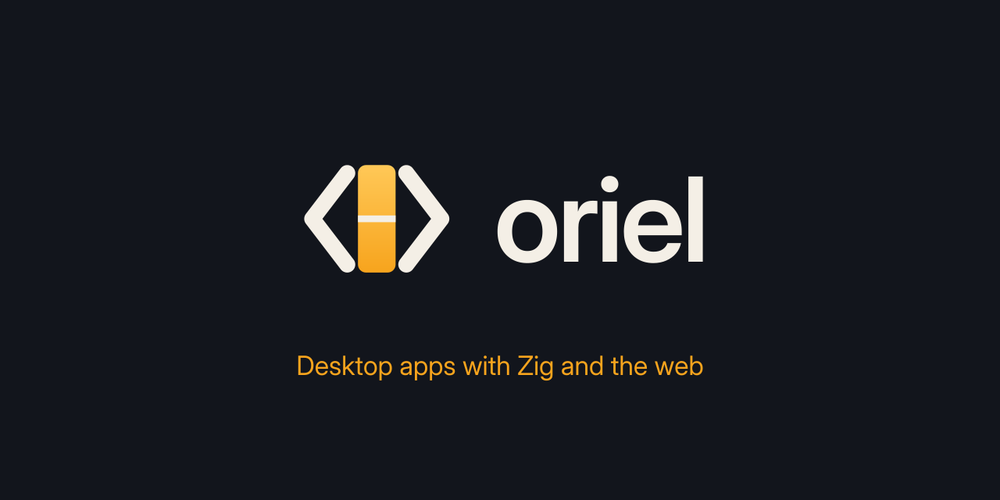

<p align="center"></p>

<p align="center">
  <a href="https://oriel.foreachdeveloper.com"></a>
  <a href="#license"></a>
  
  
  
</p>

# Oriel

**Desktop and mobile apps in Zig, with a web UI or native views.** One
codebase for Linux, Windows, macOS, Android and iOS (iOS is verified in the
simulator; device testing is next): your frontend (React, Vite, plain
HTML…) in the system webview, embedded in a small binary, with typed JS ↔
Zig calls generated from plain Zig structs. Local AI and voice are built in,
updates are signed, and every platform gets its packages. The optional
[native renderer](docs/native-renderer.md) runs the same frontend without
a WebView, or compiled `.oriel` views with no JavaScript at all. Coming
from Electron or Tauri? See [how Oriel compares](docs/comparison.md).
The website, with the documentation and search, is
[oriel.foreachdeveloper.com](https://oriel.foreachdeveloper.com).

- **Small:** a release app is a few MB; the build cache is hundreds of MB, not gigabytes.
- **Typed both ways:** `invoke` and `listen` in TypeScript are generated from your Zig `Commands` and `Events`.
- **Secure by default:** navigation limits, per-origin command capabilities, a strict CSP.
- **Batteries included, opt-in:** tray, updater, SQLite & sqlite-vec, llama.cpp, whisper.cpp, offline text to speech (Kokoro), speaker diarization (voice-detect.cpp), the phone's own model (system AI: Gemini Nano, Apple Foundation Models), camera and photo library, lifecycle events, file watching, dialogs, notifications, global shortcuts, clipboard, packaging (deb, rpm, AppImage), and web wrapping (`oriel wrap`).
- **Native code when you need it:** [app extensions](docs/extensions.md) in Kotlin, Objective-C, Swift or Zig, called by name from Zig and, where you expose them, from the page.

```sh
curl -fsSL https://raw.githubusercontent.com/highercomve/Oriel/main/install.sh | sh     # Linux, macOS
# Windows (PowerShell): irm https://raw.githubusercontent.com/highercomve/Oriel/main/install.ps1 | iex
oriel doctor              # checks Zig 0.16, the platform webview SDK, Node.js
oriel init my-app         # React + Vite (or --template vue|svelte|vanilla)
cd my-app && oriel dev    # hot reload; `oriel build` for the release binary

# Or wrap any website into a standalone desktop app with system tray & AppImage:
oriel wrap https://web.whatsapp.com --user-agent chrome --package
```

## Renderers

Use the system WebView, or build with `-Dnative_ui` to render HTML, CSS and
JavaScript with QuickJS, Oriel’s native DOM, Yoga, and platform drawing.
The native renderer is experimental; see its [guide](docs/native-renderer.md)
and [support reference](docs/native-ui-reference.md).

## App extensions

Call your own native code by name: an [app extension](docs/extensions.md) is a
Kotlin class on Android, an Objective-C or Swift class on iOS, or Zig on the
desktop, declared in `build.zig`. Zig calls it with bytes in and out; the page
reaches the methods Zig exposes (`oriel.extensions.call`). Oriel's own
`oriel.system_ai` is built this way.

Platform hooks react to or take over the platform's own app, window and web
view events: `oriel.hooks` in Zig on Linux, macOS and Windows (each window and
web view with its native handle), Kotlin or Java on Android (`.android.hooks`,
`OrielAndroidHooks`: WebView and Activity lifecycles, native results and
permissions, a custom file picker), Objective-C or Swift on iOS and macOS.

See [Platform hooks](docs/platform-hooks.md).

## Examples

- [Showcase](docs/examples.md#showcase): windows, local AI, dictation, text to speech, SQLite, notifications, and more on desktop and mobile.
- [Breakout](docs/examples.md#breakout): the same canvas game in the WebView and native renderer, with JavaScript or Zig physics.
- [System monitor](docs/examples.md#system-monitor): live CPU, memory, and process telemetry with direct kernel sampling and native rendering.
- [Smoke test](docs/examples.md#smoke): end-to-end checks for modules and security.
- [Render bench](docs/examples.md#render-bench) and [canvas demo](docs/examples.md#canvas-demo): rendering measurements and 2D drawing.

[GhostPen](https://github.com/highercomve/GhostPen) is a desktop AI editor built
with Oriel. See [apps and examples](docs/examples.md) for screenshots and details.

## Documentation

Every feature has one page with the same parts: where it works, a quick
start, how it works (with a diagram), examples, and the full reference. Start
with the [documentation index](docs/README.md) (the same pages as the
[website](https://oriel.foreachdeveloper.com/docs/)), or go straight to:

| Guide | Contents |
|---|---|
| [Getting started](docs/getting-started.md) · [Tutorial](docs/tutorial.md) | Install, scaffold, and build a first app |
| [Concepts](docs/concepts.md) | How an Oriel app is put together: windows, the bridge, commands, modules, the build |
| [Commands and events](docs/commands.md) | Typed calls between the page and Zig, and the generated TypeScript |
| [Modules](docs/modules.md) | Every module, its build flag and where it works, with a page each |
| [Local AI](docs/local-ai.md) | llama.cpp, whisper.cpp, GPU backends; [chat](docs/chat.md), [dictation](docs/dictation.md), [text to speech](docs/tts.md), [speakers](docs/speakers.md) |
| [Platform hooks](docs/platform-hooks.md) · [App extensions](docs/extensions.md) | Your Kotlin, Objective-C, Swift or Zig code inside the platform's events, or called from Zig |
| [Desktop](docs/desktop.md) · [Android](docs/android.md) · [iOS](docs/ios.md) | Platform setup, builds, and behavior |
| [Building](docs/building.md) · [Packaging](docs/packaging.md) · [Signing](docs/signing.md) · [Updates](docs/updater.md) | Every `build.zig` option, packages, signatures, signed updates |
| [CLI](docs/cli.md) | Every `oriel` command |
| [Contributing](docs/internal/contributing.md) | Repository layout, builds, tests, development rules, and releases |

## Project status

Oriel is experimental and APIs will change. It targets Linux, Windows,
macOS, Android, and iOS; see the [desktop](docs/desktop.md), [Android](docs/android.md)
and [iOS](docs/ios.md) guides for verification details and limitations.

[Changelog](CHANGELOG.md) · [Project background](docs/architecture.md#background) · [Dependencies](LIBRARIES.md)

## License

MIT: see [LICENSE](LICENSE). Contributions are accepted under the same license.
