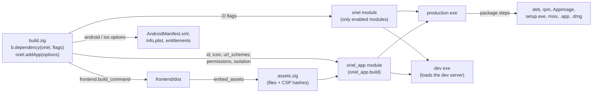

<!-- Generated from site/content/docs/building.smd by tools/docs/gen-md.mjs: edit that file. -->

# Building

oriel.addApp and its AppOptions, the build steps, the Oriel dependency's -D options, the generated oriel_app module, and cross-compiling.

An Oriel app is a Zig package whose `build.zig` depends on Oriel and calls
`oriel.addApp`. That one call builds the frontend, embeds it, compiles the
production and development executables, generates the TypeScript bindings,
writes the platform manifests (Info.plist, AndroidManifest.xml, the MSIX
manifest) from what you declare, and registers every step: `run`, `dev`,
`check`, `types`, `package`, and on phones the Android and iOS steps.

This page is the reference for `build.zig`: every `AppOptions` field, every
step, every option the Oriel dependency takes. What each field *does* at
runtime is on the page of the feature it belongs to (linked from each row);
turning the build into installers is [Packaging](packaging.md),
and signing them is [Signing](signing.md).

## Availability

| Target | Build on | Output of `zig build` | Needs |
|---|---|---|---|
| Linux (x86_64, aarch64) | Linux | `zig-out/bin/<name>` | Zig 0.16, GTK 4 and WebKitGTK 6.0 development files (no WebKitGTK with `-Dnative_ui`) |
| Windows (x86_64, aarch64) | Windows, or cross-compiled from Linux | `zig-out/bin/<name>.exe` and `WebView2Loader.dll` | `-Dwebview2-loader` (the CLI passes the cached one) |
| macOS (aarch64, x86_64) | A Mac (Xcode or the Command Line Tools) | `zig-out/bin/<name>` and `zig-out/<Name>.app` | The macOS SDK |
| Android (aarch64, x86_64) | Linux, macOS, Windows | `zig-out/jniLibs/<abi>/liboriel.so` (the APK is Gradle's) | The Android NDK; the SDK and a JDK 17 for the APK |
| iOS (device, simulator) | macOS, or Linux with xtool | `zig-out/ios/<Name>.app` | The iOS SDK (`-Dapple_sdk`, `$APPLE_SDK`, or Xcode's) |

Node.js is needed only when the frontend's build or dev commands use it
(every template except `vanilla`).

## Quick start

`build.zig.zon` pins Oriel as a dependency (`oriel init` writes it); `build.zig`:

```zig
const std = @import("std");
const oriel = @import("oriel");

pub fn build(b: *std.Build) void {
    const target = oriel.resolveTarget(b, b.standardTargetOptions(.{}));
    const optimize = b.standardOptimizeOption(.{});

    // The modules the app uses, for every target.
    const dep = b.dependency("oriel", .{
        .target = target,
        .optimize = optimize,
        .tray = false,
        .sql = false,
    });

    _ = oriel.addApp(b, dep, .{
        .name = "my-app",
        .root_source_file = b.path("src/main.zig"),
        .icon = b.path("icon.png"),
        .frontend = .{ .dir = "frontend" },
        .package = .{ .id = "dev.example.MyApp", .name = "My App", .version = "0.1.0" },
        .url_schemes = &.{"my-app"},
    });
}
```

`src/main.zig` takes everything `build.zig` declared from the generated
`oriel_app` module:

```zig
const std = @import("std");
const oriel = @import("oriel");
const app = @import("oriel_app");

pub const Commands = struct {
    pub fn greet(gpa: std.mem.Allocator, args: struct { name: []const u8 }) ![]const u8 {
        return std.fmt.allocPrint(gpa, "Hello, {s}!", .{args.name});
    }
};
pub const Events = struct {};

pub fn main(init: std.process.Init) !u8 {
    return oriel.main(init, .{ .commands = Commands, .events = Events }, .{
        .app = app.build,
        .window = .{ .title = "My App", .width = 800, .height = 600 },
    });
}
```

```sh
zig build run      # production build, then run it
zig build dev      # dev server with hot reload, Zig rebuilt on save
zig build package  # installers for this OS into zig-out/package
```

## How it works



**Two builders.** The Oriel dependency is built with the options the app
passes to `b.dependency("oriel", .{...})`. Each module flag decides whether
that module is compiled at all: a module that is off is neither compiled nor
linked, and `oriel.<module>` is a stub whose `available` is `false`
(`build.zig`: `Features.fromOptions`). A module asked for on a platform
where it doesn't exist (a tray on iOS) resolves to off rather than failing,
so one set of flags serves every target; only on Oriel's own command line is
that an error. Declaring a capability turns its module on too
(`capability_modules` in `build.zig`): `.permissions.local_network` turns on
`network`, `.permissions.camera` turns on `camera`, `.share_target` turns on
`share`, unless the app set that module's flag itself.

**addApp.** `addApp` (`build.zig`) first validates every platform
declaration for every target (Android permission names, Info.plist keys,
MSIX capability names, hook and extension classes), so a bad entry fails on
the developer's machine rather than in CI. It then branches on the
dependency's target: Android (`addAndroidApp`: the app is `liboriel.so`,
loaded by a generated Gradle project), iOS (`addIosApp`: an executable in a
`.app` bundle), or the desktop. On the desktop it:

1. runs `frontend.install_command` when `node_modules` is missing, the
   `types` generator, then `frontend.build_command`;
2. embeds `frontend.dist` with the `embed_assets` tool, which also records
   the SHA-256 hashes of inline scripts and styles for the CSP
   ([Security](security.md));
3. generates the `oriel_app` module (`appConfigModule`): the app id, the
   embedded assets or the dev server settings, the icon bytes, the URL
   schemes, the declared permissions (plus those enabled modules need), the
   isolation hook and the update key;
4. compiles the production executable (`ReleaseSafe` unless `-Doptimize`
   is given), the dev executable (`Debug`), and a type-check-only copy for
   `zig build check`; on Windows embeds the icon as a resource, on macOS
   builds the app's Objective-C and Swift hooks and extensions;
5. installs GPU backend libraries (`-Dggml_cuda`, `-Dggml_vulkan`) and
   espeak-ng's data (`-Dkokoro`) next to the executable;
6. registers the packaging steps (`build/package.zig`), which reuse the
   same executable.

`addApp` may be called more than once in one `build.zig`: the top-level
steps are shared, so `zig build run` or `zig build package` acts on every
app. Apps built with the same Oriel dependency share its module, so they
must declare the same `.extensions` and `.ios.hooks` / `.macos.hooks`.

**The dev executable** is the same app built with `oriel_app.build.dev`
set: it loads `frontend.dev.url` instead of embedded files, and
`zig build dev` runs it under `dev_runner` (`tools/dev_runner.zig`), which
starts `frontend.dev.command`, watches `src/` and rebuilds and restarts the
app on a Zig change ([Development](development.md)).

## Examples

### Turn a module on from the command line

Options on the `zig build` command line belong to the app's builder; the
Oriel dependency only sees what `build.zig` passes it. Declare an option and
forward it:

```zig
const dep = b.dependency("oriel", .{
    .target = target,
    .optimize = optimize,
    .whisper = true,
    .ggml_vulkan = b.option(bool, "ggml_vulkan", "Run whisper on the GPU through Vulkan") orelse false,
    .ggml_cuda = b.option(bool, "ggml_cuda", "Run whisper on NVIDIA GPUs (Linux)") orelse false,
    .cuda_arch = b.option([]const u8, "cuda_arch", "nvcc -arch, e.g. all-major"),
});
```

```sh
zig build -Dggml_vulkan -Doptimize=ReleaseFast
```

`examples/showcase/build.zig` forwards every GPU and native UI flag this way.

### A third-party Zig package

```zig
const zigimg = b.dependency("zigimg", .{ .target = target, .optimize = optimize });
_ = oriel.addApp(b, dep, .{
    .name = "my-app",
    .root_source_file = b.path("src/main.zig"),
    .frontend = .{ .dir = "frontend" },
    .imports = &.{.{ .name = "zigimg", .module = zigimg.module("zigimg") }},
});
```

The import is added to every executable `addApp` builds (production, dev,
check, the types generator) and to desktop Zig extensions.

### A static frontend, faster type generation

```zig
.frontend = .{
    .dir = "web",
    .dist = ".",                // embed web/ as it is
    .build_command = null,      // nothing to build
    .install_command = null,
    .dev = null,                // no dev server: no `dev` step
    .types_from = .root_decls,  // bindings from `pub const Commands` alone
},
```

### Cross-compile for Windows from Linux

```sh
oriel build -Dtarget=x86_64-windows     # fetches and passes WebView2Loader.dll
oriel package -Dtarget=x86_64-windows   # setup.exe, built with makensis
```

With plain `zig build`, pass the loader yourself:
`zig build -Dtarget=x86_64-windows -Dwebview2-loader=/path/to/WebView2Loader.dll`
([Desktop](desktop.md)).

### Phones

```sh
zig build -Dtarget=aarch64-linux-android        # zig-out/jniLibs/arm64-v8a/liboriel.so
oriel android build --apk --aab                 # every ABI, then Gradle
zig build ios-ipa -Dtarget=aarch64-ios          # zig-out/<Name>.ipa (unsigned)
oriel ios build --ipa
```

The workflows (devices, dev servers, installing) are on
[Android](android.md) and [iOS](ios.md).

### A second executable in the packages

```zig
const cli = b.addExecutable(.{ .name = "my-app-cli", .root_module = b.createModule(.{
    .root_source_file = b.path("src/cli.zig"),
    .target = target, // oriel.resolveTarget'ed, so macOS minimums agree
    .optimize = optimize,
}) });
_ = oriel.addApp(b, dep, .{
    // ...
    .package = .{ .id = "dev.example.MyApp", .contents = .{ .executables = &.{cli} } },
});
```

See [Packaging](packaging.md#contents) for where it lands in each format.

## Reference

### `oriel.addApp`

```zig
pub fn addApp(b: *std.Build, oriel_dep: *std.Build.Dependency, options: AppOptions) App
pub const App = struct {
    exe: *std.Build.Step.Compile,      // production (Android: liboriel.so)
    dev_exe: ?*std.Build.Step.Compile, // null without frontend.dev (always set on Android and iOS)
};
```

- `oriel_dep` must be `b.dependency("oriel", ...)`; anything else panics.
- Invalid declarations panic at configure time with the field named
  (`AppOptions.android.permissions: invalid name ...`).
- The returned compile steps can be modified (link a C library, add a C
  source): the packages ship them.

### `oriel.resolveTarget`

```zig
pub fn resolveTarget(b: *std.Build, target: std.Build.ResolvedTarget) std.Build.ResolvedTarget
```

For macOS targets only: no version given becomes macOS 13.0
(`oriel.default_macos_min`), and a native CPU becomes the architecture's
baseline (Apple M1 on arm64, x86-64 on Intel), so a release built on a newer
Mac runs on older ones. Other targets are returned unchanged. Pass its
result to the dependency and to every other executable you put in the
packages; `package-app` warns when one needs a newer macOS than the app.

### `AppOptions`

| Field | Type | Default | Meaning |
|---|---|---|---|
| `name` | `[]const u8` | required | Executable name (`zig-out/bin/<name>`; the dev build is `<name>-dev`). Also the default display name and app id suffix. |
| `root_source_file` | `LazyPath` | required | The app's `main.zig`; it can import `oriel` and `oriel_app`. |
| `icon` | `?LazyPath` | Oriel's icon | A PNG, 1024×1024 recommended: window and Dock icon, `.ico` resource on Windows, hicolor icons on Linux, `.icns` on macOS, launcher icons on Android, the iOS app icon ([Packaging](packaging.md#icons)). |
| `frontend` | `Frontend` | required | Where the web frontend is and how to build it ([below](#frontend)). |
| `package` | `?PackageOptions` | `null` (all defaults) | App id, display name, version and package metadata ([Packaging](packaging.md#package-options)). `package.id` is the app id everywhere, default `dev.oriel.<name>`. |
| `update_public_key` | `?[]const u8` | `null` | Base64 Ed25519 public key (44 characters) for the [Updater](updater.md); exposed as `oriel_app.update_public_key`. |
| `url_schemes` | `[]const []const u8` | `&.{}` | Custom URL schemes (`&.{"my-app"}`): written into every package and manifest, delivered by `oriel.deep_link` ([Deep links](deep-links.md)). |
| `permissions` | `Permissions` | `.{}` | OS permissions, each with the reason shown to the user (`""` for a default text): `microphone`, `camera`, `screen_capture`, `accessibility`, `location`, `notifications`, `system_audio`, `bluetooth`, `local_network`, each `?[]const u8` ([Permissions](permissions.md)). |
| `imports` | `[]const Module.Import` | `&.{}` | Extra modules for the app's code ([example](#example-imports)). |
| `isolation` | `?Isolation` | `null` | The isolation pattern: `.{ .hook = b.path("isolation/hook.js") }` ([Security](security.md)). |
| `include_paths` | `[]const LazyPath` | `&.{}` | C include directories for the app's root module (its `@cImport` and C sources). |
| `android` | `Android` | `.{}` | Android manifest and Gradle settings ([below](#android)). |
| `ios` | `Ios` | `.{}` | iOS bundle settings ([below](#ios)). |
| `macos` | `Macos` | `.{}` | macOS bundle settings ([below](#macos)). |
| `windows` | `Windows` | `.{}` | Windows (MSIX) settings ([below](#windows)). |
| `share_target` | `?ShareTarget` | `null` | Receive what other apps share; turns on the share module ([Share](share.md)). |
| `camera` | `Camera` | `.{}` | `oriel.camera` settings ([Camera](camera.md)). |
| `extensions` | `[]const Extension` | `&.{}` | The app's own native code by name, per platform ([Extensions](extensions.md)). |

### `Frontend`

| Field | Type | Default | Meaning |
|---|---|---|---|
| `dir` | `[]const u8` | required | Frontend directory, relative to the build root. |
| `dist` | `[]const u8` | `"dist"` | Build output inside `dir`; embedded into the production executable. |
| `build_command` | `?[]const []const u8` | `npm run build` | Run in `dir` before embedding. `null`: `dist` is embedded as it is. |
| `install_command` | `?[]const []const u8` | `npm install` | Run in `dir` when `node_modules` is missing. |
| `dev` | `?Frontend.Dev` | `.{}` | The dev server. `null`: no dev build and no `dev` step. |
| `types_path` | `?[]const u8` | `"src/oriel.ts"` | Where the TypeScript for the commands is written, relative to `dir`. `null`: no generation. |
| `types_from` | `TypesFrom` | `.dev_exe` | `.dev_exe` builds and runs the dev executable to write the types; `.root_decls` builds a small generator that reads `pub const oriel_api: oriel.App.Api`, else `pub const Commands` (and `Events`) from the root file, compiling only the command signatures. |

`Frontend.Dev`:

| Field | Type | Default | Meaning |
|---|---|---|---|
| `url` | `[]const u8` | `"http://localhost:5173/"` | What the dev executable loads. On iOS `-Dios_dev_url` overrides it (a device needs the machine's LAN address). |
| `command` | `[]const []const u8` | `node_modules/.bin/vite --port 5173 --strictPort` | Started by `zig build dev` in `dir`; empty: start it yourself. |

Types are generated only when the target runs on the build machine; for
Android, iOS and cross builds the `types` step fails with a message to run
it natively. The production build runs the generator before
`build_command`, so the frontend type-checks against current bindings.

### `Isolation`, `Camera`, `ShareTarget`

| Struct | Field | Type | Default | Meaning |
|---|---|---|---|---|
| `Isolation` | `hook` | `LazyPath` | required | JavaScript setting `globalThis.__ORIEL_ISOLATION_HOOK__`; embedded into `oriel_app.build.isolation`. |
| `Camera` | `transcode` | `bool` | `true` | Android: picked images the WebView can't decode (HEIC, AVIF) are transcoded to JPEG. |
| `ShareTarget` | `types` | `[]const []const u8` | `&.{"*/*"}` | MIME types accepted; `text/plain` also means text and URLs. |
| | `multiple` | `bool` | `false` | Several items at once (Android `ACTION_SEND_MULTIPLE`). |
| | `label` | `?[]const u8` | display name | The label in the share sheet, Send To, and Services menu. |
| | `windows_extensions` | `[]const []const u8` | `&.{}` | Windows: also "Open with" for these extensions ([Packaging](packaging.md#file-associations)). |

### `Android`

| Field | Type | Default | Meaning |
|---|---|---|---|
| `tile` | `?[]const u8` | `null` | A Quick Settings tile with this label ([Android](android.md)). |
| `input_method` | `?[]const u8` | `null` | The Oriel keyboard, with this name ([Android](android.md)). |
| `permissions` | `[]const Permission` | `&.{}` | `<uses-permission>`s no `.permissions` kind declares: `{ .name, .max_sdk: ?u32 = null, .flags: ?[]const u8 = null }`. A name a kind declares keeps that entry; without `max_sdk` here it holds on every API level. |
| `features` | `[]const Feature` | `&.{}` | `<uses-feature>`s: `{ .name, .required: bool = false }`; required if any declaration requires it. |
| `native_libraries` | `[]const Feature` | `&.{}` | `<uses-native-library>` entries for vendor libraries an SDK loads (`libOpenCL.so`). |
| `sources` | `[]const LazyPath` | `&.{}` | Kotlin/Java files copied on every build to `app/src/main/java/<package path>/`; a file dropped from the list is removed there. |
| `hooks` | `[]const AndroidHook` | `&.{}` | `{ .class, .sources, .dependencies }`: classes implementing `OrielAndroidHooks`, at most 64 ([Platform hooks](platform-hooks.md#android-declare)). |
| `dependencies` | `[]const []const u8` | `&.{}` | Maven coordinates `group:artifact:version`, at most 64, regenerated on every build. |
| `proguard_rules` | `?LazyPath` | `null` | R8 rules kept in `app/proguard-rules.pro` between `# oriel:proguard` markers. |

The Android version code is derived from `package.version`:
`MAJOR*10000 + MINOR*100 + PATCH` (a `-pre` or `+build` suffix ignored;
minor and patch below 100; `0.0.0` becomes 1). `package.name` and
`package.version` can't contain `" $ \ & < > '`, control characters, or a
leading `@` or `?`. The minimum API level is 29.

### `Ios`

| Field | Type | Default | Meaning |
|---|---|---|---|
| `background_audio` | `bool` | `false` | `UIBackgroundModes` `audio`: keep capturing or playing in the background. |
| `usage_descriptions` | `[]const UsageDescription` | `&.{}` | Info.plist usage keys no `.permissions` kind writes: `{ .key = "NSMotionUsageDescription", .text = "..." }`. A key a kind also writes takes this text. |
| `hooks` | `[]const PlatformHook` | `&.{}` | Classes conforming to `OrielPlatformHooks`, at most 16 ([Platform hooks](platform-hooks.md#apple-declare)). |
| `team_id` | `?[]const u8` | `null` | The 10-character Apple team ID, prefix of the `application-identifier` entitlement embedded in simulator builds. |

The minimum iOS is 15.0; Swift sources (in hooks, extensions, or
`-Dsystem_ai`) raise it to 18.0, and an explicit lower `-Dtarget` version
is then an error.

### `Macos`

| Field | Type | Default | Meaning |
|---|---|---|---|
| `usage_descriptions` | `[]const UsageDescription` | `&.{}` | Info.plist usage keys no `.permissions` kind writes (as on iOS). |
| `entitlements` | `[]const []const u8` | `&.{}` | Boolean hardened-runtime entitlements added to `<Name>.entitlements` for signing (`"com.apple.security.device.bluetooth"`). |
| `hooks` | `[]const PlatformHook` | `&.{}` | As `Ios.hooks`: the app delegate, windows and WebKit delegates. |

The minimum macOS is 13.0 (see `resolveTarget`); Swift sources raise it to 15.0.

`PlatformHook` and `UsageDescription`:

| Struct | Field | Type | Meaning |
|---|---|---|---|
| `PlatformHook` | `class` | `[]const u8` | Objective-C class (or `@objc(Name)` Swift class) with a plain `-init`. |
| | `sources` | `[]const LazyPath` | Objective-C files, compiled with `-fobjc-arc`. |
| | `swift_sources` | `[]const LazyPath` | Swift files, compiled by `swiftc` into one object. |
| | `frameworks` | `[]const []const u8` | SDK frameworks to link. |
| `UsageDescription` | `key` | `[]const u8` | Ends in `UsageDescription`, `[A-Za-z0-9_.~-]`. |
| | `text` | `[]const u8` | Non-empty UTF-8, no control characters. |

### `Windows`

| Field | Type | Default | Meaning |
|---|---|---|---|
| `capabilities` | `[]const Capability` | `&.{}` | MSIX capabilities no `.permissions` kind declares: `{ .name, .kind = .general }`, `kind` one of `.general` (`<Capability>`), `.uap`, `.restricted` (`<rescap:Capability>`, Store review), `.device` (`<DeviceCapability>`). Names are `[A-Za-z0-9._-]` or a `{GUID}`. The NSIS installer ignores them. |

### `Extension`

The full contract is on [Extensions](extensions.md).

| Field | Type | Default | Meaning |
|---|---|---|---|
| `name` | `[]const u8` | required | Lowercase dotted words (`"pantry.vision"`), up to 64 characters, unique; `oriel.` is reserved. At most 64 extensions. |
| `android` | `?AndroidExtension` | `null` | `{ .class, .sources, .dependencies, .assets }`: a class implementing `dev.oriel.OrielAppExtension`; `assets` are `{ .from, .to }` copied into the APK's assets. |
| `ios` | `?IosExtension` | `null` | `{ .class, .sources, .swift_sources, .frameworks, .weak_frameworks, .resources }`; `resources` are `{ .from, .to }` copied into the bundle. |
| `desktop` | `?DesktopExtension` | `null` | `{ .zig = path }`: a Zig file with `pub fn call(...)`, for every desktop OS. |
| `linux`, `windows` | `?DesktopExtension` | `null` | Override `desktop` on that OS. |
| `macos` | `?MacosExtension` | `null` | `.{ .zig = path }`, or `.{ .objc = AppleNativeExtension }` (as `IosExtension` without `resources`). Overrides `desktop`. |
| `max_bytes` | `usize` | 32 MiB | Cap on a call's input and reply, at most 256 MiB. |
| `concurrency` | `u8` | `1` | Calls running at once, 1 to 8. |

`Asset.to` paths are relative, at most 256 bytes, without `.` or `..`
components, made of `[A-Za-z0-9_.-]`. Framework names are `[A-Za-z0-9_]`,
at most 64 characters.

### Build steps

Desktop targets:

| Step | What it does |
|---|---|
| `zig build` (install) | Build the frontend, embed it, install `zig-out/bin/<name>`; on Windows `WebView2Loader.dll` next to it, on macOS also `zig-out/<Name>.app` (ad-hoc signed); GPU backend libraries and `espeak-ng-data/` when enabled. |
| `run` | Install, then run the production build. Arguments after `--` go to the app. |
| `build-dev` | Install the dev executable `zig-out/bin/<name>-dev`. |
| `dev` | Run the dev executable under `dev_runner`: starts `frontend.dev.command`, rebuilds and restarts on Zig changes (same `-D` options). Only with `frontend.dev`. |
| `types` | Regenerate `frontend.types_path`. |
| `check` | Type-check the app with a dev configuration: no frontend build, no codegen, no linking. |
| `package`, `package-<format>` | Distribution packages ([Packaging](packaging.md#steps)). |
| `desktop-entry`, `desktop-entry-release` | Linux: install a `.desktop` file and icons for the build in `zig-out` ([Packaging](packaging.md#desktop-entry)). |
| `keygen`, `sign-update`, `combine-manifests` | Update keys and signed manifests ([Updater](updater.md#update-tool)). |

Android targets (`-Dtarget=aarch64-linux-android` or `x86_64-linux-android`):

| Step | What it does |
|---|---|
| `zig build` | `zig-out/jniLibs/<abi>/liboriel.so` (the app) and `liboriel_exec.so` (the app's `main` as a process, for helper processes), APK assets in `zig-out/android-assets/`, and a refresh of the Gradle project's Kotlin runtime and manifest regions. |
| `android-dev` | The same library loading the dev server (through `adb reverse`). |
| `android-project` | Write `android/` from Oriel's template; `-Dandroid_force` rewrites edited files. |
| `check` | Type-check. `types` fails: run it natively. |

iOS targets (`aarch64-ios`, `aarch64-ios-simulator`, `x86_64-ios-simulator`):

| Step | What it does |
|---|---|
| `zig build` | `zig-out/ios/<Name>.app` (unsigned; simulator builds signed ad hoc on a Mac). |
| `ios-dev` | `zig-out/ios-dev/<Name>.app`, loading the dev server (`-Dios_dev_url`). |
| `ios-ipa` | `zig-out/<Name>.ipa`: `Payload/<Name>.app`, zipped with `zip` (unsigned). |
| `check` | Type-check. `types` fails: run it natively. |

The [CLI](cli.md) wraps these: `oriel build` (`zig build`),
`oriel run`, `oriel dev`, `oriel package`, `oriel types`, `oriel check`,
`oriel android build`, `oriel ios build`. For `build`, `run` and `package`
it adds `-Doptimize=ReleaseSafe` and, without `-Dtarget` or `-Dcpu`, a
portable CPU (`-Dcpu=x86_64_v3` on x86-64, `apple_m1` on Apple silicon,
`baseline` on other arm64). For Windows targets it passes the cached
`-Dwebview2-loader`, downloading it first when missing (not with
`ORIEL_NO_WEBVIEW2_FETCH=1`), and finds `makensis` for `package`.

### Oriel dependency options: modules

Passed in `b.dependency("oriel", .{ ... })`. A module that is off isn't
compiled; where a module doesn't exist on the target it is off whatever the
flag says ([Modules](modules.md) has the platform table).

| Option | Default | Module |
|---|---|---|
| `tray` | on | `oriel.tray` ([Tray](tray.md)) |
| `updater` | on (off on Android) | `oriel.updater` ([Updater](updater.md)) |
| `media_server` | on | `oriel.media_server` ([Media server](media-server.md)) |
| `sql` | on | `oriel.sql` ([SQL](sql.md)) |
| `fs_watch` | on | `oriel.fs_watch` ([File watching](fs-watch.md)) |
| `dialog` | on | `oriel.dialog` ([Dialogs](dialogs.md)) |
| `notification` | on | `oriel.notification` ([Notifications](notifications.md)) |
| `store` | on | `oriel.store` ([Store](store.md)) |
| `menu` | on | `oriel.menu` ([Menu](menu.md)) |
| `network` | on | `oriel.network`; also on with `.permissions.local_network` ([Network](network.md)) |
| `share` | on | `oriel.share`; also on with `.share_target` ([Share](share.md)) |
| `global_shortcut` | on | `oriel.global_shortcut` ([Global shortcuts](global-shortcuts.md)) |
| `input` | on | `oriel.input` ([Input](input.md)) |
| `clipboard` | on | `oriel.clipboard` ([Clipboard](clipboard.md)) |
| `deep_link` | off | `oriel.deep_link` ([Deep links](deep-links.md)) |
| `camera` | off | `oriel.camera`; also on with `.permissions.camera` ([Camera](camera.md)) |
| `audio_capture` | off | Microphone and system audio; declares `microphone` / `system_audio` ([Dictation](dictation.md)) |
| `sqlite_vec` | off | Vector search in SQLite; needs `sql` |
| `llama` | off | llama.cpp ([Chat](chat.md)) |
| `llama_mtmd` | off | llama.cpp's multimodal library (images, audio); needs `llama` |
| `whisper` | off | whisper.cpp ([Dictation](dictation.md)) |
| `kokoro` | off | Kokoro text to speech; needs `llama` or `whisper`; GPL-3 through espeak-ng ([TTS](tts.md)) |
| `system_ai` | off | The phone's own model, Android and iOS ([System AI](system-ai.md)) |
| `layer_shell` | off | Linux/Wayland overlay windows as layer surfaces (gtk4-layer-shell) |
| `native_ui` | off | Draw pages with native views instead of a web view ([Native renderer](native-renderer.md)) |

### Oriel dependency options: native code and GPUs

| Option | Type | Default | Meaning |
|---|---|---|---|
| `ggml_cuda` | bool | `false` | Linux: build ggml's CUDA backend as `libggml-cuda.so`, installed next to the app. Needs the CUDA toolkit. |
| `cuda_path` | string | `$CUDA_PATH` or `/opt/cuda` | CUDA toolkit root. |
| `cuda_arch` | string | native | `nvcc -arch` value (`all-major`), or compute capabilities like `75,86,89,120a`. |
| `cuda_static` | bool | `false` | Link cuBLAS statically: only the NVIDIA driver is needed at runtime (a much larger library). |
| `ggml_cuda_prebuilt` | path | none | Use this `libggml-cuda.so` (from the same Oriel version) instead of running `nvcc`; implies `ggml_cuda`. |
| `ggml_vulkan` | bool | `false` | Vulkan backend: `libggml-vulkan.so` on Linux, in the executable on Windows. Needs Vulkan headers, SPIRV-Headers and `glslc`. |
| `glslc` | path | `glslc` on PATH (Windows: `$VULKAN_SDK\Bin\glslc.exe`) | Shader compiler for `ggml_vulkan`. |
| `vulkan_include` | path | system (Windows: `$VULKAN_SDK\Include`) | Vulkan and SPIR-V headers. |
| `ggml_opencl` | bool | `false` | OpenCL backend (Android: Adreno GPUs). |
| `ggml_metal` | bool | on for macOS and iOS devices, off for the simulator | ggml's Metal backend; kernels are embedded, compiled when a model loads. |
| `ggml_arm` | `baseline`, `dotprod`, `i8mm` | `dotprod` on Android arm64 | ARM extensions for ggml's CPU kernels; `i8mm` only runs on Armv8.6/v9 CPUs. |
| `tts_languages` | string | espeak-ng's default set | With `kokoro`: espeak-ng dictionaries compiled into the shipped data, comma-separated. |
| `native_ui_prof` | bool | `false` | Log the native renderer's stage timings. |

At runtime CUDA is tried first, then Vulkan, then the CPU: a library that
can't find its driver or GPU doesn't load, so it is safe to ship to
everyone.

### Options of the app's own build

Declared by `addApp` on the app's builder, so they go straight on the
command line:

| Option | Meaning |
|---|---|
| `-Dtarget`, `-Doptimize`, `-Dcpu` | Zig's standard options. Without `-Doptimize`, production builds are `ReleaseSafe` and dev builds `Debug`; with it, both use it. |
| `-Ddev_debug_info=false` | Build the dev executable without debug info: faster rebuilds, no symbolized stack traces. |
| `-Dwebview2-loader=<path>` | `WebView2Loader.dll` for Windows builds and packages, used when `package.webview2_loader` is null. |
| `-Dappimage-runtime=<path>` | AppImage type-2 runtime to use instead of the downloaded one (or `$ORIEL_APPIMAGE_RUNTIME`). |
| `-Dmacos-sign-identity`, `-Dmacos-notarize-profile`, `-Dmacos-sign-dry-run` | macOS distribution signing ([Signing](signing.md#apple)). |
| `-Dmsix-pfx`, `-Dmsix-cert-sha1`, `-Dmsix-timestamp` | MSIX signing ([Signing](signing.md#msix)). |
| `-Dwinget-url=<base URL>` | Write WinGet manifests ([Packaging](packaging.md#winget)). |
| `-Dmacos_sdk=<path>` | macOS SDK for the app's Objective-C and Swift code (default `$SDKROOT`, else Xcode's). |
| `-Dswift_resource_dir=<path>` | Swift on Linux: the Darwin Swift resource directory (default: from xtool). |
| `-Dapple_sdk=<path>` | iOS SDK (`iPhoneOS.sdk` or `iPhoneSimulator.sdk`; default `$APPLE_SDK`, else Xcode's). |
| `-Dios_dev_url=<url>` | iOS: the dev server's URL as the device reaches it. |
| `-Dandroid_ndk=<path>` | Android NDK (default `$ANDROID_NDK_HOME`, `$ANDROID_NDK_ROOT`, or the newest `$ANDROID_HOME/ndk/*`). |
| `-Dandroid_force` | `android-project`: rewrite files that already exist. |
| `-Dggml_hexagon_prebuilt=<dir>` | Android arm64: ship `libggml-hexagon.so` and `libggml-htp-v*.so` from this absolute directory (Snapdragon NPU). |

### The `oriel_app` module

Generated per executable by `addApp` and importable from the root source file:

```zig
const app = @import("oriel_app");
// app.build: oriel.App.Build, everything build.zig declared, for App.Config.app
// app.update_public_key: ?[]const u8, AppOptions.update_public_key
```

`oriel.App.Build`:

| Field | Type | From |
|---|---|---|
| `id` | `[:0]const u8` | `package.id`, else `"dev.oriel.<name>"` |
| `assets` | `[]const oriel.App.Asset` | The embedded `frontend.dist` (empty in dev builds) |
| `dev` | `?oriel.App.Dev` | `frontend.dev` in dev builds (`url`, `command`, `cwd`); `null` in production |
| `icon` | `?[]const u8` | The PNG bytes of `icon` |
| `url_schemes` | `[]const []const u8` | `url_schemes` |
| `permissions` | `oriel.permissions.Declared` | `permissions`, plus the ones enabled modules need (`audio_capture` adds `microphone` and `system_audio`) |
| `isolation` | `?oriel.security.Isolation` | `isolation`, the hook embedded |

### Targets and minimum versions

| Platform | Minimum | Set by |
|---|---|---|
| macOS | 13.0 (15.0 with Swift) | `oriel.resolveTarget`; `-Dtarget=aarch64-macos.14.0` picks another |
| iOS | 15.0 (18.0 with Swift) | `addApp`; an explicit version in `-Dtarget` wins unless it is below the Swift minimum |
| Android | API 29 | `addApp` raises lower targets; Gradle's `minSdk` is 29, `targetSdk` 36 |
| Linux packages | GTK 4.12, glibc 2.38 | The deb and rpm dependencies (Ubuntu 24.04, Debian 13, Fedora 39 and later) |

Cross-compiling: Linux builds Windows (installer included) and Android; a
Mac builds every target; Linux builds iOS with xtool's SDK. Zig adds the
macOS SDK's framework path only for native targets, so an extra executable
that links Apple frameworks without importing `oriel` must add it itself.

### Migrating from 0.11

- `main.zig` passes `.app = app.build` instead of the separate
  `oriel_app.assets`, `.dev`, `.icon_bytes`, `.url_schemes`,
  `.permissions` and `.isolation` declarations, which are no longer public.
- `AppOptions.url_schemes` is a plain slice (`&.{}` for none), not optional.
- `PackageOptions.icon` and `PackageOptions.url_schemes` are gone: use
  `AppOptions.icon` and `AppOptions.url_schemes`.

## Troubleshooting

- **`-Dllama` on the command line does nothing** (or Zig says the option is
  unused). Command-line options go to the app's builder; forward them to
  the dependency ([example](#example-flags)).
- **`oriel.tray.available` is false** although `.tray = true`: the target
  has no tray. Guard platform-specific calls with `if (oriel.<module>.available)`.
  `zig build --verbose` lists the modules that resolved to off.
- **`TypeScript generation needs a dev build (frontend.dev)`**: with
  `frontend.dev = null`, set `types_from = .root_decls` or `types_path = null`.
- **`Cannot generate TypeScript types when cross-compiling`**: run
  `zig build types` without `-Dtarget`, then cross-compile.
- **"illegal instruction" on another machine**: the binary was built for
  the build machine's CPU. Pass `-Dcpu` (`oriel build` does by default).
- **A Debug rebuild in `oriel dev` is slow**: `-Ddev_debug_info=false`.
- **`apps sharing one oriel dependency must declare the same ...`**: two
  `addApp` calls with one dependency differ in `.extensions` or hooks; give
  them the same lists or separate dependencies.

## Related

- [Packaging](packaging.md): the installers each format builds from these executables.
- [Signing](signing.md): code signing for Windows, macOS and Android, and update keys.
- [Development](development.md): the dev loop behind `zig build dev`.
- [CLI](cli.md): the `oriel` commands that wrap these steps.
- [Desktop](desktop.md), [Android](android.md), [iOS](ios.md): platform requirements and workflows.
- [Modules](modules.md): which module exists on which platform.
