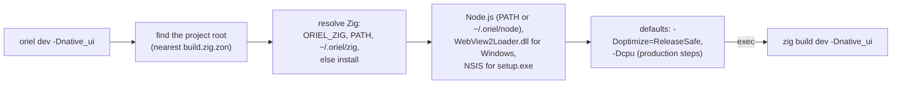

<!-- Generated from site/content/docs/cli.smd by tools/docs/gen-md.mjs: edit that file. -->

# CLI

Every oriel command and flag: creating and wrapping apps, the build wrappers, phones, tools, permissions, deep links, signing and updates.

`oriel` is a single static program (no GTK, no Node.js) that creates apps,
runs their builds and manages the tools they need. Most commands are thin
wrappers: `oriel dev` is `zig build dev` run in the project root with the
right Zig, Node.js and WebView2 loader found or installed first. Anything
the CLI does, `zig build <step>` in the project does too; the CLI adds
discovery, defaults and tool management.

Use the CLI day to day. Call `zig build` directly in CI scripts that pin
their own tools, or for the project's own steps (`zig build --help` lists
them).

## Availability

| Host | The CLI | Builds for |
|---|---|---|
| Linux (x86-64, ARM64) | Yes | Linux; Windows (cross); Android; iOS (with xtool and the iOS SDK) |
| Windows (x86-64, ARM64) | Yes | Windows; Android |
| macOS (Apple silicon, Intel) | Yes | macOS; iOS (Xcode's SDK); Android |

Install it with the script in [Getting started](getting-started.md);
`oriel update` keeps it current. `oriel doctor` reports what the host is
missing. `oriel desktop-entry` does something only on Linux.

## Quick start

```sh
oriel doctor                   # what this machine needs
oriel init notes --template svelte --id com.example.Notes
cd notes
oriel dev                      # develop with hot reload
oriel permission add microphone "Dictation turns your speech into text"
oriel build                    # production build in zig-out/bin
oriel package                  # deb, rpm, AppImage / setup.exe / .app, .dmg
```

## How it works



The build wrappers (`dev`, `build`, `run`, `package`, `types`, `check`) are
`project.Wrapper` commands (`cli/project.zig`). Each one finds the project
root, resolves the project's Zig, and runs `zig build <step> [args...]`
there, passing every argument on. Before that it:

- adds `-Dwebview2-loader=<cached dll>` when the build targets Windows and no
  loader was given, downloading it first if needed (`oriel webview2`);
- for `build`, `run` and `package`, adds `-Doptimize=ReleaseSafe` unless
  `-Doptimize` is given, and `-Dcpu=x86_64_v3` (x86-64), `apple_m1` (macOS
  ARM64) or `baseline` (other ARM64) unless `-Dtarget` or `-Dcpu` is given,
  so a binary built on a new CI machine runs on older CPUs;
- puts a managed Node.js (`~/.oriel/node`) on `PATH` when the system has
  none, or stops with `run: oriel setup node` when the project needs it;
- for a Windows `package`, finds NSIS (`ORIEL_MAKENSIS`, `~/.oriel/nsis`,
  `makensis` on PATH);
- for `dev`, checks that the app has a dev server and forwards Zig's own
  `--fork=<path>` flags to the rebuilds (`ORIEL_DEV_ZIG_ARGS`).

The other commands are implemented in `cli/<name>.zig`. Options are parsed
from each command's struct (`cli/args.zig`): `oriel <command> --help` prints
its usage, and `oriel --help` the list. A usage error exits with code 2,
a failure with 1.

## Examples

### A new app on a machine with nothing installed

```sh
oriel setup all --yes      # Zig, Node.js LTS, WebView2Loader.dll, NSIS on Windows
oriel init hello --yes     # --yes also installs Node.js if init needs it
```

### Windows packages from Linux

```sh
oriel build -Dtarget=x86_64-windows
oriel package -Dtarget=x86_64-windows   # zig-out/package/<app>-<version>-setup.exe
```

The loader is fetched and passed automatically; `makensis` must be installed
(`oriel setup nsis` prints the package manager command).

### A web app as a desktop app

```sh
oriel wrap https://music.example.com --name music --title "Music" --user-agent chrome --run
```

See [Wrap](wrap.md).

### Phones

```sh
oriel android init
oriel android dev --abi arm64            # run the frontend dev server yourself
oriel android build --aab -Dnative_ui
oriel ios dev --simulator
oriel ios build --ipa
```

### Pin the toolchain in CI

```sh
export ORIEL_NO_ZIG_INSTALL=1 ORIEL_ZIG=/opt/zig-0.16.0/zig
oriel build -Doptimize=ReleaseFast -Dcpu=baseline
```

## Reference

### Global

```
Usage: oriel <command> [options]

Options:
  -h, --help     Show help (also: oriel <command> --help)
  -V, --version  Show the version
```

`oriel --version` prints the CLI's version and the Oriel commit that
`oriel init` and `oriel wrap` depend on by default.

| Command | Summary |
|---|---|
| [`init`](#init) | Create a new Oriel app in `./<name>` |
| [`wrap`](#wrap) | Wrap a web page or web app into a desktop application |
| [`doctor`](#doctor) | Check that this system can build Oriel apps |
| [`setup`](#setup) | Install managed tools (`~/.oriel/<tool>`) without admin rights |
| [`update`](#update) | Update the oriel CLI in place |
| [`webview2`](#webview2) | Download and cache WebView2Loader.dll for Windows |
| [`deep-link`](#deep-link) | Configure and register deep link URL schemes |
| [`permission`](#permission) | Declare the OS permissions the app needs (microphone, camera, ...) |
| [`signing`](#signing) | Self-signed code-signing certificate for macOS apps (keeps permissions across updates) |
| [`desktop-entry`](#desktop-entry) | Install the app's desktop entry for local runs (Linux: global hotkeys, app menu) |
| [`zig`](#zig) | Install and manage the Zig versions Oriel uses (~/.oriel/zig) |
| [`android`](#android) | Build and run the app on Android (init, dev, build, devices) |
| [`ios`](#ios) | Build the app for iOS and install it (build, dev, install, setup) |
| [`dev`, `build`, `run`, `package`, `types`, `check`](#build-wrappers) | The build wrappers |

### `oriel init`

```
Usage: oriel init <name> [options]
```

| Argument or option | Meaning |
|---|---|
| `<name>` | App name: letters, digits, `-` and `_` (also the directory and executable name). Zig keywords and primitive type names are refused. |
| `--template <react\|vue\|svelte\|vanilla>` | Frontend template (default: react) |
| `--id <app-id>` | Application id in reverse-DNS form (default: `com.example.<Name>`) |
| `--oriel-ref <ref>` | Oriel git tag or commit to depend on (default: the commit this CLI was built from) |
| `--oriel-path <dir>` | Depend on a local Oriel checkout instead (`.path` dependency); exclusive with `--oriel-ref` |
| `--no-install` | Only record the dependency: skip `zig build --fetch` and `npm install` |
| `--no-webview2` | Skip downloading WebView2Loader.dll for Windows builds |
| `--yes` | Skip the confirmation prompt when installing a missing Node.js |

react, vue and svelte use Vite (Node.js and npm); vanilla is a static page
with no build step and no dev server. The target directory must not exist
or must be empty. `init` writes the project (`build.zig`, `build.zig.zon`,
`src/main.zig`, `frontend/`, `isolation/hook.js`, `icon.png`), adds the
Oriel dependency (`zig fetch --save=oriel`), runs `zig build --fetch` and
`npm install`, and caches WebView2Loader.dll.

### `oriel wrap`

```
Usage: oriel wrap <url> [options]
```

| Argument or option | Meaning |
|---|---|
| `<url>` | Target web URL (e.g. `https://web.whatsapp.com`) |
| `--name <name>` | App name: letters, digits, `-` and `_` (also directory and executable name) |
| `--title <title>` | Window title and package display name |
| `--id <app-id>` | Application id in reverse-DNS form (default: `com.<domain>.<name>`) |
| `--icon <icon.png>` | Path to PNG icon file |
| `--no-tray` | Disable the system tray icon (on by default: closing the window hides it to the tray) |
| `--user-agent <ua>` | Custom User-Agent: `chrome`, `safari`, `firefox`, or a custom string |
| `--devtools` | Enable web developer tools and forward console messages to stdout |
| `--allow-subdomains` | Also allow the subdomains of the URL's host (`https://*.<host>`) as origins |
| `--package` | Build distribution packages (AppImage on Linux) immediately |
| `--run` | Run the wrapped application immediately |
| `--oriel-ref <ref>`, `--oriel-path <dir>` | As for `init` |

The app may only navigate to, and grant capabilities to, the URL's exact
origin (`https://<host>`). `--allow-subdomains` also allows
`https://*.<host>` (a leading `www.` dropped); pages on other domains open
in the browser. Details: [Wrap](wrap.md).

### `oriel doctor`

```
Usage: oriel doctor [options]
```

| Option | Meaning |
|---|---|
| `--fix` | Install missing non-admin tools and print the admin commands for the rest |
| `--yes` | Skip the confirmation prompt for `--fix` |

Required everywhere: Zig 0.16.x (on PATH, or `$ORIEL_ZIG`), Node.js (20.19+
or 22.12+) and npm for the Vite templates. Linux: pkg-config and the GTK 4
and WebKitGTK 6.0 development packages; optional packaging tools and plugin
libraries; the tray host and the GlobalShortcuts portal are reported for
information only. macOS: the Xcode command-line tools (Apple SDK). Windows:
the WebView2 runtime; NSIS (`makensis`) for installers. Exits with 1 when
something required is missing.

### `oriel setup`

```
Usage: oriel setup <tool> <version> [options]
```

| Argument or option | Meaning |
|---|---|
| `<tool>` | `all`, `node` or `nsis` (default: all) |
| `<version>` | Optional tool version (node: the current LTS; nsis: pinned 3.12) |
| `--yes` | Skip confirmation prompts |

| Tool | What it does |
|---|---|
| `all` | Install everything this OS needs, Zig and WebView2Loader.dll included (skips what is already present) |
| `node [version]` | Download official Node.js into `~/.oriel/node/<v>` |
| `nsis` | Windows hosts: portable NSIS 3 into `~/.oriel/nsis/<v>` (pinned SHA-256). Linux and macOS: print the package manager command for `makensis` |

Zig and the WebView2 loader have their own commands: `oriel zig install`,
`oriel webview2`.

### `oriel update`

```
Usage: oriel update [options]
```

| Option | Meaning |
|---|---|
| `--check` | Check if an update is available without installing it |
| `--version <tag>` | Update to a specific version or tag (default: latest release) |
| `--yes` | Do not ask for confirmation before installing |

Downloads the signed release manifest for this architecture from Oriel's
GitHub releases, verifies the Ed25519 signature against the release key
built into the CLI, and atomically replaces the running binary (on Windows
the old one is renamed to `oriel.exe.old` and removed on the next run).

### `oriel webview2`

```
Usage: oriel webview2 [options]
```

| Option | Meaning |
|---|---|
| `--version <nuget-version>` | Specific NuGet package version (default: latest stable) |
| `--arch <x64\|arm64\|all>` | Architecture to extract (default: all) |
| `--out <dir>` | Also copy the extracted DLL(s) to this directory |

Downloads `Microsoft.Web.WebView2` from NuGet, verifies its SHA-512 package
hash against the NuGet registration catalog, extracts
`runtimes/win-<arch>/native/WebView2Loader.dll`, and caches it in
`~/.oriel/webview2`. The build wrappers pass the newest cached loader as
`-Dwebview2-loader=<path>` to Windows builds; an explicit
`-Dwebview2-loader` wins.

### `oriel deep-link`

```
Usage: oriel deep-link <command> [args...]
```

| Command | Meaning |
|---|---|
| `add <scheme>` | Turn on the `deep_link` module in `build.zig` and add the scheme to the app's URL schemes. A scheme is a letter followed by letters, digits, `+`, `-` or `.`. |
| `register` | Register the built dev app for the scheme on this machine: a desktop file and `xdg-mime default` (Linux), `HKCU\Software\Classes` keys (Windows), Launch Services for the `zig-out/<Name>.app` bundle (macOS) |
| `unregister` | Remove that local registration |

Run `oriel deep-link` without arguments for this usage. Packages declare
their schemes themselves; see [Deep links](deep-links.md).

### `oriel permission`

```
Usage: oriel permission <command>
```

| Command | Meaning |
|---|---|
| `add <kind> ["reason"]` | Declare a permission in `build.zig` (`.permissions`); the reason is what the OS shows the user (default: a generic text) |
| `remove <kind>` | Remove a declared permission |
| `list` | Show the declared permissions |

Kinds: `microphone`, `camera`, `screen_capture`, `accessibility`,
`location`, `notifications`, `system_audio`, `bluetooth`, `local_network`.
The app requests them at runtime with `oriel.permissions.request(kind)`
(Zig) or `oriel.permissions.request("kind")` (JavaScript); undeclared ones
are denied. Run `oriel permission` without arguments for this usage. See
[Permissions](permissions.md).

### `oriel signing`

```
Usage: oriel signing <action> <file> [options]
```

| Argument or option | Meaning |
|---|---|
| `<action>` | `create`, `import` or `show` (default: show) |
| `<file>` | The `.p12` (import, show) |
| `--name <name>` | Certificate name (create; default: the app name from build.zig) |
| `--out <dir>` | Directory for the `.p12` (create; default `~/.config/oriel/keys`) |
| `--days <n>` | Validity in days (create; default 3650) |
| `--force` | Overwrite an existing certificate (create) |
| `--password-env <VAR>` | Environment variable with the `.p12` password (import; default: `<file>.password`) |
| `--keychain <name>` | Keychain to import into (import; default: a new `oriel-signing` keychain for CI; `login` for yours) |

| Action | What it does |
|---|---|
| `create` | Make a self-signed code-signing certificate (`<name>-codesign.p12` and its password file, both mode 0600); any OS, needs `openssl` |
| `import` | macOS: import a `.p12` so `codesign` can use it (CI: a new unlocked keychain) |
| `show` | Print a certificate's name, SHA-1 and expiry |

Then sign with `oriel package -Dmacos-sign-identity=<SHA-1>`. See
[Signing](signing.md).

### `oriel desktop-entry`

```
Usage: oriel desktop-entry [--release | --remove] [zig build args...]
```

| Option | Meaning |
|---|---|
| (none) | The dev build (`<id>.Dev`, used by `oriel dev`), or the production build when the app has no dev mode (`zig build desktop-entry`) |
| `--release` | The production build (`<id>`, used by `oriel build` and `oriel run`; `zig build desktop-entry-release`) |
| `--remove` | Remove both entries and their icons |

Installs `$XDG_DATA_HOME/applications/<id>.desktop` and the app's icons for
the build in `zig-out`, so the desktop knows the app when it runs from
there: global hotkeys (the GlobalShortcuts portal needs it on Wayland), the
app menu, notifications. Installed packages ship their own. On macOS and
Windows it prints that it isn't needed.

### `oriel zig`

```
Usage: oriel zig <action> <version>
```

| Action | Meaning |
|---|---|
| `install [version]` | Download (from a community mirror, minisign-verified) and install Zig into `~/.oriel/zig/<version>` |
| `uninstall <version>` | Remove `~/.oriel/zig/<version>` |
| `list` | Installed versions, and the zig on PATH |
| `which` | The zig this project uses, and where it comes from |

`<version>` defaults to the project's `minimum_zig_version` (e.g. 0.16.0).

#### How the Zig is chosen

The commands that run Zig (`dev`, `build`, `run`, `package`, `types`,
`check`, `init`, `wrap`, `android`, `ios`) use, in order:

1. `$ORIEL_ZIG`; a version other than the project's is an error;
2. `zig` on PATH, when it matches the project's `build.zig.zon`
   `.minimum_zig_version` (same major.minor, not older);
3. `~/.oriel/zig/<version>/zig` (`%USERPROFILE%\.oriel\zig\<version>\zig.exe`
   on Windows);
4. otherwise that version is downloaded and installed there, unless
   `ORIEL_NO_ZIG_INSTALL=1`.

Downloads come from a randomly ordered community mirror, with ziglang.org
as the last fallback; a tarball is used only when its minisign signature
verifies against the Zig Software Foundation's key and names the requested
file. Extraction refuses absolute paths, `..`, drive letters, backslashes
and symlinks.

### `oriel android`

```
Usage: oriel android [args...]
```

| Command | Meaning |
|---|---|
| `init [--force]` | Write `android/` (the Gradle project) with the app's id, name, version, permissions and URL schemes from `build.zig`; `--force` rewrites edited files |
| `dev [--port N] [--abi arm64\|x86_64] [-Doption[=value]...]` | Debug build for the connected device's ABI, installed with adb, the dev server forwarded (`adb reverse`, port 5173 by default), the app started; run the frontend's dev server yourself |
| `build [--abi arm64\|x86_64\|all] [--apk] [--aab] [-Doption[=value]...]` | Release libraries for every ABI (default all), then Gradle: an APK for sideloading and an AAB for Play (both by default), signed with `$ORIEL_ANDROID_KEYSTORE` if set |
| `devices` | The devices adb sees |

`dev` and `build` forward Zig `-D` options (`-Dnative_ui`, `-Dggml_vulkan`).
Needs the Android SDK (adb, Gradle 8.11.1+ or `android/gradlew`, a JDK) and
the NDK (`$ANDROID_NDK_HOME` or `$ANDROID_HOME/ndk/<version>`). See
[Android](android.md).

### `oriel ios`

```
Usage: oriel ios [args...]
```

| Command | Meaning |
|---|---|
| `build [--simulator] [--ipa] [-Doption[=value]...]` | The release app, `zig-out/ios/<Name>.app` (and `zig-out/<Name>.ipa` with `--ipa`), for a device (arm64) or the simulator |
| `dev [--simulator] [--url URL] [-Doption[=value]...]` | The dev build (loading the dev server, e.g. `--url http://<LAN address>:5173/`) installed and started: on the simulator with `xcrun simctl` (a Mac), on a device with `xtool install` (Linux or a Mac). Run the dev server yourself, listening on the LAN (`vite --host`) |
| `install [--simulator] [--dev]` | Install the last build (release, or the dev build) |
| `setup` | Set up the iOS SDK and, for devices, xtool |

`-y`/`--yes` accepts the offers to download or set up what's missing.
Needs the iOS SDK (`$APPLE_SDK`, Xcode's on a Mac, `xtool setup` on Linux)
and xtool (a device) or Xcode's simctl (the simulator). See
[iOS](ios.md).

### Build wrappers

| Command | Runs | What |
|---|---|---|
| `oriel dev [args...]` | `zig build dev` | Run the app against the frontend dev server, with hot reload ([Development](development.md)) |
| `oriel build [args...]` | `zig build` | Build the app (frontend embedded) into `zig-out/bin` |
| `oriel run [args...]` | `zig build run` | Build and run the app |
| `oriel package [args...]` | `zig build package` | Build packages into `zig-out/package` (deb, rpm, AppImage; setup.exe; .app, .dmg) ([Packaging](packaging.md)) |
| `oriel types [args...]` | `zig build types` | Regenerate the frontend's TypeScript types for the Zig commands ([Commands](commands.md#typescript)) |
| `oriel check [args...]` | `zig build check` | Type-check the app's Zig code without building |

Every argument is passed on: `-D` options (`-Dnative_ui`,
`-Doptimize=ReleaseFast`, `-Dtarget=x86_64-windows`), and `-- <app args>`
for `run` and `dev`. They run in the project root, the nearest directory
above with a `build.zig.zon`.

### Environment

| Variable | Meaning |
|---|---|
| `ORIEL_ZIG` | The Zig binary to use (must be the project's version) |
| `ORIEL_HOME` | Replaces `~/.oriel` (managed Zig, Node.js, NSIS, WebView2 loader) |
| `ORIEL_NO_ZIG_INSTALL=1` | Never download Zig |
| `ORIEL_ZIG_MIRRORS` | Replaces the community mirror list (e.g. a company mirror; ziglang.org stays the fallback, every download is minisign-verified) |
| `ORIEL_NO_WEBVIEW2_FETCH=1` | Don't download WebView2Loader.dll; pass `-Dwebview2-loader=<path>` |
| `ORIEL_MAKENSIS` | The `makensis` to use for Windows installers |
| `ORIEL_ANDROID_KEYSTORE` | Keystore that signs `oriel android build` |
| `ANDROID_HOME`, `ANDROID_NDK_HOME` | The Android SDK and NDK |
| `APPLE_SDK` | The iOS SDK |

## Troubleshooting

| Message | Fix |
|---|---|
| `error: no build.zig.zon in ... or any parent directory` | Run the command inside an app (or create one with `oriel init`). |
| `error: this app has no frontend dev server ...` | The app has no `Frontend.dev` (the vanilla template): `oriel run`. |
| `error: this project requires Node.js and npm (run: oriel setup node)` | No Node.js on PATH or in `~/.oriel/node`. |
| `warning: failed to fetch WebView2Loader.dll` | Offline or blocked: download it by hand from NuGet and pass `-Dwebview2-loader=<path>`. |
| A wrong-version Zig error | `oriel zig which` shows the Zig in use and why; unset `ORIEL_ZIG` or install the project's version with `oriel zig install`. |
| `Illegal instruction` on an older machine | A build with `-Dcpu=native` or a hand-run `zig build`; build with `oriel build` (which passes a portable `-Dcpu`) or pass `-Dcpu=baseline`. |
| `oriel deep-link --help` or `oriel permission --help` prints only one line | Run the command without arguments for its full usage. |

## Related

- [Getting started](getting-started.md): installing the CLI and a first app.
- [Development](development.md): what `oriel dev` runs.
- [Building](building.md) and [Packaging](packaging.md): the steps the wrappers call.
- [Android](android.md) and [iOS](ios.md): the phone commands in context.
- [Wrap](wrap.md): `oriel wrap` in detail.
