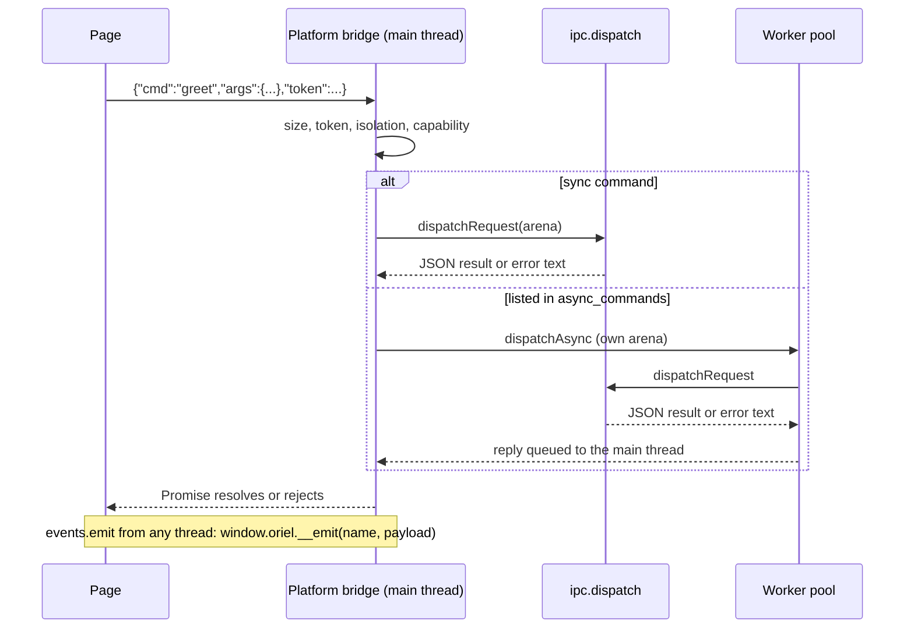

<!-- Generated from site/content/docs/commands.smd by tools/docs/gen-md.mjs: edit that file. -->

# Commands and events

The typed IPC between the page and Zig: commands the page invokes, events Zig emits, their JSON mapping, threads, errors, limits and the generated TypeScript.

The page and Zig talk through two plain Zig structs. **Commands** are the
`pub fn` declarations of `Commands`: the page calls one with
`invoke("name", args)` and gets its result in a Promise. **Events** are the
fields of `Events`: Zig pushes one with `events.emit(.name, payload)` and the
page receives it with `listen("name", callback)`. Arguments and results
cross as JSON, converted by comptime reflection, and the build generates
TypeScript from the same structs, so both sides are type-checked.

Use a command for anything the page asks for; use an event for anything Zig
has to tell the page on its own (progress, a file changed, a hotkey). For a
second window's page, events can target one window
([Windows](windows.md)). For calls into native Kotlin or
Swift code, see [Extensions](extensions.md).

## Availability

| Platform | Commands and events | Transport |
|---|---|---|
| Linux | Yes | WebKitGTK script message handler with reply |
| Windows | Yes | WebView2 message channel |
| macOS | Yes | `WKScriptMessageHandlerWithReply` |
| Android | Yes | `WebMessageListener` channel |
| iOS | Yes | `WKScriptMessageHandlerWithReply` |

Always on: no build flag, no permission. Pages drawn by the
[native renderer](native-renderer.md) (`-Dnative_ui`) use the
same commands and events through the engine's own `invoke`. Only pages
the app trusts get the bridge: its own (`app://app`, or
`https://app.localhost` on Windows and Android, plus the dev server in dev
builds) and remote origins a capability names
([Security](security.md)).

## Quick start

```zig
// src/main.zig
const std = @import("std");
const oriel = @import("oriel");
const app = @import("oriel_app");

pub const Commands = struct {
    pub fn greet(gpa: std.mem.Allocator, args: struct { name: []const u8 }) ![]const u8 {
        if (args.name.len == 0) return error.EmptyName;
        events.emit(.greeted, .{ .name = args.name });
        return std.fmt.allocPrint(gpa, "Hello, {s}!", .{args.name});
    }
};

pub const Events = struct {
    greeted: struct { name: []const u8 },
};
const events = oriel.App.events(Events);

pub fn main(init: std.process.Init) !u8 {
    return oriel.main(init, .{ .commands = Commands, .events = Events }, .{
        .app = app.build,
        .window = .{ .title = "Greeter" },
    });
}
```

```ts
// frontend/src/main.ts (oriel.ts is generated: `oriel types`)
import { invoke, listen } from "./oriel";

const off = listen("greeted", (e) => console.log("greeted", e.name)); // e: { name: string }
try {
  const text = await invoke("greet", { name: "Ada" }); // text: string
  console.log(text);
} catch (err) {
  console.error(String(err)); // "Error: EmptyName"
}
off();
```

`oriel dev` and `oriel build` regenerate `frontend/src/oriel.ts` before the
frontend builds; `oriel types` does only that.

## How it works



**A call.** `invoke(cmd, args)` sends `{cmd, args, token}` (plus an `id` on
the channel transports) to the platform bridge
(`src/platform/<os>/bridge.zig`). The bridge refuses a message over
`ipc.max_request_len` (32 MiB) before parsing it, then checks the page's
IPC token, the isolation signature when the
[isolation pattern](security.md#isolation) is on, and
the calling origin's capabilities. Window commands (`oriel:window:*`) go to
`src/core/window_commands.zig`, built-ins to `ipc.dispatchBuiltin`, and the
app's commands to `ipc.dispatchRequest` (`src/core/ipc.zig`).

**Dispatch.** `dispatchRequest` finds the `pub fn` whose name is `cmd`
(an `inline for` over `Commands`' declarations, so there is no table to
register), fills each parameter (the allocator, the `std.Io`, the argument
value parsed from `args` with `std.json`), calls it and serializes the
result with `std.json.Stringify`. A sync command runs right there on the
main thread. A command named in `async_commands` is copied into a job with
its own arena and posted to the worker pool (`src/core/ThreadPool.zig`);
its reply is queued back to the main thread.

**Events.** `events.emit(.name, payload)` serializes the payload and
evaluates `window.oriel?.__emit(name, payload)` in every window whose page
gets the bridge (WebKit), or sends it on the channel (Windows, Android).
Called on the main thread (a sync command emitting), the event is delivered
at once, so it reaches the page before that command's reply. From other
threads it is queued to the main thread in order. The page's `__emit`
calls every listener; an exception in one is logged to the console and
doesn't stop the others.

**Types.** `ipc.typescript(Commands, Events)` builds the TypeScript module
at compile time. The build runs the dev executable (or a small generator)
with `--emit-types <frontend>/src/oriel.ts`, which writes it only when it
changed, so the dev server doesn't reload for nothing.

## Examples

### A slow command off the UI thread

```zig
pub const Commands = struct {
    pub const async_commands = .{"export_notes"};

    /// Runs on a worker: the window stays responsive.
    pub fn export_notes(gpa: std.mem.Allocator, io: std.Io, args: struct { path: []const u8 }) !u64 {
        const notes = try loadNotes(gpa);
        const file = try std.Io.Dir.cwd().createFile(io, args.path, .{});
        defer file.close(io);
        var buf: [4096]u8 = undefined;
        var w = file.writer(io, &buf);
        for (notes) |n| try w.interface.print("{s}\n", .{n.text});
        try w.interface.flush();
        return notes.len;
    }
};
```

A name in `async_commands` that isn't a command is a compile error.

### A readable error for the page

```zig
pub fn fetch_models(gpa: std.mem.Allocator, io: std.Io, args: struct { base_url: []const u8 }) ![]const []const u8 {
    return listModels(gpa, io, args.base_url) catch |err|
        oriel.ipc.fail("Could not reach {s} ({s})", .{ args.base_url, @errorName(err) });
}
```

```ts
try {
  await invoke("fetch_models", { base_url: url });
} catch (err) {
  status.textContent = (err as Error).message; // "Could not reach http://... (ConnectionRefused)"
}
```

### Progress events from a worker

```zig
pub const Events = struct {
    import_progress: struct { done: u32, total: u32 },
    import_finished: void,
};
const events = oriel.App.events(Events);

pub const Commands = struct {
    pub const async_commands = .{"import_all"};

    pub fn import_all(gpa: std.mem.Allocator, args: struct { files: []const []const u8 }) !void {
        for (args.files, 0..) |path, i| {
            try importOne(gpa, path);
            events.emit(.import_progress, .{ .done = @intCast(i + 1), .total = @intCast(args.files.len) });
        }
        events.emit(.import_finished, {});
    }
};
```

```ts
listen("import_progress", ({ done, total }) => (bar.value = done / total));
listen("import_finished", () => toast("Imported")); // payload: null
await invoke("import_all", { files });
```

### Work started outside a command

A tray or hotkey callback runs on the main thread. Long work goes to the
pool; touching a window goes back to the main thread:

```zig
fn onHotkey() void {
    oriel.App.spawn(transcribe, .{@as(u32, 30)}) catch |err|
        std.log.err("spawn: {s}", .{@errorName(err)});
}

fn transcribe(seconds: u32) !void {
    _ = seconds; // ... record and transcribe ...
    oriel.App.runOnMain(@as(u8, 0), struct {
        fn f(_: u8) void {
            if (oriel.App.getWindow("main")) |w| w.show();
        }
    }.f);
}
```

### Generate the types without compiling the whole app

```zig
// build.zig
.frontend = .{ .dir = "frontend", .types_from = .root_decls },
```

The generator imports `src/main.zig` and reads `pub const oriel_api:
oriel.App.Api`, or else `pub const Commands` (and `pub const Events` if
present). Only the command signatures are compiled, so a production build
doesn't compile the whole app a second time for the bindings.

## Reference

### `Commands`

Every `pub fn` of the struct passed as `App.Api.commands` is a command named
after the function. Other declarations (constants, non-`pub` functions) are
ignored, except `async_commands`.

| Rule | Detail |
|---|---|
| Parameters | Any order. `std.mem.Allocator`: the call's arena. `std.Io`: the app's `std.Io` (the one `oriel.main` got). At most one other parameter: the arguments, parsed from `args`. More than one is a compile error ("commands can have at most one arguments type"); a parameter without a concrete type is too. |
| Return | Any type `std.json.Stringify` can write, or an error union of one. `void` returns `null`. |
| `pub const async_commands = .{ "a", "b" }` | These run on the worker pool. Each name must be a `pub fn` (compile error otherwise). |
| Name collisions | A name the bridge handles first (`open_external`, `events:ready`, `oriel:window:*`, ...) never reaches `Commands`. Zig identifiers can't contain `:`, so only `open_external` could clash. |

### Arguments and results as JSON

Arguments are parsed with `std.json.parseFromValueLeaky(T, arena, args,
.{ .ignore_unknown_fields = true })`; results are written with
`std.json.Stringify.valueAlloc`. The TypeScript type is generated from the
same Zig type:

| Zig | JSON | TypeScript |
|---|---|---|
| `bool` | `true`, `false` | `boolean` |
| integers, floats | number | `number` |
| `[]const u8`, `[N]u8` | string | `string` |
| `[]const T`, `[N]T` | array | `(T)[]` |
| `?T` | value or `null` | `T \| null` |
| `enum { a, b }` | `"a"`, `"b"` | `"a" \| "b"` |
| `struct { x: T, y: U = default }` | object | `{ x: T; y?: U; }` |
| `void` | `null` | `null` |
| unions and anything else | as `std.json` writes it | `unknown` |

- A struct field without a default must be present, or the call fails with
  `MissingField`; give optional fields a default (`label: ?[]const u8 =
  null`), which also makes them optional (`label?:`) in TypeScript.
- Unknown fields in `args` are ignored.
- A command without an arguments parameter takes no `args`
  (`invoke("ping")`); `args` is then `null` on the wire.
- JavaScript numbers are doubles: integers beyond 2^53 lose precision. Send
  big ids as strings.
- Strings must be UTF-8.

### The allocator and memory

The `std.mem.Allocator` a command receives is an arena created for that
call. Everything it allocates is freed after the reply is sent: return
memory from it (or static memory) and free nothing. Don't keep pointers into
it past the call; copy what must outlive it into your own allocator.
Arguments live in the same arena. Each async call has its own arena, freed
on the main thread after the reply.

### Threads

| What | Thread |
|---|---|
| A sync command | The main (UI) thread; the UI waits for it. |
| A command in `async_commands` | A worker-pool thread. The pool has one thread per CPU (at least 2, at most 16) and holds at most 1024 waiting tasks; beyond that the call fails with `WorkerPoolBusy`. |
| `oriel.extensions.call`, `oriel.systemAi` calls, `oriel.camera.capturePhoto` from the page | Always a worker (they wait on native code or the user). |
| `events.emit`, `events.emitTo` | Any thread. On the main thread the event is delivered at once; from others it is queued to the main thread, in order. |
| `App.spawn(func, args)` | A worker-pool thread. |
| `App.runOnMain(ctx, func)` | Queued to the main thread from any thread, even from the main thread (it runs after the caller returns). |

Windows, web views, the tray and menus may only be touched on the main
thread. A window pointer from `App.getWindow` is freed when the window
closes, so use it on the main thread only; from a worker go by label
(`events.emitTo`) or through `App.runOnMain`. Commands
can't be cancelled.

### Errors

A command that returns an error rejects the page's Promise with an `Error`
whose message is the error's name (`EmptyName`), or the text given to
`oriel.ipc.fail`.

| Declaration | Meaning |
|---|---|
| `oriel.ipc.fail(comptime fmt, args) error{CommandFailed}` | Formats a message (at most 2047 bytes; longer is cut and ends in `...`) and returns `error.CommandFailed`; the page sees the message instead of the name. Per thread; used once. |
| `oriel.ipc.errorText(err) [:0]const u8` | What the page sees for `err` (used by the bridges). |

Errors the IPC itself produces:

| Error | When |
|---|---|
| `UnknownCommand` | No command, built-in or window command has that name. |
| `MissingField`, `UnexpectedToken`, `InvalidCharacter`, `Overflow`, ... | `args` doesn't fit the argument type (`std.json` errors). |
| `Forbidden` | The page has no IPC token for its origin, the isolation check failed, or the origin's capability doesn't grant the command. |
| `RequestTooLarge` | The message is longer than `max_request_len`. |
| `WorkerPoolBusy` | 1024 async tasks are already waiting. |
| `WorkerPoolNotRunning` | An async command arrived while the app is shutting down. |
| `IoNotProvided` | A command takes `std.Io` but the app's pool isn't running (shutdown). |
| `OutOfMemory` | Allocation failed while dispatching. |
| `IsolationStale` | The isolation frame's key was evicted; the bridge retries once with a new frame. |

### Events

```zig
pub const Events = struct {
    notes_changed: []const Note,
    status: struct { message: []const u8, progress: u32 },
    @"sync-done": void,
};
const events = oriel.App.events(Events);
events.emit(.status, .{ .message = "Saving", .progress = 50 });
try events.emitTo("settings", .status, .{ .message = "Saved", .progress = 100 });
```

| Declaration | Meaning |
|---|---|
| `App.events(comptime Events: type) type` | The app's events, typed: the name and payload type are checked at compile time. `Events` is the struct passed as `Api.events` (a module may pass a struct of its own fields of it). |
| `events.emit(comptime name: std.meta.FieldEnum(Events), payload: @FieldType(Events, name)) void` | To every window. |
| `events.emitTo(label: []const u8, comptime name: std.meta.FieldEnum(Events), payload: @FieldType(Events, name)) !void` | To one window only; `error.WindowNotFound` when no window has that label. |

- Each field is an event; its type is the payload (`void` sends `null`).
  Names that aren't JavaScript identifiers (`"sync-done"`) are quoted in the
  TypeScript.
- Delivery is best-effort: an event emitted before a page listens is lost,
  except the events below that wait for the first `listen`.
- Events go only to pages that get the bridge (the app's origins and
  capability origins), never to another page a window may show.
- Serialization errors are logged (`emit <name>: <error>`), not returned.

Events Oriel itself sends (and declares in the generated `Events`
interface where marked):

| Event | Payload | Sent by | Waits for `listen` |
|---|---|---|---|
| `deep-link` (declared when `deep_link` is on) | `{ url: string }` | [Deep links](deep-links.md) | Yes (page keeps at most 16) |
| `permission-changed` (declared) | `{ name, status }` | [Permissions](permissions.md) | No |
| `lifecycle` (declared) | `LifecycleEvent` | [Lifecycle](lifecycle.md) | Yes |
| `notification:action` | see [Notifications](notifications.md) | Notifications | Yes |
| `share:received`, `share:sent` | see [Share](share.md) | Share | `share:received` |
| `extension:<name>` | `{ name, data }` | [Extensions](extensions.md) | Yes |
| `window:created`, `window:closed` (declared) | `{ label: string }` | [Windows](windows.md) | No |

For the events that wait, the bridge's `listen()` sends the `events:ready`
built-in, and Zig then delivers what came before (an app launched by a
notification click or a link, a lifecycle change before the page loaded).

### Page API

| API | Meaning |
|---|---|
| `invoke<K>(cmd: K, args?): Promise<Commands[K]["result"]>` | Call a command (from `./oriel`, typed). `args` is required exactly when the command has an arguments parameter. |
| `listen<K>(event: K, callback: (payload: Events[K]) => void): () => void` | Subscribe; returns the unsubscribe function. |
| `window.oriel.invoke(cmd: string, args: unknown): Promise<unknown>` | The untyped call `invoke` wraps. |
| `window.oriel.listen(event: string, callback): () => void` | The untyped subscription. |
| `window.oriel.platform` | `{ os: "linux" \| "macos" \| "windows" \| "android" \| "ios", arch: string }`, fixed per build. |
| `window.oriel.features` | Every module flag as this build resolved it, camelCase (`features.fsWatch`). |

`window.oriel` is frozen and defined with `Object.defineProperty`, so a page
script can't replace it. Its methods call the bridge's closure, so
destructuring works (`const { invoke } = window.oriel`).

### TypeScript generation

`frontend/src/oriel.ts` (the path is `Frontend.types_path`, relative to the
frontend directory; null turns generation off) exports:

| Export | What |
|---|---|
| `interface Commands` | `name: { args: ...; result: ... }` for every command |
| `interface Events` | Every event, plus `deep-link`, `permission-changed` and `lifecycle` when the app doesn't declare them |
| `invoke`, `listen` | The typed functions above |
| `orielWindow`, `deepLink`, `lifecycle`, `extensions`, `systemAi`, `camera`, `permissions`, `platform`, `features`, `oriel` | The built-in APIs (`orielWindow` is `window.oriel.window`; not exported as `window`, which would shadow the global) |
| `openExternal(url)` | Open a URL in the default browser ([Security](security.md#external-urls)) |
| `WindowOptions`, `WindowHandle`, `WindowApi`, `PermissionName`, `PermissionStatus`, `PermissionsApi`, `Platform`, `Features`, `DeepLinkApi`, `LifecycleEvent`, `LifecycleApi`, `ExtensionEvent`, `ExtensionsApi`, `CapturePhotoOptions`, `CapturedPhoto`, `CameraApi`, the system AI types | Interfaces for those APIs |

It also declares `window.oriel` globally, so plain scripts get types too.

| How | What it runs |
|---|---|
| `oriel types` / `zig build types` | The generator with `--emit-types <frontend>/<types_path>` |
| `oriel dev`, `oriel build` | The same, before the frontend builds |
| `Frontend.types_from = .dev_exe` (default) | The whole development executable is the generator |
| `Frontend.types_from = .root_decls` | A small generator that imports the root file's `oriel_api` or `Commands`/`Events` |
| `oriel.writeTypes(io, gpa, api, path)` | The function behind `--emit-types`; writes only when the text changed |

Types are generated on the host: cross-compiling (`-Dtarget=...`), or an
Android or iOS target, makes `zig build types` fail with a message; run it
natively.

### Limits

| Limit | Value | Where |
|---|---|---|
| Request size (page to Zig) | 32 MiB (`ipc.max_request_len`) | Every bridge, before parsing |
| `oriel.ipc.fail` message | 2047 bytes | `ipc.fail` |
| Worker threads | CPU count, clamped to 2..16 | `ThreadPool.init` |
| Waiting async tasks | 1024 (`ThreadPool.default_max_queued`) | `ThreadPool.submit` |
| Queued `deep-link` events in the page | 16 (oldest dropped) | `bridge_js.zig` |
| Files in `oriel.share.send` from the page | 16 MiB in all | `share:send` |

### Built-in commands

The bridge's own commands. They pass the same token, isolation and
capability checks as the app's (a remote origin needs them in its
capability's `commands`), except `oriel:window:*`, which the window API
policy governs.

| Command | Used by | Result |
|---|---|---|
| `open_external` `{ url }` | `openExternal` | `null`; errors `DisallowedScheme`, `InvalidUrl`, `ControlCharactersNotAllowed` |
| `events:ready` `{ event }` | `listen` for queued events | `null`; `UnknownEvent` for another name |
| `permissions:query`, `permissions:request`, `permissions:open_settings` `{ name }` | `oriel.permissions` | status string, or `boolean`; `UnknownPermission` |
| `deep_link:current` | `oriel.deepLink.current()` | the launch URL or `null` |
| `share:send`, `share:read`, `share:capabilities` | `oriel.share` | see [Share](share.md) |
| `camera:capture` | `oriel.camera.capturePhoto` | see [Camera](camera.md) |
| `extensions:call` | `oriel.extensions.call` | see [Extensions](extensions.md) |
| `system_ai:*` | `oriel.systemAi` (all but `system_ai:cancel` run on a worker) | see [System AI](system-ai.md) |
| `oriel:window:open`, `close`, `show`, `hide`, `focus`, `setTitle`, `setSize`, `maximize`, `fullscreen`, `startDragging`, `setThemeColor`, `get`, `all`, `current`, `emitTo` | `oriel.window` | see [Windows](windows.md#window-commands) |
| `oriel:isolated` | The isolation pattern's signed calls | the inner call's result |
| `drop:path` | Native renderer pages only | see [Drag and drop](drag-and-drop.md) |

### Migrating from 0.11

- The `notification:ready` and `deep_link:ready` commands are gone: the
  bridge's `listen()` sends `events:ready` (`{ event }`) for every queued
  event, `deep-link` and `notification:action` included. Pages that only
  use `listen` need no change.
- `App.emit(name, payload)` (untyped) is gone: declare the event in
  `Events` and use `App.events(Events).emit(.name, payload)`.
- `App.emitTo(label, name, payload)` and `Window.emit(name, payload)` are
  `App.events(Events).emitTo(label, .name, payload)`.

## Troubleshooting

| Symptom | Cause and fix |
|---|---|
| `invoke` rejects with `UnknownCommand` | The function isn't `pub`, the name differs (commands keep the Zig name, `snake_case`), or the page is an old build: rebuild, and run `oriel types`. |
| `MissingField` | A field without a default is missing from `args`; add `= null` (or another default) to optional fields. |
| `Forbidden`, and the log says `blocked command "x" from https://...` | A remote origin without a capability for the command; add it to the capability's `commands` ([Security](security.md#capabilities)). |
| `refused an IPC call without this page's token` in the log | A call from a frame, or from a page the bridge doesn't serve. Only the top frame of an allowed origin can call. |
| The window freezes during a command | It is sync: add it to `async_commands`. |
| `listen` never fires | The event was emitted before the page listened (only the events in the table above wait), the page isn't on an allowed origin, or the name differs (check the generated `Events`). |
| `Cannot generate TypeScript types when cross-compiling` | Run `oriel types` without `-Dtarget`, on the host. |
| A big integer arrives changed | JavaScript doubles; send it as a string. |

## Related

- [Concepts](concepts.md): where the bridge sits in an app.
- [Windows](windows.md): targeted events and the `oriel.window` API.
- [Security](security.md): tokens, capabilities and the isolation pattern that guard every call.
- [Extensions](extensions.md): native code the page reaches through Zig.
- [Development](development.md): `oriel types` and the dev loop.
