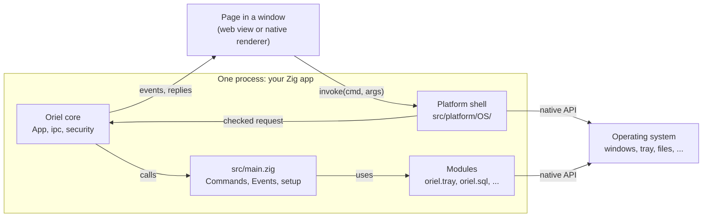
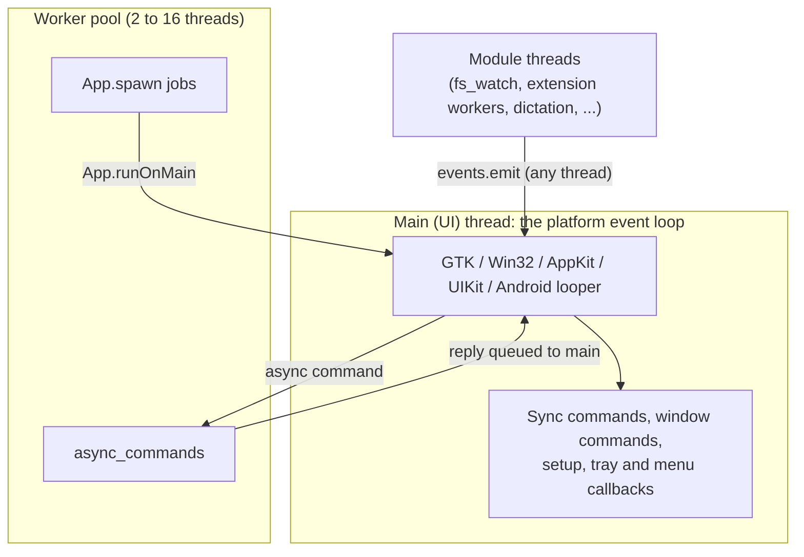
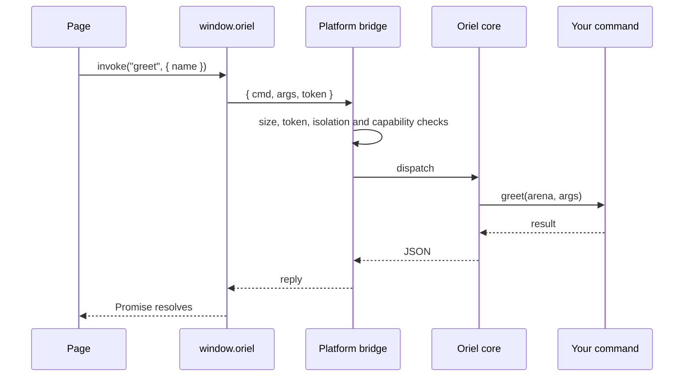
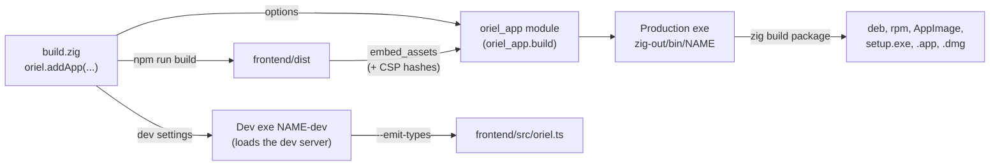

<!-- Generated from site/content/docs/concepts.smd by tools/docs/gen-md.mjs: edit that file. -->

# Concepts

How an Oriel app is put together: one native process, its windows and web views, the bridge between the page and Zig, modules, the build and the platform layer.

An Oriel app is one native program written in Zig. It opens windows whose
content is a web page: HTML, CSS and JavaScript from the app's `frontend/`,
drawn by the platform's own web view, or by Oriel's
[native renderer](native-renderer.md) with `-Dnative_ui`.
The page calls Zig through a small bridge (`window.oriel`), and Zig pushes
events back. Everything else, the tray, notifications, a database, a local
model, is a module the Zig side uses and may expose to the page.

This page is the map. Each part links to the page that documents it in
full.

## The pieces



| Piece | What it is | Source | Documented in |
|---|---|---|---|
| Your app | `src/main.zig`: the `Commands` and `Events` structs and `main`, which calls `oriel.main` | your project | [Commands and events](commands.md) |
| `oriel_app` | A module the build generates from `build.zig`: the app id, embedded assets, dev server, icon, URL schemes, permissions, isolation hook | `build.zig` (`appConfigModule`) | [The build](#build) |
| Core | Windows, IPC dispatch, events, asset lookup, the worker pool | `src/core/App.zig`, `ipc.zig`, `window_commands.zig` | [Windows](windows.md) |
| Security | Navigation policy, IPC scopes (capabilities), CSP, the isolation pattern | `src/core/security.zig`, `csp.zig`, `isolation.zig` | [Security](security.md) |
| The bridge | The `window.oriel` script every page gets, one script for every platform | `src/core/bridge_js.zig` | [The bridge](#bridge) |
| Platform shell | The event loop, native windows, the web view, the app scheme, the bridge transport | `src/platform/<os>/` | [The platform layer](#platform-layer) |
| Modules | `oriel.tray`, `oriel.sql`, `oriel.notification`, ...: compiled only when on | `src/modules/`, `src/plugins/` | [Modules](modules.md) |
| Native code | App extensions (your Kotlin, Objective-C, Swift or Zig as a service) and platform hooks (your code in the platform's own events) | `src/core/extensions.zig`, `src/core/hooks.zig` | [Extensions](extensions.md), [Platform hooks](platform-hooks.md) |
| CLI | `oriel init`, `dev`, `build`, `package`, ...: wrappers around `zig build` plus tool management | `cli/` | [CLI](cli.md) |

## The entry point

```zig
const std = @import("std");
const oriel = @import("oriel");
const app = @import("oriel_app"); // generated from build.zig

pub const Commands = struct {
    pub fn greet(gpa: std.mem.Allocator, args: struct { name: []const u8 }) ![]const u8 {
        return std.fmt.allocPrint(gpa, "Hello, {s}!", .{args.name});
    }
};
pub const Events = struct { saved: struct { id: u64 } };

pub fn main(init: std.process.Init) !u8 {
    return oriel.main(init, .{ .commands = Commands, .events = Events }, .{
        .app = app.build, // id, assets, dev server, icon, url_schemes, permissions, isolation
        .window = .{ .title = "My App", .width = 800, .height = 600 }, // the main window
        .setup = setup, // optional: runs on the main thread once the main window exists
    });
}

fn setup() !void {
    std.log.info("main window is up", .{});
}
```

`oriel.main(init, api, config)` (in `src/oriel.zig`):

1. initializes the updater when it is compiled in;
2. answers `--emit-types <path>` by writing the page's TypeScript bindings
   and exiting (the build uses this, see [Commands](commands.md#typescript));
3. keeps the process arguments for the platform (deep links, a second
   launch), then calls `App.run(init.io, api, config)`, which returns the
   exit code when the app quits.

`api` and `config` are comptime: the commands, the events, the security
policy and the main window's options are known when the app compiles, so
the bridge script, the CSP and the dispatch code are generated for exactly
this app.

## The process and its threads



- **The main thread** runs the platform's event loop. Windows, web views,
  the tray and menus may only be touched there. Commands run there unless
  they are listed in `async_commands`, so a slow sync command freezes the
  UI.
- **The worker pool** (`src/core/ThreadPool.zig`) has one thread per CPU,
  at least 2 and at most 16, and at most 1024 queued tasks. It runs async
  commands and `App.spawn` jobs; replies go back to the main thread.
- **From any thread**, `events.emit`, `App.emit`, `App.emitTo`,
  `App.quit` and `App.runOnMain` are safe. Use `App.runOnMain(ctx, func)`
  to touch a window from a worker.

The rules for each command and event are on
[Commands and events](commands.md#threads).

## Windows and the page

A window is a native window plus what draws its page:

| Platform | Window | Web view | App origin |
|---|---|---|---|
| Linux | `GtkApplicationWindow` (GTK 4) | WebKitGTK 6.0 | `app://app` |
| Windows | Win32 `HWND` | WebView2 | `https://app.localhost` |
| macOS | `NSWindow` (AppKit) | `WKWebView` | `app://app` |
| Android | An Activity per window (Kotlin, over JNI) | `android.webkit.WebView` | `https://app.localhost` |
| iOS | A view controller in a `UIWindowScene` | `WKWebView` | `app://app` |

With `-Dnative_ui` the same page runs in QuickJS and is drawn with native
views instead of a web view, on every platform; see
[Native renderer](native-renderer.md).

In a production build the frontend's `dist/` is embedded in the
executable and served from the app origin by the platform's scheme handler
(`src/platform/<os>/scheme.zig`), with the app's CSP on every page. In a
development build the window loads the frontend's dev server instead
([Development](development.md)). Each window has a
**label**; the first one, from `App.Config.window`, is `"main"`. Windows,
their options and the page's `oriel.window` API are on
[Windows](windows.md).

## The bridge

Every page the app trusts gets one script before its own scripts run:
`window.oriel`, built from `src/core/bridge_js.zig`. It is the same script
on every platform; each platform only supplies how a message travels:

| Platform | Page to Zig | Zig to page |
|---|---|---|
| Linux, macOS, iOS | WebKit script message handler `oriel` (`postMessage` with a reply) | `evaluateJavascript("window.oriel.__emit(...)")` |
| Windows, Android | A message channel (WebView2 `chrome.webview`, Android `WebMessageListener`); requests carry an id | Events and replies on the same channel, in order |



What the bridge carries is checked before anything runs: the request size
(32 MiB at most), the page's IPC token (only the top frame of an allowed
origin has it), the isolation hook's signature when the isolation pattern
is on, and the calling origin's capabilities. The checks are on
[Security](security.md).

`window.oriel` holds `invoke`, `listen`, `openExternal`, `platform`,
`features`, `window`, `permissions`, `lifecycle`, `deepLink`, `share`,
`camera`, `extensions` and `systemAi`. The generated `frontend/src/oriel.ts`
gives them types ([Commands](commands.md#typescript)).

## Commands and events

The app's API to the page is two plain Zig structs:

- **`Commands`**: every `pub fn` is a command the page calls with
  `invoke(name, args)`. Arguments arrive as JSON and are parsed into the
  function's parameter type; the result goes back as JSON.
- **`Events`**: every field is an event Zig pushes with
  `events.emit(.name, payload)`; the page subscribes with
  `listen(name, callback)`.

Both sides are typed: the build generates TypeScript from the structs.
[Commands and events](commands.md) has the rules.

## Modules

Oriel's features beyond windows and IPC are modules: `oriel.tray`,
`oriel.menu`, `oriel.dialog`, `oriel.notification`, `oriel.store`,
`oriel.sql`, `oriel.fs_watch`, `oriel.media_server`, `oriel.deep_link`,
`oriel.share`, `oriel.camera`, the local AI modules (`oriel.llama`,
`oriel.whisper`, `oriel.tts`, ...) and the plugins `oriel.clipboard`,
`oriel.global_shortcut` and `oriel.input`.

- Each one is a build flag on the `oriel` dependency (`.tray = false`).
  A module that is off is not compiled or linked.
- `oriel.<module>.available` is a comptime bool: false where the build
  leaves the module out or the target has none (a tray on a phone). Guard
  calls with `if (oriel.tray.available)`.
- The page sees the same flags as `oriel.features` (`features.tray`,
  `features.fsWatch`, camelCase).

The list, flags and per-platform availability are on
[Modules](modules.md).

## Native code

Two ways in, for code the modules don't cover:

- **[App extensions](extensions.md)**: your Kotlin,
  Objective-C, Swift or Zig as a named service; Zig calls it, and the page
  only through what Zig exposes.
- **[Platform hooks](platform-hooks.md)**: your code inside
  the platform's own events (an Activity starting, a web view being
  created, a URL opening).

## The build



An app's `build.zig` calls `oriel.addApp(b, dep, .{ ... })` with its name,
root file, frontend, icon, package metadata, URL schemes, permissions and
platform options. From that the build makes:

- **`oriel_app`**, a generated module the app imports. `oriel_app.build`
  is an `App.Build` (below) to pass as `App.Config.app`;
  `oriel_app.update_public_key` is the updater's key.
- **A production executable** with the frontend's `dist/` embedded
  (`tools/embed_assets.zig`, which also hashes each HTML file's inline
  scripts and styles for the CSP), optimized `ReleaseSafe` unless
  `-Doptimize` says otherwise.
- **A development executable** `<name>-dev` (Debug) whose assets are empty
  and whose `dev` points at the frontend's dev server.
- **Steps**: `zig build` (production), `run`, `dev`, `build-dev`, `types`,
  `check`, `package` and the per-format package steps, `desktop-entry`;
  Android and iOS targets have their own (`android-dev`, `ios-dev`, ...).

The `oriel` CLI runs these steps for you from anywhere in the project. The
build options are on [Building](building.md), packaging on
[Packaging](packaging.md), the dev loop on
[Development](development.md).

## The platform layer

`src/platform/platform.zig` picks one backend at compile time and checks,
with comptime assertions, that it exports the whole contract: window
operations (`createWindow`, `showWindow`, `setWindowPlacement`,
`startWindowDrag`, ...), the event loop (`run`, `quit`), `evalJs`,
`openExternal`, `dispatchWithCleanup` (queue work on the UI thread) and
`setMenu`. The core never calls an OS API directly.

| Directory | Underneath | Notes |
|---|---|---|
| `src/platform/linux/` | GTK 4, WebKitGTK 6.0, GIO | `Shell.zig` (GtkApplication, signals), `window.zig`, `scheme.zig` (`app://`), `bridge.zig`, `overlay.zig` (layer-shell, X11 hints), `dev_server.zig` |
| `src/platform/windows/` | Win32, WebView2, WinRT | Cross-builds from Linux; `WebView2Loader.dll` comes from `oriel webview2` |
| `src/platform/macos/` | AppKit, WebKit, through the Objective-C runtime from Zig | No Xcode project; `.app` and `.dmg` from `zig build package` |
| `src/platform/android/` | A Kotlin Activity and `android.webkit.WebView`, driven over JNI | The Gradle project lives in the app's `android/` (`oriel android init`) |
| `src/platform/ios/` | UIKit and `WKWebView` from Zig | No Xcode project; `oriel ios build` |
| `src/platform/apple/` | Shared by macOS and iOS | Platform hooks, extensions |

Which modules exist on which platform, and what each platform needs to
build, is on [Desktop](desktop.md),
[Android](android.md), [iOS](ios.md) and
[Modules](modules.md).

## Reference

### `oriel.main` and `App.run`

| Declaration | Meaning |
|---|---|
| `oriel.main(init: std.process.Init, comptime api: App.Api, comptime config: App.Config) !u8` | The entry point: updater init, `--emit-types`, process arguments, then `App.run`. Returns the exit code. |
| `App.run(io: std.Io, comptime api: App.Api, comptime config: App.Config) u8` | Runs the app on the calling (main) thread until it quits. For an app that parses its own arguments: call `App.setProcessArgs(args)` first (deep links and second launches need them). |
| `App.Api` | `struct { commands: type, events: type = struct {} }` |
| `oriel.writeTypes(io, gpa, comptime api, path) !void` | Writes the TypeScript bindings to `path`, leaving the file untouched when nothing changed. |

### `App.Config`

| Field | Type | Default | Meaning |
|---|---|---|---|
| `app` | `App.Build` | required | What `build.zig` declares: pass `oriel_app.build`. |
| `window` | `WindowOptions` | `.{}` | The main window; its label is always `"main"` (another label is a compile error). Every field: [Windows](windows.md#window-options). |
| `user_agent` | `?[:0]const u8` | `null` | The web view's User-Agent. |
| `start` | `[:0]const u8` | `"index.html"` | Path and query loaded at startup, relative to the app origin, when the window has no `url`. |
| `spa_fallback` | `bool` | `true` | An unknown path whose last segment has no dot serves `index.html` (client-side routing). |
| `devtools` | `bool` | `true` in Debug builds | The web view's inspector ([Development](development.md#devtools)). |
| `security` | `security.Security` | `.{}` | CSP, allowed origins, capabilities, external links, window API policy, headers ([Security](security.md)). |
| `window_open` | `.main_view` or `.new_window` | `.main_view` | Where `window.open()` and `target="_blank"` to an app page go ([Windows](windows.md#example-window-open)). |
| `setup` | `?*const fn () anyerror!void` | `null` | Runs once on the main thread after the main window exists: create the tray, register shortcuts, start background work. An error is logged. |
| `on_second_instance` | `?*const fn (args: []const []const u8) void` | `null` | Apps are single-instance on the desktop: a second launch forwards its arguments (without argv[0]) to the running instance and exits. This runs on the running instance's main thread with them. Null keeps the platform default (the main window comes back). |

### `App.Build`

Generated into `oriel_app.build`; an app doesn't write it by hand.

| Field | Type | From `build.zig` |
|---|---|---|
| `id` | `[:0]const u8` | `.package.id`, else `"dev.oriel.<name>"` |
| `assets` | `[]const App.Asset` | The embedded `frontend/dist` (empty in dev builds) |
| `dev` | `?App.Dev` | The dev server (null in production builds) |
| `icon` | `?[]const u8` | `.icon`, PNG bytes (Oriel's icon by default) |
| `url_schemes` | `[]const []const u8` | `.url_schemes` ([Deep links](deep-links.md)) |
| `permissions` | `permissions.Declared` | `.permissions` ([Permissions](permissions.md)) |
| `isolation` | `?security.Isolation` | `.isolation` ([Security](security.md#isolation)) |

### Source map

| File | What's in it |
|---|---|
| `src/oriel.zig` | The `oriel` module: `main`, `writeTypes`, every module by name |
| `src/core/App.zig` | `Config`, `Build`, `WindowOptions`, windows, `emit`, `spawn`, `runOnMain`, `run` |
| `src/core/ipc.zig` | Command dispatch, async dispatch, built-in commands, IPC tokens, TypeScript generation |
| `src/core/window_commands.zig` | The page's `oriel.window` commands |
| `src/core/bridge_js.zig` | The `window.oriel` script |
| `src/core/security.zig`, `csp.zig`, `isolation.zig` | The security policy |
| `src/core/ThreadPool.zig` | The worker pool |
| `src/platform/platform.zig` | The backend contract and selection |
| `build.zig` | `addApp`, `AppOptions`, `Frontend`, the generated `oriel_app` |
| `tools/dev_runner.zig` | `oriel dev`'s rebuild-and-restart loop |
| `cli/` | The `oriel` command |

## Related

- [Getting started](getting-started.md) and the
  [tutorial](tutorial.md): build an app step by step.
- [Commands and events](commands.md): the IPC in full.
- [Windows](windows.md), [Security](security.md),
  [Development](development.md), [CLI](cli.md).
- [Modules](modules.md): everything an app can switch on.
- [Native renderer](native-renderer.md): the page without a web view.
- [Comparison](comparison.md): Oriel next to Tauri and Vercel native.
