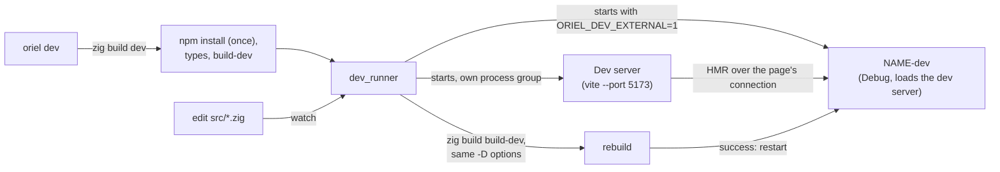

<!-- Generated from site/content/docs/development.smd by tools/docs/gen-md.mjs: edit that file. -->

# Development

The dev loop: oriel dev with the frontend's dev server and hot reload, Zig rebuilds and restarts, devtools, logs and type checking.

`oriel dev` runs the app against the frontend's dev server (Vite by
default): edits to the page reload in place with the dev server's hot module
replacement, and edits to the Zig code rebuild and restart the app on their
own. Development builds are Debug builds with the web inspector on, load
the page from the dev server instead of embedded files, and stop
everything they started when you stop them.

Use `oriel dev` while working on the app, `oriel run` to try the production
build, and `oriel check` for a fast type-check of the Zig code. Phones have
their own dev commands (`oriel android dev`, `oriel ios dev`).

## Availability

| Platform | Dev loop | How |
|---|---|---|
| Linux | `oriel dev`: dev server, hot reload, Zig rebuild and restart | inotify watch on `src/` |
| Windows | `oriel dev` | Polls `src/` every 300 ms; a kill-on-close job object stops every child |
| macOS | `oriel dev` | Polls `src/` every 300 ms |
| Android | `oriel android dev`: a debug build on the connected device, the dev server forwarded with `adb reverse`; run the dev server yourself | No Zig restart loop: rerun after Zig edits |
| iOS | `oriel ios dev`: the dev build installed and started on the simulator or a device; the dev server must listen on the LAN (`vite --host`) | No Zig restart loop |

An app needs a frontend dev server (`Frontend.dev`, on by default) for
`oriel dev`; without one (the vanilla template) there is no `dev` step:
use `oriel run` and rerun after edits.

## Quick start

```sh
oriel init my-app        # React + Vite template
cd my-app
oriel dev                # Vite on http://localhost:5173/, the app against it
```

Edit `frontend/src/App.tsx`: the window updates in place. Edit
`src/main.zig`: the terminal shows

```
[oriel dev] Change detected (main.zig). Recompiling...
[oriel dev] Rebuilt successfully. Restarting app...
```

Close the window, press Ctrl-C, or kill the `zig` process: the app, the
dev server and the runner all stop.

## How it works



`oriel dev` finds the project root (the nearest directory with a
`build.zig.zon`), resolves the project's Zig ([CLI](cli.md#zig-resolution)),
and runs `zig build dev`. That step, from `oriel.addApp` in `build.zig`:

1. runs `npm install` when `frontend/node_modules` is missing;
2. regenerates `frontend/src/oriel.ts` from `Commands` and `Events`;
3. builds the development executable `<name>-dev` (Debug unless
   `-Doptimize` says otherwise) whose `oriel_app.build.dev` points at the
   dev server and whose embedded assets are empty;
4. runs `dev_runner` (`tools/dev_runner.zig`).

`dev_runner` starts the dev server command in the frontend directory and
the app in the project root, each in its own process group, and sets
`ORIEL_DEV_EXTERNAL=1` so the app doesn't start a second dev server. The
app's window loads the dev server's URL, retrying every 250 ms while the
server starts (every 250 ms on Linux, up to `App.Dev.timeout_ms`, 30 s); the page then gets hot
module replacement straight from the dev server.

It watches the `.zig` files under `src/` (skipping directories that start
with `.`, `node_modules`, `dist`, `zig-out` and `zig-pkg`). After a change
it waits 100 ms for more writes, stops the app, runs `zig build build-dev`
with the same `-D` options `zig build dev` got, and on success starts the
new build. After a failed build no app runs until the next change builds. When the app exits with code 0 (the window closed) dev mode
ends; another exit code waits for a change and restarts.

Stopping is thorough: on Linux `dev_runner` and the app get
`PR_SET_PDEATHSIG`, `dev_runner` watches the `zig` process through a pidfd,
and on exit kills each child's whole process group (SIGTERM, then SIGKILL
after 0.5 s). macOS polls the `zig` process and the app watches
`ORIEL_DEV_RUNNER_PID`. On Windows `dev_runner` runs in a kill-on-close job
object, so closing the console takes everything with it.

## Examples

### Pass arguments and build options

```sh
oriel dev -Dnative_ui                  # the native renderer, rebuilds keep the option
oriel dev -Ddev_debug_info=false       # faster rebuilds, no symbolized stack traces
oriel dev -- --profile work            # arguments for the app (after --)
```

### A different dev server

```zig
// build.zig
.frontend = .{
    .dir = "frontend",
    .dev = .{
        .url = "http://localhost:3000/",
        .command = &.{ "npm", "run", "dev", "--", "--port", "3000" },
    },
},
```

The URL's origin is trusted like the app's own in dev builds, so it must
be the server's exact `scheme://host:port`. An empty `command` starts no
server: run it yourself.

### Inspect the page

Development builds are Debug builds, so `App.Config.devtools` is on:

| Platform | Open the inspector |
|---|---|
| Linux | Right-click, Inspect Element (WebKitGTK inspector); console messages also go to stdout |
| Windows | Right-click, Inspect, or F12 (WebView2 DevTools) |
| macOS | Safari, Develop menu, the app's page (`isInspectable`) |
| iOS | Safari on a Mac, Develop menu, the device or simulator |
| Android | `chrome://inspect` in desktop Chrome; console messages go to logcat |

To inspect a release build, set `.devtools = true` in `App.Config` (and
remove it before shipping).

### Type-check while editing

```sh
oriel check
```

`zig build check` compiles the app's Zig code with a dev configuration and
requests no binary, so Zig skips code generation and linking. No frontend
build or embedded assets are needed.

### Global hotkeys from a local build (Linux)

On Wayland the GlobalShortcuts portal only registers apps it can find, and
a build in `zig-out` has no desktop entry:

```sh
oriel desktop-entry            # for oriel dev (the .Dev id)
oriel desktop-entry --release  # for oriel run
```

### Run the app headless (Oriel's own tests)

In the Oriel repository, `scripts/headless.sh` runs a GUI program on a
private X display (Xvfb) and D-Bus session, so tests never touch the
desktop:

```sh
scripts/headless.sh ./zig-out/bin/oriel-smoke --auto-quit
SHOT=out.png SHOT_AFTER=4 scripts/headless.sh ./zig-out/bin/my-app   # screenshot after 4 s
```

`examples/smoke` runs the security and module checks inside the real web
view this way.

## Reference

### Development and production builds

| | `oriel dev` (`<name>-dev`) | `oriel build` / `oriel run` |
|---|---|---|
| Optimize | `Debug` | `ReleaseSafe` (`oriel build`, `run`, `package` also pass `-Dcpu=x86_64_v3` on x86-64 hosts, `apple_m1` on Apple silicon, `baseline` on other ARM64, unless `-Dtarget` or `-Dcpu` is given) |
| Page | The dev server | Embedded `frontend/dist`, served from the app origin |
| CSP | None (the dev server sends none) | `security.csp` |
| Trusted origins | The app origin and the dev server | The app origin |
| `App.Config.devtools` default | On | Off |
| App id | `<id>.Dev` on Linux and Windows (runs beside an installed copy, its own single instance); unchanged elsewhere | `<id>` |
| `oriel_app.build` | `assets` empty, `dev` set | `assets` set, `dev` null |

Data directories (logs, the store) use the app id without `.Dev`, so the
two builds share them.

### `Frontend.dev` (build.zig)

`Frontend.Dev`, the dev server; `.dev = null` means the app has no dev mode
(and no `dev` step). The other `Frontend` fields are on
[Building](building.md#frontend).

| Field | Type | Default | Meaning |
|---|---|---|---|
| `url` | `[]const u8` | `"http://localhost:5173/"` | What the dev build loads; its origin is trusted in dev builds (checked at compile time). |
| `command` | `[]const []const u8` | `&.{ "node_modules/.bin/vite", "--port", "5173", "--strictPort" }` | Started in the frontend directory by `dev_runner`; empty: none. |

### `App.Dev` (oriel_app.build.dev)

Generated from `Frontend.dev` into development builds:

| Field | Type | Default | Meaning |
|---|---|---|---|
| `url` | `[]const u8` | | The dev server URL. |
| `command` | `?[]const []const u8` | `null` | The dev server command the app itself starts (Linux, macOS) when it runs outside `dev_runner`, e.g. `zig-out/bin/<name>-dev` started by hand; null: managed elsewhere. |
| `cwd` | `?[]const u8` | `null` | Its working directory (the frontend). |
| `timeout_ms` | `u32` | `30_000` | How long the window retries the URL while the server starts. |

### Build steps

| Step | CLI | What |
|---|---|---|
| `zig build dev` | `oriel dev` | The loop above |
| `zig build build-dev` | | Build and install `<name>-dev` only (what each rebuild runs) |
| `zig build types` | `oriel types` | Regenerate `frontend/src/oriel.ts` ([Commands](commands.md#typescript)) |
| `zig build check` | `oriel check` | Type-check without binaries |
| `zig build run` | `oriel run` | Build and run the production executable |
| `zig build desktop-entry` | `oriel desktop-entry` | Linux: install the dev build's desktop entry |
| `zig build android-dev`, `ios-dev` | `oriel android dev`, `oriel ios dev` | The phones' dev builds |

| `-D` option | Default | Meaning |
|---|---|---|
| `-Ddev_debug_info` | `true` | Debug info in the dev build; false makes rebuilds faster but crashes print no symbolized stack traces. |

### Environment

| Variable | Set by | Meaning |
|---|---|---|
| `ORIEL_DEV_EXTERNAL` | `dev_runner` | The dev server is managed outside the app: it doesn't start `App.Dev.command`. |
| `ORIEL_DEV_RUNNER_PID` | `dev_runner` | The app quits when that process is gone (Linux, macOS). |
| `ORIEL_DEV_ZIG_ARGS` | `oriel dev` | Zig's own flags (`--fork=<path>`) for the rebuilds, which `build.zig` never sees. |

### Logs and the console

The app's `std.log` goes to stderr, so it shows in the `oriel dev`
terminal, and to a log file once `src/main.zig` sets
`pub const std_options: std.Options = .{ .logFn = oriel.log.logFn };`.
Where the file is, levels, and the page's console:
[Logging](logging.md).

### `App.Config.devtools`

| Field | Type | Default | Meaning |
|---|---|---|---|
| `devtools` | `bool` | `builtin.mode == .Debug` | The web view's inspector: WebKitGTK developer extras (and console to stdout), WebView2 `AreDevToolsEnabled`, `WKWebView.isInspectable` (macOS 13.3+, iOS 16.4+), `WebView.setWebContentsDebuggingEnabled` on Android. |

## Troubleshooting

| Symptom | Cause and fix |
|---|---|
| `error: this app has no frontend dev server` | `Frontend.dev` is null (the vanilla template): use `oriel run`. |
| The window stays blank, then shows a load error | The dev server didn't come up within 30 s, or on another port: check its output above, and that `Frontend.dev.url` matches (`--strictPort`). |
| `Port 5173 is in use` | Another dev server (an old run) holds it; stop it. |
| `error: this project requires Node.js and npm (run: oriel setup node)` | No Node.js on PATH or in `~/.oriel/node`. |
| `Rebuild failed with code 1. Waiting for code changes...` | A compile error (shown above it); the app stays stopped until a save builds. |
| Edits to a `.zig` file outside `src/` don't rebuild | Only `src/` is watched; save a file there or restart `oriel dev`. |
| Hotkeys don't register on Wayland in dev | `oriel desktop-entry`. |
| A dev build and an installed copy share settings | Expected: data directories use the app id without `.Dev`. |

## Related

- [CLI](cli.md): every `oriel` command.
- [Building](building.md): `addApp`, `Frontend` and the build options.
- [Commands and events](commands.md): the generated types.
- [Logging](logging.md): log files and the page's console.
- [Android](android.md) and [iOS](ios.md): developing on phones.
- [Security](security.md): what changes between dev and production pages.
