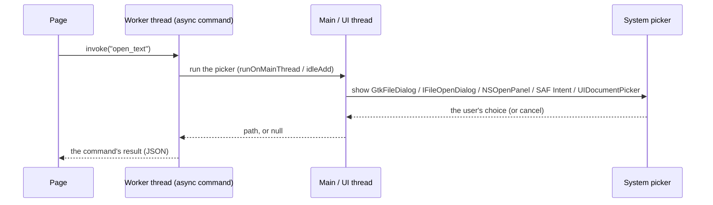
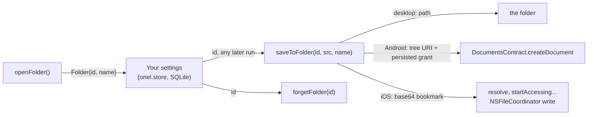

<!-- Generated from site/content/docs/dialogs.smd by tools/docs/gen-md.mjs: edit that file. -->

# Dialogs

The platform's own open, save and folder pickers, called from Zig, with folders the app can keep writing to across restarts.

`oriel.dialog` shows the system's file pickers: open a file, choose where to
save one, and choose a folder the app may keep writing into after a restart
(an app that saves received files where the user said, once). Each picker is
the platform's own: GTK's file dialog on Linux, the common item dialogs on
Windows, `NSOpenPanel` and `NSSavePanel` on macOS, the Storage Access
Framework on Android and the Files picker on iOS.

The pickers are Zig functions that wait for the user. The page reaches them
through your own [commands](commands.md): there is no
`window.oriel.dialog`. A page that only needs the user's files can use a
plain `<input type="file">` instead, which the web view (or, on Android,
Oriel's file chooser) answers without Zig; see [Files](files.md)
for every way a file reaches an app.

## Availability

| Platform | Open, save | Folders with lasting access | Underneath |
|---|---|---|---|
| Linux | yes | yes (the path) | `GtkFileDialog` (the FileChooser portal where there is one) |
| Windows | yes | yes (the path) | COM `IFileOpenDialog` / `IFileSaveDialog`, `FOS_PICKFOLDERS` for folders |
| macOS | yes | yes (the path) | `NSOpenPanel` / `NSSavePanel`, run app-modally |
| Android | yes | yes (a SAF tree URI with a persisted grant) | `ACTION_OPEN_DOCUMENT`, `ACTION_CREATE_DOCUMENT`, `ACTION_OPEN_DOCUMENT_TREE` |
| iOS | yes | yes (a security-scoped bookmark) | `UIDocumentPickerViewController` |

The module is on by default (`.dialog = true` in `b.dependency("oriel", ...)`;
`.dialog = false` leaves it out of the build). It needs no permission on any
platform: the user's choice in the picker is the grant.
`oriel.dialog.available` is `true` wherever the module is built.

## Quick start

```zig
// build.zig: dialog is on by default
const dep = b.dependency("oriel", .{ .target = target, .optimize = optimize });
```

```zig
// src/main.zig
const std = @import("std");
const oriel = @import("oriel");
const app = @import("oriel_app");

pub const Commands = struct {
    // Pickers wait for the user: run them on a worker thread.
    pub const async_commands = .{ "open_text", "save_text" };

    /// The picked file's text, or null when the user cancelled.
    pub fn open_text(gpa: std.mem.Allocator, io: std.Io) !?[]const u8 {
        const path = try oriel.dialog.openFile(gpa, .{
            .title = "Open a note",
            .filter = .{ .name = "Text", .extensions = &.{ "txt", "md" } }, // desktop only
        }) orelse return null;
        defer gpa.free(path);
        return try std.Io.Dir.cwd().readFileAlloc(io, path, gpa, .limited(1 << 20));
    }

    /// Write `text` where the user picks; false when cancelled.
    pub fn save_text(gpa: std.mem.Allocator, io: std.Io, args: struct { text: []const u8 }) !bool {
        const path = try oriel.dialog.saveFile(gpa, .{ .title = "Save the note" }) orelse return false;
        defer gpa.free(path);
        try oriel.dialog.writeFile(io, path, args.text); // not createFile: see Android below
        return true;
    }
};

pub const Events = struct {};

pub fn main(init: std.process.Init) !u8 {
    return oriel.main(init, .{ .commands = Commands, .events = Events }, .{
        .app = app.build,
        .window = .{ .title = "Notes", .width = 800, .height = 600 },
    });
}
```

```js
const { invoke } = window.oriel;
const text = await invoke("open_text", {}); // null: cancelled
if (text !== null) editor.value = text;
await invoke("save_text", { text: editor.value });
```

## How it works



Every picker is shown on the main (UI) thread, because that is the only
thread the toolkit accepts; the calling thread then waits for the answer.
`src/modules/dialog.zig` is the facade, `src/modules/dialog/<platform>.zig`
the backends:

- **Linux** (`dialog/linux.zig`). Called on the thread that owns the GLib
  main context, it runs a nested main loop until the user answers; called
  from a worker, it starts the dialog on the main loop with `g_idle_add`
  and waits on a condition variable. The dialog's parent is the main
  window. GTK uses the desktop portal when there is one, so a Flatpak or a
  KDE session gets its own picker.
- **Windows** (`dialog/windows.zig`) and **macOS** (`dialog/macos.zig`).
  The call is marshalled with `Shell.runOnMainThread` (run directly when
  already on the main thread). Windows creates the COM dialog with
  `FOS_FORCEFILESYSTEM` (file-system paths only), owned by the main window
  when `modal`; macOS brings the app forward and runs the panel with
  `runModal`.
- **Android** (`dialog/android.zig`, `OrielRuntime.kt`). The picker is an
  Activity, so waiting for it on the UI thread would freeze the app: the
  functions return `error.MainThread` there. A content provider hands out
  `content://` URIs, not paths, so `openFile` copies the picked document to
  `<cacheDir>/picked/<display name>` and returns that path, and `saveFile`
  opens the created document for writing (`"rwt"`) and returns
  `/proc/self/fd/<n>`, a descriptor the app keeps for the rest of the run.
  That path can't be reopened (the document's storage isn't the app's),
  which is why `writeFile` exists: it writes through the descriptor.
- **iOS** (`dialog/ios.zig`). The Files picker is presented over the
  frontmost view controller; on the main thread the functions return
  `error.MainThread`. `openFile` asks for a copy (`asCopy`) in the app's
  temporary directory. iOS has no save panel that yields a path, so
  `saveFile` asks for a folder and returns `<folder>/<name>`, keeping the
  folder's security scope open for the rest of the run.

One picker runs at a time on Android and iOS: a second call while one is
open returns `error.DialogBusy`. On the desktop the pickers are modal and
the main thread is busy until one closes.

### Folders with lasting access



`openFolder` returns a `Folder` whose `id` is an opaque string: store it as
is, and hand it back to `saveToFolder`, `folderName` and `forgetFolder` in
this run or any later one. What the id is depends on the platform:

| Platform | `id` | What keeps the access |
|---|---|---|
| Linux, Windows, macOS | the folder's absolute path | nothing: Oriel doesn't sandbox desktop apps, so the user's own access applies (`dialog/path_folder.zig`) |
| Android | the SAF tree URI (`content://<authority>/tree/<id>`) | `takePersistableUriPermission` (read and write), which survives restarts; `forgetFolder` releases it |
| iOS | the base64 of the folder's bookmark, made inside its security scope | the bookmark carries the scope; `saveToFolder` resolves it and works inside `start/stopAccessingSecurityScopedResource` |

`saveToFolder` copies a file of the app's into the folder and never
replaces a file there: a taken name becomes `photo (1).jpg`, `photo (2).jpg`,
and so on. On the desktop and iOS Oriel numbers the name itself (creating
each candidate exclusively, up to 9999 tries); on Android the document
provider picks the numbered name, and `saveToFolder` returns the name it
got. A failed copy leaves nothing behind. On iOS the copy runs inside an
`NSFileCoordinator` write, so iCloud and provider folders see it; a stale
bookmark (the folder moved or was renamed) still resolves and is refreshed
for the rest of the run, while the id the app stored keeps working.

## Examples

### Save received files into a folder the user chose once

```zig
const std = @import("std");
const oriel = @import("oriel");

pub const Commands = struct {
    pub const async_commands = .{ "choose_save_folder", "save_received" };

    /// Ask for the folder; its display name, or null when cancelled.
    pub fn choose_save_folder(gpa: std.mem.Allocator) !?[]const u8 {
        const folder = try oriel.dialog.openFolder(gpa, .{ .title = "Save received files in…" }) orelse return null;
        if (settings.get("save_dir")) |old| oriel.dialog.forgetFolder(old); // Android counts grants
        try settings.put("save_dir", folder.id);
        return folder.name; // a command's allocator is a per-call arena: nothing to free
    }

    /// Copy a downloaded file in; the name it got ("photo (1).jpg" on a clash).
    pub fn save_received(gpa: std.mem.Allocator, io: std.Io, args: struct { tmp_path: []const u8, name: []const u8 }) ![]const u8 {
        const id = settings.get("save_dir") orelse return error.NoFolder;
        return oriel.dialog.saveToFolder(gpa, io, id, args.tmp_path, args.name, null) catch |err| switch (err) {
            // Revoked, moved away, its drive unplugged: ask again.
            error.FolderUnavailable => error.ChooseFolderAgain,
            else => err,
        };
    }
};
```

`settings` stands for wherever the app keeps its settings
([Store](store.md)). HollerShare (`personal/ghostfile`) saves
every file it receives this way, on every desktop and on Android.

### Show where files go

```zig
pub fn save_folder_label(gpa: std.mem.Allocator, io: std.Io) !?[]const u8 {
    const id = settings.get("save_dir") orelse return null;
    return oriel.dialog.folderName(gpa, io, id) catch |err| switch (err) {
        error.FolderUnavailable => null, // show "choose a folder" instead
        else => err,
    };
}
```

On iOS the name is the one Files shows ("On My iPhone"), on Android the
provider's display name, on the desktop the last path component.

### Open and save a document (showcase)

`examples/showcase/src/main.zig` has `open_file` (reads the start of the
picked file for a preview) and `save_file` (writes the page's text with
`writeFile`), both listed in `async_commands`.

## Reference

### Functions

```zig
pub const available: bool;

pub fn openFile(gpa: std.mem.Allocator, options: OpenOptions) !?[]u8;
pub fn saveFile(gpa: std.mem.Allocator, options: SaveOptions) !?[]u8;
pub fn writeFile(io: std.Io, path: []const u8, data: []const u8) !void;

pub fn openFolder(gpa: std.mem.Allocator, options: FolderOptions) !?Folder;
pub fn folderName(gpa: std.mem.Allocator, io: std.Io, id: []const u8) ![]u8;
pub fn saveToFolder(gpa: std.mem.Allocator, io: std.Io, id: []const u8, src_path: []const u8, name: []const u8, mime: ?[]const u8) ![]u8;
pub fn forgetFolder(id: []const u8) void;

pub fn check(gpa: std.mem.Allocator, ctx: oriel.CheckContext) !oriel.Check;
```

| Function | Returns | Notes |
|---|---|---|
| `openFile` | the picked file's path (caller frees with `gpa`), or `null` when cancelled | Desktop: the file itself. Android: a copy in `<cacheDir>/picked/` (a later pick with the same name overwrites it). iOS: a copy in the app's temporary directory. |
| `saveFile` | a path to write to (caller frees), or `null` when cancelled | Windows and macOS confirm overwriting an existing file; GTK does too. Android: `/proc/self/fd/<n>` for the created document (Android names it "untitled"; the user can rename it in the picker). iOS: `<picked folder>/<name>`, where `name` is `options.title` when it looks like a file name (has a `.`, no `/`, `\` or `:`, doesn't start with `.`), else `Untitled`. |
| `writeFile` | | Writes `data` to a path `saveFile` returned, replacing what was there. On Android, for a `/proc/self/fd/<n>` path it truncates and writes through the descriptor (which stays open, so a second write works too); elsewhere it creates the file. Use it rather than opening the path yourself. |
| `openFolder` | a `Folder` (free with `Folder.deinit(gpa)`), or `null` when cancelled | Lasting access, see [above](#lasting-access). |
| `folderName` | the folder's display name (caller frees) | `error.FolderUnavailable` when the access was revoked, the folder is gone, or `id` isn't one `openFolder` returned. |
| `saveToFolder` | the name the file got (caller frees) | Copies `src_path` (a file the app can read) into folder `id` as `name`, never replacing a file. `mime`: the type to create the document with on Android (`null`: from the extension, via `MimeTypeMap`, else `application/octet-stream`); ignored elsewhere. |
| `forgetFolder` | | Gives up the access: Android releases the persisted grant (grants count against a per-app limit); iOS drops this run's refreshed bookmark; the desktop has nothing to release. The id stops working on Android; elsewhere it is still a path or bookmark, so stop using it. Unknown ids are ignored. |
| `check` | `oriel.Check{ .module = "dialog", ... }` | The module's smoke check (run by `oriel.checkAll`): on macOS inside a running app it opens an open panel and aborts it after 0.5 s; elsewhere it checks the picker classes exist. |

### Options

```zig
pub const OpenOptions = struct {
    title: []const u8 = "Open File",
    modal: bool = true,
    filter: ?Filter = null,
};

pub const SaveOptions = struct {
    title: []const u8 = "Save File",
    modal: bool = true,
};

pub const FolderOptions = struct {
    title: []const u8 = "Choose a Folder",
    modal: bool = true,
};

pub const Filter = struct {
    name: []const u8, // "Images"
    extensions: []const []const u8, // &.{ "jpg", "png" }, without the dot
};
pub const max_filter_extensions = 32;
```

| Field | Linux | Windows | macOS | Android | iOS |
|---|---|---|---|---|---|
| `title` | dialog title (at most 255 bytes: longer is `error.NoSpaceLeft`) | dialog title | the panel's title and message (panels have no title bar since macOS 11) | the picker's prompt (`EXTRA_PROMPT`) | ignored (the Files picker has no title), except as `saveFile`'s file name |
| `modal` | `gtk_file_dialog_set_modal`, parent: the main window | owned by the main window when true, unowned when false | ignored: a running panel always blocks the app | ignored | ignored |
| `filter` | the dialog's default filter (suffixes, case-insensitive) | one file type entry, `Name (*.jpg;*.png)` | `allowedFileTypes` | ignored | ignored |

A filter's extensions are 1 to 16 letters or digits each; invalid ones and
any past the 32nd are skipped. A filter with no valid extension shows every
file.

### Folder and its errors

```zig
pub const Folder = struct {
    id: []u8, // opaque: store as is
    name: []u8, // for display ("Downloads")
    pub fn deinit(self: Folder, gpa: std.mem.Allocator) void;
};

pub const FolderError = error{
    FolderUnavailable, // revoked, removed, its volume gone, or not an id openFolder returned
    InvalidName, // a separator, empty, ".", "..", or (Windows) a name Win32 can't open
    Unsupported, // reserved: every platform has a folder picker now
};
```

`saveToFolder`'s `name` must be a plain file name of at most 255 bytes: no
`/`, `\` or NUL, not `.` or `..` (the same rule on every OS, so a name
means the same everywhere). On Windows it also refuses names that Win32
programs (Explorer included) could neither open nor delete afterwards:
device names (`CON`, `PRN`, `AUX`, `NUL`, `COM1`..`COM9`, `LPT0`..`LPT9`,
`CONIN$`, `CONOUT$`, with or without an extension: `nul.txt`), a trailing
dot or space, `<>:"|?*` and control characters. Name clashes there are
case-insensitive (`PHOTO.JPG` is taken by `photo.jpg`).

### Errors

| Error | From | When |
|---|---|---|
| `error.MainThread` | Android, iOS | called on the UI thread: use an async command |
| `error.DialogBusy` | Android, iOS | another picker is open |
| `error.DialogFailed` | Android, iOS | the picker could not be shown (no Activity or view controller in front yet) |
| `error.FolderFailed` | Android | the provider failed (logged as `cannot keep access to the picked folder` or `cannot save into the folder`) |
| `error.FolderUnavailable`, `error.InvalidName` | every platform | see above |
| `error.FileNotFound` | `saveToFolder` | `src_path` doesn't exist |
| `error.PathAlreadyExists` | `saveToFolder`, desktop and iOS | 9999 numbered names were all taken |
| `error.DialogCreateFailed`, `error.DialogShowFailed`, `error.DialogGetResultFailed`, `error.DialogSetTitleFailed`, `error.DialogSetOptionsFailed`, `error.DialogGetOptionsFailed`, `error.DialogSetFileTypesFailed`, `error.DialogGetDisplayNameFailed` | Windows (the first and third also macOS) | the COM dialog or panel failed |
| `error.AppNotRunning` | Windows, macOS | called before the app's main loop exists |

Cancelling is never an error: the functions return `null`.

### Threads

Call the pickers from an [async command](commands.md) (listed
in `async_commands`) or another worker thread. On Linux, Windows and macOS
they also work on the main thread (a nested loop or the modal panel's own
loop runs meanwhile); on Android and iOS they return `error.MainThread`
there. `folderName`, `saveToFolder` and `forgetFolder` work on any thread;
on Android they run on Kotlin threads and only wait, so prefer a worker
(a cloud provider can be slow).

### Migrating from 0.11

Nothing changed in `oriel.dialog` for 0.12.

## Troubleshooting

- **`error.MainThread` on Android or iOS.** The command isn't in
  `async_commands`; add it.
- **Writing the saved file fails on Android** (`AccessDenied` or
  `FileNotFound` on `/proc/self/fd/...`). Write it with
  `oriel.dialog.writeFile`, not `createFile`.
- **`saveToFolder` returns `error.FolderUnavailable` after a reinstall or a
  while.** The user revoked the access in the system settings, removed the
  folder or unplugged its drive, or (Android) the app was reinstalled,
  which drops its grants. Ask again with `openFolder`.
- **The filter does nothing on a phone.** Android's and iOS's pickers
  ignore it; check the picked file's extension yourself.
- **The panel opens behind other apps on macOS.** It shouldn't: Oriel
  activates the app first. If the main thread is blocked in a synchronous
  command, the panel can't run: use an async command.

## Related

- [Files](files.md): every way a file reaches the app or
  the page (dropped, picked, shared) and what crosses to the page.
- [Commands](commands.md): async commands, which the
  pickers need.
- [Store](store.md): where to keep a folder id.
- [Share](share.md): files other apps send, and the share
  sheet.
- [Camera](camera.md): photos from the camera or the photo
  library, and image `<input type="file">` on Android.
