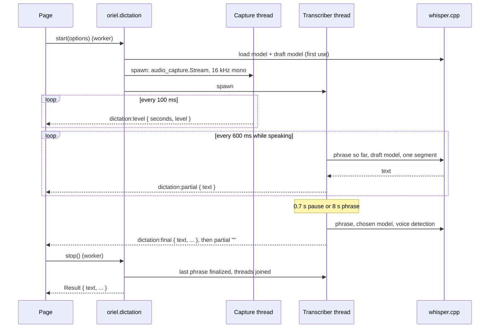

<!-- Generated from site/content/docs/dictation.smd by tools/docs/gen-md.mjs: edit that file. -->

# Dictation

Voice to text with oriel.dictation: live dictation from the microphone or system audio and transcription of recordings, on whisper.cpp or the platform's own recognizer.

`oriel.dictation` turns speech into text, with the tuning done: live
dictation from the microphone (or, on the desktop, from what the computer
plays, for captions), and transcription of recordings. It runs whisper.cpp
offline on every platform, with a model catalog and downloads, voice
detection, a fast draft model for the live text and the CPU or the GPU per
device, or the platform's own recognizer (Android's SpeechRecognizer,
Apple's Speech framework) with nothing to download.

The page gets the phrase being spoken as it is heard
(`dictation:partial`), each finished phrase (`dictation:final`) and the
input level. Its building blocks, `oriel.whisper` and `oriel.audio_capture`,
are public for pipelines of your own; `audio_capture` is documented here,
`whisper` in [Local AI](local-ai.md#whisper-api).

## Availability

| Platform | whisper engine | System engine (`.system`) | `.auto` picks | Audio sources |
|---|---|---|---|---|
| Linux | yes (CUDA, Vulkan) | no | whisper | microphones and system audio (PulseAudio or PipeWire monitor sources) |
| Windows | yes (Vulkan) | no | whisper | microphones and system audio (WASAPI loopback of each output) |
| macOS | yes (Metal) | Apple Speech (`SFSpeechRecognizer`) | whisper | microphones; "System audio (all apps)" on macOS 14.2+ (a Core Audio process tap); loopback devices such as BlackHole |
| Android | yes (Vulkan, OpenCL, Hexagon) | SpeechRecognizer (Google's on-device model on a Pixel, the maker's service elsewhere) | system, when it runs on the device (API 31+) | microphones (AAudio) |
| iOS | yes (Metal) | Apple Speech (`SFSpeechRecognizer`) | system, when it runs on the device | microphones (AVAudioSession) |

- **Build:** `.whisper = true` and `.audio_capture = true` (both off by
  default). Linux builds link `libpulse` (install its development package).
  `oriel.audio_capture` alone is `.audio_capture = true`.
- **Permissions:** `.permissions.microphone` (and, for macOS's system-audio
  tap, `.system_audio`). With `audio_capture` on, Oriel declares both with an
  empty purpose string if you don't; declare them yourself to give the
  reason the OS shows. Ask with `oriel.permissions.request(.microphone)`
  before `start` ([Permissions](permissions.md)). On iOS and
  macOS the system engine also needs speech-recognition authorization, asked
  on the first `start`; Oriel writes `NSSpeechRecognitionUsageDescription`
  with the microphone's text.
- **Background:** Android keeps capturing behind a foreground service of
  type `microphone` (`oriel.android.setForegroundService`); iOS needs
  `.ios = .{ .background_audio = true }`.

## Quick start

`build.zig`:

```zig
const dep = b.dependency("oriel", .{
    .target = target,
    .optimize = optimize,
    .whisper = true,
    .audio_capture = true,
});
_ = oriel.addApp(b, dep, .{
    .name = "my-app",
    .root_source_file = b.path("src/main.zig"),
    .permissions = .{ .microphone = "Dictation turns what you say into text, on this device." },
});
```

`src/main.zig`:

```zig
const std = @import("std");
const oriel = @import("oriel");
const app = @import("oriel_app");
const dictation = oriel.dictation;

pub const Events = struct {
    @"dictation:download": @FieldType(dictation.Events, "dictation:download"),
    @"dictation:level": @FieldType(dictation.Events, "dictation:level"),
    @"dictation:partial": dictation.Partial,
    @"dictation:final": dictation.Final,
    @"dictation:error": @FieldType(dictation.Events, "dictation:error"),
    @"dictation:ended": @FieldType(dictation.Events, "dictation:ended"),
};

pub const Commands = struct {
    pub const async_commands = .{ "dictation_download", "dictation_start", "dictation_stop" };

    pub fn dictation_download(_: std.mem.Allocator, args: struct { model: []const u8 }) !void {
        try dictation.download(args.model);
    }
    pub fn dictation_start(_: std.mem.Allocator, args: dictation.Options) !dictation.Started {
        _ = oriel.permissions.request(.microphone);
        return dictation.start(args);
    }
    pub fn dictation_stop(gpa: std.mem.Allocator) !dictation.Result {
        return dictation.stop(gpa);
    }
};

pub fn main(init: std.process.Init) !u8 {
    const data = try oriel.paths.appData(init.gpa, .{ .name = "MyApp" });
    const models_dir = try std.fs.path.join(init.gpa, &.{ data, "models" });
    dictation.init(init.io, init.gpa, models_dir); // must outlive the app

    return oriel.main(init, .{ .commands = Commands, .events = Events }, .{
        .app = app.build,
        .window = .{ .title = "Dictate", .width = 800, .height = 600 },
    });
}
```

The page:

```js
const { invoke, listen } = window.oriel;

await invoke("dictation_download", { model: "base" }); // whisper, once per device
listen("dictation:partial", ({ text }) => { live.textContent = text; });
listen("dictation:final", ({ text }) => { done.textContent += text + " "; });

await invoke("dictation_start", { language: "auto" });
// ... later
const r = await invoke("dictation_stop");
console.log(r.text); // everything said
```

## How it works



**The whisper engine** (`src/modules/dictation.zig`) runs two threads of its
own, outside the command pool:

- The **capture thread** opens an `audio_capture.Stream` on
  `Options.source` (the default microphone when null) at 16 kHz, appends
  100 ms blocks to the recording and emits `dictation:level`. Recordings stop
  at 5 minutes.
- The **transcriber thread** wakes every 600 ms. While the current phrase
  has new audio, it transcribes the phrase so far with the **draft** model
  (the next smaller model on the device, several times faster: base under
  small, tiny under base), as one segment, and emits `dictation:partial`. A
  slow device updates less often rather than falling behind: the next update
  waits for at least as much new audio as the last one took to transcribe.
  After 0.7 s of quiet, or 8 s of phrase, it transcribes the phrase with the
  chosen model and voice detection, appends it to the session's text and
  emits `dictation:final`, then `dictation:partial` with `""`.
- With `.vad` (the default), a phrase without speech never reaches whisper,
  and finals go through Silero voice detection (built into Oriel, written
  next to the models as `ggml-silero-v6.2.0.bin`), so there is no made-up
  "Thank you." over noise. Whisper's window is sized to the clip
  (`whisper.audioCtxFor`) instead of its fixed 30 s.
- `stop` ends the capture, finalizes the rest (if it is at least 0.25 s and,
  with `.vad`, has speech), joins both threads and returns everything said.

**Models.** `.model = "auto"` is the largest catalog model on the device.
Models load on `start` (or `transcribeFile`) and stay loaded; a model
freshly loaded on the GPU gets one untimed pass of 2 s of quiet noise first
(Vulkan builds its pipelines on first use, which once cost a Pixel's first
live update 11 s).

**CPU or GPU.** `.backend = .auto` uses what `compare()` measured for the
model on this device (saved in `backends.txt` in the models directory);
until then the GPU on desktops and the CPU on phones (ggml's ARM kernels
beat many mobile GPU drivers). The draft model makes its own choice: on a
Pixel's Mali-G715, small ran faster on the GPU and base on the CPU. On
phones the GPU must be 1.3 times faster to be picked: phone CPUs vary with
heat (2.5 s cool, 6.8 s warm on the same clip).

**The system engine.** On Android, `src/modules/dictation/android.zig`
drives `OrielSpeech.kt`: SpeechRecognizer opens the microphone itself and
streams partial results about once a second; Android ends recognition after
each utterance, and Oriel restarts it until `stop`. A missing language pack
is requested from Android. On iOS and macOS, `src/modules/dictation/apple.zig`
feeds an `AVAudioEngine` input tap to `SFSpeechRecognizer`, on the device
where the language's model is installed, else Apple's servers
(`Final.on_device` is then false). Apple's recognizer doesn't end utterances
and stops a task after about a minute, so each phrase is its own task: after
a pause (or 50 s) its final result becomes `dictation:final` and a new task
takes the audio that follows. Both emit the same events as whisper
(`backend` "Android" or "Apple"); when the recognizer fails, listening stops
with `dictation:error` and `dictation:ended`.

**Shutdown and memory.** `oriel.main` calls `deinit` after its command pool
drains: it joins the threads and frees the models. On Android, the system
recognizer is cancelled at the `terminating` lifecycle event, while the UI
thread still runs. `unload_on` (critical memory pressure by default) frees
the models when not listening; the last recording stays for `compare`
([Local AI](local-ai.md#how-it-works)).

**Testing without a microphone.** While a `test.wav` is in the models
directory, it replaces the microphone (played at real-time pace, then
silence), for the whisper engine and Apple's; an emulator has no
microphone. Remove it for real use.

## Examples

### A dictate button

```js
const { invoke, listen } = window.oriel;
let on = false;
listen("dictation:level", ({ level }) => { meter.value = level; });
listen("dictation:partial", ({ text }) => { draft.textContent = text; });
listen("dictation:final", ({ text }) => { field.value += (field.value ? " " : "") + text; });
listen("dictation:error", ({ message }) => { status.textContent = message; on = false; });

mic.onclick = async () => {
  if (!on) {
    const s = await invoke("dictation_start", { engine: "auto", language: "auto" });
    status.textContent = `${s.model} on ${s.backend}` + (s.draft ? `, live text from ${s.draft}` : "");
  } else {
    await invoke("dictation_stop");
  }
  on = !on;
};
```

`examples/showcase`'s Dictate tab adds a model picker, downloads, Compare
and file transcription; its Chat tab dictates the message.

### Transcribe a file

```zig
pub fn transcribe_file(gpa: std.mem.Allocator, args: struct { path: []const u8 }) !oriel.dictation.Transcript {
    return oriel.dictation.transcribeFile(gpa, args.path, .{ .language = "de" });
}
```

`transcribeFile` reads WAV (8, 16, 24 or 32-bit PCM, or 32-bit float, any
channel count, rates from 4 kHz), mixed down to mono and resampled to
16 kHz. For MP3, Opus or a video's audio, decode it yourself to 16 kHz mono
`f32` and call `transcribeSamples`.

### Captions of what the computer plays

```zig
const sources = try oriel.audio_capture.listSources(gpa);
defer oriel.audio_capture.freeSources(gpa, sources);
for (sources) |s| if (s.monitor) {
    _ = try oriel.dictation.start(.{ .engine = .whisper, .source = s.name });
    break;
};
```

Monitor sources exist on Linux, Windows and macOS. On Windows, loopback of
an idle output delivers silence, so the stream never blocks.

### Dictate into other apps

`examples/showcase/src/anywhere.zig` dictates into whatever app has focus.
On the desktop a system-wide hotkey ([Global shortcuts](global-shortcuts.md))
or the tray menu toggles `start`/`stop`, and the text goes to the focused
app through the clipboard and a paste ([Clipboard](clipboard.md),
[Input](input.md)). On Android the entry points are a Quick
Settings tile (`.android.tile`), the Oriel keyboard (`.android.input_method`),
the headset button and the foreground service's notification action, all
arriving at `oriel.android.onSystemEvent` (`"tile"`, `"ime-mic"`,
`"media-button"`, `"action"`); the text is typed with
`oriel.android.commitText` when the Oriel keyboard is active
([Android](android.md)):

```zig
var listening = false; // touched by one worker at a time in this sketch

// In main, before oriel.main: if (oriel.target.is_android) oriel.android.onSystemEvent(onSystemEvent);
fn onSystemEvent(name: []const u8, _: []const u8) void { // main thread
    if (std.mem.eql(u8, name, "tile") or std.mem.eql(u8, name, "ime-mic"))
        oriel.App.spawn(toggle, .{}) catch {};
}

fn toggle() void { // a worker: start and stop block
    if (!listening) {
        oriel.android.setForegroundService(true, "Listening", "Tap Stop to insert the text", &.{
            .{ .id = "stop", .label = "Stop" },
        }) catch {};
        _ = oriel.dictation.start(.{}) catch return;
        oriel.android.setTile(true, "Listening…");
    } else {
        var arena: std.heap.ArenaAllocator = .init(std.heap.smp_allocator);
        defer arena.deinit();
        const r = oriel.dictation.stop(arena.allocator()) catch return;
        oriel.android.commitText(r.text) catch {}; // error.NoKeyboard under another keyboard
        oriel.android.setForegroundService(false, "", "", &.{}) catch {};
        oriel.android.setTile(false, "Dictate anywhere");
    }
    listening = !listening;
}
```

### Your own pipeline

```zig
var stream = try oriel.audio_capture.Stream.open(null, "My App", oriel.whisper.sample_rate);
defer stream.close();
var buf: [16000]f32 = undefined; // 1 s
try stream.read(&buf); // blocks until full
const text = try ctx.transcribe(gpa, &buf, .{ .audio_ctx = oriel.whisper.audioCtxFor(buf.len) });
```

## Reference

### Functions

| Function | Thread | Meaning |
|---|---|---|
| `init(io, gpa, dir: []const u8) void` | any, once, before anything else | Where the models live (created when needed); `dir` must outlive the app. Silences whisper's logging, subscribes to `oriel.lifecycle`, deletes the q5_1 and f16 files Oriel 0.9 downloaded. |
| `start(opts: Options) !Started` | worker | Start listening; blocks while models load. |
| `stop(a) !Result` | worker | Stop, finalize the last phrase, return the session's text (allocated with `a`). |
| `transcribeFile(a, path, opts) !Transcript` | worker | Transcribe a WAV file with whisper (up to 1 GiB; see `wav`). |
| `transcribeSamples(a, audio: []const f32, opts) !Transcript` | worker | Transcribe 16 kHz mono samples with the chosen model (not the draft); voice detection per `opts.vad`. |
| `compare(a, opts) !Comparison` | worker | Up to 8 s of the last whisper recording, from shortly before the speech, on the GPU (after a warm-up) and then the CPU; emits `dictation:compare` per run; remembers the winner. |
| `status() Status` | worker | Models, engines, backend, what is loaded. Loads the GPU backend the first time. |
| `download(name) !void` | worker | Fetch a whisper model from `huggingface.co/ggerganov/whisper.cpp`, emitting `dictation:download`. |
| `delete(name) !void` | worker | Remove a model (unloading it), and a half-finished download. |
| `findModel(name) ?*const Model` | any | A catalog entry, or null. |
| `modelPresent(m) bool` | any after `init` | The model's file is complete. |
| `unloadIdle() void` | any (main included) | Free the models now unless listening or busy; returns at once. |
| `deinit() void` | after commands finished | Join the threads, free models and buffers. `oriel.main` calls it; safe twice or without `init`. |

| Variable | Meaning |
|---|---|
| `available: bool` | `true` with `.whisper` and `.audio_capture`. |
| `unload_on: oriel.lifecycle.UnloadOn` | When the models are freed by themselves; default critical memory pressure. |
| `models: [3]Model` | The catalog (below). |
| `wav` | The WAV decoder: `decode(gpa, data, rate) Error![]f32` (mono at `rate`), `resample(gpa, in, from, to) Error![]f32`; `Error = { NotWav, BadWav, UnsupportedWav, OutOfMemory }`. |

### Models

| Name | File | Size |
|---|---|---|
| `tiny` | `ggml-tiny-q8_0.bin` | 42 MB |
| `base` | `ggml-base-q8_0.bin` | 78 MB |
| `small` | `ggml-small-q8_0.bin` | 252 MB |

Multilingual (about 99 languages), q8_0: ggml repacks it for ARM's dotprod
and i8mm kernels, and it keeps whisper's accuracy. Where whisper can listen
(`Options.source`) is `oriel.audio_capture.listSources`
([below](#audio-capture)).

### Types

```zig
pub const Engine = enum { auto, whisper, system };
pub const Backend = enum { auto, cpu, gpu };
pub const Model = struct { name: []const u8, file: []const u8, mb: u32 };
```

`Options`:

| Field | Type | Default | Meaning |
|---|---|---|---|
| `engine` | `Engine` | `.auto` | `.auto`: the system engine on Android and iOS when it runs on the device, else whisper. `.system` where there is none: `error.EngineUnavailable`. |
| `model` | `[]const u8` | `"auto"` | Whisper: a model name; `"auto"`: the largest on the device. |
| `language` | `[]const u8` | `"auto"` | `"en"`, `"de"`...; the system engine also takes BCP 47 tags (`"de-DE"`). Up to 15 bytes are kept for a session. |
| `vad` | `bool` | `true` | Skip silence (see How it works). |
| `backend` | `Backend` | `.auto` | Whisper's CPU or GPU. |
| `draft` | `bool` | `true` | Live text from the next smaller model on the device. |
| `source` | `?[]const u8` | `null` | Whisper: an `audio_capture` source name; null: the default microphone. Up to 511 bytes (`error.NameTooLong`). |

`Started`: `{ engine, model, draft: ?[]const u8, backend, load_ms: u64 }`
(the system engine reports its name, `"Android"` or `"Apple"`, as model and
backend).

`Result` (from `stop`): `{ engine, model, backend, audio_s: f32, text,
draft: ?[]const u8, updates: u32, mean_ms: u64, last_ms: u64 }`: everything
said, the live updates and their mean time, and the last final's time (the
wait after stop).

`Transcript`: `{ text, model, backend, audio_s: f32, transcribe_ms: u64 }`.

`Comparison`: `{ model, audio_s, vad, gpu: ?Run, cpu: Run, faster }`, with
`Run = { text, backend, transcribe_ms }`; the runs' `text` is allocated with
`compare`'s allocator.

`Status`:

| Field | Meaning |
|---|---|
| `backend`, `gpu` | The GPU backend (`"Vulkan"`, `"OpenCL"`, `"Hexagon"` on Android, `"GPU"` elsewhere) or `"CPU"`, and the GPU's name. |
| `system`, `system_on_device: bool` | A platform recognizer is installed; it runs on the device. |
| `auto_engine: Engine` | What `.auto` picks now. |
| `models_dir` | |
| `models: [3]ModelStatus` | `{ name, file, mb, present, faster: ?[]const u8 }`. |
| `loaded`, `downloading: ?[]const u8` | |
| `recording: bool` | Listening (either engine). |

### Events

`oriel.dictation.Events` has the payload types for your `Events` struct.

| Event | Payload | When |
|---|---|---|
| `dictation:level` | `{ seconds, level }` (level 0 to 1) | About 10 times a second while listening. |
| `dictation:partial` | `Partial { text }` | The phrase so far; `""` once it was finalized. |
| `dictation:final` | `Final { text, audio_s, transcribe_ms, backend, on_device }` | A finished phrase. `on_device` is false when Apple's servers did it. |
| `dictation:download` | `{ model, done_mb, total_mb }` | Each megabyte of a download. |
| `dictation:compare` | `{ backend, transcribe_ms }` | Each run of `compare`. |
| `dictation:error` | `{ message }` | The recognizer or the microphone failed (`"MicrophoneUnavailable"`, `"LanguageUnavailable"`...); listening stops. |
| `dictation:ended` | `{ engine }` | Listening stopped on its own (the system engine after an error). |

### Errors

| Error | Meaning |
|---|---|
| `NotInitialized` | `init` wasn't called (or `deinit` ran). |
| `EngineUnavailable` | `.system` on a platform without a recognizer, or none installed. |
| `AlreadyRecording` | A session is running. |
| `UnknownModel`, `NoModel`, `ModelNotFound`, `CpuUnsupported` | Not in the catalog; nothing downloaded; unreadable file; CPU lacks `ggml_arm`'s extensions. |
| `Recording` | `delete`, `compare`, `transcribe*` while listening. |
| `NothingRecorded` | `compare` with under 0.5 s recorded; empty samples. |
| `NameTooLong` | `source` over 511 bytes. |
| `AlreadyDownloading`, `Downloading` | One download at a time; deleting the model being downloaded. |
| `NotWav`, `BadWav`, `UnsupportedWav` | `transcribeFile`'s decoder. |
| `TranscribeFailed`, `AudioTooLong` | whisper.cpp failed. |

### `oriel.audio_capture`

Mono `f32` samples at the rate you ask for, from a microphone or system
audio. `src/modules/audio_capture.zig`, one backend per platform in
`src/modules/audio_capture/`.

```zig
pub const Source = struct {
    name: [:0]const u8, // the id to open
    description: []const u8, // "Built-in Audio Analog Stereo"
    monitor: bool, // system audio, not a microphone
};
pub fn listSources(gpa) ![]Source; // free with freeSources(gpa, list)
pub fn freeSources(gpa, sources: []Source) void;
pub const Stream = struct {
    pub fn open(source: ?[:0]const u8, app_name: [:0]const u8, rate: u32) !Stream; // null: default input
    pub fn read(self: *Stream, samples: []f32) !void; // blocks until `samples` is full
    pub fn close(self: *Stream) void;
};
pub fn check(gpa, ctx) !oriel.Check;
pub const available: bool;
```

`read` and `close` belong to the thread that opened the stream.

| Platform | Backend | Source names | Notes |
|---|---|---|---|
| Linux | libpulse (PipeWire through pipewire-pulse) | the sound server's source names; monitors last | The server resamples and downmixes. `app_name` shows in the sound settings. |
| Windows | WASAPI shared mode | endpoint ids; system audio as `loopback:<render endpoint id>` | Downmixed and resampled linearly; idle loopback is filled with silence. |
| macOS | CoreAudio + AudioQueue | device UIDs; "System audio (all apps)" (macOS 14.2+, process tap: macOS asks once for System Audio Recording); loopback devices as monitors | A denied microphone records silence, so `open` returns `error.MicrophonePermissionDenied`; the first `open` shows the prompt. `microphonePermission()` reports it. |
| Android | AAudio | `"default"`, `"device:<id>"` | Resampled when the device can't open at the rate. Other apps' audio isn't a source. |
| iOS | AVAudioSession + AudioQueue | `"default"`, then the session's inputs by port UID | `open` sets the session to play-and-record (mixing, speaker and Bluetooth allowed). `error.MicrophonePermissionDenied`, `microphonePermission()`. |

### Migrating from 0.11

- `dictation.sources(a)` is gone: call `oriel.audio_capture.listSources(a)`.
- `find(name) !*const Model` and `present(m)` are
  `findModel(name) ?*const Model` and `modelPresent(m)`, as in `oriel.chat`
  and `oriel.tts`.
- The six `legacy` catalog entries (`tiny-q5_1` ... `small-f16`) and
  `Model.legacy` / `ModelStatus.legacy` are gone: `init` deletes those files.

## Troubleshooting

- **`NoModel`.** Download one (`download("base")`) or copy the file, named as
  in the catalog, into the models directory.
- **`dictation:error` `MicrophoneUnavailable`.** The microphone couldn't be
  opened: permission not granted (request it first), or no input device.
- **Silence becomes "Thank you." or repeated sentences.** Keep `.vad` on.
- **Live text lags behind speech on a phone.** Download a smaller model as
  the draft (tiny under base), or run `compare`.
- **The system engine reports `LanguageUnavailable`.** Android is
  downloading the language pack, or the recognizer lacks the language; use
  whisper for it.
- **Nothing is heard on an emulator.** Put a `test.wav` in the models
  directory.
- **Android stops listening in the background.** Turn on the foreground
  service before `start`.

## Related

- [Local AI](local-ai.md): whisper.cpp, GPU backends, downloads and memory.
- [Chat](chat.md) and [Text to speech](tts.md): what to do with the text, and voice out.
- [Permissions](permissions.md): the microphone and system audio.
- [Android](android.md): the tile, the keyboard, the foreground service.
