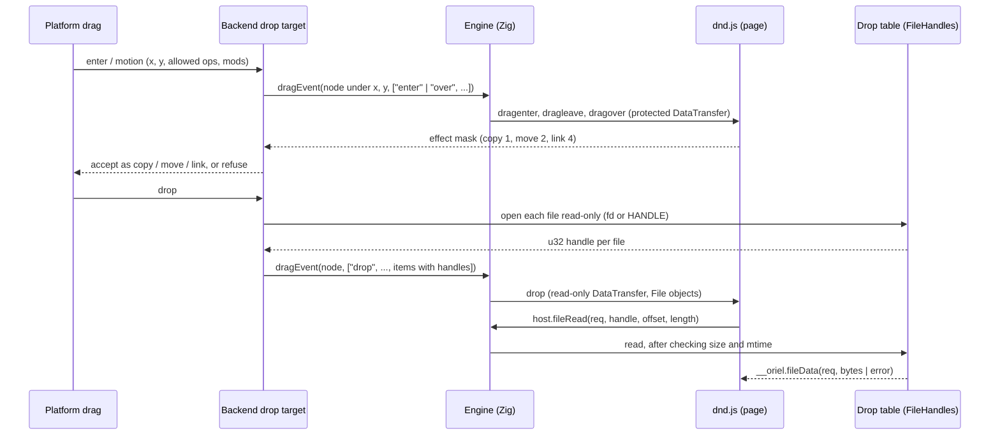

<!-- Generated from site/content/docs/drag-and-drop.smd by tools/docs/gen-md.mjs: edit that file. -->

# Drag and drop

Files, text and links dragged from other apps into the page, with the browser's DragEvent, DataTransfer and File API, in both renderers.

A user drags a file from the file manager, a block of text from an editor
or a link from a browser onto the app's window, and the page gets the same
events a browser page gets: `dragenter`, `dragover`, `dragleave` and `drop`,
with a `DataTransfer` holding the text and the dropped files as `File`
objects. There is nothing to turn on and no Oriel API to learn: write the
drop zone as for the web.

In the web view, the system's web view handles drops itself. In the
[native renderer](native-renderer.md), Oriel implements the
same API: each platform's drop target feeds the page, and dropped files are
opened read-only when they land, so the page reads their bytes without ever
seeing a path.

This page covers drops **into** the page. To let the user pick files with a
dialog, use [Dialogs](dialogs.md); for files other apps
share with yours, [Share](share.md).

## Availability

| | Linux | Windows | macOS | iOS | Android |
|---|---|---|---|---|---|
| Web view: drops into the page | WebKitGTK | WebView2 | WKWebView | WKWebView (iPad; in-app on iPhone) | Android WebView |
| Native renderer: drops into the page | `GtkDropTargetAsync` | OLE `IDropTarget` | `NSDraggingDestination` | `UIDropInteraction` (iPad; in-app on iPhone) | `View.onDragEvent` |
| Native renderer: files | Files with a local path | Yes | Yes (while the drag's sandbox grant holds) | Yes, by data type (Photos images too) | `content://` URIs, with the drag's permissions |
| Native renderer: `oriel.drop.path` | Yes | Yes | Yes | While iOS keeps the file | When the URI is a file |

No build flag and no permission. Not available in either renderer's
Oriel-specific part, on any platform:

- **Drags out of the page** to other apps, and in-page HTML5 drag and drop
  (`draggable`, `dragstart`, `drag`, `dragend`) in the native renderer.
  The web view's own engine handles in-page dragging.
- **Folders.** The native renderer skips directories; files only.
- **Virtual files** (Outlook attachments, macOS file promises from Photos
  or Mail on the desktop) and Linux files without a local path (gvfs).
- `webkitGetAsEntry()`, Blob URLs (`URL.createObjectURL`) and
  `<input type=file>` in the native renderer.

## Quick start

The same page works in both renderers:

```
<div id="zone">Drop files or text here</div>
<ul id="out"></ul>
```

```js
const zone = document.querySelector("#zone");
const out = document.querySelector("#out");

// Taking dragover (preventDefault) is what makes the zone accept a drop.
zone.addEventListener("dragover", (e) => {
  e.preventDefault();
  e.dataTransfer.dropEffect = "copy";
  zone.classList.add("over");
});
zone.addEventListener("dragleave", () => zone.classList.remove("over"));

zone.addEventListener("drop", async (e) => {
  e.preventDefault();
  zone.classList.remove("over");
  for (const file of e.dataTransfer.files) {
    const li = document.createElement("li");
    li.textContent = `${file.name} (${file.type || "unknown"}, ${file.size} bytes)`;
    out.append(li);
    if (file.type.startsWith("text/")) console.log(await file.text());
  }
  const text = e.dataTransfer.getData("text/plain");
  if (text && e.dataTransfer.files.length === 0) out.append(Object.assign(document.createElement("li"), { textContent: text }));
});
```

## How it works



**Web view.** WebKitGTK, WebView2, WKWebView and the Android WebView run the
HTML drag-and-drop model themselves; Oriel adds one guard to every web view
bridge (`drop_guard_js` in `src/core/security.zig`): a file dropped on a
text field the page didn't handle would be inserted as the file's absolute
path, so the guard cancels only that default action. The page still gets
every event, and a page that handles the drop is unaffected. A file dropped
where nothing handles it would make the web view navigate to its `file:`
URL, which Oriel's navigation policy blocks.

**Native renderer, the drag.** Each backend registers a drop target on the
page's view (`gtk.zig`, `win32.zig`, `appkit.zig`, `uikit.zig`,
`android.zig` with `OrielNative.kt`). As the drag enters and moves, the
backend hit-tests the node under the pointer and sends the engine a
`"drag"` event (`Engine.dragEvent` in `src/native_ui/engine.zig`) with the
point in CSS px, the operations the source allows, the one the system
suggests (from the modifier keys), the modifiers, a per-drag session number
and, on enter, the kinds and types of the items. The runtime
(`src/native_ui/js/src/dnd.js`) follows the HTML spec's processing model:
`dragenter` on the new target, `dragleave` on the old, then `dragover`,
each bubbling to `document` and `window`. The page's answer is its last
`dragover`: if it called `preventDefault()`, the effect is its
`dropEffect` (when the source allows it); if not, a text field or
`contenteditable` accepts the drag, anything else refuses it. The backend
hands that effect to the system, which shows the matching cursor.

**Native renderer, the drop.** The backend reads the drag's data, opens each
dropped file read-only and puts the descriptor into the engine's drop table
(`src/native_ui/drop.zig`, which is `src/core/file_handles.zig`, shared with
received shares): the page gets a `u32` handle, the file's name, MIME type,
size and modification time, never its path. Then `drop` fires on the target
with a read-only `DataTransfer`. If the page doesn't cancel `drop` and the
target is a text field, the text goes in as a native edit: the field takes
the focus, `beforeinput` and `input` fire with `inputType`
`insertFromDrop`. The platforms' own text fields don't take drops
themselves (Oriel removes their drop targets), so the page always sees the
drag first.

**Reading a file.** `file.text()`, `arrayBuffer()`, `bytes()`, `slice()` and
`FileReader` read through `host.fileRead`, which the engine queues for its
next turn on the UI thread and answers with `__oriel.fileData`. Reads are
always asynchronous, at most 64 MiB a call (larger blobs read in pieces).
Every read checks the file's size and modification time against the drop's:
a file changed since it was dropped reads as `NotReadableError`, as in
browsers. The descriptor goes back when no `File` (or slice of it) is
reachable any more (a `FinalizationRegistry`), and all of them close with
the window.

**When the drop is decided.** On Windows and macOS the data is there at drop
time, so the page's `drop` handler decides the result (its `dropEffect`, or
none). On Linux, iOS and Android the data arrives after the system has
asked for an answer, so the last `dragover`'s effect decides: a page can't
refuse a drop it accepted on the last `dragover`. For copies this makes no
difference.

## Examples

### Import a dropped CSV

```js
const zone = document.querySelector("#import");
zone.addEventListener("dragover", (e) => {
  // Accept only drags that carry files; types are readable during the drag.
  if (e.dataTransfer.types.includes("Files")) e.preventDefault();
});
zone.addEventListener("drop", async (e) => {
  e.preventDefault();
  const file = [...e.dataTransfer.files].find((f) => f.name.endsWith(".csv"));
  if (!file) return;
  try {
    const rows = (await file.text()).split(/\r?\n/).filter(Boolean).map((l) => l.split(","));
    await window.oriel.invoke("import_rows", { rows });
  } catch (err) {
    if (err.name === "NotReadableError") console.error("The file changed or was removed since the drop.");
    else throw err;
  }
});
```

### Show a dropped image

There are no Blob URLs in the native renderer: read the file as a `data:`
URL.

```js
zone.addEventListener("drop", (e) => {
  e.preventDefault();
  const file = e.dataTransfer.files[0];
  if (!file || !file.type.startsWith("image/")) return;
  const reader = new FileReader();
  reader.onload = () => { document.querySelector("#preview").src = reader.result; };
  reader.readAsDataURL(file);
});
```

### Hand a dropped file to Zig by path

Reading a large video through the page is slow; a trusted app can ask where
the file lives and let Zig open it (native renderer):

```js
zone.addEventListener("drop", async (e) => {
  e.preventDefault();
  for (const file of e.dataTransfer.files) {
    const path = await window.oriel.drop.path(file);
    if (path) await window.oriel.invoke("transcode", { path });
    else console.warn(`${file.name}: no path (gone, changed, or not available here)`);
  }
});
```

### Stop stray drops in the web view

A page that has no drop zones can refuse every drop, as Electron apps do:

```js
for (const type of ["dragover", "drop"]) {
  document.addEventListener(type, (e) => e.preventDefault());
}
```

Oriel doesn't inject this itself: a listener registered before the page's
own would break pages that only call `preventDefault()`.

## Reference

### Events

| Event | Target | Cancelable | `DataTransfer` |
|---|---|---|---|
| `dragenter` | The element entered (the body when none) | Yes | Protected |
| `dragover` | The current target, on every move (once per display frame on Android) | Yes: cancel it to accept the drag | Protected |
| `dragleave` | The element left; the target when the drag leaves the window or ends without a drop | No | Protected |
| `drop` | The target, when the last `dragover`'s effect wasn't none (else only `dragleave`) | Yes: cancel it to keep the default text insertion from running | Read-only |

`DragEvent` extends `MouseEvent`: `clientX`, `clientY`, `buttons`,
`shiftKey`, `ctrlKey`, `altKey`, `metaKey`, `relatedTarget`, and
`dataTransfer`. Handler properties (`ondrop`, `ondragover`) and inline
handlers work. `dragstart`, `drag` and `dragend` are never fired in the
native renderer.

### `DataTransfer`

| Member | Meaning |
|---|---|
| `types` | A frozen array: each string item's type, plus `"Files"` when any item is a file. Readable during the drag. |
| `getData(format)` | The string of that type (`"text"` is `text/plain`; `"url"` the first URL of `text/uri-list`); `""` while protected |
| `files` | A `FileList` of the dropped files; empty while protected |
| `items` | A `DataTransferItemList` (`length`, `[i]`, iterable; `add`, `remove`, `clear` on a page's own `DataTransfer`) of `DataTransferItem` (`kind` `"string"` or `"file"`, `type`, `getAsString(callback)`, `getAsFile()`) |
| `dropEffect` | `"none"`, `"copy"`, `"move"` or `"link"`; starts as the system's suggestion, set it in `dragover` |
| `effectAllowed` | What the source allows (`"copy"`, `"copyMove"`, `"all"`, ...); settable only on a page's own `DataTransfer` |
| `setData`, `clearData` | Only on a `new DataTransfer()` the page made |
| `setDragImage()` | Does nothing |

**Modes**, as in the spec: *protected* during `dragenter`, `dragover` and
`dragleave` (types and item kinds only), *read-only* during `drop`, and
*disabled* once its event is over (a kept `DataTransfer` reads nothing).

**What a drag carries.** Plain text as `text/plain`, a link as
`text/uri-list` (and `text/plain`), HTML as `text/html`, files as `File`
items. A drag with files lists only the files: the `file:` URIs or paths the
source also offers are left out, as Chrome does, so a path never reaches the
page that way. At most 4096 items and 16 MiB per string (larger ones are
left out and logged).

### `File`, `Blob`, `FileReader`

| API | Supported |
|---|---|
| `Blob` | `new Blob(parts, { type })` (strings as UTF-8, `ArrayBuffer`s, views, Blobs), `size`, `type`, `slice(start, end, type)`, `text()` (UTF-8), `arrayBuffer()`, `bytes()` |
| `File` | `new File(bits, name, { type, lastModified })`, `name`, `lastModified`, `webkitRelativePath` (`""`); extensible (libraries add `path`). A dropped file also has `handle`, an opaque number for `oriel.drop.path` |
| `FileList` | `length`, `item(i)`, `[i]`, iterable |
| `FileReader` | `readAsText` (UTF-8 only), `readAsArrayBuffer`, `readAsDataURL`, `readAsBinaryString`, `abort`, `readyState`, `result`, `error`; `loadstart`, `progress`, `load`, `error`, `abort`, `loadend` and their `on…` properties |

Errors are `DOMException`s: `NotReadableError` when the file changed or was
removed since the drop or can't be read, `NotFoundError` when its handle is
unknown. `stream()` isn't supported.

### `oriel.drop.path(file)`

```ts
oriel.drop.path(file: File | number): Promise<string | null>
```

Where a dropped file lives now, for a trusted app that hands the file to
Zig (Electron's `webUtils.getPathForFile` is the precedent). Only the native
renderer's dropped files have a handle; in the web view it answers `null`.

- **Argument.** A `File` from a `drop`, or its `handle`. Anything else
  (a web view's `File`) answers `null`.
- **Answer.** The path, or `null` when the handle is unknown or released,
  the file was deleted or changed since the drop, or the platform has no
  path for it.
- **Platforms.** The path of the descriptor the drop opened: Linux and
  Android (`/proc/self/fd/N`; on Android a `content://` URI whose stream
  isn't a file, or was copied, answers `null`), Windows
  (`GetFinalPathNameByHandleW`), macOS and iOS (`F_GETPATH`; iOS deletes
  its temporary copies, which then answer `null`).
- **Security.** It goes through the bridge's command check
  ([`security.capabilities`](security.md)) as the
  `drop:path` command. The path can only come from a drop the user made
  into this window, and the handle dies with the window.

### Platform details

| Platform | Native renderer |
|---|---|
| Linux | A `GtkDropTargetAsync` on the page's overlay (file lists, `text/plain`, `text/uri-list`, `text/html`); the native fields' own drop targets are removed. Files open by their local path; MIME types guessed by name. |
| Windows | An OLE `IDropTarget` on the page's canvas, with `IDropTargetHelper` so Explorer's drag image keeps drawing; `CF_HDROP`, `CF_UNICODETEXT`, `UniformResourceLocatorW`, `HTML Format` (its fragment). Files open with `CreateFileW` (shared read, write and delete); MIME types from common extensions, then the registry's `Content Type`. The RichEdit fields' own targets are revoked. Windows' UIPI blocks drops from a non-elevated Explorer into an elevated app. |
| macOS | The page's view registers file URLs, strings, URLs and HTML. Files open in `performDragOperation:`, while the drag's sandbox extension holds; MIME types from `UTType`. The source's mask maps Copy to copy, Link to link, Generic and Move to move. The field editors don't take drops. |
| iOS | A `UIDropInteraction` on the page's view. An item with non-text data (an image, a PDF), or named text from Files, is a `File`; Photos images arrive as files; other text is `text/plain`; a link is both `text/uri-list` and `text/plain`. Each file opens in its load's completion handler, before iOS deletes the temporary copy. Move only when the session allows it. |
| Android | `NuiView.onDragEvent`; drags over an `EditText` are forwarded to it. Android gives no source operations or modifiers: every operation is allowed and copy suggested, as Chrome does. Text, HTML and URI lists are strings, any other MIME type a file. On drop, `requestDragAndDropPermissions`, then each `content://` URI is opened on a worker; a stream that can't seek is copied into `cacheDir/oriel-dropped/`, opened and unlinked at once. |

### Migrating from 0.11

- `oriel.drop.path` resolves the path as a string, not `{ path }`, on
  every platform (macOS, iOS and Android rejected it), and `oriel.drop`
  exists in the web view too (answering `null`).

## Troubleshooting

- **The drop never fires.** The page didn't cancel `dragover` on that
  element (or the drop target is a child that didn't): without
  `preventDefault()` in `dragover`, only text fields accept a drag.
- **`files` is empty in `dragover`.** By design: during the drag the
  `DataTransfer` is protected. Check `types.includes("Files")` and read the
  files in `drop`.
- **`file.text()` rejects with `NotReadableError`.** The file was modified,
  moved or deleted after the drop; ask the user to drop it again.
- **A folder dropped does nothing.** Directories are skipped in the native
  renderer.
- **`oriel.drop.path` answers `null`.** The file has no path any more (iOS's
  temporary copies, Android content that isn't a file), or it's a web
  view's `File`; read the file's bytes through the `File` instead.
- **The log says `native ui: a dropped file: …`.** A file couldn't be
  opened (permissions, a device file); it's left out of the drop.

## Related

- [Native renderer](native-renderer.md): the renderer that implements these events without a web view.
- [Native UI reference](native-ui-reference.md#events): every event the native renderer fires.
- [Dialogs](dialogs.md): open and save files with the system's picker.
- [Share](share.md): files other apps send to yours, read the same way.
- [Security](security.md): the navigation policy that blocks `file:` and the command check `drop:path` goes through.
