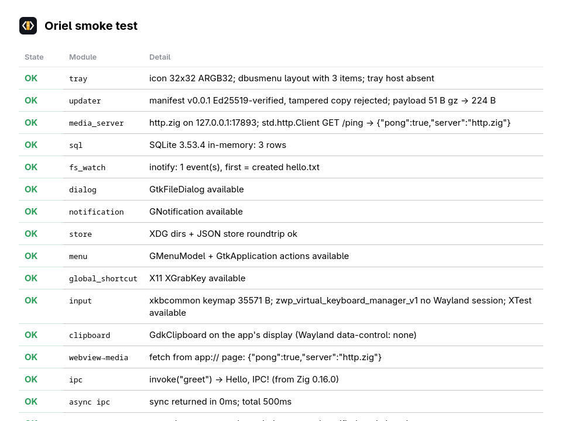
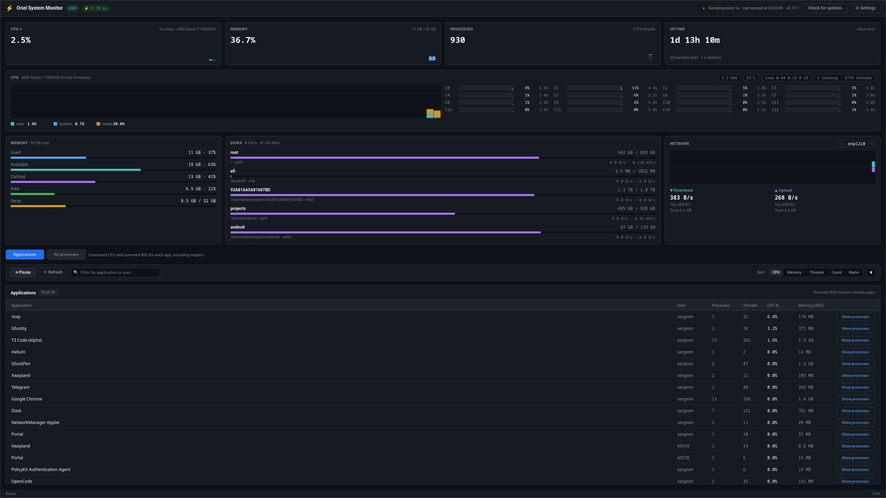
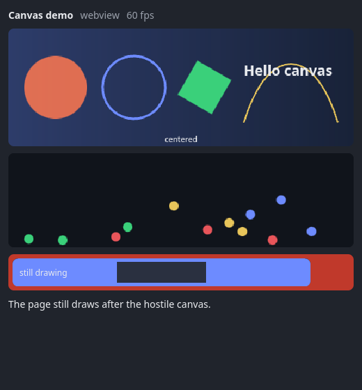
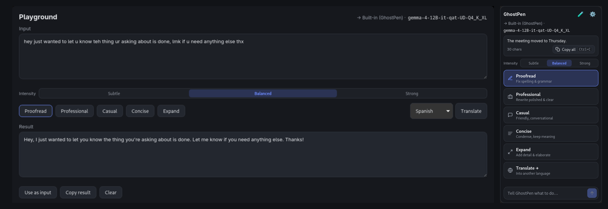

<!-- Generated from site/content/docs/examples.smd by tools/docs/gen-md.mjs: edit that file. -->

# Examples

The example apps in the repository and the apps built with Oriel: what each one shows, how to run it, and what it looks like.

Each example is a complete Oriel app under [`examples/`](https://github.com/highercomve/Oriel/tree/main/examples),
its own Zig package with its own `build.zig`, built on Oriel the way any app
is. Build one from its directory with `zig build` (or `oriel run`); add
`-Dnative_ui` for the [native renderer](native-renderer.md).

| Example | What it shows |
|---|---|
| [showcase](#showcase) | Every module in one app, on Linux, Windows, macOS, Android and iOS |
| [smoke](#smoke) | A pass/fail check of every module and of the security model, run in CI |
| [breakout](#breakout) | A canvas game in both renderers, its loop in JavaScript or in Zig |
| [system-monitor](#system-monitor) | Live CPU, memory, disks, network and processes, sampled in Zig on Linux, Windows and macOS |
| [render-bench](#render-bench) | One page timed in the WebView and the native renderer |
| [canvas-demo](#canvas-demo) | The 2d canvas: shapes, text, animation and calls that must not break the window |

## showcase

[`examples/showcase`](https://github.com/highercomve/Oriel/tree/main/examples/showcase):
everything Oriel does, in one app built from the same `src/main.zig` and
`web/` for every platform. Each tab covers one area:

- **Dictate**: voice to text with [`oriel.dictation`](dictation.md)
  (whisper on the CPU or the GPU, or the system recognizer), live text, file
  transcription and "dictate anywhere".
- **Chat**: a local LLM with [`oriel.chat`](chat.md)
  (llama.cpp): streamed replies, Stop, KV-cache reuse, a GPU against CPU
  comparison, a mic that dictates the message, and Read aloud.
- **Speak**: offline [text to speech](tts.md) with
  `oriel.tts` (Kokoro 82M): voices by language or guessed from the text,
  speed, Markdown read as prose, and per utterance the first-audio time,
  real-time factor and gaps.
- **Notes**: SQLite ([`oriel.sql`](sql.md)) and
  [deep links](deep-links.md) (`oriel-showcase://note/<text>`),
  with Read aloud on each note.
- **Files**: open and save [dialogs](dialogs.md), photos
  ([`oriel.camera`](camera.md): image inputs and
  `capturePhoto`), transcribing a WAV file.
- **System**: clipboard, notifications, keyboard shortcuts; the tray, menus
  and typing into other apps on desktops; the Quick Settings tile and the
  keyboard on Android.
- **App**: windows, IPC, events from a worker thread, device info.

It also carries the native-code examples: an
[app extension](extensions.md) `showcase.echo` written in
Zig (desktop), Kotlin (Android) and Objective-C (iOS), and
[platform hooks](platform-hooks.md) in Kotlin, Objective-C
and Zig that log what they see (`-Dswift_example` adds Swift versions).

Models are not in the app: Dictate, Chat and Speak download them on first
use.

```sh
cd examples/showcase
zig build run                          # Linux, macOS, Windows
oriel package                          # deb, rpm, AppImage / .app, .dmg / NSIS installer
oriel android dev --abi arm64          # on a connected phone
```

<div class="shots phones">
<figure><figcaption><strong>Dictate</strong> · whisper small on Vulkan, drafted by base on the CPU</figcaption></figure>
<figure><figcaption><strong>Chat</strong> · Llama 3.2 1B on Vulkan, streamed tokens</figcaption></figure>
<figure><figcaption><strong>Speak</strong> · Kokoro 82M on the phone's CPU</figcaption></figure>
<figure><figcaption><strong>Notes</strong> · SQLite, deep links, read aloud</figcaption></figure>
<figure><figcaption><strong>System</strong> · dictate anywhere, clipboard, notifications</figcaption></figure>
<figure><figcaption><strong>App</strong> · windows, IPC, worker events</figcaption></figure>
</div>

*On Android: Dictate and Chat on a Pixel, the rest on a Poco X3.*

The same app on the native renderer, on Linux:


The [showcase README](https://github.com/highercomve/Oriel/tree/main/examples/showcase)
has the build steps for each platform, the GPU options (`-Dggml_vulkan`,
`-Dggml_cuda`, `-Dggml_opencl`) and the headless checks (`--chat`,
`--transcribe`, `--say`).

## smoke

[`examples/smoke`](https://github.com/highercomve/Oriel/tree/main/examples/smoke):
opens a window whose page calls into Zig to run the check of every enabled
module (`oriel.checkAll`, see [Modules](modules.md#how-modules-work)),
then lists each check with what it verified. One run tells you Oriel works
end to end on your machine, not just that it compiles.

- **Tray and menus**: dbusmenu icons, layout and actions.
- **Updater**: Ed25519-verified manifests; tampered copies rejected.
- **Data**: SQLite (with sqlite-vec), the store, file watching.
- **Desktop**: dialogs, notifications, global shortcuts, clipboard, typed
  input into other apps, deep links, the second-instance forward.
- **Webview and IPC**: page fetch, `invoke` round trips, async commands from
  worker threads, declared permissions, and an iframe from another origin
  that must not reach IPC.
- **Isolation**: built with the [isolation hook](security.md)
  by default; `-Disolation=false` runs the same checks without it.

```sh
cd examples/smoke
zig build
./zig-out/bin/oriel-smoke              # the window
./zig-out/bin/oriel-smoke --auto-quit  # quits once the page reports; exit 1 on failure
./zig-out/bin/oriel-smoke --check      # headless: run the checks, print them, exit
```

CI runs it on every platform, so a red row names the module that broke.



## breakout

[`examples/breakout`](https://github.com/highercomve/Oriel/tree/main/examples/breakout):
Breakout for comparing the two renderers. The board is a `<canvas>` drawn
at the display's pixel ratio; the score, overlays, settings and stats around
it are HTML and CSS, so the native widgets get exercised too.

- **Two modes** on the native renderer (Settings → Renderer mode): **JS**
  steps `physics.js` and draws with `draw.js` each frame; **Zig** runs the
  same rules and drawing in `game.zig` through `oriel.canvas`, with no
  JavaScript per frame. The page keeps the HTML and the input.
- **Settings**: balls per launch (1 to 500), brick rows, particles,
  autoplay and a stats overlay with the frame rate, frame time and
  JavaScript time per frame.
- **Controls**: mouse or arrow keys (or A and D) on the desktop, click or
  Space to launch, P or Esc to pause; drag and tap on a phone.

At 500 balls:

| | Native, Zig | Native, JavaScript | WebView |
|---|---|---|---|
| Windows 11 laptop, 144 Hz | 142–144 fps | 59–75 fps | 103–116 fps |
| Android phone, 120 Hz | 120 fps (0.35 ms of Zig a frame) | 63 fps | 120 fps |
| Linux desktop, 180 Hz | 180 fps | 88–108 fps | |

```sh
cd examples/breakout
zig build                                   # WebView
zig build -Dnative_ui -p zig-out-native     # native renderer
BREAKOUT_DEMO=500 BREAKOUT_MODE=zig ./zig-out-native/bin/oriel-breakout   # autoplay, logs fps
```

`BREAKOUT_DEMO=<balls>` starts in autoplay with that many balls a launch
and logs the frame rate every 2 s; `BREAKOUT_MODE` is `js` or `zig`.

<figure class="smoke-shot breakout-shots doc-shot">


<figcaption>The native renderer in Zig mode, on Linux and an Android phone</figcaption>
</figure>

## system-monitor

[`examples/system-monitor`](https://github.com/highercomve/Oriel/tree/main/examples/system-monitor):
a live system monitor. The page is the same everywhere; a sampler per OS
fills it, with no subprocesses: `/proc` and `/sys` on Linux, NT and Win32
calls on Windows, Mach, libproc and sysctl on macOS. It renders in the
WebView or the native renderer, and hides what an OS doesn't report.

- **Summary tiles**: CPU, memory, processes and threads, uptime, each with a
  60-sample sparkline.
- **Panels**: system information, CPU per core with frequency and
  temperature, memory and swap, disks with I/O rates, network rates, and
  hwmon sensors (Linux), each one shown or hidden from Settings with the
  sampling interval (1, 2 or 5 s).
- **Processes**: the 256 busiest, in a virtual table; filter by name, user,
  command or PID, sort by CPU, memory, threads, PID or name; Terminate
  (`SIGTERM` after a confirmation; on Windows `WM_CLOSE` to its windows) and
  Copy (through [`oriel.clipboard`](clipboard.md)).

The page talks to Zig through six typed [commands](commands.md):
`sample`, `system_info`, `command_line`, `terminate_process`,
`copy_to_clipboard` and `get_meta`. Measured against the same app built
with another native SDK, sampling is about three times faster and the native
renderer build uses less memory and CPU; the numbers and method are on the
[comparison page](comparison.md).

```sh
cd examples/system-monitor
oriel run -Dnative_ui     # native renderer
oriel run                 # WebView
```



*The native renderer on Linux, sampling every 2 s.*

## render-bench

[`examples/render-bench`](https://github.com/highercomve/Oriel/tree/main/examples/render-bench):
one static page, timed in the WebView and in the native renderer. It builds
and updates rows of styled text (each followed by a layout read), animates
200 boxes with `requestAnimationFrame`, runs a `<canvas>` game loop (also in
Zig through `oriel.canvas`, `zig_balls.zig`), and records memory. A
**Measure power** button times idle, animation and canvas scenarios against
the battery.

On a 180 Hz Linux desktop (2026-10-03, median of 3 runs):

| | native | WebView |
|---|---|---|
| startup → first frame | 69 ms | 431 ms |
| build 1000 / 3000 rows | 6.4 / 18.6 ms | 20 / 69 ms |
| update 1000 / 3000 rows | 2.8 / 8.5 ms | 9 / 40 ms |
| animate 200 boxes | 165 fps | 62 fps |
| canvas 200 / 1000 balls | 180 / 91 fps | 62 / 62 fps |
| memory at start (PSS) | 110 MB | 491 MB |

```sh
cd examples/render-bench
zig build -Doptimize=ReleaseFast                                 # WebView
zig build -Dnative_ui -Doptimize=ReleaseFast -p zig-out-native   # native renderer
RENDER_BENCH=1 ./zig-out-native/bin/oriel-render-bench           # one JSON line, then exits
```


Recordings of both renderers running it side by side are on the
[native renderer page](native-renderer.md).

## canvas-demo

[`examples/canvas-demo`](https://github.com/highercomve/Oriel/tree/main/examples/canvas-demo):
a small page for the 2d canvas, with no commands on the Zig side. Three
canvases:

- **Static**: filled and stroked shapes, a rotated rectangle, a curve and
  centered text.
- **Animated**: balls moving on a `requestAnimationFrame` loop, with the
  renderer and frame rate shown above.
- **Hostile**: calls a browser shrugs off (extra `restore()`, `scale(0)`, a
  coordinate that overflows f32, a `clearRect` over a red background). They
  must not break the window, and the text after it must still draw.

```sh
cd examples/canvas-demo
zig build && ./zig-out/bin/oriel-canvas-demo
zig build -Dnative_ui -p zig-out-native && ./zig-out-native/bin/oriel-canvas-demo
```



## Built with Oriel

**[GhostPen](https://github.com/highercomve/GhostPen)**
([website](https://highercomve.github.io/GhostPen/)): AI text editing
anywhere on the desktop. Select text in any app, press a hotkey, pick an
action; the result is pasted back. It runs AI models itself (llama.cpp
compiled in, on the GPU with Vulkan or CUDA on Linux and Metal on macOS),
captions what the computer plays and takes dictation (whisper.cpp), on
Linux, Windows and macOS. Ported from Tauri; its README
[compares the two](https://github.com/highercomve/GhostPen#compared-with-the-rust-tauri-ghostpen)
(build time, binary size, dependencies, memory).


