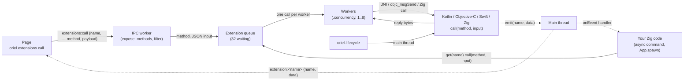

<!-- Generated from site/content/docs/extensions.smd by tools/docs/gen-md.mjs: edit that file. -->

# App extensions

Your own Kotlin, Objective-C, Swift or Zig code, declared by name in build.zig and called from Zig with one API on every platform.

An app extension is the app's own native code, declared by name in
`build.zig` and implemented per platform: Kotlin (or Java) on Android,
Objective-C or Swift on iOS and macOS, Zig on the desktop. Zig calls it by
name with one API everywhere: `(method, input bytes) -> reply bytes`. The
page reaches it only through Zig, through an app command or the methods Zig
exposes.

Oriel does the transport (JNI, the Objective-C runtime, a Zig call), the
worker threads, timeouts and cancellation, size limits, events back to Zig
and the page, lifecycle delivery, and the build plumbing: Kotlin sources and
Maven dependencies in the Gradle project, R8 keep rules, Objective-C and
Swift compilation, frameworks, APK assets and bundle resources.

Use an extension when *your code* calls native code: an on-device model, a
vendor SDK, a platform API Oriel has no module for. When *the platform* calls
you (an Activity started, a web view was created, a URL was opened), that's a
[platform hook](platform-hooks.md). One class can be both:
Oriel constructs it once and both roles get the same object.

| | App extensions | Platform hooks |
|---|---|---|
| Who calls | Your Zig code, by name; the page through what Zig exposes | The platform, through Oriel, when its events happen |
| Thread | The extension's own worker threads | The main (UI) thread |
| What for | Your native code as a service | React to, or take over, the app's lifecycle, windows and web views |
| Declared with | `AppOptions.extensions` | `.android.hooks`, `.ios.hooks`, `.macos.hooks`; `oriel.hooks` in Zig |

## Availability

| Platform | Implementation | Declared in the entry's | Built with |
|---|---|---|---|
| Android | Kotlin or Java class implementing `dev.oriel.OrielAppExtension` | `.android` | Gradle, in the generated project ([Android](android.md)) |
| iOS | Objective-C or `@objc` Swift class conforming to `OrielAppExtension` | `.ios` | Zig's clang (`-fobjc-arc`) and `swiftc`, against the iOS SDK ([iOS](ios.md)) |
| macOS | A Zig module, or an Objective-C / Swift class as on iOS | `.macos` (else `.desktop`) | Zig; Objective-C and Swift need the macOS SDK |
| Linux | A Zig module | `.linux` (else `.desktop`) | Zig |
| Windows | A Zig module | `.windows` (else `.desktop`) | Zig |

Extensions need no build flag and no permission of their own (the native
code needs whatever permissions its APIs need: declare them in
[`.permissions`](permissions.md)). A platform the entry
gives no implementation still builds: there the extension is unavailable
(`available()` is `false` at compile time and calls fail with
`error.Unavailable`).

## Quick start

A desktop extension in Zig that reverses text, exposed to the page.

```zig
// build.zig
_ = oriel.addApp(b, dep, .{
    .name = "my-app",
    .root_source_file = b.path("src/main.zig"),
    .frontend = .{ .dir = "frontend" },
    .extensions = &.{.{
        .name = "app.echo",
        .desktop = .{ .zig = b.path("src/echo_desktop.zig") },
    }},
});
```

```zig
// src/echo_desktop.zig
const std = @import("std");
const oriel = @import("oriel");

pub fn call(ctx: *oriel.extensions.Context, method: []const u8, input: []const u8) ![]u8 {
    if (!std.mem.eql(u8, method, "reverse")) return ctx.fail("unknown_method", "no method {s}", .{method});
    const args = std.json.parseFromSliceLeaky(struct { text: []const u8 }, ctx.arena, input, .{}) catch
        return ctx.fail("bad_input", "expected {{\"text\": \"...\"}}", .{});
    const out = try ctx.arena.dupe(u8, args.text);
    std.mem.reverse(u8, out);
    return std.json.Stringify.valueAlloc(ctx.arena, .{ .text = out }, .{});
}
```

```zig
// src/main.zig
const std = @import("std");
const oriel = @import("oriel");
const app = @import("oriel_app");

pub const Commands = struct {};

pub fn main(init: std.process.Init) !u8 {
    return oriel.main(init, .{ .commands = Commands }, .{
        .app = app.build,
        .window = .{ .title = "Echo", .width = 800, .height = 600 },
        .setup = setup,
    });
}

fn setup() !void {
    if (oriel.extensions.get("app.echo").available())
        oriel.extensions.expose("app.echo", .{ .methods = &.{"reverse"} });
}
```

```js
const { text } = await oriel.extensions.call("app.echo", "reverse", { text: "hello" });
// text === "olleh"
```

The same name gets a Kotlin class on Android and an Objective-C class on
iOS by adding `.android` and `.ios` to the entry ([Examples](#examples)).

## How it works



**The table.** `build.zig` turns `AppOptions.extensions` into a generated
module per app and per target (`oriel_extensions`, read by
`src/core/extensions/runtime.zig`): each extension's name, limits and which backend
this target has (`none`, `zig`, `android`, `objc`). So
`oriel.extensions.get("name")` with a name the app didn't declare is a
compile error that lists the declared ones, and `available()` is decided at
compile time.

**A call.** `call` is refused on the main thread (`error.WrongThread`),
which must never block on native code. It checks the method name and the
input size, starts the extension's workers on first use, and queues the
call. A worker takes it, runs the implementation with a per-call arena, and
hands the reply back; the caller blocks until the reply, its timeout or its
cancel token. A caller that gives up marks the call cancelled and returns at
once; the worker keeps running until the native code returns, so long work
should poll `isCancelled`. A call still queued when it is cancelled never
starts.

**Workers.** Each extension has its own workers (`.concurrency`, default 1)
behind a queue of 32 waiting calls. The first worker loads the extension
before any call runs: on Android the generated `OrielExtensions` registry
constructs the class and calls `onLoad`; on iOS and macOS Oriel finds the
class with `objc_getClass`, makes one instance and sends it `load:`; a Zig
module's optional `onLoad` runs. On Android the workers attach to the VM
once, as daemon threads (`src/platform/android/extensions.zig`); on Apple
platforms each call runs inside an autorelease pool
(`src/platform/apple/extensions.zig`).

**Errors across the boundary.** Kotlin answers through JNI with a status
byte (ok, failed with code and message, unavailable, cancelled), so
exceptions never cross JNI. Objective-C reports failure with its `NSError`.
A Zig module returns an error or `ctx.fail(...)`. The caller always gets one
of `oriel.extensions.Error`, with the code and message in `Diagnostics`.

**Events.** Native code may emit `(name, data)` from any thread. Oriel copies
the event and delivers it on the main thread to the extension's `onEvent`
handler and to the page as `extension:<name>` with `{ name, data }` (`data`
parsed when it is JSON, else a string, base64 when it isn't UTF-8). Events
that come before the handler is set or before the page listens wait in a
queue of 8 per audience (the oldest is dropped when it is full), so an event
emitted from `onLoad` isn't lost (`src/core/pending_events.zig`).

**Lifecycle.** Once the app runs, the module subscribes to
[`oriel.lifecycle`](lifecycle.md); every *loaded* extension
gets its events on the main thread, in declaration order: Kotlin
`onLifecycle(event, level)`, Objective-C `lifecycle:level:`, Zig
`onLifecycle(event)`. An extension that hasn't loaded yet gets none; call
`load()` in setup to have it load early.

**The page.** The page has no direct access. `oriel.extensions.call` sends
the built-in `extensions:call` command, which always runs on an IPC worker
(`src/core/ipc.zig`). It is refused unless Zig exposed that method; the
optional filter sees each call first. The payload goes to the extension as
JSON, and a JSON reply comes back parsed (anything else as a string).

## Examples

### One extension on every platform

```zig
// build.zig
.extensions = &.{.{
    .name = "pantry.vision",
    .android = .{
        .class = "dev.ghostpantry.VisionExtension",
        .sources = &.{b.path("android/VisionExtension.kt")},
        .dependencies = &.{"com.microsoft.onnxruntime:onnxruntime-android:1.20.0"},
        .assets = &.{.{ .from = b.path("models/detectors"), .to = "detectors" }},
    },
    .ios = .{
        .class = "GPVisionExtension",
        .sources = &.{b.path("ios/VisionExtension.m")},
        .frameworks = &.{ "Vision", "CoreML" },
        .resources = &.{.{ .from = b.path("models/yoloe.mlmodelc"), .to = "yoloe.mlmodelc" }},
    },
    .desktop = .{ .zig = b.path("src/vision_desktop.zig") },
    .max_bytes = 32 << 20,
    .concurrency = 1,
}},
```

```kotlin
// android/VisionExtension.kt
package dev.ghostpantry

import dev.oriel.OrielAppExtension
import dev.oriel.OrielCall
import dev.oriel.OrielExtensionContext
import dev.oriel.OrielExtensionError

class VisionExtension : OrielAppExtension {
    override fun onLoad(ctx: OrielExtensionContext) {
        // Open sessions; ctx.context.assets.open("detectors/...") reads .assets.
    }

    override fun call(method: String, input: ByteArray, call: OrielCall): ByteArray {
        if (method != "detect") throw OrielExtensionError("unknown_method", "no method $method")
        for (step in 0 until 10) {
            if (call.isCancelled) throw OrielExtensionError("cancelled", "")
            call.emit("progress", """{"done":${step / 10.0}}""".toByteArray())
        }
        return """{"boxes":[]}""".toByteArray()
    }

    override fun onLifecycle(event: String, level: String?) {
        if (event == "memory_pressure" && level == "critical") { /* close sessions */ }
    }
}
```

```objc
// ios/VisionExtension.m
#import "oriel_extension.h"

@interface GPVisionExtension : NSObject <OrielAppExtension>
@end

@implementation GPVisionExtension
- (nullable NSData *)callMethod:(NSString *)method input:(NSData *)input
                           call:(OrielCall *)call error:(NSError **)error {
    if (![method isEqualToString:@"detect"]) {
        *error = [NSError errorWithDomain:@"unknown_method" code:1
                                 userInfo:@{NSLocalizedDescriptionKey: method}];
        return nil;
    }
    if (call.cancelled) return nil; // nil without an error: an empty reply (the caller has returned)
    [call emit:@"progress" data:[@"{\"done\":0.5}" dataUsingEncoding:NSUTF8StringEncoding]];
    return [@"{\"boxes\":[]}" dataUsingEncoding:NSUTF8StringEncoding];
}

- (void)lifecycle:(NSString *)event level:(nullable NSString *)level {
    // "memory_pressure" with level "critical": free what can be rebuilt.
}
@end
```

### Calling from an async command

```zig
const vision = oriel.extensions.get("pantry.vision");

pub const Commands = struct {
    pub const async_commands = .{"detect"}; // calls block: never on the main thread

    pub fn detect(arena: std.mem.Allocator, args: struct { image: []const u8 }) ![]const u8 {
        if (!vision.available()) return error.Unavailable;
        const input = try std.json.Stringify.valueAlloc(arena, .{ .image = args.image }, .{});
        var diag: oriel.extensions.Diagnostics = .{};
        return vision.call(arena, "detect", input, .{ .timeout_ms = 60_000, .diag = &diag }) catch |err| switch (err) {
            error.ExtensionFailed => return oriel.ipc.fail("{s}: {s}", .{ diag.code(), diag.message() }),
            else => return err,
        };
    }
};
```

### Cancelling a long call

```zig
var token: oriel.extensions.CancelToken = .{};

fn work() void {
    var arena_state: std.heap.ArenaAllocator = .init(std.heap.smp_allocator);
    defer arena_state.deinit();
    const reply = vision.call(arena_state.allocator(), "index", "{}", .{ .cancel = &token, .timeout_ms = 10 * 60 * 1000 }) catch |err| {
        std.log.info("index: {s}", .{@errorName(err)}); // error.Cancelled after token.cancel()
        return;
    };
    _ = reply;
}

// setup: oriel.App.spawn(work, .{}); a "Stop" command: token.cancel();
```

### Swift on iOS

```zig
.ios = .{ .class = "GPVisionExtension", .swift_sources = &.{b.path("ios/Vision.swift")} },
```

```swift
import Foundation

@objc(GPVisionExtension) // keeps the class name unmangled for objc_getClass
final class GPVisionExtension: NSObject, OrielAppExtension {
    func callMethod(_ method: String, input: Data, call: OrielCall) throws -> Data {
        call.emit("progress", data: Data("{\"done\":0.5}".utf8))
        return Data("{\"boxes\":[]}".utf8)
    }
}
```

A Swift `throw` becomes the `NSError` the protocol returns. Swift raises the
app's minimum to iOS 18 ([Building Objective-C and Swift](#apple-building)).

### Objective-C on macOS

```zig
.macos = .{ .objc = .{
    .class = "GPVisionExtension",
    .sources = &.{b.path("macos/VisionExtension.m")},
    .frameworks = &.{ "Vision", "CoreML" },
} },
```

The class uses the same protocol and header as on iOS. `.macos` overrides
`.desktop` on macOS either way.

[`examples/showcase`](https://github.com/highercomve/Oriel/tree/main/examples/showcase)
declares `showcase.echo` in Zig (`src/echo_desktop.zig`), Kotlin
(`extensions/android/EchoExtension.kt`) and Objective-C
(`extensions/ios/EchoExtension.m`; on macOS with `-Dobjc_echo`,
`extensions/macos/EchoExtension.m`), plus a Swift one on iOS with
`-Dswift_example`, and exposes `reverse` to its App tab through a filter.
`--ui-test extension` drives it on the desktop. GhostPantry's
`PantryVisionExtension` runs its on-device vision models this way, and is a
platform hook too.

## Reference

### `AppOptions.extensions`

`extensions: []const Extension = &.{}`, at most 64 entries.

| `Extension` field | Type | Default | Meaning |
|---|---|---|---|
| `name` | `[]const u8` | required | Lowercase dotted words: `[a-z][a-z0-9_]*` joined by single dots, up to 64 characters, unique. What Zig, the native code and the page call it. Names starting with `oriel.` are Oriel's own. |
| `android` | `?AndroidExtension` | `null` | The Android implementation. |
| `ios` | `?IosExtension` | `null` | The iOS implementation. |
| `desktop` | `?DesktopExtension` | `null` | A Zig module for any desktop OS, unless `linux`, `macos` or `windows` overrides it. |
| `linux` | `?DesktopExtension` | `null` | Linux only. |
| `macos` | `?MacosExtension` | `null` | `.{ .zig = path }` or `.{ .objc = .{ ... } }`; either overrides `desktop`. |
| `windows` | `?DesktopExtension` | `null` | Windows only. |
| `max_bytes` | `usize` | `32 << 20` | The cap on a call's input and on its reply; 1 to 256 MiB. |
| `concurrency` | `u8` | `1` | Calls running at once on the extension's workers; 1 to 8. |

| `AndroidExtension` field | Type | Meaning |
|---|---|---|
| `class` | `[]const u8` | The fully qualified class implementing `dev.oriel.OrielAppExtension` (at least one package, up to 256 characters), with a public zero-argument constructor. Build.zig adds `-keep class <class> { *; }` to the R8 rules. |
| `sources` | `[]const LazyPath` | Its Kotlin/Java files, copied like `.android.sources` (by their `package` line). |
| `dependencies` | `[]const []const u8` | Maven coordinates `group:artifact:version`, at most 64; merged with `.android.dependencies`, each once. |
| `assets` | `[]const Asset` | Files or directories installed under the APK's assets at `to` (`zig-out/android-assets/<to>`); read with `context.assets.open("<to>/...")`. |

| `IosExtension` field | Type | Meaning |
|---|---|---|
| `class` | `[]const u8` | The Objective-C class, or the `@objc(Name)` of a Swift class, conforming to `OrielAppExtension`; a C identifier up to 128 characters, with a plain `-init`. |
| `sources` | `[]const LazyPath` | Objective-C files, compiled with `-fobjc-arc`; `#import "oriel_extension.h"` works. |
| `swift_sources` | `[]const LazyPath` | Swift files, compiled by `swiftc` into one object per extension. Raises the minimum to iOS 18. |
| `frameworks` | `[]const []const u8` | SDK frameworks to link (`"Vision"`). Frameworks a Swift file imports link by themselves. |
| `weak_frameworks` | `[]const []const u8` | Frameworks newer than the app's minimum iOS: weak-linked, and only when the SDK has them (Swift sees them through `#if canImport(...)`; check the OS version before use). |
| `resources` | `[]const Asset` | Files or directories copied into the bundle at `to`, relative to its root (`Bundle.main` finds them). `from` is a source path or a dependency's path; a build step's output can't be a resource. |

`MacosExtension` is `union(enum) { zig: LazyPath, objc: AppleNativeExtension }`.
`AppleNativeExtension` has `class`, `sources`, `swift_sources`, `frameworks`
and `weak_frameworks` as on iOS (no `resources`); Swift raises the minimum to
macOS 15.

`DesktopExtension` is `struct { zig: LazyPath }`: a Zig file that declares

```zig
pub fn call(ctx: *oriel.extensions.Context, method: []const u8, input: []const u8) ![]u8; // required
pub fn onLoad(ctx: *oriel.extensions.Context) !void; // optional: on the first worker, before any call
pub fn onLifecycle(event: oriel.lifecycle.Event) void; // optional: main thread, once loaded
```

The module can import `oriel` and the app's `imports`; a missing `call` is
a compile error. Allocate the reply in `ctx.arena` (freed after the call).

`Asset` is `struct { from: LazyPath, to: []const u8 }`; `to` is relative,
without `..`. A `from` in the source tree that is a file is installed as a
file, anything else as a directory.

Build errors, on any host: an invalid, reserved or duplicate name,
`max_bytes` or `concurrency` out of range, an invalid class, framework,
Maven coordinate or asset path, more than 64 extensions. Apps that share
one Oriel dependency in a `build.zig` must declare the same extensions
(they share its `oriel` module).

### Zig: `oriel.extensions`

```zig
/// The extension `name`, checked at compile time (an undeclared name is a compile error).
pub fn get(comptime name: []const u8) type; // returns a namespace:
    pub const extension_name: []const u8;
    pub inline fn available() bool; // comptime: this target has an implementation
    pub fn call(arena: std.mem.Allocator, method: []const u8, input: []const u8, options: CallOptions) Error![]u8;
    pub fn load() Error!void; // start the workers and load now (lifecycle events from then on)
    pub fn onEvent(handler: EventHandler) void; // one handler; a second replaces it

/// Whether AppOptions.extensions declares `name` (comptime), for code shared by builds.
pub fn declared(comptime name: []const u8) bool;
/// Let the page call `options.methods` of `name` (any thread; a second call replaces the first).
pub fn expose(comptime name: []const u8, comptime options: Expose) void;
pub const count: usize; // extensions this app declares (with Oriel's own)

pub const CallOptions = struct {
    timeout_ms: u32 = 30_000, // clamped to 10 minutes; the timeout cancels the call, then reports
    cancel: ?*const CancelToken = null,
    diag: ?*Diagnostics = null, // filled on error.ExtensionFailed and error.TooLarge
};

pub const CancelToken = struct {
    pub fn cancel(t: *CancelToken) void; // any thread
    pub fn isCancelled(t: *const CancelToken) bool;
};

pub const Diagnostics = struct {
    pub fn code(d: *const Diagnostics) []const u8; // up to 64 bytes
    pub fn message(d: *const Diagnostics) []const u8; // up to 1024 bytes
    pub fn set(d: *Diagnostics, code: []const u8, message: []const u8) void; // both cut to fit
};

pub const Event = struct { extension: []const u8, name: []const u8, data: []const u8 };
pub const EventHandler = *const fn (event: Event) void;

pub const Expose = struct {
    methods: []const []const u8, // up to 32 valid method names, checked at compile time
    filter: ?Filter = null,
    timeout_ms: u32 = 30_000,
};
pub const PageRequest = struct {
    extension: []const u8,
    method: []const u8,
    input: []const u8, // the page's payload as JSON; replace it (allocate in arena) to rewrite
    arena: std.mem.Allocator,
};
pub const Filter = *const fn (request: *PageRequest) anyerror!void;

/// What a Zig implementation gets.
pub const Context = struct {
    name: []const u8, // "pantry.vision"
    arena: std.mem.Allocator, // freed when the call returns: allocate the reply here
    pub fn isCancelled(ctx: *const Context) bool; // the caller cancelled or timed out; false in onLoad
    pub fn emit(ctx: *const Context, event: []const u8, data: []const u8) void;
    pub fn fail(ctx: *Context, code: []const u8, comptime fmt: []const u8, args: anytype) error{ExtensionFailed};
    pub fn callId(ctx: *const Context) u64; // 0 in onLoad
};

pub const max_extensions = 64;
pub const default_max_bytes = 32 << 20;
pub const max_concurrency = 8;
pub const queue_capacity = 32;
pub const default_timeout_ms = 30_000;
pub const max_timeout_ms = 10 * 60 * 1000;
```

| `Error` | When |
|---|---|
| `Unavailable` | No implementation on this target, the app isn't running yet (before `oriel.main`), no worker thread could start, or the Android registry lacks the class (rebuild the Gradle project). |
| `Timeout` | `timeout_ms` passed. The native side sees `isCancelled`. |
| `Cancelled` | The `CancelToken` was cancelled, or the implementation returned `Cancelled`. |
| `TooLarge` | The input is over `max_bytes` (refused before it crosses), or the reply is (code `too_large`). |
| `ExtensionFailed` | The implementation failed; the code and message are in `Diagnostics`. A Zig error other than these becomes `ExtensionFailed` with the error's name as code and message; a Kotlin exception other than `OrielExtensionError` becomes its class's simple name and message (logged to logcat). |
| `WrongThread` | Called on the main thread. |
| `Busy` | 32 calls already wait for a worker, or 128 native calls run at once across all extensions. |
| `InvalidMethod` | The method is empty, over 128 characters, or has spaces, control characters, quotes or backslashes. |
| `OutOfMemory` | |

**Threads.** `call` from any thread but the main one: an async command
(`pub const async_commands = .{...}` in `Commands`), `oriel.App.spawn`, or
your own thread. `onEvent` handlers and lifecycle callbacks run on the main
thread. `expose`, `onEvent` and `CancelToken.cancel` may be called from any
thread.

**Events.** An event name follows the method rules, up to 64 characters;
its data is at most 1 MiB. An invalid or oversized event is dropped with a
log line.

The runtime's other declarations, which the backends and Oriel's own
modules use (`Runner`, `Impl`, `begin`, `pageCall`, `setSink`, ...), live
in `src/core/extensions/runtime.zig` and aren't part of
`oriel.extensions`.

### Page: `oriel.extensions`

```ts
interface ExtensionEvent { name: string; data: unknown } // data parsed when it is JSON
interface ExtensionsApi {
  /** A method Zig exposed; others reject with "<name>.<method> is not exposed". */
  call<T = unknown>(name: string, method: string, payload?: unknown): Promise<T>;
  /** Events the native code emits (`extension:<name>`). Returns an unsubscribe function. */
  on(name: string, callback: (event: ExtensionEvent) => void): () => void;
}
export const extensions: ExtensionsApi; // in the generated bindings
```

| The promise rejects with | When |
|---|---|
| `unknown extension "<name>"` | No such extension. |
| `<name>.<method> is not exposed` | Zig didn't expose the extension, or not this method. |
| the filter's error name, or its `oriel.ipc.fail` message | The filter refused the call. |
| `<name>.<method>: the payload is over N bytes` | The JSON payload (after the filter) is over `max_bytes`. |
| `<code>: <message>` (or the code alone) | The implementation failed, or the reply was too large. |
| the error's name (`Timeout`, `Busy`, `Unavailable`, ...) | The other `Error`s. |

`payload` is serialized as JSON (`undefined` becomes `null`). The call
runs on an IPC worker with the `timeout_ms` given to `expose`. A page under a
[capability](security.md) needs `extensions:call` in its
`commands`. `on()` sends `events:ready`, so events emitted before the page
listened arrive first (up to 8).

### Android: `OrielAppExtension`

```kotlin
package dev.oriel

interface OrielAppExtension {
    fun call(method: String, input: ByteArray, call: OrielCall): ByteArray // the extension's worker thread
    fun onLifecycle(event: String, level: String?) {} // main thread, once loaded
    fun onLoad(ctx: OrielExtensionContext) {} // once, on the first worker, before the first call
}

class OrielExtensionError(val code: String, message: String) : Exception(message)

open class OrielExtensionContext {
    val extension: String
    val context: Context // the application context
    val activity: Activity? // the Activity in front, or null
    val filesDir: File
    val cacheDir: File
    fun emit(name: String, data: ByteArray)
    fun runOnUi(block: () -> Unit) // runs now when already on the main thread
}

class OrielCall : OrielExtensionContext {
    val isCancelled: Boolean
}
```

- `call` blocks as long as it needs on its worker (attached to the VM).
  Return the reply (JSON by convention); throw `OrielExtensionError(code,
  message)` for a structured failure.
- `onLifecycle` events: `background`, `foreground`, `memory_pressure`
  (level `moderate` or `critical`), `suspend`, `resume`, `terminating`.
  Return quickly.
- An exception in `onLoad` is logged; the extension still loads.
- The class needs a public zero-argument constructor. The generated
  `OrielExtensions.kt` (regenerated on every build) constructs it directly,
  without reflection. A class may also implement `OrielAndroidHooks`
  ([platform hooks](platform-hooks.md)); list it in
  `.android.hooks` without sources and both get one instance.

### iOS and macOS: `OrielAppExtension`

`src/platform/ios/include/oriel_extension.h` (on the include path of the
app's Objective-C sources; Swift sees it through the bridging header
`oriel_swift.h`):

```objc
@interface OrielExtensionContext : NSObject
@property (nonatomic, readonly) NSString *name;
- (void)emit:(NSString *)name data:(NSData *)data; // any thread
@end

@interface OrielCall : OrielExtensionContext
@property (nonatomic, readonly) BOOL cancelled;
@end

@protocol OrielAppExtension <NSObject>
- (nullable NSData *)callMethod:(NSString *)method input:(NSData *)input
                           call:(OrielCall *)call error:(NSError **)error;
@optional
- (void)load:(OrielExtensionContext *)context; // once, on the worker, before the first call
- (void)lifecycle:(NSString *)event level:(nullable NSString *)level; // main thread
@end
```

- Calls run on the extension's worker inside an autorelease pool. Return
  `nil` and an `NSError` to fail: the caller gets `ExtensionFailed` with code
  `<domain>:<code>` and the error's `localizedDescription` as message
  (`Cancelled` instead when the call was cancelled). `nil` without an error
  is an empty reply.
- Don't throw Objective-C exceptions: nothing catches them. Use
  `dispatch_async` / `dispatch_sync` on the main queue for UIKit or AppKit.
- `OrielExtensionContext` and `OrielCall` are defined by Oriel at run time:
  send them messages, but don't subclass them or use their class objects.
- A class that is also a platform hook (`.ios.hooks`, `.macos.hooks`) is
  constructed once; list its sources in one place only.

### Building Objective-C and Swift

- **Objective-C** compiles with Zig's clang (`-fobjc-arc`) against the
  platform SDK: the iOS SDK for iOS builds ([iOS](ios.md)),
  the macOS SDK for `.macos.objc` (`-Dmacos_sdk=<MacOSX.sdk>`, else
  `$SDKROOT` when it is a MacOSX SDK, else `xcrun`; so in practice a Mac).
  Without the SDK the build stops naming what to install; `zig build check`
  compiles no native sources.
- **Swift** compiles with `swiftc`: `$SWIFTC`, else `xcrun --find swiftc` on
  a Mac, else `swiftc` on `PATH`; for `arm64-apple-ios18.0` (or the
  simulator triples) or `arm64-apple-macos15.0` / `x86_64-apple-macos15.0`,
  with `oriel_swift.h` as the bridging header, linked against the OS's Swift
  runtime (`/usr/lib/swift`).
  - On a Mac: Xcode. The iOS SDK comes from `-Dapple_sdk` / `$APPLE_SDK`
    (the `oriel` CLI passes Xcode's).
  - On Linux (iOS only): the Swift toolchain from swift.org plus xtool's
    Darwin SDK (`oriel ios setup` with Xcode.xip extracts it into
    `~/.swiftpm/swift-sdks/darwin.artifactbundle`). A Linux `swiftc` has no
    Darwin standard library: Oriel reads it from the bundle's
    `swift-sdk.json` (`swiftResourcesPath`), or from `-Dswift_resource_dir`
    / `$SWIFT_RESOURCE_DIR`.
  - A missing `swiftc`, SDK or Darwin standard library is a build error
    naming what to install. Apps without Swift never need `swiftc`.
- **Minimums with Swift: iOS 18, macOS 15.** These releases split the Swift
  Darwin overlay into separate libraries (`libswift_errno`, ...), which
  Zig's linker records correctly only for them. The minimum is raised when
  the target names no version; an explicit lower one
  (`-Dtarget=aarch64-ios.16.0`) is a build error. Without Swift, Oriel's
  minimums stay (iOS 15, macOS 13).
- Swift imports link by themselves (`import CoreML`, `Metal`, ...): Oriel
  links the imported frameworks and the SDK's Swift overlays, and drops the
  unused ones with `dead_strip_dylibs`.

### Limits

| | |
|---|---|
| Extensions per app | 64 |
| Name | 64 characters, `[a-z][a-z0-9_]*` joined by dots; `oriel.*` is Oriel's |
| Method | 1 to 128 printable ASCII characters, no spaces, quotes or backslashes |
| Input and reply | `max_bytes` (32 MiB default, 256 MiB at most) |
| Workers | `concurrency`, 1 to 8 per extension |
| Waiting calls | 32 per extension; 128 native calls running across all extensions |
| Timeout | 30 s default, 10 min at most |
| Event | name 64 characters, data 1 MiB; 8 queued per audience until handled |
| Error | code 64 bytes, message 1024 bytes |
| Exposed methods | 32 per extension |
| Android dependencies | 64 per extension |

### Oriel's own extensions

Oriel builds some modules on the same mechanism: `-Dsystem_ai` adds the
extension `oriel.system_ai`, with a Kotlin class (`OrielSystemAi.kt`, plus
its ML Kit dependency) and a Swift one (`SystemAi.swift`, FoundationModels
weak-linked), added to the app's project only when the module is on. They
come before the app's extensions; declaring or exposing an `oriel.*` name is
a build error, and their events go to their module (which turns them into
callbacks and page events) instead of `onEvent` and `extension:<name>`.
Oriel's Swift counts toward the iOS 18 minimum like an app's
([System AI](system-ai.md)).

## Troubleshooting

- **`oriel.extensions.get("x"): no such extension in AppOptions.extensions`**:
  the name isn't declared, or it is spelled differently; the error lists
  the declared names. For code shared by builds, guard with
  `if (comptime oriel.extensions.declared("x"))`.
- **`error.WrongThread`**: the call ran on the main thread (a sync command,
  `setup`, an event handler). Make the command async or use `oriel.App.spawn`.
- **`error.Unavailable` on Android** with `extensions: <name>: not in the APK's
  extension registry` in logcat: the Gradle project wasn't rebuilt after
  adding the extension. Run `oriel android dev` or `oriel android build`.
- **The page gets `<name>.<method> is not exposed`**: call `expose` (in
  `setup`) with that method.
- **Calls time out but keep the worker busy**: the native code doesn't poll
  `isCancelled` / `cancelled`. Check it in loops.
- **A Swift extension stops the build for an older iOS**: Swift needs iOS 18
  or macOS 15; drop the explicit lower version from `-Dtarget`.

## Related

- [Platform hooks](platform-hooks.md): the platform calling
  your code; one class can be both.
- [Commands](commands.md): async commands, the usual way to
  call an extension for the page.
- [Lifecycle](lifecycle.md): the events extensions receive.
- [Android](android.md) and [iOS](ios.md):
  the projects and SDKs the native code builds with.
