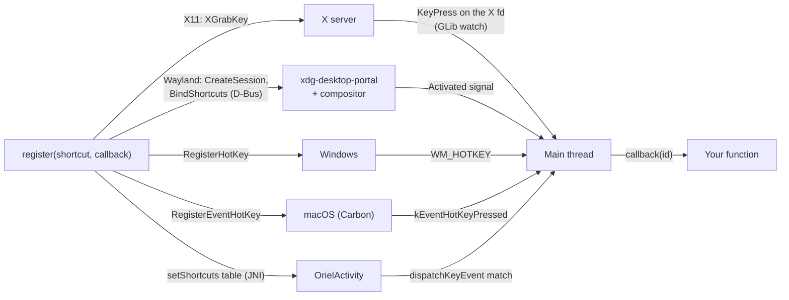

<!-- Generated from site/content/docs/global-shortcuts.smd by tools/docs/gen-md.mjs: edit that file. -->

# Global shortcuts

System-wide hotkeys on Linux, Windows and macOS, and in-app keyboard shortcuts on Android, registered from Zig.

`oriel.global_shortcut` registers a key combination ("ctrl+alt+G") and
calls your Zig function when the user presses it, **even when the app isn't
focused or its window is hidden**: on X11 through a key grab, on Wayland
through the desktop's GlobalShortcuts portal, on Windows with
`RegisterHotKey`, on macOS with Carbon hot keys. Android has no system-wide
hotkeys, so there the same API gives in-app shortcuts for a hardware
keyboard, listed in the system's shortcut helper.

Use it for "summon the app" and "act on whatever the user is doing" keys:
GhostPen's rewrite hotkey, the showcase's "dictate into the focused app".
For shortcuts that only matter while your window is focused, handle
`keydown` in the page, or give a [menu](menu.md) item an
accelerator: a global shortcut takes the combination away from every other
app. The API is Zig-only; tell the page with an
[event](commands.md).

## Availability

| Platform | Backend | Scope | Notes |
|---|---|---|---|
| Linux (Wayland) | `org.freedesktop.portal.GlobalShortcuts` (xdg-desktop-portal) | system-wide | The compositor owns the bindings and may ask the user to confirm or pick other keys. Needs the portal and an installed `<app id>.desktop`. |
| Linux (X11) | `XGrabKey` on the root window | system-wide | |
| Windows | `RegisterHotKey` / `WM_HOTKEY` on Oriel's host window | system-wide | Holding the keys doesn't repeat (`MOD_NOREPEAT`). |
| macOS | Carbon `RegisterEventHotKey` | system-wide | No permission needed. |
| Android | `OrielActivity.dispatchKeyEvent` | the app's focused window, hardware keyboard | Listed in the Meta+/ keyboard shortcuts helper. |
| iOS | — | — | Not available: `oriel.global_shortcut.available` is `false`. |

The module is **on by default** (`global_shortcut` in
`b.dependency("oriel", .{ ... })`; `.global_shortcut = false` leaves it
out). Where it doesn't exist (iOS) the flag resolves to off; guard calls
with `if (oriel.global_shortcut.available)`. The page sees
`window.oriel.features.globalShortcut`. No permission is needed on any
platform.

## Quick start

```zig
// src/main.zig
const std = @import("std");
const oriel = @import("oriel");
const app = @import("oriel_app");

pub const Commands = struct {};
pub const Events = struct { shortcut: struct { id: []const u8 } };
const events = oriel.App.events(Events);

pub fn main(init: std.process.Init) !u8 {
    return oriel.main(init, .{ .commands = Commands, .events = Events }, .{
        .app = app.build,
        .window = .{ .title = "Hotkeys", .width = 600, .height = 400 },
        .setup = setup,
    });
}

fn setup() !void {
    if (!oriel.global_shortcut.available) return;
    oriel.global_shortcut.register(std.heap.smp_allocator, .{
        .id = "toggle",
        .description = "Show or hide the window",
        .trigger = "ctrl+alt+space",
    }, onShortcut) catch |err| std.log.warn("hotkey: {s}", .{@errorName(err)});
}

fn onShortcut(id: []const u8) void {
    if (std.mem.eql(u8, id, "toggle")) if (oriel.App.getWindow("main")) |w| w.toggle();
    events.emit(.shortcut, .{ .id = id });
}
```

```js
window.oriel.listen("shortcut", ({ id }) => console.log("pressed", id));
```

On Linux under Wayland, install the desktop entry once so the portal
accepts the app: `oriel desktop-entry` for a dev build, `oriel desktop-entry
--release` for `oriel build` ([CLI](cli.md)).

## How it works



Each backend turns the trigger into its own key code, registers it with
the OS, and keeps a table of `{ id, callback }`. When the OS reports the
combination, the backend looks up the entry and calls its callback **on the
main thread** with the shortcut's id.

- **X11** (`src/plugins/global_shortcut/linux.zig`): the key name becomes
  an X keysym (`XStringToKeysym`, any case, plus aliases), the keysym a
  keycode, and `XGrabKey` grabs it on the root window four times: with and
  without CapsLock and NumLock, which would otherwise make the grab miss.
  A GLib watch on the X connection's file descriptor reads the key presses.
- **Wayland** (same file): a key grab only fires while an XWayland window
  has focus, so there is no X11 fallback. Oriel opens a private session-bus
  connection, registers the app id with the portal's host registry
  (`org.freedesktop.host.portal.Registry`, xdg-desktop-portal 1.19+; older
  portals derive the id themselves), creates a GlobalShortcuts session and
  binds the whole shortcut list with `BindShortcuts`, each with its
  `description` and a `preferred_trigger` in the XDG format
  (`CTRL+ALT+g`, `LOGO+SHIFT+space`). Registrations in a row (in `setup`)
  are coalesced into one bind on the next idle; a change while a bind is in
  flight binds again afterwards. The bind's outcome is only logged:
  `GlobalShortcuts: N shortcut(s) bound`, or the error. The session's
  `Activated` signal names the shortcut id.
- **Windows** (`windows.zig`): `RegisterHotKey` on Oriel's hidden host
  window; the shell routes `WM_HOTKEY` to the module. Calls from a worker
  are marshalled to the main thread.
- **macOS** (`macos.zig`): `RegisterEventHotKey` on the application event
  target, which `NSApplication`'s run loop services. `ctrl` is Control,
  `alt` Option, `shift` Shift, `super`/`meta`/`cmd`/`win` Command. Calls are
  marshalled to the main thread.
- **Android** (`android.zig`): the whole table (id, `KeyEvent` code, meta
  state, description) goes to the Kotlin runtime on every change.
  `OrielActivity.dispatchKeyEvent` matches key presses **before the WebView
  sees them** (the page doesn't get those keys), and
  `onProvideKeyboardShortcuts` lists the descriptions in the system's
  keyboard shortcuts helper (Meta+/). Shortcuts work while one of the app's
  windows has focus, with a hardware keyboard: desktop windowing, ChromeOS,
  Samsung DeX, a tablet's keyboard.

## Examples

### Act on the selection in any app

GhostPen's pattern: on the hotkey, copy the selection with
[Input](input.md), read it with the
[Clipboard](clipboard.md) on a worker, and paste the result
back:

```zig
fn onHotkey(_: []const u8) void {
    oriel.App.spawn(rewrite, .{}) catch {};
}

fn rewrite() !void {
    const gpa = std.heap.smp_allocator;
    try oriel.input.copy(); // Ctrl+C / ⌘C into the focused app
    const text = try oriel.clipboard.readText(gpa);
    defer gpa.free(text);
    const result = try transform(gpa, text);
    defer gpa.free(result);
    try oriel.clipboard.writeText(result);
    try oriel.input.paste();
}
```

### Let the user rebind a hotkey

`Shortcut`'s strings aren't copied: keep the trigger in memory you own
until it is unregistered.

```zig
var trigger_buf: [64]u8 = undefined;
var trigger: []const u8 = "ctrl+alt+G";

fn rebind(new_trigger: []const u8) !void {
    _ = oriel.global_shortcut.unregister("rewrite");
    if (new_trigger.len > trigger_buf.len) return error.TriggerTooLong;
    @memcpy(trigger_buf[0..new_trigger.len], new_trigger);
    trigger = trigger_buf[0..new_trigger.len];
    try oriel.global_shortcut.register(std.heap.smp_allocator, .{
        .id = "rewrite",
        .description = "Rewrite the selected text",
        .trigger = trigger,
    }, onHotkey);
}
```

### In-app shortcuts on Android

The showcase registers tab shortcuts on Android only, where they appear in
the Meta+/ list:

```zig
if (oriel.target.is_android) {
    try oriel.global_shortcut.register(gpa, .{ .id = "dictate", .description = "Start or stop dictation", .trigger = "ctrl+shift+D" }, onShortcut);
}
```

`examples/showcase/src/main.zig` registers both kinds (in-app on Android,
"dictate anywhere" on the desktop).

## Reference

### Functions and types

```zig
pub const available: bool; // false on iOS, or with .global_shortcut = false

pub const Shortcut = struct {
    id: []const u8,
    description: []const u8 = "",
    trigger: []const u8,
};
pub const Callback = *const fn (id: []const u8) void;

pub fn register(gpa: std.mem.Allocator, shortcut: Shortcut, callback: Callback) !void;
pub fn unregister(id: []const u8) bool;
pub fn trigger(id: []const u8) bool;
pub fn deinit(gpa: std.mem.Allocator) void;
pub fn check(gpa: std.mem.Allocator, ctx: oriel.CheckContext) !oriel.Check;

pub const Modifiers = struct { ctrl: bool = false, alt: bool = false, shift: bool = false, super: bool = false };
pub const ParsedTrigger = struct { modifiers: Modifiers, key: []const u8 };
pub fn parseTrigger(trigger_str: []const u8) !ParsedTrigger;
pub fn vkFor(name: []const u8) ?u16;
```

| Declaration | Meaning |
|---|---|
| `Shortcut.id` | Your name for it; passed to the callback, and the key for `unregister`/`trigger`. Use distinct ids: nothing checks. |
| `Shortcut.description` | What the user sees: the portal's dialog and settings (Wayland), the Meta+/ helper (Android; the id when empty). Unused elsewhere. |
| `Shortcut.trigger` | The combination, see [Triggers](#triggers). |
| `register` | Registers the shortcut. **The `Shortcut` is kept as is: its strings must stay valid until it's unregistered** (literals are fine). `gpa` allocates the table entry; use the same allocator for every call and `deinit`. |
| `unregister` | Removes the shortcut with this id and releases the key. `false` when no such id (or, on Windows and macOS, when the app isn't running). On Wayland the remaining list is bound again. |
| `trigger` | Calls the shortcut's callback as if pressed, on the calling thread. `false` when no such id. For tests and dev tools. |
| `deinit` | Releases every shortcut, the portal session (Wayland) and the X connection (X11). Oriel doesn't call it; call it at shutdown if you need the keys released before the process exits. |
| `check` | Smoke check (`oriel.checkAll`): Wayland creates and closes a portal session for `ctx.app_id` (no bind, so no prompt); X11 grabs and releases Ctrl+F12; Windows checks the key mapping; macOS registers and removes an unusual combination; Android checks the key mapping. |
| `parseTrigger`, `vkFor` | The parser and the key-name to Win32 virtual-key mapping every backend uses; exposed for apps that validate a trigger before registering. |

**Threads.** Callbacks always run on the main thread (UI thread on
Android). Call `register` and `unregister` on the main thread on Linux
(from `setup`, a command, a tray or hotkey callback); on Windows, macOS
and Android any thread works once the app runs (they are marshalled), and
before the main loop starts they fail with `error.AppNotRunning`. Register
in `setup`. A callback may register, unregister or trigger shortcuts.

### Triggers

A trigger is modifiers and exactly one key, joined with `+`, any case,
spaces around parts ignored: `"ctrl+alt+G"`, `"super+shift+Space"`,
`"CTRL+F12"`.

| Modifier | Accepted names | Windows | macOS | Linux |
|---|---|---|---|---|
| `ctrl` | `ctrl`, `control` | Ctrl | Control | Control |
| `alt` | `alt` | Alt | Option | Alt (Mod1) |
| `shift` | `shift` | Shift | Shift | Shift |
| `super` | `super`, `meta`, `win`, `cmd` | Win | Command | Super (Mod4; `LOGO` on the portal) |

Keys on Windows, macOS and Android (`vkFor`): letters `A`–`Z`, digits
`0`–`9`, `F1`–`F24` (Android: `F1`–`F12`), `space`, `enter`/`return`,
`tab`, `escape`/`esc`, `backspace`, `up`, `down`, `left`, `right`, `home`,
`end`, `pageup`/`prior`, `pagedown`/`next`, `insert`/`ins`,
`delete`/`del`, and punctuation by character or name: `-` `minus`, `=` `+`
`plus` `equal` `equals`, `,` `comma`, `.` `period` `dot`, `/` `slash`, `\`
`backslash`, `;` `semicolon`, `'` `quote` `apostrophe`, `` ` `` `~`
`grave` `backtick`, `[` `bracketleft`, `]` `bracketright`.

Keys on Linux (`keysymFor`): X keysym names, tried as written, in
lowercase and capitalized (`space`, `Return`, `F12`, `Home`, `Prior`,
`minus`, `comma`, `period`, `slash`, `Print`, `XF86AudioPlay`...), single
letters and digits, and the aliases `enter`, `esc`, `del`, `backspace`,
`pageup`, `pagedown`. Punctuation *characters* (`"ctrl+-"`) and the other
aliases (`ins`, `dot`, `quote`...) are Windows/macOS/Android only. For a
trigger that works everywhere, use letters, digits, `F1`–`F12`, `space`,
`enter`, `tab`, `escape`, `backspace`, the arrow and edit keys by their
full names, and punctuation by its keysym name (`minus`, `equal`, `comma`,
`period`, `slash`, `backslash`, `semicolon`, `apostrophe`, `grave`,
`bracketleft`, `bracketright`).

### Errors

| Error | Where | Meaning |
|---|---|---|
| `error.NoKeyInTrigger`, `error.MultipleKeysInTrigger` | all | the trigger has no key, or more than one |
| `error.UnknownKey` | all | the key name isn't known on this platform |
| `error.HotkeyAlreadyRegistered` | Windows, macOS, Android | another app holds the combination (Android: another of your shortcuts) |
| `error.RegisterHotKeyFailed`, `error.InstallEventHandlerFailed` | Windows, macOS | the OS refused it |
| `error.HostWindowNotReady`, `error.AppNotRunning` | Windows, macOS, Android | called before the app runs: register in `setup` |
| `error.PortalUnavailable` | Linux (Wayland) | no GlobalShortcuts portal backend |
| `error.AppIdNotRegistered`, `error.NoAppId` | Linux (Wayland) | the portal refused the app id (no `<id>.desktop` installed), or there's no id |
| `error.CreateSessionFailed`, `error.CreateSessionDenied`, `error.CreateSessionTimeout`, `error.NoSessionHandle`, `error.DBusConnection` | Linux (Wayland) | the portal session couldn't be created (5 s timeout) |
| `error.XOpenDisplay`, `error.KeycodeNotFound` | Linux (X11) | no X display, or the keysym isn't on the keyboard |

A failed or refused Wayland bind isn't an error from `register` (it
happens later): it is logged as `GlobalShortcuts.BindShortcuts: portal
response 1 (cancelled by the user)` or `... (failed)`.

### Linux helpers

On Linux the module also exposes the pieces its backends and tests use:
`keysymFor(name)`, `triggerToPortal(buf, trigger)`, `portalVersion()`,
`createSession(gpa, conn)`, `handlePath(...)`,
`buildBindShortcutsParams(...)`, `x11Available()` and the `x11` C
import. They are `void` on other platforms. Apps don't need them.

## Troubleshooting

- **Wayland: `registering app id '<id>' with the portal: ... (no <id>.desktop
  is installed ...)`.** xdg-desktop-portal only accepts app ids with an
  installed desktop file. Run `oriel desktop-entry` (dev builds use
  `<id>.Dev`) or `oriel desktop-entry --release`.
- **Wayland: `error.PortalUnavailable`.** The desktop has no
  GlobalShortcuts portal: xdg-desktop-portal must run with a backend for
  the desktop that implements GlobalShortcuts. There is no fallback.
- **Wayland: registered, but the key does nothing.** The compositor shows a
  dialog the first time; if the user dismissed it, the log has `portal
  response 1`. The user can bind the shortcut in the desktop's settings,
  where it is listed with its `description`.
- **X11: no error, no callback.** `XGrabKey` reports a combination another
  client already grabbed asynchronously, so `register` can't tell; pick
  another combination.
- **`error.HotkeyAlreadyRegistered` on Windows or macOS.** Another app (or
  a second instance of yours) holds the combination.

## Related

- [Clipboard](clipboard.md) and
  [Input](input.md): what a hotkey usually does next.
- [Menu](menu.md): accelerators that work while the app is
  focused.
- [Desktop](desktop.md): Wayland, X11 and desktop entries.
