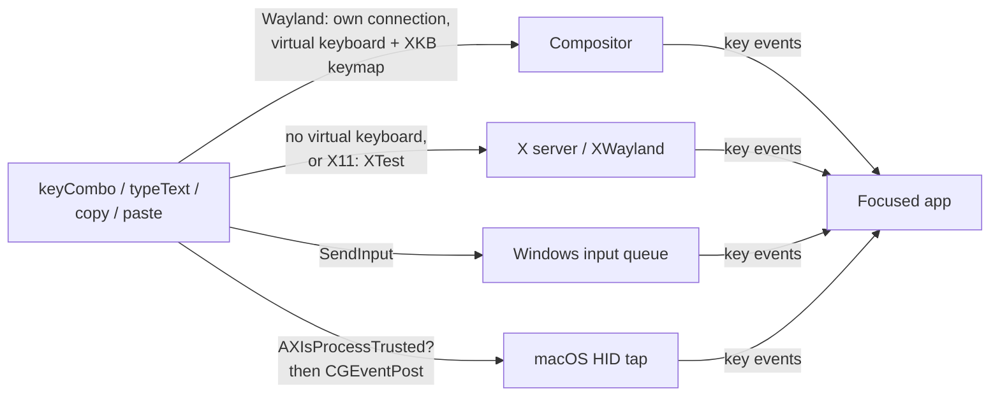

<!-- Generated from site/content/docs/input.smd by tools/docs/gen-md.mjs: edit that file. -->

# Input

Send keystrokes to the focused app from Zig: key combinations, typed text, copy and paste, on Linux, Windows and macOS.

`oriel.input` synthesizes keyboard input into **whatever app has focus**:
a key combination (`"ctrl+v"`), a string of text, or the platform's copy
and paste shortcuts. It is how a desktop app acts on another app: copy the
user's selection, paste a result, type a snippet.

To put arbitrary text into another app, the reliable way is to write it to
the [clipboard](clipboard.md) and call `paste()`: that
works with every layout and every character, where `typeText` depends on
the platform (see [typeText](#type-text)). Your own window
doesn't need this: the page handles its own input. Phones don't let one app
type into another; on Android the Oriel keyboard does it instead
([below](#android)). The API is Zig-only.

## Availability

| Platform | Backend | Permission |
|---|---|---|
| Linux (Wayland) | `zwp_virtual_keyboard_v1` (wlroots compositors: Sway, Hyprland...), else XTest through XWayland | none |
| Linux (X11) | XTest (`XTestFakeKeyEvent`) | none |
| Windows | `SendInput` | none; Windows drops input aimed at windows of a more privileged (elevated) process |
| macOS | `CGEvent` posted to the HID event tap | **Accessibility** (System Settings > Privacy & Security > Accessibility) |
| Android, iOS | — | not available: `oriel.input.available` is `false` |

The module is **on by default** (`input` in `b.dependency("oriel", .{ ...
})`; `.input = false` leaves it out). On Android and iOS the flag resolves
to off; guard calls with `if (oriel.input.available)`. The page sees
`window.oriel.features.input`.

On macOS, declare the permission so the app can ask for it:
`.permissions = .{ .accessibility = "" }` in `addApp` (the reason string is
unused here: macOS has no usage text for Accessibility). See
[Permissions](permissions.md).

## Quick start

```zig
// build.zig
_ = oriel.addApp(b, dep, .{
    .name = "my-app",
    .root_source_file = b.path("src/main.zig"),
    .frontend = .{ .dir = "web" },
    .permissions = .{ .accessibility = "" }, // macOS
});
```

```zig
// src/main.zig: a command the page calls to paste text into the app the
// user switched to.
pub const Commands = struct {
    pub const async_commands = .{"insert"};

    pub fn insert(_: std.mem.Allocator, args: struct { text: []const u8 }) !void {
        if (!oriel.input.available) return error.Unsupported;
        try oriel.clipboard.writeText(args.text);
        try oriel.input.paste(); // Ctrl+V, ⌘V on macOS
    }
};
```

```js
// macOS: ask once (opens the system prompt; the user flips the switch in Settings)
if (window.oriel.platform.os === "macos") {
  await window.oriel.permissions.request("accessibility");
}
await window.oriel.invoke("insert", { text: "Hello" });
```

## How it works



Every call is synchronous and self-contained: it opens what it needs,
sends the events and returns. Nothing is marshalled to the main thread, so
any thread works; because `copy()` sleeps and the Wayland path waits
between events, call them from a worker (an async command, or
`oriel.App.spawn` from a hotkey callback) rather than the main thread.

- **Wayland** (`src/plugins/input/linux.zig`): each call opens a private
  Wayland connection (`src/plugins/wayland_globals.zig`), binds
  `zwp_virtual_keyboard_manager_v1` and the seat, uploads the default XKB
  keymap from libxkbcommon (a memfd), sends the keys and the modifier state
  (`modifiers`: a virtual keyboard's modifier *keys* don't set it), waits
  for the compositor (a roundtrip) and closes the connection. GNOME and KDE
  don't offer the virtual keyboard protocol; there Oriel falls back to
  XTest when XWayland has it, which only reaches XWayland windows.
- **X11** (same file): `XOpenDisplay`, `XTestFakeKeyEvent` for each
  modifier, the key and the releases, `XFlush`, close.
- **Windows** (`src/plugins/input/windows.zig`, builders in
  `common.zig`): one `SendInput` call with all events: modifiers down in
  order, the key down and up (`KEYEVENTF_EXTENDEDKEY` for arrows, Home,
  End, Page Up/Down, Insert, Delete), modifiers up in reverse; text as
  `KEYEVENTF_UNICODE` pairs per UTF-16 unit, independent of the layout.
- **macOS** (`src/plugins/input/macos.zig`): every call first checks
  `AXIsProcessTrusted()`, because macOS silently drops events from an app
  without the Accessibility permission; then posts `CGEvent` keyboard
  events with the modifier flags. Text goes as Unicode strings (up to 20
  UTF-16 units per event, never splitting a surrogate pair), independent of
  the layout.

## Examples

### Copy the selection, transform it, paste it back

```zig
fn onHotkey(_: []const u8) void {
    oriel.App.spawn(rewrite, .{}) catch {};
}

fn rewrite() !void {
    const gpa = std.heap.smp_allocator;
    try oriel.input.copy(); // Ctrl+C / ⌘C, then waits 80 ms for the app to fill the clipboard
    const text = try oriel.clipboard.readText(gpa);
    defer gpa.free(text);
    const upper = try std.ascii.allocUpperString(gpa, text);
    defer gpa.free(upper);
    try oriel.clipboard.writeText(upper);
    try oriel.input.paste();
}
```

GhostPen does this with a [global shortcut](global-shortcuts.md),
and saves and restores the user's clipboard around it. The showcase's
"dictate anywhere" (`examples/showcase/src/anywhere.zig`) pastes a
transcript into the focused app the same way.

### Send a key combination

```zig
try oriel.input.keyCombo("ctrl+shift+t"); // reopen the last browser tab
try oriel.input.keyCombo("enter");
```

On macOS modifiers are literal: `"cmd+shift+t"` for the Mac shortcut,
`"ctrl+..."` sends Control.

### Ask for Accessibility from Zig (macOS)

```zig
if (oriel.target.os == .macos and oriel.permissions.status(.accessibility) != .granted) {
    _ = oriel.permissions.request(.accessibility); // result through oriel.permissions.onChange
}
```

## Reference

### Functions

```zig
pub const available: bool; // false on Android and iOS, or with .input = false

pub fn keyCombo(combo: []const u8) !void;
pub fn typeText(text: []const u8) !void;
pub fn copy() !void;
pub fn paste() !void;
pub fn check(gpa: std.mem.Allocator, ctx: oriel.CheckContext) !oriel.Check;
```

| Function | What it sends |
|---|---|
| `keyCombo(combo)` | Presses the modifiers, presses and releases the key, releases the modifiers. `combo` uses the [global shortcut trigger syntax](global-shortcuts.md#triggers). |
| `typeText(text)` | `text` (UTF-8) as key presses; see below. An empty string sends nothing. |
| `copy()` | `ctrl+c` (macOS: `cmd+c`), then sleeps 80 ms so the target app has updated the clipboard before you read it. |
| `paste()` | `ctrl+v` (macOS: `cmd+v`). |
| `check` | Smoke check (`oriel.checkAll`): Linux builds the XKB keymap and reports whether the virtual keyboard manager is offered and XTest is available; Windows checks `SendInput` resolves; macOS reports whether Accessibility is granted (an explicit `SKIP (permission)` when not) and creates, without posting, a key event. Nothing is typed. |

Calls are blocking and run on the calling thread; any thread works.

**Keys.** Windows and macOS accept every key of the trigger syntax. Linux
X11 accepts X keysym names (`keyComboX11`). Under Wayland's virtual
keyboard, `keyCombo` knows letters, digits, `space`, `enter`/`return`,
`tab`, `backspace`, `escape`/`esc`, `insert`, `delete`/`del` and the
arrows; anything else is `error.UnknownKey`.

### typeText

| Platform | Characters | Layout |
|---|---|---|
| Windows | any Unicode | independent (`KEYEVENTF_UNICODE`) |
| macOS | any Unicode | independent (`CGEventKeyboardSetUnicodeString`) |
| Linux, virtual keyboard | `a`–`z`, `A`–`Z`, `0`–`9`, space, `\n` (Enter), `\t` (Tab); **other characters are skipped** | the default XKB keymap |
| Linux, XTest | ASCII letters, digits, space, `\n`, `\t`, and punctuation through its keysym, with Shift for the shifted US punctuation (`!`, `@`, `#`, `(`, `?`, `~`...); characters with no keycode are skipped | the X server's current layout (Shift guesses assume US) |

For anything beyond plain ASCII on Linux, use the clipboard and `paste()`.

### Errors

| Error | Where | Meaning |
|---|---|---|
| `error.NoKeyInTrigger`, `error.MultipleKeysInTrigger`, `error.UnknownKey` | all | the combination doesn't parse, or the key isn't known |
| `error.AccessibilityNotGranted` | macOS | the app (for an unbundled executable: the terminal that started it) lacks the Accessibility permission |
| `error.CGEventCreateFailed`, `error.InvalidUtf8` | macOS | event creation failed; `typeText` got invalid UTF-8 |
| `error.SendInputFailed` | Windows | `SendInput` inserted fewer events than asked (blocked by another thread or by UIPI) |
| `error.NoVirtualKeyboardManager`, `error.NoSeat`, `error.KeymapWriteFailed`, `error.RoundtripFailed`, `error.XkbContext`, `error.XkbKeymap` | Linux (Wayland) | the virtual keyboard couldn't be set up and XTest isn't available either |
| `error.XOpenDisplay`, `error.KeycodeNotFound` | Linux (X11) | no X display, or the key isn't on the keyboard |

### Linux helpers

On Linux the module also exposes its backend pieces: `keyComboX11`,
`typeTextX11` (force XTest), `xtestAvailable()`, `defaultKeymap(gpa)`,
`evdevForKey(name)`, `WaylandInput`, and the `xkb`, `x11` and `EVDEV` C
imports. They are `void` on other platforms. Apps don't need them.

### Android: the Oriel keyboard

Android lets only the active input method type into other apps. With
`.android = .{ .input_method = "My App keyboard" }` in `addApp`, the app
ships a keyboard the user can pick in the system settings, and
`oriel.android.commitText(text)` types into the focused field of any app
while it is the active keyboard (`error.NoKeyboard` otherwise;
`oriel.android.keyboardActive()` tells). See
[Android](android.md).

## Troubleshooting

- **macOS: `error.AccessibilityNotGranted` after granting.** The grant
  belongs to the binary that was trusted: a rebuilt unsigned dev binary,
  or a different terminal, is a new one. Remove and re-add the app in
  System Settings > Privacy & Security > Accessibility. For `zig build
  run`, the terminal needs the permission.
- **GNOME or KDE on Wayland: nothing happens in native apps.** These
  compositors don't offer `zwp_virtual_keyboard_v1`, and the XTest
  fallback only reaches XWayland windows. The smoke check says
  `zwp_virtual_keyboard_manager_v1 not offered`.
- **The paste lands in the wrong place.** The focused app is whatever has
  focus when the events arrive: hide your own window first (and give the
  compositor a moment) if the shortcut showed it.
- **`copy()` then `readText` returns the old content.** Some apps take
  longer than 80 ms; wait and read again.
- **Windows: no effect on an administrator window.** Windows doesn't let a
  normal process send input to an elevated one.

## Related

- [Clipboard](clipboard.md): what `copy()` fills and
  `paste()` inserts.
- [Global shortcuts](global-shortcuts.md): the trigger
  syntax, and the hotkey that usually starts this.
- [Permissions](permissions.md): `.permissions.accessibility`,
  `status` and `request`.
