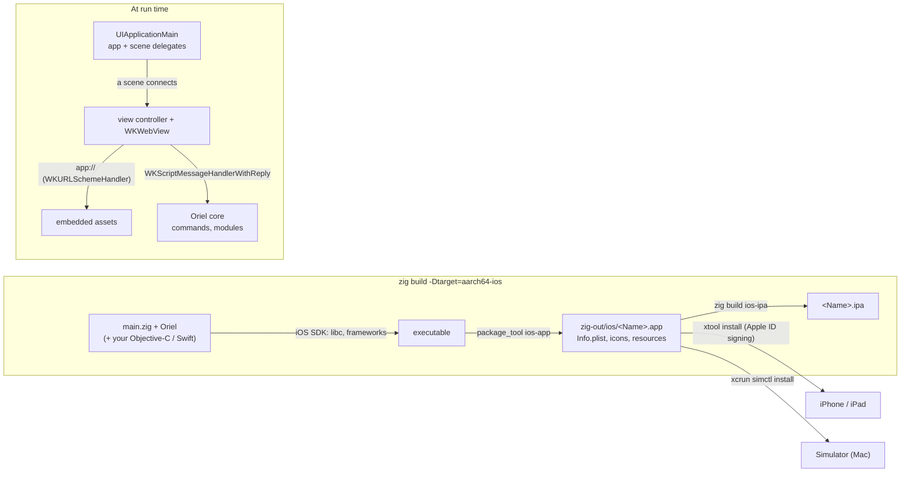

<!-- Generated from site/content/docs/ios.smd by tools/docs/gen-md.mjs: edit that file. -->

# iOS

Build an Oriel app for iPhone and iPad from a Mac or from Linux, run it on the simulator or a device, and package it: the SDK, the oriel ios CLI, the bundle and every .ios option.

The same `main.zig`, commands, events and web frontend that run on the
desktop build for iPhone and iPad. On iOS Oriel is UIKit with a `WKWebView`
per window, driven from Zig through the Objective-C runtime, as the macOS
backend is. The app is an ordinary executable in an `.app` bundle that Oriel
writes itself: no Xcode project, and no Objective-C or Swift unless you add
your own ([app extensions](extensions.md),
[platform hooks](platform-hooks.md)).

Linking needs Apple's iOS SDK. On a Mac it comes with Xcode; on Linux,
[xtool](https://github.com/xtool-org/xtool) extracts it from `Xcode.xip`
and also signs and installs the app on a device, so a Linux machine can
build, sign and install iOS apps.

## Availability

| | |
|---|---|
| Devices | iPhone and iPad, iOS 15 or newer (iOS 18 when the app has Swift sources) |
| Targets | `aarch64-ios` (devices), `aarch64-ios-simulator` (Apple-silicon Macs), `x86_64-ios-simulator` (Intel Macs) |
| Web view | `WKWebView` |
| Build on a Mac | Xcode: devices and the simulator |
| Build on Linux | xtool's SDK: devices (the simulator needs a Mac) |
| Packages | `.app` and `.ipa` (unsigned; signed by xtool or `codesign`) |

These modules don't exist on iOS, so an app's `.tray = true` resolves to
`oriel.tray.available = false` there ([Modules](modules.md)):
`tray`, `menu`, `global_shortcut`, `input`, `updater`, `media_server`,
`fs_watch`, `layer_shell`. `-Dtray=true` on Oriel's own command line for an
iOS target is a build error. Background work beyond audio uses
[platform hooks](platform-hooks.md) (background URLSessions).

## Quick start

On a Mac, install Xcode and open it once. On Linux, download `Xcode.xip`
from Apple's developer site (it needs your Apple ID in a browser), then:

```sh
oriel ios setup          # Linux: downloads xtool, installs usbmuxd, runs `xtool setup` (Apple ID, Xcode.xip)
```

In an Oriel app:

```sh
oriel ios build                                   # zig-out/ios/<Name>.app for a device
oriel ios install                                 # sign and install it on the connected device (xtool)
oriel ios dev --url http://192.168.1.20:5173/     # dev build against your dev server, installed
oriel ios dev --simulator                         # on a Mac: the booted simulator, with its console
```

For `dev`, run the frontend's dev server listening on the LAN
(`npm run dev -- --host`): a device can't reach the computer's
`localhost`, while the simulator shares the Mac's network.

## How it works



**Building.** `oriel.addApp` for an iOS target compiles the app against the
SDK (found from `-Dapple_sdk`, `$APPLE_SDK`, or Xcode's on a Mac;
`build/ios.zig`), linking UIKit, WebKit, Foundation, AVFoundation,
UserNotifications, UniformTypeIdentifiers and CoreLocation (plus
AudioToolbox and Speech with `audio_capture`). Oriel declares the
Objective-C runtime in Zig (`src/platform/apple/objc.zig`) instead of
translating SDK headers, so `zig build check` type-checks without an SDK.
Then `package_tool ios-app` (`tools/package/ios.zig`) writes the flat bundle
iOS expects: the executable, `Info.plist`, `PkgInfo` and the icons as loose
PNGs named in `CFBundleIcons` (no asset catalog, so no `actool`), plus
espeak-ng's data with `-Dkokoro` and extensions' `.ios.resources`.

**Simulator entitlements.** The simulator can't carry restricted
entitlements in a code signature, so simulator builds embed theirs the way
Xcode does: `application-identifier`, `get-task-allow` and the keychain
group, in the executable's `__TEXT,__entitlements` and `__TEXT,__ents_der`
sections (`build/ios_entitlements.zig`). Background URLSessions and the
keychain need them. On a Mac the simulator bundle is then signed ad hoc as
a whole (`codesign --sign -`), so the signature names the bundle id and
seals `Info.plist` and the resources.

**Running.** `App.run` calls `UIApplicationMain`, which never returns. The
app and scene delegates are defined at run time (`src/platform/ios/Shell.zig`).
Launching opens the main window and runs `setup`; the first scene the
system connects shows it. Each window is a view controller with a
`WKWebView` (`window.zig`): on iPad (Stage Manager, Split View) extra windows
get scenes of their own (`requestSceneSessionActivation`); on iPhone they are
presented full screen over the window in front. Closing one dismisses it;
the main window can't be closed. The page is laid out in the safe area
(below the status bar and the Dynamic Island, above the home indicator), so
pages need no `env(safe-area-inset-*)`; `fullscreen` gives it the whole
screen and hides the status bar and home indicator. Main-thread tasks run
from the GCD main queue. Assets come from `app://` through a
`WKURLSchemeHandler`; IPC goes over a `WKScriptMessageHandlerWithReply`
with the same token and isolation checks as every platform; JavaScript
`alert` / `confirm` / `prompt` are `UIAlertController`s.

**App events.** [`oriel.lifecycle`](lifecycle.md) reports
`background` (every window left the screen), `foreground`,
`memory_pressure` (`critical`: the memory warning) and `terminating`
(`applicationWillTerminate`). Deep links arrive through
`scene:willConnectToSession:options:` (cold start) and
`scene:openURLContexts:`, and as a link among the launch arguments
(`xcrun simctl launch <device> <id> myapp://...`)
([Deep links](deep-links.md)). Everything else from the
app and scene delegates reaches `.ios.hooks`. `quit` cleans up and calls
`exit` (Apple discourages quitting outside fatal errors).

## Examples

### Usage descriptions and background audio

```zig
_ = oriel.addApp(b, dep, .{
    .name = "memos",
    .root_source_file = b.path("src/main.zig"),
    .frontend = .{ .dir = "frontend" },
    .package = .{ .id = "com.example.memos", .name = "Memos", .version = "1.2.0" },
    .permissions = .{ .microphone = "Records your memos" }, // NSMicrophoneUsageDescription
    .url_schemes = &.{"memos"}, // CFBundleURLTypes
    .ios = .{
        .background_audio = true, // UIBackgroundModes: audio, keep recording in the background
        .usage_descriptions = &.{.{ .key = "NSMotionUsageDescription", .text = "Counts your steps" }},
    },
});
```

### A simulator build with your team's identifier

```zig
.ios = .{ .team_id = "ABCDE12345" }, // application-identifier ABCDE12345.com.example.memos
```

```sh
oriel ios build --simulator && oriel ios install --simulator
```

### An App Store build

```sh
oriel ios build --ipa -Doptimize=ReleaseFast    # zig-out/ios/<Name>.app and zig-out/<Name>.ipa
```

Sign the `.app` with a distribution certificate and provisioning profile
(`codesign`, or xtool), zip it again as `Payload/<Name>.app`, and upload the
`.ipa` with Transporter or `xcrun altool`.

[`examples/showcase`](https://github.com/highercomve/Oriel/tree/main/examples/showcase)
runs on iOS with the rest: dictation (whisper on Metal, background audio),
notes in SQLite, deep links (`oriel-showcase://`), the file pickers, a second
window (a scene of its own on iPad), its Objective-C hooks and extension, and
a Swift extension with `-Dswift_example`.

## Reference

### The SDK and tools

| Tool | Found from | Needed for |
|---|---|---|
| iOS SDK | `-Dapple_sdk=<iPhoneOS.sdk or iPhoneSimulator.sdk>`, else `$APPLE_SDK`, else `xcrun --sdk iphoneos\|iphonesimulator --show-sdk-path` on a Mac. The CLI also finds xtool's in `~/.swiftpm/swift-sdks/darwin.artifactbundle` (`$XDG_CONFIG_HOME/swiftpm` when set) on Linux and passes it. | Linking (not `zig build check`) |
| xtool | `PATH`, else `~/.oriel/xtool/xtool` (where `oriel ios setup` puts the pinned 1.21.0 Linux AppImage, SHA-256 checked) | Installing on a device (signing with your Apple ID); the SDK on Linux |
| usbmuxd | The distro's package (Linux) | xtool reaching the device over USB |
| Xcode (`xcrun simctl`) | A Mac | The simulator |
| `swiftc` | `$SWIFTC`, Xcode's, or `PATH` | Only Swift sources ([App extensions](extensions.md#apple-building)) |

Without the SDK, a build stops with `building for iOS needs the iOS SDK:
pass -Dapple_sdk=... or set $APPLE_SDK`. C dependencies (`sql`, `llama`,
`whisper`, `kokoro`) type-check against the SDK's libc when there is one,
else against Zig's own Darwin headers.

### `oriel ios`

| Command | What it does |
|---|---|
| `oriel ios build [--simulator] [--ipa] [-Doption[=value]...]` | `zig build -Dtarget=aarch64-ios` (or the simulator target for this Mac's CPU) `-Dapple_sdk=... -Doptimize=ReleaseSafe`; with `--ipa`, also `zig build ios-ipa`. |
| `oriel ios dev [--simulator] [--url URL] [-Doption[=value]...]` | `zig build ios-dev` (with `-Dios_dev_url=URL`), then installs the dev bundle and, on the simulator, launches it with its console (`xcrun simctl launch --console-pty booted <id>`). On a device, start it from the home screen. |
| `oriel ios install [--simulator] [--dev]` | Installs the last build (`zig-out/ios/` or, with `--dev`, `zig-out/ios-dev/`): `xtool install` for a device, `xcrun simctl install booted` for the simulator. |
| `oriel ios setup` | Finds or sets up the SDK and, on Linux, xtool and usbmuxd. |

When something is missing, the commands offer to set it up and ask first:
Enter accepts, `--yes` (`-y`) accepts without asking, and without a terminal
nothing is downloaded. Xcode.xip can't be downloaded for you, and
`xtool setup` runs only in a terminal (it asks for your Apple ID and the
path to Xcode.xip). usbmuxd is installed with the distro's package manager
(`sudo apt install usbmuxd`, or dnf, pacman, zypper). `build` and `dev`
forward `-D` options to `zig build` (an explicit `-Doptimize` replaces the
default); `install` and `setup` take none.

### `zig build` steps for iOS targets

| Step | What it does |
|---|---|
| `zig build -Dtarget=aarch64-ios` | The frontend built and embedded, the executable linked (`ReleaseSafe` unless `-Doptimize`), `zig-out/ios/<Name>.app`. |
| `zig build ios-dev -Dtarget=... [-Dios_dev_url=URL]` | The same app loading the dev server (`frontend.dev.url` by default), Debug, in `zig-out/ios-dev/<Name>.app`. The dev bundle allows plain HTTP (App Transport Security's `NSAllowsArbitraryLoads` and `NSAllowsLocalNetworking`). |
| `zig build ios-ipa -Dtarget=aarch64-ios` | `zig-out/<Name>.ipa`: `Payload/<Name>.app` zipped with `zip` (unsigned). |
| `zig build check -Dtarget=aarch64-ios` | Type-check only; no SDK needed. |

The minimum is iOS 15 (UIScene windows, `UTType`, WKWebView's media capture
permission delegate); `-Dtarget=aarch64-ios.17.0` raises it. Swift sources
(an app's, or Oriel's with `-Dsystem_ai`) raise it to 18.0, and an explicit
lower version is then a build error. `zig build types` doesn't work for iOS
targets: generate TypeScript with a native build.

### `AppOptions.ios`

| Field | Type | Default | Meaning |
|---|---|---|---|
| `background_audio` | `bool` | `false` | `UIBackgroundModes: audio`: keep capturing (`audio_capture`, dictation) or playing while the app is in the background. |
| `usage_descriptions` | `[]const UsageDescription` | `&.{}` | `Info.plist` usage keys no `.permissions` kind writes: `.{ .key = "NSMotionUsageDescription", .text = "..." }`. The key ends in `UsageDescription` (`[A-Za-z0-9_.~-]`), the text isn't empty (UTF-8, no control characters). A key a kind writes too takes this text. |
| `hooks` | `[]const PlatformHook` | `&.{}` | Platform hooks: classes conforming to `OrielPlatformHooks`, constructed at launch in this order, at most 16. See [Platform hooks](platform-hooks.md#apple-declare). |
| `team_id` | `?[]const u8` | `null` | Your Apple developer team ID (10 letters and digits): the prefix of the `application-identifier` embedded in simulator builds. Without it the identifier is `.<bundle id>`, which the simulator accepts. |

Native code and its bundle resources are declared on app extensions
(`.extensions[].ios`: `class`, `sources`, `swift_sources`, `frameworks`,
`weak_frameworks`, `resources`):
[App extensions](extensions.md#appoptions).

### The bundle's `Info.plist`

| Key | From |
|---|---|
| `CFBundleIdentifier`, `CFBundleDisplayName`, `CFBundleShortVersionString`, `CFBundleVersion` | `.package.id` (default `dev.oriel.<name>`), `.package.name`, `.package.version` (default `0.1.0`) |
| `MinimumOSVersion` | The target's minimum (15.0, or 18.0 with Swift) |
| `NSMicrophoneUsageDescription`, `NSCameraUsageDescription`, `NSLocationWhenInUseUsageDescription`, ... | `.permissions` (iOS terminates an app that uses one of these without its key); the reason, or the default text (`"<Name> ..."`) for `""`. The microphone also writes `NSSpeechRecognitionUsageDescription` with its text (dictation's system engine). |
| Other `NS...UsageDescription` keys | `.ios.usage_descriptions` |
| `CFBundleURLTypes` | `.url_schemes` |
| `CFBundleDocumentTypes`, `LSSupportsOpeningDocumentsInPlace` | `.share_target` types |
| `UIBackgroundModes: audio` | `.ios.background_audio` |
| `NSAppTransportSecurity` (arbitrary loads, local networking) | Dev bundles only |
| `UIApplicationSceneManifest` (multiple scenes), `NSUserActivityTypes` | Always: windows are scenes on iPad |
| `UILaunchScreen` (empty), all four orientations, `UIDeviceFamily` (iPhone and iPad), `CADisableMinimumFrameDurationOnPhone` (ProMotion) | Always |
| `UIRequiredDeviceCapabilities: arm64`, `CFBundleSupportedPlatforms`, `DTPlatformName` | Device or simulator builds |
| `CFBundleIcons` | `.icon`, resized to loose PNGs (transparency composited over white: iOS icons are opaque) |

### Signing and installing

- **A device, for development:** `oriel ios install` runs `xtool install`,
  which signs the bundle with your Apple ID's development certificate and a
  provisioning profile, then installs it over USB or Wi-Fi. It works from
  Linux and from a Mac (install xtool there by its own instructions; the
  CLI downloads it only on Linux).
- **The simulator:** a Mac with Xcode; `oriel ios install --simulator` or
  `xcrun simctl install booted zig-out/ios/<Name>.app`. Simulator bundles are
  signed ad hoc on a Mac.
- **The App Store and TestFlight:** sign with a distribution certificate
  (`codesign` or xtool) and upload the `.ipa` with Transporter or
  `xcrun altool`. The bundle Oriel writes is unsigned, and Oriel writes no
  device entitlements file: capabilities such as push notifications
  (`aps-environment`) come from the provisioning profile and the signing
  step. See [Signing](signing.md).

### Modules on iOS

| Module | On iOS |
|---|---|
| [permissions](permissions.md) | AVCaptureDevice (microphone, camera), CLLocationManager (location when in use), UNUserNotificationCenter. Screen capture, system audio and accessibility don't exist for iOS apps: `denied`. `openSettings` opens the app's page in Settings. |
| [clipboard](clipboard.md) | `UIPasteboard` text and PNG; reading shows iOS's paste banner. |
| [notifications](notifications.md) | `UNUserNotificationCenter`, also shown while the app is in front; clicks and buttons through the center's delegate. |
| [dialogs](dialogs.md) | `UIDocumentPickerViewController`. `openFile` returns a copy in the app's temporary directory; `saveFile` asks for a folder. Call them from async commands. Folders with lasting access through security-scoped bookmarks (`openFolder`, `saveToFolder`). |
| [camera](camera.md) | `capturePhoto`: `UIImagePickerController` for the camera (`error.Unsupported` on the simulator), `PHPickerViewController` for the library. `<input type="file" accept="image/*" capture>` is WKWebView's own. |
| audio_capture, [dictation](dictation.md) | `AVAudioSession` + AudioQueue; the system engine is Apple's Speech framework (on the device when the language's model is installed, else Apple's servers). |
| [store](store.md), [sql](sql.md) | As on macOS, in the app's sandbox. |
| [Local AI](local-ai.md) | ggml with Metal on devices (`-Dggml_metal`, on by default; off for the simulator, which uses the CPU). Chat and dictation use the CPU on phones until their Compare measures the GPU faster. |
| [tts](tts.md) | espeak-ng's data at `<Name>.app/espeak-ng-data`; Kokoro on Metal or the CPU's fast cores. |
| [system-ai](system-ai.md) | Apple Foundation Models (`-Dsystem_ai`): iOS 26 and Apple Intelligence at run time; Swift raises the minimum to iOS 18. |

Logs go to stderr (Xcode's console, `xcrun simctl launch --console-pty`)
and to `Library/Logs/<id>/app.log` in the app's sandbox
([Logging](logging.md)).

### Migrating from 0.11

- `oriel.ios.onSystemEvent` is gone: use [`oriel.lifecycle`](lifecycle.md)
  (`background`, `foreground`, `memory_pressure`, `terminating`), and
  `.ios.hooks` for the rest of the app and scene delegates.

### Limits

- Window size, placement, always-on-top, click-through and dragging are
  no-ops: the system decides.
- The simulator needs a Mac; Linux builds and installs for devices only.
- Swift sources need iOS 18; without them, iOS 15.
- No self-update (the App Store updates apps).

## Troubleshooting

- **`building for iOS needs the iOS SDK`**: run `oriel ios setup`, set
  `$APPLE_SDK`, or pass `-Dapple_sdk`. `zig build check` works without it.
- **The device shows a blank page in a dev build**: it can't reach
  `localhost`. Pass `--url http://<LAN address>:<port>/` and run the dev
  server with `--host`.
- **`the simulator needs Xcode (xcrun simctl)`**: the simulator runs only on
  a Mac; on Linux install on a device.
- **Background downloads or the keychain fail on the simulator**: build with
  Oriel's simulator target so the entitlements are embedded; set
  `.ios.team_id` if your code checks the team prefix.
- **`iOS 16.0 is below what Swift supports here`**: an app with Swift sources
  targets iOS 18 or later; drop the explicit lower version.
- **xtool can't find the device on Linux**: install and start usbmuxd
  (`oriel ios setup` offers to), and trust the computer on the device.

## Related

- [Platform hooks](platform-hooks.md): Objective-C or Swift
  in the app and scene delegates and WebKit delegates.
- [App extensions](extensions.md): Objective-C or Swift your
  Zig calls; building Swift on Linux.
- [Permissions](permissions.md): usage descriptions and
  runtime prompts.
- [Android](android.md) and [Desktop](desktop.md):
  the other platforms.
