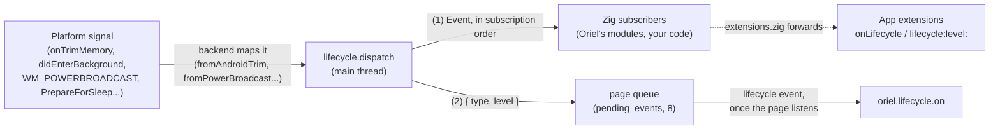

<!-- Generated from site/content/docs/lifecycle.smd by tools/docs/gen-md.mjs: edit that file. -->

# Lifecycle

Background and foreground, memory pressure, sleep and wake, and the end of the app: one set of events on every platform, for Zig and for the page.

`oriel.lifecycle` turns each platform's own signals (an Activity stopped,
`applicationWillTerminate`, `WM_ENDSESSION`, logind's `PrepareForSleep`,
GMemoryMonitor...) into six events: `background`, `foreground`,
`memory_pressure`, `suspend`, `resume` and `terminating`. Zig code
subscribes to them; the page listens with `oriel.lifecycle.on`. Use it to
save a draft before iOS suspends the app, free caches when the system runs
low on memory, close connections before the machine sleeps, and flush state
before the app ends.

It is part of Oriel's core: no build flag, no permission, no native code.
When you need an event Oriel doesn't map (scene changes, configuration
changes, a Dock reopen), use a [platform hook](platform-hooks.md).

## Availability

| Event | Linux | Windows | macOS | Android | iOS |
|---|---|---|---|---|---|
| `background` / `foreground` | - | - | - | yes | yes |
| `memory_pressure` | yes (GMemoryMonitor) | yes (`critical` only) | yes | yes | yes (`critical` only) |
| `suspend` / `resume` | yes (logind) | yes | yes | - | - |
| `terminating` | yes | yes | yes | when the app itself ends | yes |

Always built; nothing to declare in `build.zig`. Sleep events on Linux need
the system D-Bus (not there in most containers: then no sleep events, and
nothing else changes).

## Quick start

```zig
const std = @import("std");
const oriel = @import("oriel");
const app = @import("oriel_app");

pub fn main(init: std.process.Init) !u8 {
    try oriel.lifecycle.subscribe(onLifecycle);
    return oriel.main(init, .{ .commands = struct {}, .events = struct {} }, .{
        .app = app.build,
        .window = .{ .title = "My App", .width = 800, .height = 600 },
    });
}

fn onLifecycle(event: oriel.lifecycle.Event) void {
    switch (event) {
        .background => saveDraft(),
        .memory_pressure => |level| if (level == .critical) dropCaches(),
        .terminating => flush(),
        else => {},
    }
}

fn saveDraft() void {}
fn dropCaches() void {}
fn flush() void {}
```

In the page:

```js
const off = oriel.lifecycle.on((e) => {
  if (e.type === "background") saveScrollPosition();
  if (e.type === "memory_pressure" && e.level === "critical") clearImageCache();
});
```

## How it works



Each platform shell watches its own signals and calls
`lifecycle.dispatch` on the main thread (`src/platform/<os>/Shell.zig`,
and `OrielRuntime.kt` on Android). The mapping from a platform value to an
event is a pure function in `src/core/lifecycle.zig` (`fromAndroidTrim`,
`fromDispatchMemoryPressure`, `fromPowerBroadcast`, `fromGioMemoryWarning`),
tested on every host.

`dispatch` logs the event (`info(lifecycle): background`), calls every Zig
subscriber in the order they subscribed, then hands `{ type, level }` to the
page. Subscribers live in a fixed table of 16 slots filled lock-free, so any
thread may subscribe while the main thread dispatches; Oriel's own modules
take slots from the same table.

The page side is a pending-events queue (`src/core/pending_events.zig`): until a page calls
`oriel.lifecycle.on` (or `oriel.listen("lifecycle", ...)`), events are kept,
up to 8 (the oldest is dropped); when it listens, the bridge sends
`events:ready` and the kept events are emitted, then later ones as they
come. Events go to every window's page.

**Where each event comes from:**

| Event | Android | iOS | macOS | Windows | Linux |
|---|---|---|---|---|---|
| `background` / `foreground` | the started Oriel Activities reach 0 / leave 0 (a configuration change isn't one; the launch isn't a `foreground`) | `UIApplicationDidEnterBackgroundNotification` / `WillEnterForeground` (only after a background) | - | - | - |
| `memory_pressure` | `onTrimMemory`: RUNNING_LOW (10) `moderate`; RUNNING_CRITICAL (15), BACKGROUND (40) and above `critical`; `onLowMemory` is COMPLETE | memory warning: `critical` | `DISPATCH_SOURCE_TYPE_MEMORYPRESSURE`: WARN `moderate`, CRITICAL `critical` | `CreateMemoryResourceNotification(LowMemoryResourceNotification)`: `critical`, once per episode (polled every 5 s until it clears) | `GMemoryMonitor::low-memory-warning`: LOW and MEDIUM `moderate`, CRITICAL `critical` |
| `suspend` / `resume` | - | - | `NSWorkspaceWillSleepNotification` / `DidWakeNotification` | `WM_POWERBROADCAST`: `PBT_APMSUSPEND` / `PBT_APMRESUMEAUTOMATIC` | logind `PrepareForSleep(true/false)` on the system bus |
| `terminating` | `App.quit`, or the last window closed (Android ends processes without warning otherwise) | `applicationWillTerminate`, `App.quit` | quit (Cmd+Q, `App.quit`, SIGTERM, SIGINT) | quit (`App.quit`), `WM_ENDSESSION` (logoff, restart, shutdown) | quit (`App.quit`, SIGTERM, SIGINT) |

**`terminating`** comes at most once per run, while the windows still exist
where the platform allows it, so subscribers can still post to the main
thread. A desktop run that ends without a backend announcing it (the last
window closed) still sends it to the Zig subscribers once the main loop
returns (`oriel.main`, `terminateAfterLoop`); the pages are gone by then. On
Windows, `WM_ENDSESSION` is the last chance: Windows may end the process as
soon as the message returns, so Oriel dispatches `terminating` right there,
from its hidden host window.

**Oriel's own modules clean up on `terminating`** and react to the other
events through the same table:

- `oriel.chat`, `oriel.dictation` and `oriel.tts` free their models on
  `memory_pressure` (critical, by default) unless busy, following their
  `unload_on` ([`UnloadOn`](#unload-on)).
- `oriel.dictation` on Android shuts its system recognizer down on
  `terminating`.
- `oriel.notification` on Windows removes its notification-area icon on
  `terminating`.
- On Android, Oriel purges bionic's malloc caches (`mallopt(M_PURGE)`) on
  `memory_pressure` and `background`, after the modules that subscribed
  earlier freed their models.
- [App extensions](extensions.md) get every event: Oriel
  subscribes once for all of them when the app declares any.

## Examples

### Unload models in the background (iOS)

iOS suspends the app soon after `background`, and a large model is what
gets a suspended app ended. The showcase frees its models on `background`
too, on iOS only:

```zig
fn setup() !void {
    if (oriel.target.is_ios) {
        const unload_on: oriel.lifecycle.UnloadOn = .{ .background = true };
        oriel.dictation.unload_on = unload_on;
        oriel.chat.unload_on = unload_on;
        oriel.tts.unload_on = unload_on;
    }
}
```

The next dictation, reply or utterance loads them again
(`examples/showcase/src/main.zig`, `unloadModelsInBackground`).

### Close a connection around sleep (desktop)

```zig
var sync: ?*Sync = null;

fn onLifecycle(event: oriel.lifecycle.Event) void {
    switch (event) {
        .suspend_ => if (sync) |s| s.disconnect(),
        .resume_ => if (sync) |s| s.reconnect(),
        else => {},
    }
}
```

Sleep events are best effort: a machine that loses power, or a desktop
session without logind, sends none.

### Save before the session ends (Windows)

```zig
fn onLifecycle(event: oriel.lifecycle.Event) void {
    if (event == .terminating) {
        // Main thread; return quickly. On logoff Windows may end the
        // process as soon as this returns.
        settings.writeNow() catch |err| std.log.err("save: {s}", .{@errorName(err)});
    }
}
```

Do the saving in Zig: the page's handler runs asynchronously and may not
get to run before the process ends.

### Track visibility in the page

```ts
import { lifecycle, type LifecycleEvent } from "./oriel";

lifecycle.on((e: LifecycleEvent) => {
  switch (e.type) {
    case "background": pausePolling(); break;
    case "foreground": resumePolling(); break;
    case "memory_pressure": if (e.level === "critical") thumbnails.clear(); break;
  }
});
```

## Reference

### Zig: `oriel.lifecycle`

```zig
pub const Pressure = enum {
    moderate,
    critical, // the process may be ended next
};

pub const Event = union(enum) {
    background,
    foreground,
    memory_pressure: Pressure,
    suspend_,
    resume_,
    terminating,

    /// "background", "foreground", "memory_pressure", "suspend", "resume", "terminating".
    pub fn name(self: Event) []const u8;
};

pub const Handler = *const fn (event: Event) void;
pub const max_subscribers = 16;
pub fn subscribe(handler: Handler) error{TooManySubscribers}!void;
```

| Declaration | Meaning |
|---|---|
| `Event.background` | Every window left the screen (Android: the last started Activity stopped; iOS: the app entered the background). Never sent on the desktop. Free what is cheap to rebuild. |
| `Event.foreground` | Back from `background` (never sent without a `background` first). |
| `Event.memory_pressure` | The system wants memory back; `critical` means the process may be ended next. No event when the pressure goes away. |
| `Event.suspend_`, `Event.resume_` | The machine is about to sleep / just woke (desktop, best effort). The trailing `_` avoids Zig keywords; the page sees `suspend` and `resume`. |
| `Event.terminating` | The app is ending: flush state, start no new work. At most once per run. |
| `Event.name()` | The name the page and app extensions see. |
| `subscribe(handler)` | Adds `handler`, from any thread. Up to `max_subscribers` (16), Oriel's own modules included; `error.TooManySubscribers` after that. There is no unsubscribe. A handler subscribed while an event is being dispatched starts with the next one. |

- **Threading.** Handlers run on the main thread, in subscription order.
  Return quickly: iOS suspends the app soon after the `background` handlers
  return, and Windows may end the process when `terminating` returns on
  `WM_ENDSESSION`.
- **When to subscribe.** Before `oriel.main` or in `setup`, so nothing is
  missed; events aren't replayed to late Zig subscribers.
- **Oriel's slots.** Depending on the build, Oriel's modules take up to
  six (`chat`, `dictation`, `tts`, the Windows notification icon, the
  Android malloc purge, app extensions); each logs a warning if the table is
  already full.

Oriel's shells call these; apps don't need them: `dispatch(event)` (main
thread), `post(event)` (`dispatch` from any thread), `beginRun()`,
`terminateAfterLoop()`, `Table(capacity)`, the platform mappings
(`fromAndroidTrim`, `fromDispatchMemoryPressure`, `fromPowerBroadcast`,
`fromGioMemoryWarning`), and `PageEvent` (the page's payload, below).

### Zig: `UnloadOn`

What a local-AI module frees its models on. `oriel.chat.unload_on`,
`oriel.dictation.unload_on` and `oriel.tts.unload_on` are variables of this
type, read at each event, so they can be changed at any time (main thread).

```zig
pub const UnloadOn = struct {
    background: bool = false,
    /// The lowest pressure that unloads; null never does.
    memory_pressure: ?Pressure = .critical,

    pub fn wants(self: UnloadOn, event: Event) bool;
};
```

| Value | Unloads on |
|---|---|
| `.{}` (default) | critical memory pressure |
| `.{ .background = true }` | the background, and critical memory pressure |
| `.{ .memory_pressure = .moderate }` | any memory pressure |
| `.{ .memory_pressure = null }` | never |

A module that is busy (answering, listening, speaking) keeps its model; the
next use loads it again ([Chat](chat.md),
[Dictation](dictation.md), [Text to speech](tts.md)).

### Page: `oriel.lifecycle`

```ts
interface LifecycleEvent {
  type: "background" | "foreground" | "memory_pressure" | "suspend" | "resume" | "terminating";
  level: "moderate" | "critical" | null; // set for memory_pressure only
}

interface LifecycleApi {
  /** Events from before the page listened come first. Returns an unsubscribe function. */
  on(callback: (event: LifecycleEvent) => void): () => void;
}
```

- `oriel.lifecycle.on(cb)` is `oriel.listen("lifecycle", cb)`; the event
  is also in the generated `Events` type, so `listen("lifecycle", ...)`
  from the generated `oriel.ts` is typed. The generated module exports
  `lifecycle`.
- **Queue.** Until the first listener, up to 8 events are kept (oldest
  dropped) and handed to it; the queue is per app, not per window.
- **`terminating` in the page** arrives only when a backend dispatches it
  while the pages exist, and the page may not run before the process ends.
  A run that ends with the last window closed sends it to Zig only.
- Events go to every window's page. Once one page has listened, later
  events are emitted at once, so a window opened or reloaded later sees
  only the events from then on.

### App extensions

Every loaded [app extension](extensions.md) gets each event
on the main thread, in declaration order, with the name above and the level
for `memory_pressure` (else null):

| Platform | Method |
|---|---|
| Android | `OrielAppExtension.onLifecycle(event: String, level: String?)` |
| iOS, macOS | `- (void)lifecycle:(NSString *)event level:(nullable NSString *)level` (optional) |
| Zig (desktop) | `pub fn onLifecycle(event: oriel.lifecycle.Event) void` in the extension's module |

### Android system events

`oriel.android.onSystemEvent` and the page's `android:event` carry
Android-only events (the quick-settings tile, the keyboard, media buttons).
Memory pressure isn't one of them: it is `memory_pressure` here, as on
every platform ([Android](android.md)).

### Migrating from 0.11

- `App.Config.on_session_end` is gone: subscribe and handle `terminating`,
  which every platform sends (on Windows at `WM_ENDSESSION`).
- `oriel.ios.onSystemEvent` is gone: subscribe to `oriel.lifecycle`.
- Android's `"trim-memory"` no longer reaches `oriel.android.onSystemEvent`
  or `android:event`: handle `memory_pressure`.

## Troubleshooting

- **`lifecycle: no room to unload on memory pressure`** (or another
  module's `no room` warning): 16 subscribers are taken. Combine your
  handlers into one.
- **No `background` on the desktop.** By design: desktop windows minimize
  and hide individually; use window events
  ([Windows](windows.md)).
- **No `suspend` / `resume` on Linux.** The app has no system bus (a
  container, a sandbox without it); the log says `no system bus, no sleep
  events` at debug level.
- **No `memory_pressure` on Linux.** GLib picks the source (PSI,
  low-memory-monitor or the portal); without any, no warnings come.
- **A save in the page's `terminating` handler is lost.** Move it to Zig,
  or save on `background` and as the user goes.
- The log shows every event: `info(lifecycle): memory pressure (critical)`,
  `info(lifecycle): terminating`.

## Related

- [Platform hooks](platform-hooks.md): every native app,
  scene and Activity event, in Kotlin, Objective-C, Swift or Zig.
- [App extensions](extensions.md): native code that gets
  these events too.
- [Local AI](local-ai.md): the modules that unload their
  models on memory pressure.
- [Windows](windows.md): per-window events (close, focus,
  hide).
