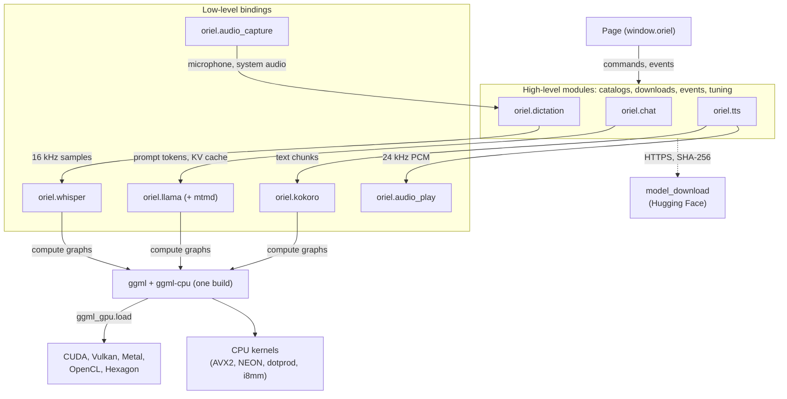

<!-- Generated from site/content/docs/local-ai.smd by tools/docs/gen-md.mjs: edit that file. -->

# Local AI

On-device inference with llama.cpp, whisper.cpp and Kokoro on one shared ggml build, on the CPU or the GPU (CUDA, Vulkan, Metal, OpenCL, Hexagon), on every platform.

Oriel compiles [llama.cpp](https://github.com/ggml-org/llama.cpp) (text and
vision models), [whisper.cpp](https://github.com/ggml-org/whisper.cpp)
(speech recognition) and kokoro.cpp (speech synthesis) into the app, on one
shared build of their tensor library, ggml. This page is the low-level
layer: the build flags, the GPU backends, the thin Zig bindings
`oriel.llama`, `oriel.whisper` and `oriel.ggml_gpu`, how models are
downloaded, and how memory is given back.

Most apps don't start here. The high-level modules carry the tuning, the
model catalogs, the downloads and the page events:

| You want | Use | Built on |
|---|---|---|
| A chat or a completion from a local LLM | [Chat](chat.md) (`oriel.chat`) | `oriel.llama` |
| Live dictation, or the text of a recording | [Dictation](dictation.md) (`oriel.dictation`) | `oriel.whisper`, `oriel.audio_capture` |
| Text read aloud | [Text to speech](tts.md) (`oriel.tts`) | `oriel.kokoro`, `oriel.audio_play` |
| The phone's own model, nothing to download | [System AI](system-ai.md) (`oriel.system_ai`) | Gemini Nano, Foundation Models (no ggml) |
| Your own pipeline: vision models, embeddings, timestamps | This page | ggml |

The low-level modules stay public next to the high-level ones: an app can use
`oriel.chat` for its chat and call `oriel.llama.c` directly for something
`chat` doesn't do, in the same process, on the same ggml.

## Availability

| Platform | CPU | GPU and NPU backends | Default |
|---|---|---|---|
| Linux | x86-64 (AVX2 by default in production builds) and arm64 | CUDA (`-Dggml_cuda`, `libggml-cuda.so`), Vulkan (`-Dggml_vulkan`, `libggml-vulkan.so`) | CPU |
| Windows | x86-64 and arm64 | Vulkan (`-Dggml_vulkan`, compiled into the executable) | CPU |
| macOS | Apple Silicon and x86-64 | Metal (compiled in) | Metal on |
| Android | arm64 with dotprod kernels (`-Dggml_arm`), x86-64 | Vulkan (`-Dggml_vulkan`), OpenCL on Adreno (`-Dggml_opencl`), Hexagon NPU (`-Dggml_hexagon_prebuilt`), all compiled in or shipped in the APK | CPU, dotprod |
| iOS | arm64 | Metal on devices (compiled in); none on the simulator | Metal on devices |

| Module | Turned on by | Notes |
|---|---|---|
| `oriel.llama` | `.llama = true` | MIT |
| llama.cpp's multimodal library (`mtmd`) | `.llama_mtmd = true` | needs `.llama` |
| `oriel.whisper` | `.whisper = true` | MIT; Silero VAD built in |
| `oriel.kokoro` | `.kokoro = true` | needs `.llama` or `.whisper`; GPL-3 data ([Text to speech](tts.md)) |
| `oriel.ggml_gpu` | any of `.llama`, `.whisper` | |

All are off by default; an app without them downloads, compiles and links
none of it. Local inference needs no permission. Downloading models needs
network access (Android's template already declares `INTERNET`).

## Quick start

Turn whisper on in `build.zig`:

```zig
const dep = b.dependency("oriel", .{
    .target = target,
    .optimize = optimize,
    .whisper = true,
});
```

Transcribe 16 kHz mono samples on a worker thread (an async command, or
`oriel.App.spawn`):

```zig
const std = @import("std");
const oriel = @import("oriel");
const whisper = oriel.whisper;

fn transcribe(io: std.Io, gpa: std.mem.Allocator, models_dir: []const u8, samples: []const f32) ![]u8 {
    whisper.silenceLogs();
    _ = oriel.ggml_gpu.load(io); // the GPU backend, if any; 0 = CPU

    const path = try std.fs.path.joinZ(gpa, &.{ models_dir, "ggml-base-q8_0.bin" });
    defer gpa.free(path);
    const ctx = try whisper.loadModel(path, whisper.contextDefaultParams());
    defer ctx.deinit();

    const vad = try whisper.VadModel.install(io, gpa, models_dir); // skip silence
    defer gpa.free(vad);
    return ctx.transcribe(gpa, samples, .{
        .language = "auto",
        .vad_model = vad,
        .audio_ctx = whisper.audioCtxFor(samples.len),
    });
}
```

The model file is whisper.cpp's ggml format
(`https://huggingface.co/ggerganov/whisper.cpp`). For live microphone
dictation with the models downloaded for you, use
[Dictation](dictation.md) instead.

## How it works



**One ggml.** llama.cpp and whisper.cpp each vendor ggml. Built twice, the
two copies would collide (duplicate symbols, and different struct layouts
behind the same names). `build/ggml.zig` compiles a single `ggml` and
`ggml-cpu` from llama.cpp's tree when `.llama` is on (else whisper.cpp's),
and compiles llama.cpp, whisper.cpp and kokoro.cpp against it. Kokoro has no
ggml of its own, which is why `.kokoro` needs `.llama` or `.whisper`.

**Always optimized.** ggml, llama.cpp and whisper.cpp are compiled with
`-O2` even in a Debug app: at `-O0` whisper ran about 30 times slower (223 s
for 8 s of audio on a Pixel). Zig's UB sanitizer is off for them (ggml does
pointer arithmetic on NULL on purpose).

**CPU kernels.** ggml picks its SIMD kernels at compile time from the target
CPU. On x86-64, `oriel build`, `oriel package` and `oriel run` default to
`-Dcpu=x86_64_v3` (AVX2 and FMA: Intel Haswell 2013+, AMD 2015+) when no
`-Dtarget` or `-Dcpu` is given, so a binary built on a CI runner doesn't die
with "illegal instruction" on an older machine; arm64 builds default to
`baseline` (`apple_m1` on macOS). On arm64 Android, `-Dggml_arm=dotprod`
(the default) compiles ggml's quantized dot products and its repacked q4_0
and q8_0 matrix kernels for ARMv8.2 (every phone since 2018); `i8mm` adds
the Armv8.6 matrix instructions. Only ggml, llama.cpp and whisper.cpp get
these flags; the rest of the app keeps the target's baseline. Before a model
loads, `ggml_gpu.cpuSupported()` reads the CPU's `AT_HWCAP` bits, and
`llama.loadModel` / `whisper.loadModel` return `error.CpuUnsupported`
instead of crashing with SIGILL on a CPU without them.

**GPU backends** (`src/modules/ggml_gpu.zig`). Nothing GPU-related happens at
startup. The high-level modules call `ggml_gpu.load(io)` the first time they
need a model (or report a status); your own code calls it before loading a
model. It is serialized (ggml's backend registry isn't thread-safe) and
returns the number of GPU devices; 0 means the CPU.

- **Linux:** CUDA and Vulkan are separate libraries, `libggml-cuda.so` and
  `libggml-vulkan.so`, which `addApp` installs next to the executable and
  links the executable with `rdynamic` so they resolve ggml's symbols from
  it. `load` looks only in the executable's directory (never the current
  one), tries CUDA first and Vulkan only if CUDA registered no GPU (an
  NVIDIA card would otherwise appear twice and ggml would split a model
  across the "two" devices). A library that can't load (no driver, no
  cuBLAS, no Vulkan loader) is logged and skipped. CUDA stays a separate
  library because nvcc's host code uses GCC's libstdc++ and Zig builds C++
  against libc++; the ggml backend interface between them is plain C.
- **Windows:** Vulkan is compiled into the executable (a DLL couldn't take
  ggml's symbols from it). The executable doesn't link `vulkan-1.lib`; `load`
  opens `vulkan-1.dll` from System32 (`src/modules/ggml_vulkan_loader.c`),
  creates the Vulkan instance without implicit layers (overlays, capture
  hooks, and NVIDIA's Optimus layer, which crashed the process on an Optimus
  laptop), and registers the backend. Without the DLL it logs
  `ggml: no Vulkan loader (vulkan-1.dll); CPU only`.
- **macOS and iOS:** ggml's Metal backend is compiled in with its kernel
  sources embedded (`tools/metal_embed.zig`, as ggml's CMake does with
  `GGML_METAL_EMBED_LIBRARY`), so no Xcode `metal` step or `.metallib` is
  needed; ggml compiles the kernels for the GPU when a model loads. Metal
  registers itself. The iOS simulator gets no Metal by default: its Metal
  lacks what ggml's kernels need, and loading a model there ends the app.
- **Android:** every backend is inside `liboriel.so` or the APK, behind a
  runtime loader (the JVM loads `liboriel.so` with local symbols, so a
  separate backend library couldn't see ggml). `load` tries, in order, the
  Hexagon NPU (`libggml-hexagon.so`, present only when built with
  `-Dggml_hexagon_prebuilt`), OpenCL (only on a GPU named Adreno: ggml's
  OpenCL kernels are written for it; the device's `libOpenCL.so` is opened
  by `src/modules/ggml_opencl_loader.c`) and Vulkan (the system's
  `libvulkan.so`, `src/modules/ggml_vulkan_loader_android.c`). Each
  candidate must pass a **self-test**: a 64x32 by 32x16 matrix product on the
  device, compared with the CPU's (drivers that load and compute garbage
  exist). The first that passes wins; `backendName()` says which. A device
  whose name matches `$ORIEL_GGML_BLOCKLIST` is skipped, and
  `ORIEL_GGML_CPU=1` keeps everything on the CPU.

Whether a model then runs on the GPU is each module's choice: `chat` and
`dictation` remember, per model, what their `compare()` measured on this
device; `tts` uses the GPU when ggml has one. Phones default to the CPU in
`chat` and `dictation`, because ggml's ARM kernels often beat mobile GPU
drivers.

**Model downloads** (`src/modules/model_download.zig`, internal: `chat`,
`dictation` and `tts` use it, apps don't call it). A download is an HTTPS
GET into `<dir>/<file>.part`, renamed to `<file>` only when complete (and,
for `tts`, only when its SHA-256 matches). Redirects (Hugging Face sends
files to its CDN) are followed by hand, at most 5, each one checked to be
`https` with a host and no credentials; `http` anywhere is
`error.InsecureModelUrl`. Without a `Content-Length` the download stops at
four times the catalog's size (`error.DownloadTooLarge`), and a body shorter
than its length is `error.Truncated`. Progress is reported once per
megabyte. On Android host names resolve through bionic (the app's `io`); on
iOS the download goes through `NSURLSession`
(`src/modules/model_download/ios.zig`), since Zig's TLS finds no CA
certificates there. A file counts as present when it exists and is larger
than 1 MiB (whisper, chat) or has exactly the catalog's size (tts), so a
`.part` left by an interrupted download is never mistaken for a model.

**Memory.** A loaded model stays loaded between uses: reloading costs
seconds. Each high-level module subscribes to
[`oriel.lifecycle`](lifecycle.md) and, by default, frees its
models on **critical** memory pressure, unless it is using them right then
(then it returns at once; the next use loads them again). `unload_on`
changes when: `.{ .background = true }` also frees them when the app goes to
the background (what iOS apps should do: a suspended app holding a large
model is the one iOS ends), `.{ .memory_pressure = .moderate }` frees them
earlier, `.{ .memory_pressure = null }` never. On Android, Oriel also purges
bionic's allocator caches on memory pressure and in the background, after the
modules have freed their models. `App.run` releases `tts`'s and
`dictation`'s contexts and threads after its command pool drains; `chat`'s
model lives until the process ends. Models you load yourself are yours to
free (`Model.deinit`, `Context.deinit`).

## Examples

### Generate text with the llama.cpp API

`oriel.llama.c` is llama.cpp's whole C API (`llama.h`, and ggml's through
it). A greedy completion, on a worker thread:

```zig
const std = @import("std");
const oriel = @import("oriel");
const llama = oriel.llama;
const c = llama.c;

fn complete(io: std.Io, gpa: std.mem.Allocator, path: [:0]const u8, prompt: []const u8) ![]u8 {
    llama.silenceLogs();
    llama.initBackend();
    defer llama.deinitBackend();
    const gpus = oriel.ggml_gpu.load(io);

    var mp = llama.modelDefaultParams();
    mp.n_gpu_layers = if (gpus > 0) 999 else 0;
    const model = try llama.loadModel(path, mp);
    defer model.deinit();
    const vocab = c.llama_model_get_vocab(model.handle);

    var cp = c.llama_context_default_params();
    cp.n_ctx = 2048;
    const ctx = c.llama_init_from_model(model.handle, cp) orelse return error.ContextFailed;
    defer c.llama_free(ctx);

    var tokens: [512]c.llama_token = undefined;
    const n = c.llama_tokenize(vocab, prompt.ptr, @intCast(prompt.len), &tokens, tokens.len, true, true);
    if (n < 0) return error.PromptTooLong;
    if (c.llama_decode(ctx, c.llama_batch_get_one(&tokens, n)) != 0) return error.DecodeFailed;

    const sampler = c.llama_sampler_init_greedy();
    defer c.llama_sampler_free(sampler);
    var out: std.ArrayList(u8) = .empty;
    errdefer out.deinit(gpa);
    for (0..128) |_| {
        var tok = c.llama_sampler_sample(sampler, ctx, -1);
        if (c.llama_vocab_is_eog(vocab, tok)) break;
        var piece: [256]u8 = undefined;
        const len = c.llama_token_to_piece(vocab, tok, &piece, piece.len, 0, false);
        if (len > 0) try out.appendSlice(gpa, piece[0..@intCast(len)]);
        if (c.llama_decode(ctx, c.llama_batch_get_one(@ptrCast(&tok), 1)) != 0) break;
    }
    return out.toOwnedSlice(gpa);
}
```

`src/modules/chat.zig` is the full version: chat templates, KV-cache reuse,
a resident threadpool, sampling chains and grammars.

### Constrain output to a JSON schema

```zig
const gbnf = try oriel.llama.jsonSchemaToGrammar(gpa,
    \\{"type":"object","properties":{"caption":{"type":"string"},"people":{"type":"integer"}},"required":["caption"]}
, null);
defer gpa.free(gbnf);
const grammar = c.llama_sampler_init_grammar(vocab, gbnf.ptr, "root") orelse return error.InvalidSchema;
defer c.llama_sampler_free(grammar);
// Add it to the sampler chain, or apply it to the candidates before sampling.
```

`oriel.chat`'s `.schema` option does this for you.

### Describe an image with a vision model

With `.llama_mtmd = true`, llama.cpp's multimodal library (`mtmd.h`,
`mtmd-helper.h`) is in `oriel.llama.c`. Vision models come with a projector,
the `mmproj-*.gguf` file next to the model on Hugging Face:

```zig
var mp = c.mtmd_context_params_default();
mp.use_gpu = true;
const vision = c.mtmd_init_from_file("mmproj-F16.gguf", model.handle, mp) orelse return error.ProjectorFailed;
defer c.mtmd_free(vision);
const bmp = c.mtmd_helper_bitmap_init_from_buf(vision, png.ptr, png.len, false, c.mtmd_helper_init_opt_default()).bitmap;
// The prompt holds c.mtmd_default_marker() where the image goes:
_ = c.mtmd_tokenize(vision, chunks, &input_text, &bitmaps, 1);
_ = c.mtmd_helper_eval_chunks(vision, ctx, chunks, 0, 0, 512, true, &n_past);
// ... then sample as for text.
```

The library is built from the same sources as llama.cpp's CMake
(`add_library(mtmd ...)`), with the header-only `stb_image` (PNG, JPEG, BMP,
GIF) and `miniaudio`; video (`MTMD_VIDEO`, which runs `ffmpeg`) stays off.
The projector runs on the model's backend. Upstream marks the API
experimental, so it changes with llama.cpp: code against the version Oriel
pins. GhostPen uses it for Extract Text on its built-in models.

### Segment timestamps from whisper

`Context.transcribe` joins the segments' text. For timestamps, run
`whisper_full` yourself with Oriel's parameters:

```zig
const w = oriel.whisper;
const params = w.fullParams(.{ .language = "en", .vad_model = vad_path });
if (w.c.whisper_full(ctx.handle, params, samples.ptr, @intCast(samples.len)) != 0) return error.TranscribeFailed;
const n = w.c.whisper_full_n_segments(ctx.handle);
for (0..@intCast(n)) |i| {
    const t0 = w.c.whisper_full_get_segment_t0(ctx.handle, @intCast(i)); // in 10 ms units
    const text = std.mem.span(w.c.whisper_full_get_segment_text(ctx.handle, @intCast(i)));
    std.log.info("{d}.{d:0>2}s {s}", .{ @divTrunc(t0, 100), @mod(t0, 100), text });
}
```

With voice detection on, whisper.cpp maps the timestamps back onto the
original audio.

### One Linux build for every GPU

Forward the options from the app's `build.zig` to the dependency, as
`examples/showcase/build.zig` does:

```zig
const dep = b.dependency("oriel", .{
    .target = target,
    .optimize = optimize,
    .llama = true,
    .whisper = true,
    .ggml_cuda = b.option(bool, "ggml_cuda", "NVIDIA GPUs through CUDA") orelse false,
    .cuda_arch = b.option([]const u8, "cuda_arch", "nvcc -arch, or compute capabilities"),
    .ggml_vulkan = b.option(bool, "ggml_vulkan", "Any GPU through Vulkan") orelse false,
});
```

```sh
oriel package -Dggml_cuda -Dggml_vulkan -Dcuda_arch=75,86,89,120a
```

The deb, rpm and AppImage carry both libraries. An NVIDIA machine with the
CUDA runtime uses CUDA; AMD and Intel GPUs use Vulkan; a machine without a
Vulkan loader runs on the CPU. `75,86,89,120a` builds machine code for
Turing, Ampere, Ada and Blackwell GeForce, plus PTX for the newest generic
one that later GPUs compile at load.

### Android: GPU, Adreno and the Snapdragon NPU

```zig
const dep = b.dependency("oriel", .{
    .target = target,
    .optimize = optimize,
    .whisper = true,
    .llama = true,
    .ggml_vulkan = true, // any GPU; glslc from the NDK
    .ggml_opencl = true, // Adreno
});
```

```sh
oriel build -Dtarget=aarch64-linux-android -Dggml_hexagon_prebuilt=/abs/path/hexagon-libs
```

`-Dggml_hexagon_prebuilt` is an option of the app's build (it is read by
`addApp`): a directory with `libggml-hexagon.so` and its DSP libraries
`libggml-htp-v*.so`, built by llama.cpp's Snapdragon toolchain
(`ghcr.io/snapdragon-toolchain/arm64-android`) at the commit Oriel vendors.
They go into the APK next to a stub `libggml-base.so` that points them at
Oriel's own ggml. The Android template already declares the vendor
libraries they open (`libOpenCL.so`, `libcdsprpc.so`) as optional
`<uses-native-library>` entries.

## Reference

### Build options

Every option is a dependency option (`b.dependency("oriel", .{ ... })`) or,
in Oriel's own checkout, a `-D` flag of `zig build`. An app's build passes
them on only when its `build.zig` forwards them (see the Linux example
above).

| Option | Type | Default | Effect |
|---|---|---|---|
| `llama` | bool | `false` | llama.cpp; `oriel.llama`, `oriel.chat`, `oriel.ggml_gpu`. |
| `llama_mtmd` | bool | `false` | llama.cpp's multimodal library in `oriel.llama.c`. Needs `llama` (else: `llama_mtmd requires llama (-Dllama)`). |
| `whisper` | bool | `false` | whisper.cpp; `oriel.whisper`, `oriel.ggml_gpu`; with `audio_capture`, `oriel.dictation`. |
| `kokoro` | bool | `false` | kokoro.cpp, espeak-ng and miniaudio; `oriel.kokoro`, `oriel.audio_play`, `oriel.tts`. Needs `llama` or `whisper`. See [Text to speech](tts.md). |
| `ggml_cuda` | bool | `false` | ggml's CUDA backend, built by `nvcc` into `libggml-cuda.so`. Linux targets only; needs `llama`, `whisper` or `kokoro`. |
| `cuda_path` | string | `$CUDA_PATH`, else `/opt/cuda` | The CUDA toolkit (`bin/nvcc`, `lib64`). |
| `cuda_arch` | string | `native` | nvcc `-arch` (`native`: the build machine's GPUs; `sm_89`, `all-major`...), or a comma-separated list of compute capabilities (`75,86,89,120a`; an `a` or `f` suffix is an architecture- or family-specific target): machine code for each, PTX for the newest plain one. |
| `cuda_static` | bool | `false` | Link cuBLAS statically: the library then needs only the NVIDIA driver (`libcuda.so.1`), and is about 590 MB. |
| `ggml_cuda_prebuilt` | absolute path | none | Use this `libggml-cuda.so`, built earlier by the same Oriel with the same options, instead of running nvcc. Implies `ggml_cuda`. |
| `ggml_vulkan` | bool | `false` | ggml's Vulkan backend. Linux: `libggml-vulkan.so`. Windows and Android: compiled in, loaded at run time. Other targets are a build error. Needs `llama`, `whisper` or `kokoro`. |
| `glslc` | path | `glslc` on `PATH`; Windows: `$VULKAN_SDK\Bin\glslc.exe`; Android: the NDK's `shader-tools/<host>/glslc` | The shader compiler for `ggml_vulkan`. |
| `vulkan_include` | path | system paths; Windows: `$VULKAN_SDK\Include`; Android: the Vulkan-Headers and SPIRV-Headers dependencies | Where `vulkan/vulkan.hpp` and `spirv/` are. |
| `ggml_opencl` | bool | `false` | ggml's OpenCL backend (Adreno), compiled in. Android targets only; needs `llama` or `whisper`. |
| `ggml_metal` | bool | on for macOS and iOS devices, off for the iOS simulator and everything else | ggml's Metal backend, compiled in. On for a non-Apple target is a build error. |
| `ggml_arm` | `baseline`, `dotprod`, `i8mm` | `dotprod` on arm64 Android, `baseline` elsewhere | ARM extensions for ggml's CPU kernels (arm64 only; ignored on other CPUs). |
| `ggml_hexagon_prebuilt` | absolute path | none | **App build option** (read by `addApp` for Android): a directory with `libggml-hexagon.so` and `libggml-htp-v*.so`. arm64 targets only. |
| `cpu` | Zig CPU model | host CPU with `zig build`; `x86_64_v3` / `apple_m1` / `baseline` with `oriel build`, `package`, `run` | The CPU ggml's kernels are compiled for. `-Dcpu=x86_64_v2` for pre-AVX2 machines. |

Build requirements:

- **CUDA:** the CUDA toolkit. The first build compiles about 140 CUDA files
  (3 to 4 minutes on 16 cores; a multi-architecture build took about 70
  minutes on a hosted CI runner, which is what `ggml_cuda_prebuilt` is for),
  cached afterwards. Users need the CUDA runtime (cuBLAS 13) unless
  `cuda_static`; without it the library doesn't load and ggml uses Vulkan or
  the CPU.
- **Vulkan on Linux:** the Vulkan headers, SPIRV-Headers, the Vulkan loader
  and `glslc` (shaderc). Arch: `vulkan-headers spirv-headers
  vulkan-icd-loader shaderc`; Debian/Ubuntu: `libvulkan-dev spirv-headers
  glslc`. ggml's `vulkan-shaders-gen` is built for the host and compiles
  about 145 shaders to SPIR-V, embedded in the library (about 2 minutes on
  16 cores the first time). Oriel tests which optional shader extensions
  your `glslc` supports, as ggml's CMake does.
- **Vulkan on Windows:** the [Vulkan SDK](https://vulkan.lunarg.com/)
  (`$VULKAN_SDK`), or both `-Dglslc` and `-Dvulkan_include`. The shaders make
  the executable about 55 MB larger (the installer compresses it).
- **Vulkan on Android:** the NDK's `glslc`. The NDK's tools are x86-64: on an
  arm64 Linux host, `glslc` must be on `PATH`.
- **Metal:** nothing beyond the platform SDK.
- **Build times:** llama.cpp and whisper.cpp take about 45 s cold (16
  threads); cached rebuilds don't recompile them.

### `oriel.llama`

`src/modules/llama.zig`. Available when `.llama = true`.

| Declaration | Meaning |
|---|---|
| `available: bool` | `true` in a build with `.llama`. |
| `c` | llama.cpp's C API (`llama.h`, ggml's headers through it), plus `mtmd.h` and `mtmd-helper.h` with `.llama_mtmd`. |
| `initBackend() void` | `llama_backend_init`. Call once before loading models. |
| `deinitBackend() void` | `llama_backend_free`. |
| `systemInfo(gpa) ![]u8` | A copy of llama.cpp's system info (CPU features, backends); the caller frees it. |
| `modelDefaultParams() c.llama_model_params` | `llama_model_default_params()`. |
| `Model` | `{ handle: *c.llama_model }`, with `deinit()`. |
| `loadModel(path: [:0]const u8, params) !Model` | Load a GGUF file. `error.ModelLoadFailed` when it is missing or unreadable, `error.CpuUnsupported` when the CPU lacks the `ggml_arm` extensions. |
| `jsonSchemaToGrammar(gpa, schema: []const u8, diag: ?*?[]u8) ![:0]u8` | The GBNF grammar for a JSON Schema (llama.cpp's own converter), for `c.llama_sampler_init_grammar(vocab, grammar, "root")`. The caller frees it. `error.InvalidSchema` with the reason in `diag` (caller frees). |
| `silenceLogs() void` | Turn off ggml's and llama.cpp's stderr logging, process-wide, for good. |
| `check(gpa, ctx) !oriel.Check` | The module's self-check (backend init and system info), used by Oriel's checks. |

A model and its contexts may be used from any thread, one call at a time per
context: llama.cpp's contexts aren't thread-safe.

### `oriel.whisper`

`src/modules/whisper.zig`. Available when `.whisper = true`.

| Declaration | Meaning |
|---|---|
| `available: bool` | `true` in a build with `.whisper`. |
| `c` | whisper.cpp's C API (`whisper.h`). |
| `sample_rate: u32` | 16000: whisper takes mono `f32` samples at this rate. |
| `systemInfo(gpa) ![]u8` | A copy of whisper.cpp's system info; the caller frees it. |
| `contextDefaultParams() c.whisper_context_params` | `whisper_context_default_params()` (`.use_gpu` decides the GPU). |
| `loadModel(path: [:0]const u8, params) !Context` | Load a ggml model file. `error.ModelLoadFailed`, `error.CpuUnsupported`. |
| `Context` | `{ handle: *c.whisper_context }` with `deinit()` and `transcribe(gpa, samples, opts) ![]u8` (all segments' text joined; the caller frees it; `error.AudioTooLong` past `c_int` samples, `error.TranscribeFailed`). One `transcribe` at a time per context. |
| `TranscribeOptions` | See below. |
| `fullParams(opts) c.whisper_full_params` | Greedy `whisper_full` parameters for `opts`, for callers that run `whisper_full` themselves. |
| `audioCtxFor(n_samples: usize) c_int` | An encoder context sized to the clip: 50 frames a second plus 64, in steps of 64, at least 256, at most 1500. |
| `VadModel` | Silero VAD v6.2.0 (MIT) in whisper.cpp's format, built in (885 KB): `bytes`, `file_name` (`ggml-silero-v6.2.0.bin`), `install(io, gpa, dir) ![:0]u8` writes it into `dir` (absolute, created if missing) unless an identical copy is there, and returns its path (the caller frees it). A damaged copy is replaced. |
| `silenceLogs() void` | Turn off ggml's and whisper.cpp's stderr logging, for good. |
| `check(gpa, ctx) !oriel.Check` | The module's self-check. |

`TranscribeOptions`:

| Field | Type | Default | Meaning |
|---|---|---|---|
| `language` | `[:0]const u8` | `"auto"` | `"en"`, `"es"`...; `"auto"` detects it. |
| `translate` | `bool` | `false` | Translate to English instead of transcribing. |
| `threads` | `c_int` | `4` | CPU threads (with a GPU, the CPU does little). |
| `single_segment` | `bool` | `false` | One segment (short live chunks). |
| `audio_ctx` | `c_int` | `0` | Encoder frames; 0 is whisper's fixed 30 s window (1500). Whisper pads every clip to 30 s, so `audioCtxFor` makes short clips several times faster, at some accuracy cost. |
| `vad_model` | `?[:0]const u8` | `null` | `VadModel.install`'s path: whisper hears only the speech (200 ms of padding around each stretch). Without it, silence gets made-up text ("Thank you.") and, past 30 s, repeats of the last sentence. |

`fullParams` always sets `no_context` and `n_max_text_ctx = 0`: no text
carries from one 30 s window into the next, which otherwise made silent
windows repeat the previous one.

### `oriel.ggml_gpu`

`src/modules/ggml_gpu.zig`. Available when `.llama` or `.whisper` is on.

| Declaration | Meaning |
|---|---|
| `available: bool` | `true` with `.llama` or `.whisper`. |
| `load(io) usize` | Register the GPU backend (see How it works) and return the number of GPU devices; 0 = CPU. Idempotent and serialized; call it from a worker before loading a model (on Windows and Android it creates a Vulkan instance and runs the self-test). |
| `gpuCount() usize` | GPU devices registered now (on Android, integrated GPUs count). |
| `gpuName() ?[:0]const u8` | The first GPU's description ("NVIDIA GeForce RTX 4070", "Apple M1", "Adreno (TM) 740"), or null. Points into ggml's static data. |
| `backendName() ?[]const u8` | Android: the backend `load` chose (`"Hexagon"`, `"OpenCL"`, `"Vulkan"`), null for the CPU. Null on every other platform. |
| `cpuSupported() bool` | Whether this CPU has the ARM extensions ggml was built for (`ggml_arm`); always true off arm64 Linux/Android. |
| `selfTest(dev) bool` | The matrix-product check `load` runs on Android, for a `ggml_backend_dev_t` of your own. |

Environment variables:

| Variable | Effect |
|---|---|
| `ORIEL_GGML_CPU=1` | Android: no GPU or NPU backend at all. |
| `ORIEL_GGML_BLOCKLIST=Mali-G57,PowerVR` | Android: skip devices whose name contains one of these (case-insensitive). |
| `VK_LOADER_LAYERS_DISABLE`, `VK_LOADER_LAYERS_ALLOW` | Windows: set by you, they override Oriel's "no implicit layers" for the Vulkan instance. |
| `ORIEL_GGML_LIB_DIR` | Tests only: where `zig build test -Dggml_cuda` / `-Dggml_vulkan` installed the GPU library (`zig-out/lib`). |

### Models on disk

Each high-level module takes a models directory in its `init` and keeps
everything there (it is created when needed): `oriel.paths.appData` plus
`"models"` is a good choice ([Paths](paths.md)). On Android
the showcase uses the external files directory instead, so `adb push` can
reach it. The modules can share one directory: their file names don't
collide.

| File | Written by |
|---|---|
| `<model file>`, `<model file>.part` while downloading | `chat`, `dictation`, `tts` |
| `backends.txt` | `dictation.compare`: one `<model> gpu` or `<model> cpu` line per model |
| `chat-backends.txt` | `chat.compare`, the same format |
| `ggml-silero-v6.2.0.bin` | `dictation` (the built-in VAD model, written on first use) |
| `espeak-ng-data/` | yours, optionally: phoneme data `tts` prefers over the bundled copy |
| `test.wav` | yours, for testing: `dictation` reads it instead of the microphone while it exists |

### What gets shipped

| Platform | Files |
|---|---|
| Linux | `libggml-cuda.so`, `libggml-vulkan.so` next to the executable (`zig-out/bin`, the deb/rpm's `/usr/lib/<app>/`, the AppImage), when built |
| Windows | nothing extra: Vulkan is in the `.exe` |
| macOS, iOS | nothing extra: Metal is in the executable |
| Android | everything in `liboriel.so`; with `-Dggml_hexagon_prebuilt`, `libggml-hexagon.so`, `libggml-htp-v*.so` and the `libggml-base.so` stub in the APK |

### Measured

| Device | Work | CPU | GPU |
|---|---|---|---|
| RTX 4070, Linux (GhostPen Lite) | whisper small, 11 s clip, model load included | 3.2 s | 0.8 s (CUDA); large-v3-turbo q8: 1.1 s |
| Apple M1 in a VM (GhostPen Lite) | whisper tiny.en, 5.9 s clip, model load included | 7.3 s | 0.95 to 1.4 s (Metal) |
| GTX 1070 Max-Q vs i7-8750H, Windows (GhostPen) | Qwen3.5 2B Q4_K_M generation | 15 tokens/s | 55 tokens/s (Vulkan) |
| same | whisper base, 6 s clip | 2.7 s | 0.35 s (Vulkan) |
| Pixel, Mali-G715 | whisper base and small | base: 1.8x faster here than on Vulkan | small: 1.6x faster here (Vulkan) than on the CPU |

### Licenses

llama.cpp, whisper.cpp, ggml and Silero VAD are MIT. kokoro.cpp's
phonemizer, espeak-ng, is GPL-3.0-or-later, and apps built with `.kokoro`
ship its data ([Text to speech](tts.md#licenses)).
Models are downloaded at run time under their authors' licenses.

## Troubleshooting

- **`error.CpuUnsupported` on an old phone.** The CPU lacks dotprod (or
  i8mm). Build with `-Dggml_arm=baseline` for such devices; it costs speed
  on every other phone.
- **"Illegal instruction" on a user's PC.** The build targeted a newer CPU.
  `oriel build` defaults to `x86_64_v3`; `zig build` alone targets the build
  machine. Use `-Dcpu=x86_64_v2` for pre-AVX2 machines.
- **The GPU isn't used on Linux.** Check that `libggml-cuda.so` or
  `libggml-vulkan.so` is next to the executable (they're only looked for
  there) and look for ggml's own load error in the log. Without cuBLAS a
  CUDA build falls back to Vulkan or the CPU; `-Dcuda_static` removes the
  dependency.
- **`glslc` not found / "extension not supported".** Install shaderc, or
  pass `-Dglslc=/path/to/glslc`.
- **Android logs `ggml: <GPU> (<backend>) self-test FAILED: CPU instead`.**
  The driver computes wrong results; the CPU is used. Nothing to fix in the
  app; add the GPU to `ORIEL_GGML_BLOCKLIST` to skip the test.
- **The app ends when a model loads on the iOS simulator.** Metal is off
  there by default for this reason; don't force `-Dggml_metal=true` for the
  simulator.
- **`-Dggml_vulkan is only supported on Linux and Windows targets`.** Vulkan
  builds for Linux, Windows and Android; macOS and iOS use Metal.

## Related

- [Chat](chat.md), [Dictation](dictation.md),
  [Text to speech](tts.md): the high-level modules on this layer.
- [System AI](system-ai.md): the phone's own model, with no ggml.
- [Lifecycle](lifecycle.md): the memory pressure and background events that unload models.
- [Building](building.md) and [Packaging](packaging.md): `-Dcpu`, targets, installers.
- [Android](android.md): the NDK, the APK, vendor libraries.
