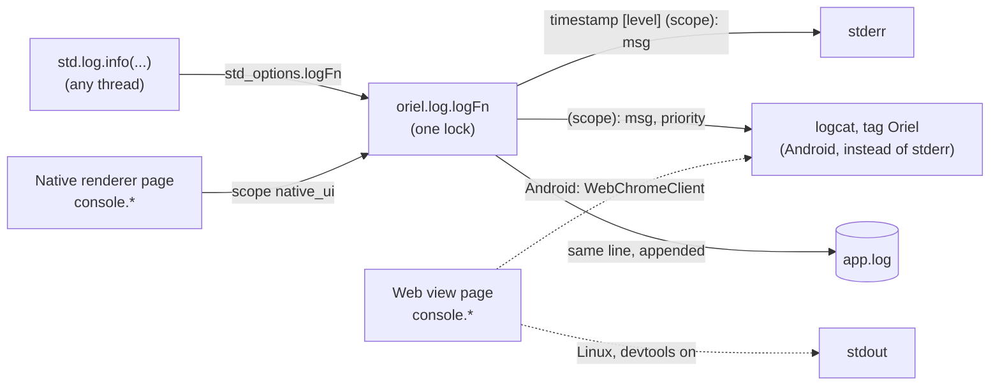

<!-- Generated from site/content/docs/logging.smd by tools/docs/gen-md.mjs: edit that file. -->

# Logging

std.log to stderr (logcat on Android) and to a per-app log file on every platform, plus where the page's console output goes.

An Oriel app logs with Zig's own `std.log`. `oriel.log.logFn` sends each
entry to stderr (logcat on Android) and appends it to a log file in the
app's own folder. The file is what matters once the app ships: an app
started from the desktop, the Dock or a phone's home screen has no
terminal, so its stderr goes nowhere.

There is no logging API to learn beyond `std.log.info(...)` and
`std.log.scoped(.my_area)`; this page is about where the lines end up, and
about the page's `console.log`.

## Availability

| Platform | Log file | Live output |
|---|---|---|
| Linux | `$XDG_DATA_HOME/<app id>/app.log` (`~/.local/share/<app id>/app.log`) | stderr |
| Windows | `%LOCALAPPDATA%\<app id>\app.log` | stderr, when the process has one (a console or a redirect) |
| macOS | `~/Library/Logs/<app id>/app.log` (Console.app lists it under Log Reports) | stderr |
| iOS | `<container>/Library/Logs/<app id>/app.log` | stderr (the Xcode console; `oriel ios dev --simulator` streams it) |
| Android | `<filesDir>/<app id>/app.log` | logcat, tag `Oriel` |

`oriel.log` is part of the core: always built, no flag, no permission. The
app turns it on with one declaration in its root source file.

## Quick start

```zig
// src/main.zig
const std = @import("std");
const oriel = @import("oriel");
const app = @import("oriel_app");

/// std.log goes to stderr and to the app's log file.
pub const std_options: std.Options = .{ .logFn = oriel.log.logFn };

const log = std.log.scoped(.notes);

fn setup() !void {
    log.info("ready; log file at {s}", .{oriel.log.getPath() orelse "(none)"});
}

pub fn main(init: std.process.Init) !u8 {
    return oriel.main(init, .{ .commands = struct {}, .events = struct {} }, .{
        .app = app.build,
        .window = .{ .title = "Notes" },
        .setup = setup,
    });
}
```

```sh
tail -f ~/.local/share/dev.example.Notes/app.log
# 2026-10-12 09:41:07 [info] (notes): ready; log file at /home/me/.local/share/dev.example.Notes/app.log
```

`oriel init` writes the `std_options` line into a new app's `main.zig`.

## How it works



`oriel.main` opens the log file before the first window, with the app's id
(`app.build.id`) as the folder name, and closes it when the app exits
(`src/core/log.zig`, `init` and `deinit`). From then on every `std.log`
call:

1. formats one line, `YYYY-MM-DD HH:MM:SS [level] (scope): message`, in
   local time, into a 4 KiB buffer;
2. writes it to stderr, or on Android sends `(scope): message` to logcat
   with the level's priority (logcat adds its own time and level);
3. appends the same line to `app.log`.

A single process-wide lock (a `GMutex` on Linux, an `SRWLOCK` on Windows,
a pthread mutex elsewhere) keeps lines from different threads whole. Lines
logged before `oriel.main` opened the file, or if it couldn't be opened, go
to stderr (logcat) only.

The file is opened for appending (`O_APPEND`, mode `0644`, not inherited
by child processes; on Windows shared for reading) and is never rotated or
truncated. Its folder is created if missing. On iOS `$HOME` is the app's
container, so the file is inside the sandbox; on Android it sits in the
same `<filesDir>/<app id>` folder as the [store's](store.md)
files.

### The page's console

Where `console.log` in the page goes depends on the platform's web view:

| Platform | `console.*` in a web view page |
|---|---|
| Android | logcat, tag `Oriel`, debug priority: `[<window label>] <message> (<source>:<line>)`, always (`OrielWindow.kt`) |
| Linux | stdout, when `devtools` is on (WebKitGTK's `enable-write-console-messages-to-stdout`) |
| Windows | the DevTools console only (F12 or right-click Inspect, when `devtools` is on) |
| macOS, iOS | Safari's Web Inspector only (Develop menu; the web view is inspectable when `devtools` is on, macOS 13.3+ / iOS 16.4+) |

`devtools` (`App.Config.devtools`) defaults to on in Debug builds and off
in release builds. None of these lines reach `app.log`.

Pages drawn by the [native renderer](native-renderer.md)
have no web view: their `console.log`/`info` log at info, `debug` at
debug, `warn` at warning and `error` at error, with scope `native_ui` and
the prefix `page: `, through `oriel.log.logFn` like any Zig log line, so
they do reach the file.

## Examples

### Less noise in release builds

The level filter is Zig's: `std_options.log_level` (default `.debug` in
Debug builds, `.info` otherwise), and `log_scope_levels` per scope.
Filtered lines are compiled out.

```zig
pub const std_options: std.Options = .{
    .logFn = oriel.log.logFn,
    .log_level = if (@import("builtin").mode == .Debug) .debug else .info,
    .log_scope_levels = &.{
        .{ .scope = .native_ui, .level = .warn }, // only the page's warnings and errors
    },
};
```

### Send the log with a bug report

```zig
pub const Commands = struct {
    /// invoke("log_path"): the page offers the file for a bug report.
    pub fn log_path(_: std.mem.Allocator) ?[]const u8 {
        return oriel.log.getPath();
    }
};
```

On Android and iOS hand the file to the
[share sheet](share.md) instead: other apps can't read the
app's private folder.

### Read the logs during development

```sh
# Linux
tail -f ~/.local/share/<app id>/app.log
# macOS
tail -f ~/Library/Logs/<app id>/app.log
# Android: Oriel's lines, the page's console, and the WebView's own messages
adb logcat -s Oriel chromium
```

```powershell
# Windows
Get-Content "$env:LOCALAPPDATA\<app id>\app.log" -Wait
```

`oriel android dev` prints the logcat command when it starts the app.

## Reference

### `oriel.log`

```zig
pub fn logFn(
    comptime level: std.log.Level,
    comptime scope: @EnumLiteral(),
    comptime format: []const u8,
    args: anytype,
) void;

pub fn getPath() ?[]const u8;
pub fn init(app_id: []const u8) void;
pub fn deinit() void;
```

| Declaration | Meaning |
|---|---|
| `logFn` | For `std_options.logFn`. Writes one entry to stderr (logcat on Android) and the open log file. |
| `getPath()` | The open log file's path, or null when no file is open. Points into a static buffer: copy it to keep it past `deinit`. |
| `init(app_id)` | Opens `app.log` in the platform's folder (the Availability table). `oriel.main` calls it; an app calls it itself only in a program that doesn't run `oriel.main` (a CLI tool, a test). A second call while a file is open does nothing. |
| `deinit()` | Closes the file. `oriel.main` calls it on exit. |

**Line format.** File and stderr: `2026-10-12 09:41:07 [info] (scope):
message`. The level texts are Zig's: `error`, `warning`, `info`, `debug`.
The scope is `default` for unscoped `std.log` calls. Logcat: `(scope):
message`, priorities ERROR, WARN, INFO, DEBUG.

**Limits.** A formatted line longer than about 4 KiB (timestamp, level and
scope included) is replaced by `[log truncated]`: log long data in pieces.
`init` gives up silently (stderr only) when the app id is empty, `.`,
`..`, or contains `/`, `\` or NUL, when the path is longer than 1 KiB, when
`$HOME` is unset or relative (macOS, iOS), when `%LOCALAPPDATA%` and
`%APPDATA%` are both unset (Windows), or when the file can't be opened.

**Threads.** `logFn` may be called from any thread, before or after
`init`. Each entry is written while holding the lock, so lines never
interleave; a slow disk slows every logging thread.

**Without `std_options.logFn`** the app gets Zig's default logger: stderr
only. `oriel.main` still creates the (empty) log file.

## Troubleshooting

- **`app.log` stays empty.** The root source file lacks
  `pub const std_options: std.Options = .{ .logFn = oriel.log.logFn };`, or
  the lines are below `log_level` (`debug` lines are compiled out of
  release builds).
- **Nothing on the terminal on Windows.** A release build is a GUI program
  with no console. Read the file, or run it from a console that captures
  stderr (`app.exe 2>&1 | more`).
- **The page's `console.log` doesn't show up.** Only Android (logcat) and
  Linux with `devtools` on print it; elsewhere open the web view's
  inspector. To keep page messages in the file, send them to Zig with a
  command and log them there.
- **A line reads `[log truncated]`.** It was longer than 4 KiB.

## Related

- [App directories](paths.md): the app's other folders.
- [Development](development.md): `devtools`, the dev
  server, and inspecting the page.
- [Android](android.md) and [iOS](ios.md):
  device logs.
