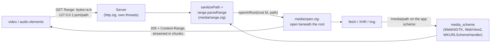

<!-- Generated from site/content/docs/media-server.smd by tools/docs/gen-md.mjs: edit that file. -->

# Media server

Stream large local video and audio to the page with HTTP range requests, from a loopback server or the app's own scheme, without loading the files into memory.

`oriel.media_server` lets the page play and seek in **large local files**
(a multi-GB video, an audio library) without reading them into memory or
passing their bytes over the bridge. It serves the files below one
directory you choose, answering HTTP range requests (RFC 9110 §14) so
`<video>` and `<audio>` seek normally. There are two ways to reach them,
sharing the same range parser and path checks:

- a **loopback HTTP server** (`Server`) on `127.0.0.1:<port>`, which every
  element can use, `<video>` and `<audio>` included;
- the app's **own scheme**: `app://app/media/<path>` on Linux and macOS,
  `https://app.localhost/media/<path>` on Windows (`scheme.setRoot`), with
  no port and no CORS, for `fetch`, XHR and ``.

Media that isn't a file below a folder (blocks fetched from another
device, a file decrypted on the fly) is served from the app's own code: a
[`Source`](#source) gives the size and bytes of each path, and
the same range handling answers the page.

For files the app bundles, use its assets ([Concepts](concepts.md)).
For a small file the user picked, read it in a command ([Files](files.md)).

## Availability

| Platform | Loopback server | Scheme | Path confinement |
|---|---|---|---|
| Linux | ✓ | `app://app/media/` (WebKitGTK): `fetch`, XHR, ``; not `<video>`/`<audio>`. Not with `-Dnative_ui` | `openat2(RESOLVE_BENEATH)`, Linux 5.6+ |
| Windows | ✓ | `https://app.localhost/media/` (WebView2 `WebResourceRequested`) | lexical checks, then `GetFinalPathNameByHandleW` below the root |
| macOS | ✓ | `app://app/media/` (`WKURLSchemeHandler`) | `fcntl(F_GETPATH)` below the root; `O_NOFOLLOW_ANY` for `.refuse_all` |
| Android | — | `https://app.localhost/media/` (the WebView's request interception, `OrielMedia.kt`); also a `Source` (`scheme.setSource`) | the canonical path below the root |
| iOS | — | — | — |

The module is the `media_server` flag, **on by default** on Linux, Windows
and macOS (`b.dependency("oriel", .{ .media_server = false })` leaves it
out, with its HTTP library). It doesn't exist on Android and iOS:
`oriel.media_server.available` is false there, and an unguarded use is a
build error; on Android `oriel.media_scheme` is built anyway. No permission
is needed.

## Quick start

```zig
const std = @import("std");
const oriel = @import("oriel");
const app = @import("oriel_app");

var media: oriel.media_server.Server = undefined; // fixed address until stop()

pub fn main(init: std.process.Init) !u8 {
    if (oriel.media_server.available) {
        try media.start(init.io, init.gpa, .{
            .root_dir = "/home/me/Videos", // /<path> maps to files below it
            .port = 17893, // 127.0.0.1 only
        });
    }
    defer if (oriel.media_server.available) media.stop();

    return oriel.main(init, .{ .commands = Commands, .events = Events }, .{
        .app = app.build,
        .window = .{ .title = "Player", .width = 1280, .height = 720 },
    });
}

const Commands = struct {};
const Events = struct {};
```

```html
<video controls src="http://127.0.0.1:17893/holiday/2025.mkv"></video>
```

The default content security policy already allows
`http://127.0.0.1:*` for media, images and `fetch`.

## How it works



**The loopback server** (`src/modules/media_server.zig`) is an
[http.zig](https://github.com/karlseguin/http.zig) server bound to
`127.0.0.1:<port>`, started on its own thread by `Server.start` and joined
by `stop`. It rejects any request whose `Host` header isn't
`127.0.0.1:<port>` or `localhost:<port>` (403, against DNS rebinding), and
answers:

- `GET /ping`: `{"pong":true,"server":"http.zig"}`;
- `OPTIONS /*`: the CORS preflight (methods `GET, HEAD, OPTIONS`, headers
  `Range, Content-Type, Accept`, max age one day);
- `GET` and `HEAD /<path>`: the file below the root, with
  `Access-Control-Allow-Origin: <allowed_origin>`, `Accept-Ranges: bytes`
  and `Content-Range`/`Content-Length` exposed to the page. The body is
  streamed in 64 KiB chunks with 64-bit offsets (files over 4 GiB work); a
  read error or a file that shrinks closes the connection early.

**The scheme** (`src/modules/media_scheme.zig` and its backends) is the
app's own URL scheme handler: a request under `/media/` goes to
`media_scheme.handle` instead of the assets. On Linux it runs on the main
thread and returns a bounded `GInputStream` that GIO reads from a worker;
on macOS the response head is sent at once and a worker thread reads
256 KiB chunks, one in flight, each handed to WebKit on the main thread;
on Windows WebView2 gets a read-only `IStream` over the opened file's
handle (positional reads, no shared file pointer). Nothing serves
`/media/` until `scheme.setRoot` is called, and a request then gets 404.

**Path checks** are the same for both (`src/modules/media/range.zig`,
`src/modules/media/open.zig`). The request path is percent-decoded; NUL,
backslashes, absolute paths and `..` segments get 403 (on Windows also
drive letters, `:` and DOS device names). Then the file is opened
**relative to the root directory's handle**, and the kernel confirms that
what was opened lies below the root, so there is no check-then-open race:
`openat2` with `RESOLVE_BENEATH` on Linux, `F_GETPATH` on the opened
descriptor on macOS (whose `O_RESOLVE_BENEATH` isn't enforced), the final
path of the opened handle on Windows. Directories, FIFOs and devices are
refused (404); FIFOs are opened non-blocking so they can't stall the main
thread.

**A source** (`Options.source`, or `scheme.setSource` on Android) replaces
the root: after the same path checks, the sanitized path goes to
`sizeFn` (null: 404) and the body to `readFn`, called with the offset of
each chunk (up to 256 KiB) from the server's threads, several streams at
once. On Android the WebView skips to a range's first byte in the stream
it's given: the source's stream only moves its position, so a seek reads
nothing before it.

**Why two transports.** The TCP server works with every client, but any
local process can connect to the port, and the page needs CORS (the
`allowed_origin` header). The scheme needs neither, but WebKitGTK's
GStreamer player accepts only http(s), blob, data and file URLs, so on
Linux `<video src="app://...">` fails with `MEDIA_ERR_SRC_NOT_SUPPORTED`
before any request is made. Use the TCP URL for `<video>` and `<audio>`.

## Examples

### Pick a folder, then play from it

```zig
var media: oriel.media_server.Server = undefined;
var media_running = false;

const Commands = struct {
    /// Serve `dir` and return the base URL the page plays from.
    pub fn openLibrary(arena: std.mem.Allocator, io: std.Io, args: struct { dir: []const u8 }) ![]const u8 {
        if (media_running) media.stop();
        try media.start(io, std.heap.smp_allocator, .{ .root_dir = args.dir, .port = 17893 });
        media_running = true;
        return std.fmt.allocPrint(arena, "http://127.0.0.1:{d}/", .{17893});
    }
};
```

```js
const base = await window.oriel.invoke("openLibrary", { dir: folder });
video.src = base + encodeURIComponent("Season 1") + "/" + encodeURIComponent("01.mp4");
```

### Subtitles and thumbnails through the scheme

```zig
fn setup() void {
    oriel.media_server.scheme.setRoot("/home/me/Videos", .inside_root) catch |err|
        std.log.warn("media scheme: {s}", .{@errorName(err)});
}
```

```js
const prefix = window.oriel.platform.os === "windows" ? "https://app.localhost" : "app://app";
const vtt = await (await fetch(`${prefix}/media/movie.vtt`)).text();
thumb.src = `${prefix}/media/movie.jpg`;
```

### Serve to a dev server page

During development the page comes from the dev server, so its origin is
the dev server's: allow that one.

```zig
try media.start(io, gpa, .{
    .root_dir = dir,
    .port = 17893,
    .allowed_origin = if (dev_build) "http://localhost:5173" else oriel.security.app_origin,
});
```

### Serve media from the app's code

A `Source` answers by path. Here one file is held in memory; a real one
fetches blocks from wherever the media lives. Its functions run on the
server's threads, several at once.

```zig
const Library = struct {
    data: []const u8,

    fn source(self: *Library) oriel.media_server.Source {
        return .{ .ctx = self, .sizeFn = size, .readFn = read };
    }

    fn size(ctx: *anyopaque, path: []const u8) ?u64 {
        const self: *Library = @ptrCast(@alignCast(ctx));
        if (!std.mem.eql(u8, path, "movie.mp4")) return null; // 404
        return self.data.len;
    }

    fn read(ctx: *anyopaque, path: []const u8, offset: u64, dest: []u8) anyerror!usize {
        const self: *Library = @ptrCast(@alignCast(ctx));
        if (!std.mem.eql(u8, path, "movie.mp4")) return error.FileNotFound;
        if (offset >= self.data.len) return 0; // the end
        const n = @min(dest.len, self.data.len - offset);
        @memcpy(dest[0..n], self.data[@intCast(offset)..][0..n]);
        return n;
    }
};

var library: Library = .{ .data = "" };
```

On desktop, give it to the server (no root is opened):

```zig
try media.start(io, gpa, .{ .root_dir = "", .port = 17893, .source = library.source() });
```

```html
<video controls src="http://127.0.0.1:17893/movie.mp4"></video>
```

On Android there is no server: the scheme serves it.

```zig
fn setup() void {
    oriel.media_scheme.setSource(library.source()) catch |err|
        std.log.warn("media source: {s}", .{@errorName(err)});
}
```

```js
video.src = "https://app.localhost/media/movie.mp4"; // media_scheme.base_url
```

## Reference

### `Server`

```zig
pub const Server = struct {
    pub fn start(self: *Server, io: std.Io, gpa: std.mem.Allocator, options: Options) !void;
    pub fn stop(self: *Server) void;
};

pub const Options = struct {
    root_dir: []const u8,
    port: u16,
    allowed_origin: []const u8 = oriel.security.app_origin,
    symlink_policy: SymlinkPolicy = .inside_root,
    source: ?Source = null,
};
```

| Field | Meaning |
|---|---|
| `root_dir` | The directory served: `/<path>` maps to `<root_dir>/<path>`. Opened once by `start` (an error if it can't be). Ignored, and may be `""`, with `source`. |
| `port` | The TCP port on `127.0.0.1`. Fixed: pick one your app owns; `start` fails if it's taken. |
| `allowed_origin` | `Access-Control-Allow-Origin` on file responses: the page's origin. The default is the app's (`app://app` on Linux and macOS, `https://app.localhost` on Windows); a dev server's page needs the dev server's origin. |
| `symlink_policy` | `.inside_root`: follow symlinks that stay inside the root; `.refuse_all`: refuse every symlink. |
| `source` | Serve every file route from the app's code instead of `root_dir` ([`Source`](#source)). Its `ctx` must outlive the server. |

- **`start`** opens the root, binds and serves from a new thread; `self`
  must stay at a fixed address until `stop` (a global or a heap
  allocation). It can be called from any thread, before or after
  `oriel.main`.
- **`stop`** stops the server, joins its thread and closes the root.
  Streams in progress end; after it, the source isn't called again.

| Response | When |
|---|---|
| `200` | No `Range`, or a malformed one (ignored): the whole file. |
| `206` | `bytes=a-b`, `bytes=a-`, `bytes=-n` (clamped to the file). Several ranges: only the first is served. |
| `416` | `start` past the end, `bytes=-0`, `start > end`, or any range of an empty file; `Content-Range: bytes */<size>`. |
| `403` | A `Host` other than `127.0.0.1:<port>` / `localhost:<port>`; a path with NUL, a backslash, `..` or an absolute path; a path or symlink that leaves the root; a refused symlink. |
| `404` | Missing file, directory or other non-regular file; an empty path; a path the source's `sizeFn` doesn't know. |
| `500` | An unexpected error (on Linux, a kernel without `openat2`). |

`Content-Type` comes from the extension: `mp4 webm mkv mov ogv` video,
`mp3 ogg oga opus wav flac m4a aac` audio, `vtt` (`text/vtt`), `srt`
(`text/plain`), `json`, `png`, `jpg`/`jpeg`, `webp`; anything else is
`application/octet-stream`.

A source's `readFn` error, or a source that ends before the size it
gave, closes the connection short of `Content-Length`, as a file read
error does.

### `Source`

```zig
/// Bytes an app serves itself, by path (relative, sanitized, no leading '/').
/// Called from server threads: must be thread-safe. The MIME type comes from
/// the path's extension (range.mimeForExtension).
pub const Source = struct {
    ctx: *anyopaque,
    /// The size of `path`, or null if there is no such file (404).
    sizeFn: *const fn (ctx: *anyopaque, path: []const u8) ?u64,
    /// Copies up to dest.len bytes of `path` starting at `offset` into dest;
    /// returns how many (0 only at the end). An error ends the response early.
    readFn: *const fn (ctx: *anyopaque, path: []const u8, offset: u64, dest: []u8) anyerror!usize,
};
```

`oriel.media_server.Source` and `oriel.media_scheme.Source` are the same
type. The path is the request's, percent-decoded and checked (no `..`, NUL,
backslash or leading `/`). `readFn` is asked for at most 256 KiB at a time
and may return fewer bytes than asked; it is called with the offsets the
page seeks to, not only in order. Both functions may block (a network
fetch): only that stream waits.

### `scheme`

```zig
pub fn setRoot(path: []const u8, policy: SymlinkPolicy) !void;
pub fn clearRoot() void;
pub fn setSource(source: Source) !void;
pub fn clearSource() void;
```

| Declaration | Meaning |
|---|---|
| `scheme.setRoot(path, policy)` | Serve the files below `path` at `<app origin>/media/<path>`, replacing any previous root. Main thread (in `setup`, or a command's main-thread code). On Linux with `-Dnative_ui` it returns `error.NoWebView`. |
| `scheme.clearRoot()` | Stop serving: requests get 404. Streams already running keep their files. |
| `scheme.setSource(source)` | Android: serve `source` at `https://app.localhost/media/<path>`, instead of the root while it is set (replacing any previous source). Any thread; it waits for calls into the previous source to return. Elsewhere `error.Unsupported`: desktop apps use the server's `Options.source`, whose http URL `<video>` can play everywhere. |
| `scheme.clearSource()` | Back to the root, or to 404 if there is none. When it returns no call into the source is in progress, so its `ctx` may be freed. Elsewhere a no-op. |

The scheme answers the same statuses as the server (no `Host` check and
no CORS: it is the page's own origin). It needs no port, so no other
process can reach it.

### Other declarations

| Declaration | Meaning |
|---|---|
| `available: bool` | The module is in this build (false on Android and iOS). |
| `SymlinkPolicy` | `enum { inside_root, refuse_all }`. |
| `Handler` | The server's request handler (`ping`, `handleOptions`, `handleFile`); used by `Server`. |
| `range` | `parseRange(header, size) RangeResult`, `sanitizePath`, `mimeForExtension`: the pure parts, for code of your own. |
| `open` | `openRoot`, `openInRoot`, `closeRoot`: opening files confined to a root, per platform. |
| `selfTest(io, gpa, port) ![]u8` | `GET /ping` over real TCP; the body. |
| `check(gpa, ctx)` | The module's smoke check: `selfTest` on `ctx.media_port`. |

## Troubleshooting

- **`<video>` stays black with `app://app/media/...` on Linux.**
  WebKitGTK's player can't load custom schemes
  (`MEDIA_ERR_SRC_NOT_SUPPORTED`): use the TCP URL.
- **A source's video stalls or never starts.** `sizeFn` must answer for
  the path the page asks for (percent-decoded, without the leading `/` or
  `/media/`), and `readFn` must return 0 only at the end. On Android,
  `setSource` waits for running calls: don't call it from code a source
  call waits on.
- **CORS error in the console.** `allowed_origin` isn't the page's origin
  (in development, the dev server's).
- **Refused by the content security policy.** A custom `security.csp`
  must allow `http://127.0.0.1:*` in `media-src` (and `img-src`,
  `connect-src` as needed) ([Security](security.md)).
- **403 for a file that exists.** It is reached through a symlink that
  leaves the root (or any symlink with `.refuse_all`), or the URL isn't
  percent-encoded and contains `..` or a backslash. On Windows, a name such
  as `con.mp4` is refused.
- **500 for every file on Linux.** The kernel predates `openat2` (5.6).
- **`start` fails.** The root can't be opened, or the port is in use.

## Related

- [Security](security.md): the content security policy and the app's origin.
- [Files](files.md): reading files the user picked.
- [Concepts](concepts.md): assets and the app's scheme.
