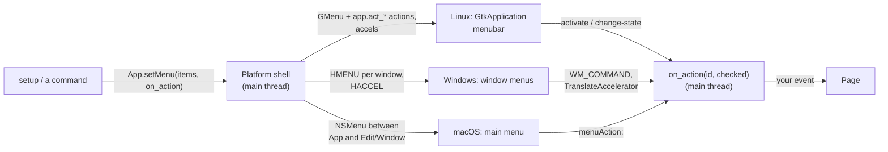

<!-- Generated from site/content/docs/menu.smd by tools/docs/gen-md.mjs: edit that file. -->

# Menu

The native menu bar: items, check items, submenus and keyboard shortcuts, in the window on Linux and Windows and at the top of the screen on macOS.

`oriel.App.setMenu` installs the app's menu bar from a list of items you
describe as data: plain items, check items, separators and submenus, with
keyboard shortcuts. Linux shows it in every window (GTK's `GMenuModel`),
Windows attaches it to every window (`HMENU`, shortcuts as an accelerator
table), and macOS puts it in the screen's menu bar between the standard App
menu and the Edit and Window menus.

For an icon in the notification area with its own menu, use the
[tray](tray.md). For shortcuts without a menu item, or that
work while the app isn't focused, use
[global shortcuts](global-shortcuts.md).

## Availability

| Platform | What it uses | Where it shows |
|---|---|---|
| Linux | GTK4 `GMenu` + `GSimpleAction`s on the `GtkApplication`, `setAccelsForAction` for shortcuts | the menu bar of every application window |
| Windows | Win32 `CreateMenu`/`AppendMenuW`, `CreateAcceleratorTableW` | the menu bar of every window, including windows opened later |
| macOS | `NSMenu` as the app's main menu | the screen's menu bar, between the App menu and Edit/Window |
| Android, iOS | none: no menu bar | `oriel.menu.available` is `false` |

The `menu` build flag is on by default wherever a menu bar exists; there is
nothing to declare and no permission. On Android and iOS it resolves to off:
guard the call with `if (oriel.menu.available)`
([Modules](modules.md)). On Android, hardware-keyboard
shortcuts are [global shortcuts](global-shortcuts.md),
listed in the system's Meta+/ panel.

## Quick start

```zig
// build.zig: menu is on by default on the desktop; nothing to add.
const dep = b.dependency("oriel", .{ .target = target, .optimize = optimize });
```

```zig
// src/main.zig
const std = @import("std");
const oriel = @import("oriel");
const app = @import("oriel_app");

pub fn main(init: std.process.Init) !u8 {
    return oriel.main(init, .{ .commands = Commands, .events = Events }, .{
        .app = app.build,
        .window = .{ .title = "My App", .width = 800, .height = 600 },
        .setup = setup,
    });
}

pub const Commands = struct {};
pub const Events = struct {
    menu: struct { id: []const u8 },
};
const events = oriel.App.events(Events);

fn setup() !void {
    if (!oriel.menu.available) return;
    try oriel.App.setMenu(&.{
        .{ .submenu = .{ .label = "File", .items = &.{
            .{ .item = .{ .id = "new", .label = "New", .shortcut = "Ctrl+N" } },
            .{ .item = .{ .id = "open", .label = "Open...", .shortcut = "Ctrl+O" } },
            .separator,
            .{ .item = .{ .id = "quit", .label = "Quit", .shortcut = "Ctrl+Q" } },
        } } },
    }, onMenu);
}

fn onMenu(id: []const u8, _: ?bool) void {
    if (std.mem.eql(u8, id, "quit")) return oriel.App.quit(0);
    events.emit(.menu, .{ .id = id });
}
```

```js
window.oriel.listen("menu", ({ id }) => {
  if (id === "new") newDocument();
  if (id === "open") openDocument();
});
```

On macOS `Ctrl+N` is ⌘N.

## How it works



`oriel.App.setMenu` (`src/core/App.zig`) hands the items to the platform
shell, which replaces the whole menu bar; calling it again swaps the bar
for a new one. The items are copied, so they needn't outlive the call.

- **Linux** (`src/modules/menu/linux.zig`). Each item becomes a
  `GSimpleAction` named `app.act_<id>` on the `GtkApplication` (characters
  GLib doesn't allow in action names are escaped; your callback still gets
  the original id), check items are stateful boolean actions, separators
  start a new menu section, and `setMenubar` installs the model. Shortcuts
  are set with `gtk_application_set_accels_for_action`, so they work in
  every window.
- **Windows** (`src/modules/menu/windows.zig`). The items are kept and an
  `HMENU` is built for each window, now and when a window opens later. The
  shortcut is shown after a tab in the label ("New\tCtrl+N") and registered
  in one accelerator table, which the message loop checks for every
  top-level window. Clicks and accelerators arrive as menu commands on the
  main thread.
- **macOS** (`src/modules/menu/macos.zig`). Oriel's default main menu (App
  menu: Hide, Show All, Quit; Edit: Undo to Select All; Window: Minimize,
  Zoom, Close) is installed at launch (`src/platform/macos/Shell.zig`).
  `setMenu` builds a new main menu: the App menu, then your items, then the
  default Edit and Window menus unless you have top-level submenus with
  those names. If building fails, the old bar stays.

Clicks call `on_action(id, checked)` on the main thread. A check item flips
its own state first, so `checked` is the new value; plain items pass
`null`; disabled items call nothing. `id` is a copy, so the callback may
call `setMenu` again.

The menu isn't part of the page: nothing crosses the bridge unless your
callback emits an event, as above.

## Examples

### A View menu with a check item

```zig
fn setup() !void {
    if (!oriel.menu.available) return;
    try oriel.App.setMenu(&.{
        .{ .submenu = .{ .label = "View", .items = &.{
            .{ .check = .{ .id = "sidebar", .label = "Show sidebar", .checked = true } },
            .{ .item = .{ .id = "reload", .label = "Reload", .shortcut = "F5" } },
            .separator,
            .{ .submenu = .{ .label = "Zoom", .items = &.{
                .{ .item = .{ .id = "zoom-in", .label = "Zoom in", .shortcut = "Ctrl+Shift+Up" } },
                .{ .item = .{ .id = "zoom-out", .label = "Zoom out", .shortcut = "Ctrl+Shift+Down" } },
            } } },
        } } },
    }, onMenu);
}

// Events has `sidebar: struct { visible: bool }` beside `menu`.
fn onMenu(id: []const u8, checked: ?bool) void {
    if (std.mem.eql(u8, id, "sidebar")) return events.emit(.sidebar, .{ .visible = checked.? });
    events.emit(.menu, .{ .id = id });
}
```

### Rebuild the menu when state changes

There is no call to change one item: build the list again. Here a command
the page calls enables "Save" only when there's something to save:

```zig
pub const Commands = struct {
    pub fn set_dirty(args: struct { dirty: bool }) !void {
        if (!oriel.menu.available) return;
        try oriel.App.setMenu(&.{
            .{ .submenu = .{ .label = "File", .items = &.{
                .{ .item = .{ .id = "save", .label = "Save", .shortcut = "Ctrl+S", .enabled = args.dirty } },
                .separator,
                .{ .item = .{ .id = "quit", .label = "Quit", .shortcut = "Ctrl+Q" } },
            } } },
        }, onMenu);
    }
};
```

```js
editor.addEventListener("input", () => window.oriel.invoke("set_dirty", { dirty: true }));
```

The showcase (`examples/showcase/src/main.zig`, `setup`) builds File, Go
(one item per tab, `Ctrl+1` to `Ctrl+7`) and Dictation menus and routes
their ids to the same handler as its keyboard shortcuts.

## Reference

### Build flag

| Flag | Default | Effect |
|---|---|---|
| `.menu` (`-Dmenu` on Oriel's own command line) | on for Linux, Windows, macOS | builds `oriel.menu` and `App.setMenu`. `.menu = false` drops it. On Android and iOS it resolves to off; `-Dmenu=true` for those targets on Oriel's own command line is an error. |

### `oriel.App.setMenu`

```zig
pub fn setMenu(items: []const oriel.menu.MenuItem, on_action: oriel.menu.ActionCallback) !void;
```

Replaces the app's menu bar with `items` and makes `on_action` the one
callback for every item.

- **Threads.** Linux: call it on the main thread (`setup`, a sync command,
  a menu or tray callback, or `oriel.App.runOnMain` from a worker).
  Windows and macOS run it on the main thread and wait, from any thread.
- **Errors.** Linux `error.AppNotRunning` (before the app started: call it
  in `setup`); Windows `error.CreateAcceleratorTableFailed`,
  `error.AppendMenuFailed`; macOS `error.InvalidUtf8` (a label that isn't
  UTF-8); `error.OutOfMemory`; with the flag off (Android, iOS,
  `.menu = false`) `error.NotImplemented`.
- **State.** Check items start at their `checked` value on every call.

### `oriel.menu`

```zig
pub const available: bool; // false on Android and iOS, or with .menu = false

pub const MenuItem = union(enum) {
    item: struct {
        id: []const u8,
        label: []const u8,
        enabled: bool = true,
        shortcut: ?[]const u8 = null,
    },
    check: struct {
        id: []const u8,
        label: []const u8,
        checked: bool = false,
        enabled: bool = true,
    },
    separator,
    submenu: struct {
        label: []const u8,
        items: []const MenuItem,
        enabled: bool = true,
    },
};

pub const ActionCallback = *const fn (id: []const u8, checked: ?bool) void;

pub fn check(gpa: std.mem.Allocator, ctx: oriel.CheckContext) !oriel.Check; // smoke check
```

| Field | Meaning |
|---|---|
| `item.id`, `check.id` | What `on_action` gets back. Keep ids unique and under 256 bytes (Windows and macOS cut longer ones in the callback). Any characters; on Linux they're escaped into the action name. |
| `label` | The text shown. |
| `enabled` | `false` greys the item out; clicks on it call nothing. A submenu's `enabled` greys it on Windows and macOS; Linux ignores it. |
| `checked` | A check item's initial state. |
| `shortcut` | A keyboard shortcut, plain items only (below). `null` for none. |
| `submenu.items` | Nested items, to any depth. A submenu has no id and isn't clickable itself. |

`oriel.menu.check` is the module's smoke check (run by `oriel.checkAll`):
it builds a menu and an accelerator table (Windows) or a menu with a key
equivalent (macOS) without installing it.

### Shortcuts

Two spellings, case-insensitive:

- `+`-separated: `"Ctrl+N"`, `"Ctrl+Shift+S"`, `"Alt+F4"`, `"F5"`.
- GTK style: `"<Ctrl>N"`, `"<Control><Shift>s"`, `"<Primary>q"`.

| Part | Linux | Windows | macOS |
|---|---|---|---|
| `Ctrl`, `Control` (and `<Primary>` in GTK style) | Control | Ctrl | ⌘ Command |
| `Shift` | Shift | Shift | ⇧ Shift |
| `Alt` | Alt | Alt | ⌥ Option |
| `Meta` | Super | Alt | ⌥ Option |
| `Option` | Alt | not recognized | not recognized |
| `Super`, `Cmd`, `Win`, `CmdOrCtrl` | Super (`CmdOrCtrl`: Control) | not recognized | not recognized |

Keys: letters `A`-`Z`, digits `0`-`9`, `F1`-`F24`, `Escape`/`Esc`, `Tab`,
`Return`/`Enter`, `Space`, `Backspace`/`Back`, `Delete`/`Del`,
`Insert`/`Ins`, `Home`, `End`, `PageUp`/`Page_Up`/`Prior`,
`PageDown`/`Page_Down`/`Next`, `Left`, `Up`, `Right`, `Down`. Punctuation
keys aren't supported on Windows and macOS. A shortcut Windows can't parse
is skipped with the log line `failed to parse menu shortcut '<text>':
<error>`; macOS skips it silently; on Linux a GTK-style string (starting
with `<`) goes to GTK as is, and anything else is translated
(`Ctrl+Shift+D` becomes `<Control><Shift>d`). Stick to `Ctrl`, `Shift`,
`Alt`, the keys above and the `+` spelling for the same shortcut on every
desktop.

On macOS `Ctrl` means ⌘, as Mac users expect; there is no way to ask for
the Control key itself.

## Troubleshooting

- **Copy and paste stopped working on macOS.** A top-level submenu named
  `Edit` replaces Oriel's default Edit menu, whose ⌘C/⌘V/⌘X/⌘Z/⌘A items
  carry the web view's editing shortcuts. Name your menu something else, or
  leave editing to the default one.
- **A shortcut does nothing on Windows.** Check the log for `failed to
  parse menu shortcut`; use the modifiers and keys listed above.
- **`error.AppNotRunning` on Linux.** `setMenu` ran before the app started:
  call it in `setup`.
- **Using `oriel.App.setMenu` in a phone build** returns
  `error.NotImplemented`: guard it with `if (oriel.menu.available)`.

## Related

- [Tray](tray.md): the notification-area icon and its menu (same item shape, no shortcuts).
- [Global shortcuts](global-shortcuts.md): system-wide hotkeys, and in-app shortcuts on Android.
- [Commands](commands.md): events and commands that connect the menu to the page.
- [Modules](modules.md): build flags and `available`.
