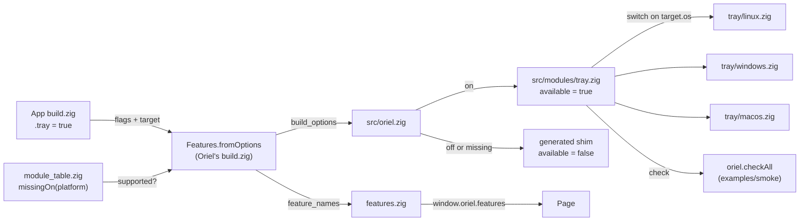

<!-- Generated from site/content/docs/modules.smd by tools/docs/gen-md.mjs: edit that file. -->

# Modules

What an Oriel module is, how build flags turn modules on, and every module and plugin with its flag, platforms and page.

A module is a piece of Oriel an app switches on in `build.zig`: the tray,
SQLite, notifications, a local LLM. Each one is a Zig namespace on
`oriel` (`oriel.tray`, `oriel.sql`) with one public API, and a backend per
platform underneath. A module the app leaves off is neither compiled nor
linked, so an app pays only for what it uses. *Plugins* (global shortcuts,
input injection, the clipboard) work the same way; they live in
`src/plugins/` instead of `src/modules/` because they reach outside the
app's own window.

The core is always there and has no flag: windows, commands and events,
the lifecycle, paths, logging, permissions, platform hooks and app
extensions. This page is the index; each module's API, examples and
platform notes are on its own page, linked from the
[table](#every-module).

## Turning modules on

Flags are options of the `oriel` dependency in the app's `build.zig`:

```zig
const dep = b.dependency("oriel", .{
    .target = target,
    .optimize = optimize,
    .sql = true,          // on by default; written out for clarity
    .tray = true,
    .llama = true,        // off by default: a native dependency
    .media_server = false, // on by default; this app doesn't use it
});
```

- **Defaults.** Every module and plugin is on unless the app says
  otherwise, except the native dependencies and a few opt-ins: `deep_link`,
  `sqlite_vec`, `llama`, `llama_mtmd`, `whisper`, `kokoro`,
  `audio_capture`, `camera`, `system_ai`, `layer_shell` and `native_ui`
  are off. `updater` is also off on Android (the store updates apps
  there).
- **`oriel init` writes the list out.** The generated `build.zig` sets the
  desktop modules to `false`, so a new app starts small; change a line to
  `true` to use that module.
- **Declaring a capability turns its module on.** `.permissions.camera`
  turns on `camera`, `.permissions.local_network` turns on `network`, and
  `.share_target` turns on `share`, so there is no flag to keep in sync
  (unless the app set that flag to `false` itself: then the module stays
  off and the build prints a warning). The other way round, a module that
  needs a permission declares it: `audio_capture` declares `microphone` and
  `system_audio`.
- **Dependencies between flags** are checked when the build starts:
  `sqlite_vec` needs `sql`, `llama_mtmd` needs `llama`, and `kokoro` needs
  `llama` or `whisper` (it shares their ggml build). Some namespaces follow
  another flag instead of having one: `oriel.chat` is on with `llama`,
  `oriel.tts` and `oriel.audio_play` with `kokoro`, `oriel.dictation` with
  `whisper` and `audio_capture` together, `oriel.ggml_gpu` with `llama` or
  `whisper`, and `oriel.canvas` with `native_ui`.
- **On Oriel's own command line** (building Oriel itself, its examples or
  tests) the same flags are `-D` options: `zig build -Dllama`,
  `-Dtray=false`. Apps pass them through too: `oriel build -Dnative_ui`.

## Availability

The flags say what the app uses, once, for every target. Where a module
can't exist (a tray on a phone, system-wide hotkeys on iOS), its flag
resolves to off for that target and `oriel.<module>.available` is `false`.
Guard the calls:

```zig
if (oriel.tray.available) {
    tray = try oriel.tray.Tray.create(gpa, .{ ... });
}
```

- **`available` is a comptime constant.** Code under a false guard is never
  analyzed: it costs nothing where the module is missing, and needs no
  stub.
- **An unguarded call is a build error** that names the module and the fix:
  `oriel.tray.Tray is not available on ios: guard the call with
  if (oriel.tray.available)`, or, for a module the app left off,
  `... is disabled: enable it with .tray = true in b.dependency("oriel",
  ...), or guard the call with if (oriel.tray.available)`.
- **Runtime state stays runtime.** A desktop with no tray host, a phone
  without Gemini Nano, a denied permission: these are the module's own
  status calls or errors, documented on its page.
- **The page sees the same table** as `window.oriel.features`, frozen, in
  camelCase: `{ tray: false, fsWatch: true, mediaServer: false, ... }`,
  typed as `Features` in the generated `oriel.ts`. A UI hides what this
  build can't do.
- **Asking for the impossible on the command line fails.**
  `zig build -Dtarget=aarch64-ios -Dtray=true` stops with
  `-Dtray is not available on ios`. From an app's `b.dependency` the same
  request quietly resolves to off (`zig build --verbose` lists what was
  turned off), because the app's flags are meant for every target.

## How modules work



1. **Resolving the flags.** Oriel's `build.zig` has one `Features`
   struct with a field per flag. `Features.fromOptions` reads each option
   from the app's `b.dependency("oriel", ...)` (or the command line), applies
   the defaults, and asks `src/core/module_table.zig` whether the module
   exists on the target's platform (`missingOn`, with Android split out of
   Linux). The result goes into the `build_options` module, along with
   `feature_names`.
2. **Choosing the namespace.** `src/oriel.zig` declares each module as
   `pub const tray = if (options.tray) @import("modules/tray.zig") else
   unavailable("tray")`. Off, the namespace is a generated shim
   (`tools/module_shims.zig`) with the same public declarations as the real
   module, each a build error carrying `module_table.reason`, and
   `available = false`. A test keeps the shim's declarations equal to the
   module's.
3. **Choosing the backend.** The module's facade (`src/modules/tray.zig`)
   holds the shared types (`tray/common.zig`) and picks its implementation
   with a `switch` on `target.os`: `tray/linux.zig`, `tray/windows.zig`,
   `tray/macos.zig`. Some backends serve several platforms (`fs_watch`
   uses inotify on Linux and Android; `store` shares its Apple backend
   between macOS and iOS); a module that doesn't exist on a platform has a
   `@compileError` there, which the shim keeps out of reach.
4. **Linking.** The same flags decide what Oriel's `build.zig` links:
   libpulse for `audio_capture` on Linux, xkbcommon and XTest for `input`,
   llama.cpp and whisper.cpp for `llama` and `whisper`, PhotosUI for
   `camera` on iOS.
5. **Telling the page.** `src/core/features.zig` turns the resolved flags
   into the `window.oriel.features` object the bridge script
   (`src/core/bridge_js.zig`) defines, the same JSON for the native
   renderer, and the `Features` TypeScript interface.
6. **Checking it works.** Most modules have a `check(gpa, ctx)` smoke test
   in each backend. `oriel.checkAll(gpa, ctx)` runs the permission check
   and then the check of every enabled module, returning
   `[]oriel.Check` (`{ module, ok, detail }`); `examples/smoke` shows the
   results in a window or prints them with `--check`.
   [`oriel doctor`](cli.md) is the build machine's side: on
   Linux it reports the libraries the plugins link (wayland-client,
   xkbcommon, XTest, X11), whether a tray host and the GlobalShortcuts
   portal are present.

## Every module

✓ works; — not on this platform (`available` is false); a note where it
works differently. *Default* is the flag's value when the app doesn't set
it.

| Module | What it's for | Flag (default) | Linux | Windows | macOS | Android | iOS | Page |
|---|---|---|---|---|---|---|---|---|
| `oriel.tray` | System tray icon with a menu | `tray` (on) | ✓ | ✓ | ✓ | — | — | [Tray](tray.md) |
| `oriel.menu` | The window's menu bar | `menu` (on) | ✓ | ✓ | ✓ | — | — | [Menu](menu.md) |
| `oriel.dialog` | Open, save and folder dialogs | `dialog` (on) | ✓ | ✓ | ✓ | ✓ SAF | ✓ document picker | [Dialogs](dialogs.md) |
| `oriel.notification` | System notifications | `notification` (on) | ✓ | ✓ | ✓ | ✓ | ✓ | [Notifications](notifications.md) |
| `oriel.store` | Persistent key-value settings | `store` (on) | ✓ | ✓ | ✓ | ✓ | ✓ | [Store](store.md) |
| `oriel.sql` | Embedded SQLite | `sql` (on) | ✓ | ✓ | ✓ | ✓ | ✓ | [SQL](sql.md) |
| `oriel.sqlite_vec` | Vector search in SQLite (sqlite-vec) | `sqlite_vec` (off; needs `sql`) | ✓ | ✓ | ✓ | ✓ | ✓ | [SQL](sql.md) |
| `oriel.fs_watch` | Watching directories for changes | `fs_watch` (on) | ✓ | ✓ | ✓ | ✓ | — | [File watching](fs-watch.md) |
| `oriel.deep_link` | Opening the app from its own URL schemes | `deep_link` (off) | ✓ | ✓ | ✓ | ✓ | ✓ | [Deep links](deep-links.md) |
| `oriel.network` | Multicast lock and mDNS/DNS-SD | `network` (on; also on with `.permissions.local_network`) | multicast; no mDNS yet | ✓ (mDNS: Windows 10 1809+) | multicast; no mDNS yet | ✓ | multicast; no mDNS yet | [Network](network.md) |
| `oriel.share` | The share sheet, and receiving shares | `share` (on; also on with `.share_target`) | not yet (`error.Unsupported`) | ✓ | ✓ | ✓ | ✓ | [Share](share.md) |
| `oriel.camera` | Photos from the camera or library | `camera` (off; on with `.permissions.camera`) | library only | library only | library only | ✓ | ✓ | [Camera](camera.md) |
| `oriel.media_server` | Streaming large local media with range requests | `media_server` (on) | ✓ | ✓ | ✓ | — | — | [Media server](media-server.md) |
| `oriel.updater` | Signed self-updates | `updater` (on; off on Android) | ✓ | ✓ | ✓ | check only | — | [Updater](updater.md) |
| `oriel.global_shortcut` | System-wide hotkeys | `global_shortcut` (on) | ✓ | ✓ | ✓ | in-app shortcuts | — | [Global shortcuts](global-shortcuts.md) |
| `oriel.input` | Typing and pasting into other apps | `input` (on) | ✓ | ✓ | ✓ | — | — | [Input](input.md) |
| `oriel.clipboard` | Text and image clipboard | `clipboard` (on) | ✓ | ✓ | ✓ | ✓ | ✓ | [Clipboard](clipboard.md) |
| `oriel.chat` | Chat with a local LLM (llama.cpp) | `llama` (off) | ✓ | ✓ | ✓ | ✓ | ✓ | [Chat](chat.md) |
| `oriel.llama` | llama.cpp's C API, JSON-schema grammars | `llama` (off); images with `llama_mtmd` (off) | ✓ | ✓ | ✓ | ✓ | ✓ | [Local AI](local-ai.md) |
| `oriel.dictation` | Voice to text, live and from files | `whisper` + `audio_capture` (off) | ✓ | ✓ | ✓ | ✓ (also the system recognizer) | ✓ (also the system recognizer) | [Dictation](dictation.md) |
| `oriel.whisper` | whisper.cpp | `whisper` (off) | ✓ | ✓ | ✓ | ✓ | ✓ | [Local AI](local-ai.md) |
| `oriel.audio_capture` | Microphone and system audio as samples | `audio_capture` (off) | ✓ | ✓ | ✓ | microphones | microphones | [Local AI](local-ai.md) |
| `oriel.tts` | Offline text to speech (Kokoro-82M) | `kokoro` (off; needs `llama` or `whisper`) | ✓ | ✓ | ✓ | ✓ | ✓ | [Text to speech](tts.md) |
| `oriel.kokoro`, `oriel.audio_play` | Synthesis and playback under `oriel.tts` | `kokoro` (off) | ✓ | ✓ | ✓ | ✓ | ✓ | [Text to speech](tts.md) |
| `oriel.ggml_gpu` | GPU backends for llama and whisper: CUDA, Vulkan; OpenCL and Hexagon on Android | `llama` or `whisper` | ✓ | ✓ | ✓ | ✓ | ✓ | [Local AI](local-ai.md) |
| `oriel.system_ai` | The phone's own model (Gemini Nano, Foundation Models) | `system_ai` (off) | — | — | — | ✓ | ✓ iOS 26 | [System AI](system-ai.md) |
| `oriel.canvas` | Drawing a page's `<canvas>` from Zig | `native_ui` (off) | ✓ | ✓ | ✓ | ✓ | ✓ | [Native renderer](native-renderer.md) |
| (renderer) | Drawing the page with native views instead of a WebView, experimental | `native_ui` (off) | ✓ | ✓ | ✓ | ✓ | ✓ | [Native renderer](native-renderer.md) |
| (windows) | Wayland overlay windows as layer surfaces (gtk4-layer-shell) | `layer_shell` (off) | ✓ Wayland | — | — | — | — | [Windows](windows.md) |

The always-on core, for completeness (no flag; `oriel.hooks.available` is
the one with platform limits):

| Namespace | What it's for | Page |
|---|---|---|
| `oriel.App` | Windows, commands, events, the app's run loop | [Commands](commands.md), [Windows](windows.md) |
| `oriel.lifecycle` | Background, foreground, memory pressure, sleep, terminating | [Lifecycle](lifecycle.md) |
| `oriel.permissions` | Declared OS permissions, queried and requested | [Permissions](permissions.md) |
| `oriel.paths` | The app's data and cache directories | [Paths](paths.md) |
| `oriel.log` | Logs to stderr and a file | [Logging](logging.md) |
| `oriel.security`, `oriel.isolation` | CSP, allowed origins, capabilities, the isolation hook | [Security](security.md) |
| `oriel.hooks` | Platform hooks in Zig (Linux, Windows, macOS) | [Platform hooks](platform-hooks.md) |
| `oriel.extensions` | The app's own native code, called by name | [App extensions](extensions.md) |

## Related

- [Concepts](concepts.md): how the window, the bridge and Zig fit together.
- [Building](building.md): `AppOptions` and the build steps.
- [Desktop](desktop.md), [Android](android.md), [iOS](ios.md): what each platform adds or replaces.
