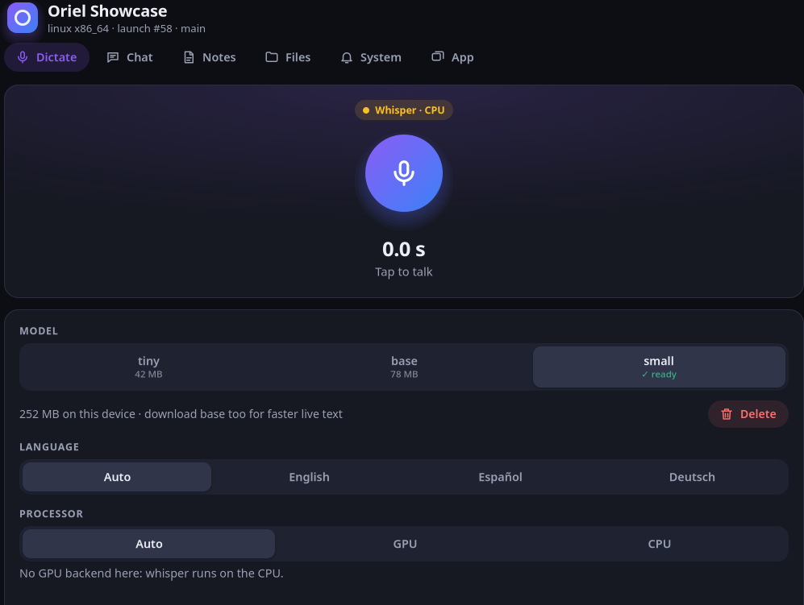
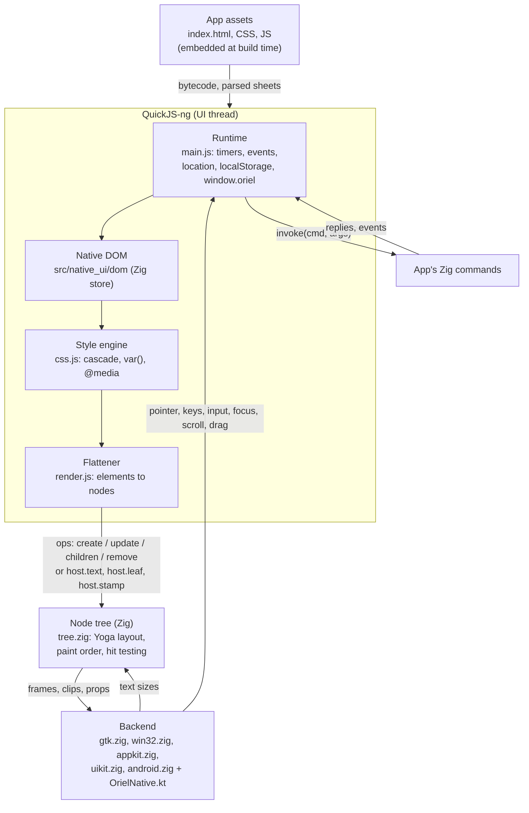
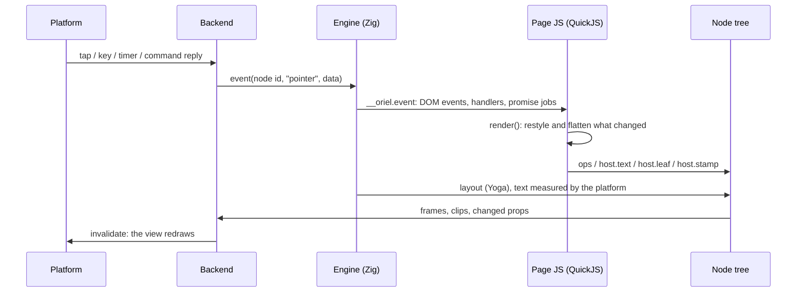

<!-- Generated from site/content/docs/native-renderer.smd by tools/docs/gen-md.mjs: edit that file. -->

# Native renderer

Your HTML, CSS and JavaScript drawn with the platform's own views instead of a web view: one process, a fraction of the memory, the same web files.

An Oriel app normally shows its page in the system's web view. The native
renderer is an optional second renderer, turned on with `-Dnative_ui`: the
app's own `index.html`, `style.css` and `app.js` run in QuickJS, a small
JavaScript engine compiled into the app, against a DOM kept in Zig, and the
page is drawn by one platform view per window, with the platform's own text
fields, selects and sliders placed over it. There is no browser engine and
no renderer process.

It is **experimental**. It runs the HTML and CSS an app's interface uses
(flexbox, the cascade, transitions, forms, canvas), not the whole web
platform; the [reference](native-ui-reference.md) lists
exactly what it supports. A page that uses something outside it still
runs: the unsupported part is ignored.

Use it when memory, startup time or the size of the running app matter more
than the full web platform: a small utility, an overlay that stays open, an
app on low-end phones. Keep the web view (the default) for apps that need
`fetch`, iframes, web fonts, a live-reloading dev server, or CSS the
renderer doesn't cover. The same sources build both ways, so an app can
ship one and keep the other.



## Availability

| Platform | Draws with | Native controls | Accessibility | `localStorage` |
|---|---|---|---|---|
| Linux | GTK 4, Cairo, Pango | `GtkEntry`, `GtkTextView`, `GtkDropDown`, `GtkScale`, `GtkCheckButton`, `GtkButton` | Field labels | Saved to disk |
| Windows | Direct2D, DirectWrite | RichEdit 5 (`EDIT` when it can't load), `COMBOBOX`, trackbar, `BUTTON` (buttons and checks) | Field labels | Saved to disk |
| macOS | AppKit, Core Graphics, Core Text | `NSTextField`, `NSTextView`, `NSPopUpButton`, `NSSlider`, `NSButton` (buttons and checks) | VoiceOver: the whole page | Saved to disk |
| iOS | UIKit, Core Graphics, Core Text | `UITextField`, `UITextView`, a `UIButton` with a menu for selects, `UISlider`, `UIButton` | VoiceOver: the whole page | For the run |
| Android | One `View` drawing on a `Canvas` (Kotlin) | `EditText`, `Spinner`, `SeekBar` | Field labels | For the run |

- **Turned on by** `-Dnative_ui` (the dependency option `.native_ui = true`,
  which the app's `build.zig` forwards). Without it nothing of the renderer
  is compiled in. Any other target stops the build with an error.
- **Permissions:** none of its own.
- **With it, every window is native.** No window creates a web view, and on
  Linux the binary doesn't link WebKitGTK at all.
- **Accessibility:** every platform gives its native fields their
  accessible names (from `aria-labelledby`, `aria-label`, the `<label>`,
  `title`). On macOS and iOS the whole page (headings, links, buttons,
  images, landmarks, text) is exposed to VoiceOver as well; GTK, Windows
  and Android don't expose the drawn content to a screen reader yet.
- **Drag and drop** into the page works on every platform:
  [Drag and drop](drag-and-drop.md).

## Quick start

Forward the option from the app's `build.zig` to Oriel:

```zig
// build.zig
const dep = b.dependency("oriel", .{
    .target = target,
    .optimize = optimize,
    .native_ui = b.option(bool, "native_ui", "Draw the page with native views (experimental)") orelse false,
});
_ = oriel.addApp(b, dep, .{
    .name = "my-app",
    .root_source_file = b.path("src/main.zig"),
});
```

Nothing else changes: the same `main.zig`, commands, events and web files.

```zig
// src/main.zig
const std = @import("std");
const oriel = @import("oriel");
const app = @import("oriel_app");

pub const Commands = struct {
    pub fn greet(_: std.mem.Allocator, args: struct { name: []const u8 }) []const u8 {
        _ = args;
        return "Hello from Zig";
    }
};
pub const Events = struct {};

pub fn main(init: std.process.Init) !u8 {
    return oriel.main(init, .{ .commands = Commands, .events = Events }, .{
        .app = app.build,
        .window = .{ .title = "My App", .width = 800, .height = 600 },
    });
}
```

```js
// web/app.js: runs unchanged in both renderers
const out = document.querySelector("#out");
document.querySelector("#go").addEventListener("click", async () => {
  out.textContent = await window.oriel.invoke("greet", { name: "you" });
});
```

Build and run it:

```sh
zig build -Dnative_ui run                                  # Linux, Windows, macOS
oriel android dev -Dnative_ui                              # Android
oriel ios dev -Dnative_ui --simulator                      # iOS
zig build -Dtarget=x86_64-windows -Dnative_ui              # cross-compile
```

`oriel dev`, `build`, `run`, `oriel android dev/build` and `oriel ios
dev/build` forward every `-D` option ([CLI](cli.md)).

## How it works



**One engine per window.** `src/native_ui/engine_js.zig` owns a window's
QuickJS context, its node tree and its backend, and everything it does runs
on the UI thread, as a browser's main thread: the page's JavaScript,
styling, layout and drawing. Async commands run on Oriel's worker pool, as
with the web view, and resolve their promises back on the UI thread.

**The page's JavaScript** runs in [QuickJS-ng](https://github.com/quickjs-ng/quickjs),
vendored in `src/native_ui/vendor/quickjs-ng` and built by Zig. Oriel's
runtime (`src/native_ui/js/src/main.js` and its modules) is compiled to
QuickJS bytecode at build time (`tools/qjs_bytecode.c`), and so are the
app's own JavaScript modules (`qjs_modules`), so nothing is parsed at
startup. The page's scripts run as `<script>` tags would, in order, then
`DOMContentLoaded` and `load` fire.

**The DOM** is the native DOM: the document lives in a Zig store
(`src/native_ui/dom/store.zig`) as records in slabs, names interned as
QuickJS atoms, `innerHTML` parsed and serialized in Zig, selectors compiled
and matched in Zig (`selector.zig`). JavaScript holds one thin wrapper per
node it touches (`dom_qjs.c`, `js/src/dom/native.js`); the long tail of the
DOM API (events, `MutationObserver`, `style`, `dataset`, forms) is
JavaScript on top. The runtime reaches it through one module (`#dom`);
its Node tests swap in [linkedom](https://github.com/WebReflection/linkedom),
a DOM written in JavaScript (vendored in `js/vendor/linkedom`), to run
without the Zig store. Apps never contain linkedom.

**`window.oriel`** is the web view's own: one file, `src/core/bridge_api.js`,
defines the page API, and the runtime bundles it with the engine's
transport (`__host.invoke`) where the web view's bridge script
(`src/core/bridge_js.zig`) splices it in with WebKit's or the message
channel's. A native page's commands go through
`src/core/native_commands.zig`, the same on every platform: window
commands, the window's command policy, `drop:path`, Oriel's built-ins, then
the app's commands.

**The style engine** (`js/src/css.js`) parses each sheet once, at build
time for the app's own (the parsed sheets are embedded), and indexes rules
by their rightmost selector. For each element it runs the cascade
(specificity, `!important`, inline styles), resolves `var()`, `calc()` and
`color-mix()`, inherits text properties and evaluates `@media`. Elements
with the same styles share one computed style.

**The flattener** (`js/src/render.js`) turns the styled DOM into as few
native nodes as it can: a paragraph with inline `<b>` and `<a>` becomes one
text node with styled runs, a box that only lays out its children becomes a
layout-only node with nothing drawn. It is incremental: the DOM's mutations
mark what changed, and only that is restyled and flattened. The differences
go to Zig as operations, or by three faster paths that skip them:
`host.text` for a text whose words changed, `host.leaf` for nodes made from
a style sent once, and `host.stamp`, where Zig reads a flex row of simple
children (or a list of identical rows) straight from the native DOM
(`dom_stamp.zig`) without a JavaScript object per child.

**The node tree** (`src/native_ui/tree.zig`) has one node per drawn view. It
maps the CSS onto [Yoga](https://www.yogalayout.dev/), the flexbox engine
React Native uses (vendored in `src/native_ui/yoga`, with two patches the
build applies), and adds what Yoga lacks: tables, sticky positioning, CSS
paint order (z-index, positioned boxes), scrolling and hit testing. Text is
measured by the platform's own text engine (Pango, DirectWrite, Core Text,
`StaticLayout`), so a paragraph wraps where it will be drawn; sizes are
cached on the node and by content and width (`text_measure_cache.zig`).

**The backend** draws. One view draws the whole page (boxes, borders,
gradients, shadows, styled text, SVG icons, canvases) and the form fields
are the platform's widgets placed over it, each clipped to the part of its
box the page shows. Those fields bring the system keyboard, selection,
autocorrect and input methods with them. Pointer, key, text, focus, scroll
and drag events come back from the backend as engine events, which the
runtime dispatches as DOM events on the element under them.



**One frame.** An event (a tap, a key, a timer, a command's reply, a display
frame) calls into the page; its handlers and their promise jobs run; then
the page renders if the DOM changed, and the tree lays out and the view
redraws. The page renders at most once per display frame however many
events arrive, and `requestAnimationFrame` runs on the platform's frame
clock (GTK's frame clock, `CVDisplayLink` and `CADisplayLink`, DWM,
Android's `Choreographer`): a 120 Hz display gets 120 frames, a hidden
window none. Frames that only change `transform` or `opacity` (an
animation, a transition) skip the flattener and go to Zig as numbers.
Scrolling skips the page entirely: the offset moves, Zig places the frames
again, the view redraws, and the page's `scroll` events follow at the next
frame.

**Commands and events.** The page has the same `window.oriel` as in the web
view: `invoke` calls the app's Zig commands, `listen` receives `events.emit`
events, and the window, permissions, lifecycle, extensions and the other
modules' page APIs are the same. Calls don't cross a process: the engine
calls the platform's bridge directly (`nativeInvoke` in
`src/platform/<os>/bridge.zig`), which checks the command against
[`security.capabilities`](security.md) as for a web page,
and answers on the main loop, never inside the call that asked.

**Security.** The page is the app's embedded code: the renderer loads only
the app's own assets, never a remote URL, so there is no IPC token or
isolation hook to apply. The app's [CSP](security.md) still
governs compiling strings: unless `security.csp`'s `script-src` (else
`default-src`) has `'unsafe-eval'` (it doesn't by default), `eval`,
`new Function`, the other Function constructors and string timers throw an
`EvalError` and the violation is logged; inline handlers (`onclick="…"`)
need `'unsafe-inline'`. QuickJS itself refuses them (`JS_EvalObject`), so a
page can't get around it by replacing globals.

### The parts

| Part | Source | What it does |
|---|---|---|
| JavaScript engine | `src/native_ui/vendor/quickjs-ng`, `qjs_shim.c` | QuickJS-ng and the `__host` functions the runtime calls (`ops`, `text`, `leaf`, `stamp`, `frame`, `invoke`, `timer`, `focus`, `scrollTo`, `tabNext`, `keyScroll`, `focusRing`, `fileRead`, ...) |
| Runtime | `src/native_ui/js/src/main.js`, bundled into `src/native_ui/runtime.js` | Timers, `requestAnimationFrame`, events and their default actions, forms, focus, `location.hash`, `matchMedia`, storage |
| Input rules | `src/native_ui/interaction.zig` (shared with the Oriel renderer) | Tab's order, what a click focuses, which keys activate, the focus ring, key scrolling and its glide ([Architecture](architecture.md#shared)) |
| Page API | `src/core/bridge_api.js` | `window.oriel`, shared with the web view's bridge |
| Native DOM | `src/native_ui/dom` (`store.zig`, `html.zig`, `selector.zig`, `serialize.zig`, `dom_qjs.c`), `js/src/dom/native.js` | The document in a Zig store; design in `docs/design/native-dom.md` |
| Test DOM | `js/vendor/linkedom`, `js/src/dom/linkedom.js`, `js/test/runtime-linkedom.js`, `js/test/engine-host.mjs` | The runtime on linkedom, for its Node tests (`npm test`), with the engine's input rules as WebAssembly (`zig build interaction-wasm`); not in apps |
| Style engine | `js/src/css.js` | Sheets, the cascade, custom properties, `@media`, `@keyframes` |
| Flattener | `js/src/render.js`, `html.js`, `icons.js` | Styled DOM to native nodes, incrementally; inline SVG as vector shapes |
| Transitions, animations | `js/src/transitions.js`, `animations.js` | CSS transitions and `@keyframes`, only the animated nodes each frame |
| Canvas | `js/src/canvas.js`, each backend, `OrielCanvas.kt` | The 2d context as a recorded program, replayed into a bitmap |
| Accessibility | `js/src/a11y.js`, `appkit.zig`, `uikit.zig` | Roles, names and states for the platform's screen reader |
| Drag and drop | `js/src/dnd.js`, `blob.js`, `drop.zig` | `DragEvent`, `DataTransfer`, `File` for drops into the page |
| Web storage | `src/native_ui/web_storage.zig` | `localStorage`, shared by the app's windows |
| Engine | `src/native_ui/engine_js.zig` on `engine_core.zig` | One per window: QuickJS, the tree and the backend; commands, timers; frames, painting and scrolling shared with the Oriel renderer |
| Commands | `src/core/native_commands.zig` | A native page's command, dispatched the same way by every platform's bridge |
| Node tree | `tree.zig`, `dom_stamp.zig`, `slab_pool.zig` | Yoga layout, paint order, sticky, tables, scrolling, hit testing, stamped rows |
| Backends | `gtk.zig`, `win32.zig`, `appkit.zig`, `uikit.zig` with `apple_draw.zig`, `android.zig` with `OrielNative.kt` | One view draws the page; platform widgets for the fields |
| Canvas from Zig | `zig_canvas.zig` | `oriel.canvas`: the app's Zig code draws into a page's canvas |

## Examples

### Build an app both ways

The [showcase](https://github.com/highercomve/Oriel/tree/main/examples/showcase)
builds with and without `-Dnative_ui` from the same sources: dictation,
chat with a local model, notes in SQLite, files and notifications run in
both. [GhostPen](https://github.com/highercomve/GhostPen), a React app,
runs its menus, settings and transparent overlays on the native renderer.

```sh
cd examples/showcase
zig build run                 # the web view
zig build -Dnative_ui run     # the native renderer
```

### Tell the renderers apart

In the page, `window.oriel.features.nativeUi` is the build's flag, the same
table the web view's bridge has:

```js
if (window.oriel.features.nativeUi) {
  // Native renderer: no fetch(), hash routing only (see the reference).
  document.documentElement.classList.add("native");
}
```

In Zig, at compile time:

```zig
const oriel = @import("oriel");

const native = oriel.options.native_ui;
// Code that only exists with the native renderer:
const game = if (native) @import("game.zig") else struct {};
```

### Draw a canvas from Zig

With the native renderer, Zig can draw into a page's `<canvas>` every
display frame without running JavaScript: the page keeps its HTML, CSS and
input, Zig simulates and draws. The
[Breakout example](https://github.com/highercomve/Oriel/tree/main/examples/breakout)
plays the same game this way, from JavaScript, and in the web view.

```
<canvas id="game" width="640" height="360"></canvas>
```

```zig
// src/game.zig: compiled only with -Dnative_ui
const std = @import("std");
const oriel = @import("oriel");
const canvas = oriel.canvas;

const Game = struct {
    window: *oriel.App.Window,
    target: canvas.Canvas,
    program: canvas.Program,
    x: f32 = 20,

    fn frame(g: *Game, f: canvas.Frame) bool {
        _ = f; // f.interval_ms: the display's refresh interval
        g.x = @mod(g.x + 2, 640);
        const p = &g.program;
        p.begin();
        p.fillStyle(canvas.rgb(0x10141b));
        p.fillRect(0, 0, 640, 360);
        p.circle(g.x, 180, 12);
        p.fillStyle(canvas.rgb(0x6d8bff));
        p.fill();
        return g.target.commit(p); // false: the window or the canvas went
    }
};

var game: Game = undefined;

pub fn start() bool {
    const window = oriel.App.getWindow("main") orelse return false;
    const target = canvas.Canvas.open(window, "game") orelse return false; // not rendered yet
    game = .{ .window = window, .target = target, .program = .init(std.heap.smp_allocator) };
    canvas.onFrame(window, &game, Game.frame) catch return false;
    return true;
}

pub fn stop() void {
    canvas.stopFrames(game.window, &game);
    game.target.release(); // the page draws it again
    game.program.deinit();
}
```

```zig
// src/main.zig
const native = oriel.options.native_ui;
const game = if (native) @import("game.zig") else struct {};

pub const Commands = struct {
    /// The page calls this once its canvas is on screen; false in the web view.
    pub fn start_game(_: std.mem.Allocator) bool {
        if (comptime !native) return false else return game.start();
    }

    pub fn stop_game(_: std.mem.Allocator) void {
        if (comptime native) game.stop();
    }
};
```

Sync commands run on the main thread, which is where `open`, `onFrame` and
`commit` must be called. In the web view build `oriel.canvas` doesn't exist
(`oriel.canvas.available` is false); an app that supports both draws with
the page's 2d context there.

### Debug a page on Android

Android apps get no environment variables, so Oriel reads them from a
system property when it loads:

```sh
adb shell setprop debug.oriel.env "'ORIEL_NUI_TRACE=1 ORIEL_NUI_MEM=1'"
adb shell am force-stop dev.example.myapp
adb logcat -s OrielNui oriel
```

## Reference

### Build options

| Option | Default | Meaning |
|---|---|---|
| `-Dnative_ui` (`.native_ui`) | `false` | Draw every window with the native renderer. Linux, Windows, macOS, Android, iOS; any other target is a build error. Compiles QuickJS-ng, Yoga, the runtime and the platform's backend in, and the app's JavaScript modules to bytecode. Windows builds also embed `src/native_ui/win32.manifest` (Common Controls 6 for the fields). |
| `-Dnative_ui_prof` (`.native_ui_prof`) | `false` | Log each stage's time (render, layout, paint) from `src/native_ui/prof.zig`; compiled out without it. |

An app forwards each one it wants from its `build.zig` to the Oriel
dependency, as in the [quick start](#quick-start).

### Page API

The page's `window.oriel` is the web view's, the same object from the same
source (`src/core/bridge_api.js`). What differs is what the renderers give
it:

| Member | Native renderer | Web view |
|---|---|---|
| `oriel.features.nativeUi` | `true` | `false` |
| `oriel.drop.path(file)` | A dropped file's path: [Drag and drop](drag-and-drop.md#drop-path) | `null`: a web view's dropped files have no handle |
| IPC token, isolation hook | None: the page is the app's own code | As configured ([Security](security.md)) |

Everything the page can use from the web platform (elements, CSS, events,
`localStorage`, canvas) is listed in the
[native UI reference](native-ui-reference.md).

### Zig: `oriel.canvas`

Exists with `-Dnative_ui`; without it, `oriel.canvas.available` is `false`
and any other use is a build error.

```zig
pub const available: bool;

pub const Color = [4]f32; // r, g, b 0-255, alpha 0-1
pub fn rgb(hex: u24) Color;
pub fn rgba(hex: u24, alpha: f32) Color;

pub const Cap = enum { butt, round, square };
pub const Join = enum { miter, round, bevel };
pub const TextAlign = enum { left, center, right };
pub const Baseline = enum { alphabetic, top, hanging, middle, bottom };

pub const Canvas = struct {
    pub fn open(window: *App.Window, element_id: []const u8) ?Canvas;
    pub fn elementId(c: *const Canvas) []const u8;
    pub fn size(c: *Canvas) ?[2]f32;
    pub fn commit(c: *Canvas, p: *Program) bool;
    pub fn release(c: *Canvas) void;
};

pub const Frame = struct { interval_ms: f64 };
pub fn onFrame(window: *App.Window, ctx: anytype, comptime func: fn (@TypeOf(ctx), Frame) bool) !void;
pub fn stopFrames(window: *App.Window, ctx: anytype) void;
```

| Declaration | Meaning |
|---|---|
| `Canvas.open(window, id)` | The `<canvas id="…">` in `window`'s page. Null when the window isn't native, the id is longer than 64 bytes, or the page hasn't rendered that canvas yet. UI thread. |
| `Canvas` | A value: it holds the engine's serial and the node's id, no pointer. After the page replaces the element, the next call finds it again by its id; after the window closes, calls fail. |
| `size()` | The drawing space: the element's `width` and `height` attributes (as the 2d context has them), else its laid-out size. Null when it's gone. |
| `commit(p)` | Show `p`: the tree takes its commands and memory and gives `p` the previous frame's memory back (call `p.begin()` before drawing again). Drawn at the window's next paint, inside `onFrame` at this frame's. False, with nothing taken, when the window or canvas is gone or `p` ran out of memory. UI thread. |
| `release()` | The page draws it again: from the first `commit` until `release`, the page's own 2d drawing into that canvas is ignored. |
| `onFrame(window, ctx, func)` | Call `func(ctx, frame)` on the UI thread at each display frame of `window`, until it returns `false` or `stopFrames`. `ctx` must be a pointer and stay valid until then. `error.NotNative` for a web view window, `error.OutOfMemory`. Frames stop when no callback and no `requestAnimationFrame` wants one. |
| `stopFrames(window, ctx)` | Stop `ctx`'s callbacks in `window`. |

**`Program`**: one frame's drawing, the same model as the page's 2d context.

| Method | Meaning |
|---|---|
| `init(gpa)`, `deinit()` | An arena-backed program. |
| `begin()` | Start a frame: the last frame's commands go (the arena keeps up to 4 MB for reuse). |
| `len()` | Commands recorded. |
| `save()`, `restore()` | The state stack. |
| `beginPath()`, `closePath()`, `moveTo(x, y)`, `lineTo(x, y)`, `rect(x, y, w, h)` | Paths. |
| `arc(x, y, r, a0, a1, ccw)` | Radians, clockwise unless `ccw`. |
| `circle(x, y, r)` | `beginPath()` and a full `arc`. |
| `bezierCurveTo(c1x, c1y, c2x, c2y, x, y)` | A cubic. |
| `fill()`, `fillEvenOdd()`, `stroke()`, `clip()` | Paint or clip the path (nonzero, even-odd). |
| `fillRect`, `strokeRect`, `clearRect` `(x, y, w, h)` | Rectangles. |
| `fillText(text, x, y)`, `strokeText(text, x, y)` | Text, copied. |
| `fillStyle(c)`, `strokeStyle(c)` | Solid colors. |
| `linearGradient(x0, y0, x1, y1) u16`, `radialGradient(x0, y0, r0, x1, y1, r1) u16`, `colorStop(id, offset, c)` | A gradient for this frame and its stops. |
| `fillGradient(id)`, `strokeGradient(id)` | Paint with it. |
| `translate(x, y)`, `scale(x, y)`, `rotate(radians)` | Transforms. |
| `lineWidth(w)`, `lineCap(cap)`, `lineJoin(join)`, `globalAlpha(a)` | Stroke and alpha. |
| `font(size, weight, italic, family)`, `textAlign(a)`, `textBaseline(b)` | Text style; `family` is a CSS family, copied. |

Recording never fails: running out of memory marks the program and
`commit` refuses it. Build a program on any thread (a simulation on a
worker can hand a built program to the UI thread with `App.runOnMain`);
`open`, `commit`, `onFrame` and `stopFrames` run on the UI thread.

### Environment variables

Debugging aids; on Android set them with `debug.oriel.env`
([example](#example-android-debug)).

| Variable | Platform | Effect |
|---|---|---|
| `ORIEL_NUI_TRACE=1` | all | Log the ops; on Android also each draw and every 120th display frame (tag `OrielNui`); on macOS clicks. |
| `ORIEL_NUI_DUMP=1` | all | The laid-out tree after each layout (Android: what `NuiView` holds: kind, frame, colors, text). |
| `ORIEL_NUI_DUMP=props` | desktop | The laid-out tree with each node's props as JSON (what the page computed: porting it to `.oriel` views). |
| `ORIEL_NUI_DUMP_AT=<seconds>` | desktop | One dump that many seconds after boot (after the UI changed: a panel opened); both renderers. |
| `ORIEL_NUI_MEM=1` | Android | The JavaScript heap and the node count. |
| `ORIEL_NUI_AXDUMP=1` | all | The accessibility tree as a backend builds it, after each change. |
| `ORIEL_NUI_SNAPSHOT=<dir>` | macOS | Each window as drawn, fields included, to `<dir>/<label>.png` after each layout. |
| `ORIEL_NUI_FIELDS=1` | Linux | Each native field's frame, clip and visibility. |
| `ORIEL_NUI_PAGE=<file>` | Linux | Read this file for `index.html` (`tools/flatten_diff`). |
| `ORIEL_NUI_JSON=1` | Android | Send props and leaf styles as JSON instead of the compact records. |
| `ORIEL_NUI_SCALE=1.25` | Windows | Force a display scale (WebView2's `--force-device-scale-factor`). |
| `ORIEL_NUI_TEXT_CHECK=1` | Windows | Measure text both ways and log differences. |
| `ORIEL_FORCED_COLORS=dark` or `light` | Windows | Fake a high-contrast theme. |

### Performance

The [render bench](https://github.com/highercomve/Oriel/tree/main/examples/render-bench)
times one page in both renderers: building and updating rows of styled
text (each followed by a layout read, as `offsetHeight` forces), a
`requestAnimationFrame` loop moving 200 boxes, and a canvas of bouncing
balls. Linux desktop, 180 Hz display, ReleaseFast, the median of 3 runs
(2026-10-03):

| | Native renderer | Web view (WebKitGTK) |
|---|---|---|
| Build 1000 / 3000 rows | **6.4 / 18.6 ms** | 20 / 69 ms |
| Update 1000 / 3000 rows | **2.8 / 8.5 ms** | 9 / 40 ms |
| Page script runs | **19 ms** after start | 349 ms |
| First frame | **69 ms** | 431 ms |
| Animate 200 boxes | **165 fps** | 62 fps |
| Canvas, 200 / 1000 balls | **180 / 91 fps** | 62 / 62 fps |
| Memory at start | **110 MB** | 491 MB |
| Memory after the tests | **174 MB** | 561 MB |

The same bench on every platform (ReleaseFast; Windows ReleaseSafe):

| | Build 1000 rows | Update 1000 rows | Animate 200 boxes | Canvas 1000 balls |
|---|---|---|---|---|
| Linux (180 Hz) | 6.4 ms | 2.8 ms | 165 fps | 91 fps |
| Windows 11 (2018 laptop, 144 Hz) | 18.9 ms | 8.2 ms | 72 fps | 64 fps |
| macOS (M1, 120 Hz) | 24.9 ms | 15.6 ms | 120 fps | 120 fps |
| iOS (simulator, 60 Hz) | 22.3 ms | 13.8 ms | 60 fps | 60 fps |
| Android (120 Hz phone) | 13.8 ms | 18.9 ms | 116 fps | 91 fps |

A result at the display's refresh rate is capped by it. Drawn from Zig
(`oriel.canvas`), 1000 balls reach 179 fps on Linux, 143 on Windows and 120
on macOS and the phone.

**Memory on Android** (Chromebook, Android 15, total PSS of every process
the app runs, `dumpsys meminfo`): a hello world takes 20.3 MB native against
105.5 MB with the web view (React Native's: 39.9 MB); the showcase 30.4 MB
against 141.5 MB, its web view renderer process (71.3 MB) gone. The native
build adds about 2 MB to the APK (QuickJS, Yoga and the runtime).
Elsewhere, the showcase idle on its first tab: about 70 MB against 96 MB on
macOS; 31 MB in one process against 90 MB in seven on Windows.

These are dated measurements on the hardware named, not guarantees for
every page. Text updates are where the web view and plain platform views
still lead: changing 1000 texts goes through JavaScript and the DOM.
`docs/internal/native-renderer-performance.md` keeps the full tables and the
later diagnostics.

### Migrating from 0.11

- `window.oriel.native` is gone: use `window.oriel.features.nativeUi`.
- `-Dnative_dom` (`.native_dom`) is gone: apps always run on the native
  DOM. Remove the option from `build.zig`.
- `oriel.canvas.openIn`, `onFrameIn`, `engineOf` and the `Engine`, `Cmd`
  and `Font` re-exports are gone: use `Canvas.open` and `onFrame` with the
  window.
- `oriel.drop.path` resolves the path as a string (it was `{ path }`).

### Limits

The [native UI reference](native-ui-reference.md#not-supported)
lists every unsupported element, property and API. The ones that change how
an app is built:

- **Built assets only.** The renderer loads the app's embedded assets, never
  a dev server or a remote URL: build the frontend (`vite build`), and do live
  development in the web view.
- **No network APIs in the page.** No `fetch`, `XMLHttpRequest` or
  `WebSocket`: call a Zig command instead.
- **Hash routing only.** `history.pushState` and `replaceState` do nothing;
  `location.hash` and `hashchange` work.
- **Installed fonts only.** `@font-face` is ignored, as are rules inside
  `@supports`, `@layer`, `@container` and `@import`.
- **Layout reads are sizes.** `getBoundingClientRect`, `offset*`,
  `client*` and `scroll*` come from the laid-out tree; `ResizeObserver` and
  `IntersectionObserver` exist but never fire.
- **iOS:** a field under the keyboard isn't scrolled into view, and only
  fields get hardware-keyboard keys.

## Troubleshooting

- **Part of the page is missing or unstyled.** The page uses something the
  renderer doesn't support; check the
  [reference](native-ui-reference.md). Tailwind CSS 4 puts
  its rules inside `@layer`, which is ignored; colors in `oklch()` are
  too.
- **`stylesheet not found: …` or `script not found: …`** in the log. The
  `href` or `src` doesn't name an embedded asset; paths are relative to the
  frontend's `dist` directory.
- **`EvalError` naming `script-src`.** The app's CSP forbids `eval` and
  `new Function` (the default). Alpine.js compiles its expressions with
  `new Function`: add `'unsafe-eval'` to `security.csp`'s `script-src`, or
  use its CSP build (`@alpinejs/csp`).
- **`native page: blocked command "…"`.** The command isn't allowed for the
  window's origin by `security.capabilities`.
- **A router shows the first page only.** It uses the History API: switch
  it to hash mode.
- **Nothing logged on Android.** Set the variables through
  `debug.oriel.env`, then restart the app.

## Related

- [Architecture](architecture.md): what the renderer shares with the others, layer by layer.
- [Native UI reference](native-ui-reference.md): every element, CSS property, event and API the renderer supports.
- [Drag and drop](drag-and-drop.md): files and text dropped into the page.
- [Commands](commands.md): how the page calls Zig, the same in both renderers.
- [Security](security.md): the CSP and capabilities the renderer applies.
- [Building](building.md): build options and targets.
- [Comparison](comparison.md): Oriel against Tauri, Electron and React Native.
