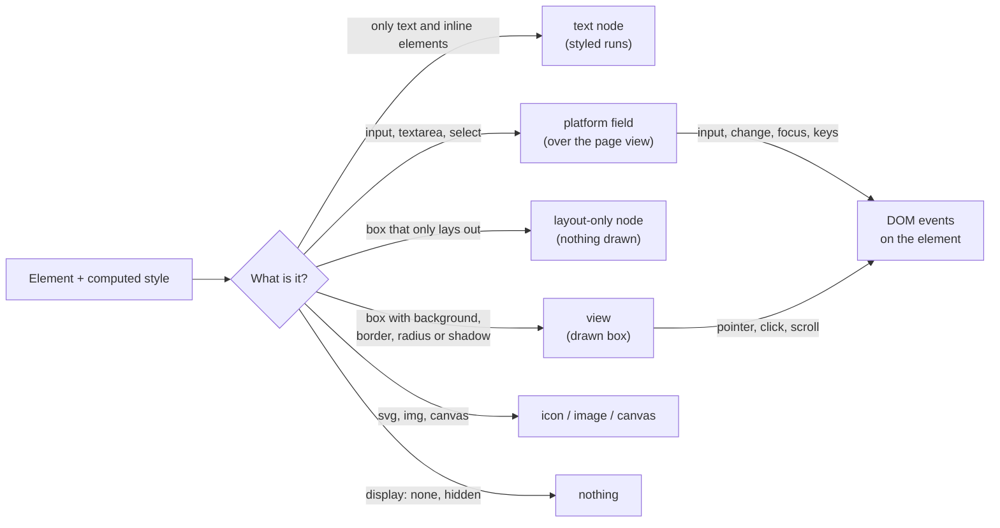

<!-- Generated from site/content/docs/native-ui-reference.smd by tools/docs/gen-md.mjs: edit that file. -->

# Native UI reference

Every HTML element, CSS selector, property, unit, event and browser API the native renderer supports, how each platform draws it, and what it doesn't support.

The [native renderer](native-renderer.md) runs the part of
the web platform an app's interface uses. This page lists that part
exactly: what each element becomes, which CSS applies, which events fire,
which browser APIs exist, and where the platforms differ. Anything not
listed here is not supported; a page that uses it still runs, and that part
is ignored. The last section, [Not supported](#not-supported),
names the gaps apps run into most.

The renderer matches each platform's own web view where it can: controls
are sized and lettered as WebKitGTK draws them on Linux, WebView2 on
Windows, WKWebView on macOS and iOS and the Android WebView on Android, so
a page laid out in the web view lays out the same way here.

## Availability

Everything on this page needs `-Dnative_ui`
([Native renderer](native-renderer.md#availability)).
The supported HTML, CSS and APIs are the same on every platform; what
differs is how the platform draws them:

| Platform | Text engine | Form fields | Checkboxes, radios | Buttons |
|---|---|---|---|---|
| Linux | Pango | GTK widgets | `GtkCheckButton` | `GtkButton` (text-only, unstyled) |
| Windows | DirectWrite | RichEdit, `COMBOBOX`, trackbar | `BUTTON` | `BUTTON` (text-only, unstyled) |
| macOS | Core Text | AppKit controls | `NSButton` | `NSButton` push button (text-only, unstyled) |
| iOS | Core Text | UIKit controls | Drawn | `UIButton` (text-only, unstyled) |
| Android | `StaticLayout` | `EditText`, `Spinner`, `SeekBar` | Drawn | Drawn |

A button or checkbox is a platform control only while the page leaves its
look to the browser: no `appearance: none`, and for buttons a text-only
label and no background or border of the page's own. Otherwise the page's
CSS draws it.

## Quick start

A page that uses only what this reference lists looks the same in both
renderers:

```
<!doctype html>
<html>
<head>
  <link rel="stylesheet" href="style.css">
</head>
<body>
  <main class="card">
    <h1>Notes</h1>
    <label>Title <input id="title" placeholder="Untitled"></label>
    <button id="save">Save</button>
    <ul id="list"></ul>
  </main>
  <script type="module" src="app.js"></script>
</body>
</html>
```

```js
// app.js
const list = document.querySelector("#list");
document.querySelector("#save").addEventListener("click", () => {
  const li = document.createElement("li");
  li.textContent = document.querySelector("#title").value || "Untitled";
  list.append(li);
  localStorage.setItem("count", String(list.children.length));
});
```

```
/* style.css */
:root { --accent: #6d8bff; color-scheme: light dark; }
.card { display: flex; flex-direction: column; gap: 12px; padding: 16px;
        border-radius: 12px; box-shadow: 0 2px 8px rgb(0 0 0 / 0.2); }
button { background: var(--accent); color: white; border: 0;
         padding: 6px 12px; border-radius: 6px; transition: opacity 150ms; }
button:active { opacity: 0.7; }
@media (prefers-color-scheme: dark) { .card { background: #1e1f24; } }
```

## How it works



Each element's computed style decides what it becomes in the node tree
(`src/native_ui/js/src/render.js`): a paragraph of text and inline elements
is one text node whose runs carry the inline styles; a box with something to
draw is a view; a box that only arranges its children is a layout node that
Yoga places but nothing draws; form fields are the platform's widgets; and
SVG, images and canvases are their own node kinds. The backend draws the
views, text, icons, images and canvases in one platform view per window and
places the fields over it. Events from the backend come back as DOM events
on the element the node came from, bubbling through the DOM as in a
browser.

## Examples

### A form that submits on Enter

```
<form id="f">
  <input name="q" type="search" placeholder="Search">
  <select name="scope"><option value="all">All</option><option value="mine">Mine</option></select>
  <button>Go</button>
</form>
<script>
  const form = document.querySelector("#f");
  form.addEventListener("submit", (e) => {
    e.preventDefault();
    const q = form.querySelector("[name=q]").value, scope = form.querySelector("[name=scope]").value;
    window.oriel.invoke("search", { q, scope });
  });
</script>
```

Enter in the one-line field fires `change`, then the form's `submit`; on
iOS the search field gets the search keyboard.

### A list that animates in

```
@keyframes slide-in { from { opacity: 0; transform: translateY(8px); } }
li { animation: slide-in 200ms ease-out; }
```

While the animation runs only the animated nodes are updated each frame,
with no restyling or flattening.

## Reference

### HTML elements

| Element | Drawn as |
|---|---|
| `div`, `section`, `main`, `header`, `footer`, `nav`, `article`, `aside`, `form`, `p`, `h1`–`h6`, `ul`, `ol`, `li`, `dl`, `dt`, `dd`, `pre`, `blockquote`, `figure`, `figcaption`, `address`, `fieldset`, `legend`, `hr` | Block boxes with the browsers' user-agent styles (margins, heading sizes, list indents, the fieldset's groove border with its legend in it) |
| `details`, `summary` | A disclosure: closed, only the first `summary` shows (whatever the page's CSS sets on the rest), with its triangle (`list-style`); a click, Enter or `open` toggles it and fires `toggle` |
| `dialog` | Hidden until open. `showModal()` puts it in the top layer over every `z-index`, with its `::backdrop` (`:modal` matches); the page outside it is inert (Tab stays inside), Escape and the platform's back fire `cancel`, `close()` (or a `method=dialog` form, its `returnValue` the submitter's value) restores the focus and fires `close`. `show()` opens it in place |
| `[popover]` | The Popover API: `showPopover()`, `hidePopover()`, `togglePopover()`, `popovertarget` buttons, `:popover-open`, `beforetoggle` and `toggle`; in the top layer in the order shown; an auto popover closes with Escape, a press outside it or another auto popover |
| `span`, `a`, `b`, `strong`, `i`, `em`, `cite`, `var`, `dfn`, `small`, `mark`, `code`, `kbd`, `samp`, `tt`, `label`, `br` | Runs inside their block's text node; a padded, bordered or rounded inline element (a `<code>` chip) keeps its box across line fragments |
| `ul`/`ol` > `li` | List items with `disc`, `circle`, `square` or `decimal` markers, inside or outside |
| `table`, `thead`, `tbody`, `tfoot`, `tr`, `td`, `th`, `caption` | Tables with automatic column widths, `colspan` and `border-spacing` |
| `input`, `textarea`, `select` | The platform's fields ([Form controls](#form-controls)) |
| `button`, `input type=button/submit/reset/image` | A button: the platform's push button when unstyled, else a drawn box |
| `img` | An image: `data:` URIs and app assets (PNG, JPEG and the formats the platform decodes), SVG files as vector icons; `object-fit`, `width`/`height` attributes |
| `svg` | Inline SVG as vector shapes, with `<use href="#id">`, its own `<style>`, presentation attributes, `fill`, `stroke` and their opacity |
| `canvas` | A 2d context ([Canvas](#canvas)) |
| `style`, `link rel=stylesheet` | Style sheets, at boot and whenever the page adds, edits, disables or removes one |
| `script` | Classic and module scripts, in document order; inline handlers (`onclick="…"`) when the CSP allows them |
| `template` | Not shown; its `content` works |
| `head`, `title`, `meta`, `noscript`, `datalist`, `option`, `col`, `colgroup`, `[hidden]` | Not shown |

A `<meta name="theme-color">` is read and followed when it changes.

### Form controls

| Control | Platform widget | Notes |
|---|---|---|
| `input` (text, search, email, url, tel, number, password, and every other type) | One-line text field | `placeholder`, `value`, `disabled`, `readonly` (selectable, not editable), `size` (default 20), password masking; on iOS the `type`, `inputmode`, `enterkeyhint`, `autocapitalize`, `autocorrect` and `spellcheck` attributes choose the keyboard and typing aids (keyboard type, return key, capitalization, correction, AutoFill), and on macOS `spellcheck` turns spell checking off |
| `textarea` | Multi-line text field | `rows` (default 2), `cols` (default 20); undo on Windows and macOS |
| `select` | Drop-down: `GtkDropDown`, `COMBOBOX`, `NSPopUpButton`, a `UIButton` menu, `Spinner` | Its `option`s (new ones replace the list); `change` on a pick; with `appearance: none` no platform arrow (the page draws one, a label's `::after`) unless its arrow is its own `background-image` |
| `input type=checkbox`, `radio` | See [Availability](#availability) | `checked`, `indeterminate` (drawn mixed), `disabled`, `accent-color`; `appearance: none` hands drawing to the page, its `::before` and `::after` too (a switch's knob) |
| `input type=range` | `GtkScale`, trackbar, `NSSlider`, `UISlider`, `SeekBar` | `min`, `max`, `step` (`any`); `input` while dragging, `change` on release; `accent-color` |
| `input type=date` | The platform's date picker: a `GtkCalendar` popover, the Date and Time Picker control, an `NSDatePicker` popover, a `UIDatePicker` keyboard, `DatePickerDialog` | The date shown in the user's format, the value `YYYY-MM-DD` (anything else is `""`); `input` then `change` on a pick; a Clear button empties it |
| `input type=file` | A drawn button ("Choose File" and the file's name) | Its click (or its label's, or Enter) opens the platform's file dialog (the [dialog](dialogs.md) module); with `capture` and an `image/*` `accept` on a phone, the camera (the [camera](camera.md) module). The pick is `files[0]` (a `File` read lazily, as a dropped one), then `input` and `change`; a cancel fires `cancel`. `accept` narrows the desktops' dialogs. One file: `multiple` is ignored |

- **Values.** The page's `value` reaches the field only when the page
  changes it, never over what the user is typing.
- **Events.** A key that edits fires `keydown` on the field first (a
  prevented `keydown` or `keypress` keeps the key from the control), then
  `beforeinput` (cancelable) with Chromium's `inputType` (`insertText`,
  `insertLineBreak`, `deleteContentBackward`, `deleteContentForward`, the
  `deleteWord…` forms, `insertFromPaste`, `deleteByCut`, `historyUndo`),
  then `input`. `change` fires on blur and on Enter in a one-line field when
  the user changed the value, never for a script's value. Enter in a
  one-line field submits its form. An input method's composition stays the
  field's (no `beforeinput` for it).
- **Selection.** `selectionStart`, `selectionEnd`, `setSelectionRange()`
  and `select()` read and set the field's own selection, in UTF-16 units.
- **Forms.** `submit` (from a submit button, Enter in a one-line field,
  or `requestSubmit()`; `submit()` fires none) and `reset` (restores each
  control's default). There is no `FormData` and no constraint validation:
  read the fields' values.
- **Names.** Each field's accessible name is `aria-labelledby`'s text,
  `aria-label`, its `<label>`, or `title`.

### Selectors

| Kind | Supported |
|---|---|
| Simple | Type, `*`, `#id`, `.class` |
| Attributes | `[a]`, `[a=v]`, `~=`, the dash match, `^=`, `$=`, `*=`, with the `i` flag |
| Combinators | Descendant, `>`, `+`, `~` |
| Logical | `:not()`, `:is()`, `:where()`, `:matches()`, `:has()` |
| Structural | `:first-child`, `:last-child`, `:only-child`, `:nth-child()`, `:nth-last-child()`, `:first-of-type`, `:last-of-type`, `:only-of-type`, `:nth-of-type()`, `:nth-last-of-type()`, `:root`, `:empty` |
| State | `:hover` (mouse, trackpad, pen), `:active` (while pressed), `:focus`, `:focus-visible` (keyboard focus, or any text field), `:focus-within`, `:checked`, `:disabled`, `:enabled`, `:link`, `:any-link`, `:modal`, `:popover-open` (these two in `matches()` and `querySelector` too) |
| Pseudo-elements | `::before`, `::after` with `content` |

The same selectors work in style sheets and in `querySelector`,
`querySelectorAll`, `matches` and `closest`. A style rule with any other
pseudo-element (`::placeholder`, `::selection`, `::-webkit-scrollbar`) or
with `:visited` is skipped.

### At-rules and media queries

- **`@media`**, nested too, with `and`, `,`, `not`, `only`, `screen`,
  `all` (`print` never matches) and range syntax (`(width >= 600px)`).
  Features: `width`, `height` and their `min-`/`max-` forms, `orientation`,
  `prefers-color-scheme`, `prefers-reduced-motion`, `prefers-contrast`,
  `forced-colors`, `pointer` (`fine`, `coarse`), `hover`, `resolution` and
  `min-`/`max-resolution` (`dppx`, `x`, `dpi`, `dpcm`),
  `-webkit-device-pixel-ratio` and its `min-`/`max-` forms. `matchMedia`
  answers the same queries and fires `change` when they flip.
- **`@keyframes`** (and `@-webkit-keyframes`).
- **Ignored, with everything inside them:** `@font-face`, `@supports`,
  `@layer`, `@container`, `@import`, `@page`.

### Values and units

| Kind | Supported |
|---|---|
| Lengths | `px`, `em`, `rem` (always 16 px), `%`, `vw`, `vh` (and their `s`/`d`/`l` forms), `vmin`, `vmax`, `pt`, `ch` and `ex` (half an em); `env(safe-area-inset-*)` is 0 (the window sits inside the system bars) or its fallback |
| Functions | `calc()` (mixing percentages and lengths), `min()`, `max()`, `clamp()`, `var()` with fallbacks, `minmax()` and `repeat()` in grid templates |
| Colors | `#rgb`, `#rgba`, `#rrggbb`, `#rrggbbaa`, `rgb()`/`rgba()`, `hsl()`/`hsla()` (comma or space syntax, `/` alpha), `color-mix(in srgb, …)`, `currentColor`, `transparent`, the system colors (`Canvas`, `CanvasText`, `Field`, `ButtonFace`, ...), and the names `white`, `black`, `red`, `green`, `blue`, `gray`/`grey`, `orange`, `yellow`, `purple` |
| Gradients | `linear-gradient()`, `radial-gradient()`, `repeating-linear-gradient()`, `repeating-radial-gradient()`, stops in `%`, `px` or `calc()`; `conic-gradient()` (`from`, stops in `%`, `deg`, `turn`; around the box's centre: a pie or donut chart) |
| Keywords | `inherit`, `initial`, `unset`; `!important` |

### CSS properties

| Group | Properties |
|---|---|
| Display | `display`: `block`, `flex`, `inline-flex`, `inline`, `inline-block`, `flow-root`, `list-item`, `none`, the table values, and `grid`/`inline-grid` as rows (below); `visibility` |
| Flexbox | `flex`, `flex-direction`, `flex-wrap`, `flex-flow`, `flex-grow`, `flex-shrink`, `flex-basis`, `justify-content`, `align-items`, `align-self`, `align-content`, `order`, `gap`, `row-gap`, `column-gap`, `place-items`, `place-content`, `place-self` |
| Grid | `grid-template-columns` (a track list, `repeat(n, …)`, `repeat(auto-fit, minmax(…))` (or `auto-fill`), `fr`, `auto`, lengths): each row of items laid out as a flex row with the grid's gaps and `align-items`; `grid-column` (`1 / -1`, `span N`, a start line) places items row by row. Areas and `grid-row` aren't placed |
| Size | `width`, `height`, `min-width`, `max-width`, `min-height`, `max-height` (`max-content`, `fit-content` too), `aspect-ratio`, `box-sizing` |
| Spacing | `margin` (with `auto`), `padding`, and their sides; vertical margins collapse as in block flow |
| Position | `position`: `static`, `relative`, `absolute`, `fixed`, `sticky`; `top`, `right`, `bottom`, `left`, `inset`, `inset-inline`, `inset-block`, `z-index` |
| Overflow | `overflow`, `overflow-x`, `overflow-y` (`visible`, `hidden`, `clip`, `scroll`, `auto`; clipped to rounded corners), `scrollbar-width`, `scrollbar-color`, `scrollbar-gutter` |
| Borders | `border` and its sides, `border-width`, `border-style` (`solid`, `dashed`, `dotted`; `double`, `groove`, `ridge`, `inset`, `outset` drawn as browsers shade them), `border-color`, `border-radius` (elliptical and percentage corners), `border-spacing` |
| Background | `background`, `background-color`, colors and gradients (several layers); `background-image` gradients with `background-size`, `background-position` (keywords, `%`, lengths, `calc(% ± px)`) and `background-repeat: no-repeat` (a drawn arrow or mark), not on form fields |
| Effects | `box-shadow` (blurred like CSS, inset, several), `opacity`, `outline`, `outline-offset` (solid, dashed, dotted), `transform` (`translate`, `scale`, `rotate`; drawn around the center, the layout keeps the box), the `translate`, `scale` and `rotate` properties |
| Text | `color`, `font`, `font-family`, `font-size`, `font-weight`, `font-style`, `line-height` (`normal` from the font's metrics), `letter-spacing`, `text-align`, `text-transform`, `text-decoration` (`underline`, `line-through`), `white-space`, `vertical-align` (`baseline`, `middle`, `top`, `bottom`), `word-break`, `overflow-wrap` |
| Lists | `list-style`, `list-style-type`, `list-style-position` |
| Replaced | `object-fit` |
| Controls | `appearance` / `-webkit-appearance` (`none`), `accent-color`, `color-scheme`; `::placeholder`'s `color` |
| Interaction | `cursor` (`pointer` shows the hand), `touch-action` (`none` and `pinch-zoom` let the page take a touch drag) |
| Accessibility | `forced-color-adjust` |
| Transitions | `transition`, `transition-property`, `-duration`, `-delay`, `-timing-function` |
| Animations | `animation`, `animation-name`, `-duration`, `-delay`, `-timing-function`, `-iteration-count` (`infinite`), `-direction` (`alternate`, `reverse`), `-fill-mode` |

**Inherited:** `color`, `font-family`, `font-size`, `font-style`,
`font-weight`, `font-variant-numeric`, `line-height`, `letter-spacing`,
`text-align`, `text-transform`, `white-space`, `visibility`, `cursor`,
`word-break`, `overflow-wrap`, `list-style-type`, `list-style-position`,
`color-scheme`, `text-decoration-color`, and custom properties. A
`font-size` or `line-height` in `em` or `%` inherits as its computed
length.

**Transitions and animations** animate `opacity`, `background` (colors and
gradients), `color`, `transform`, `translate`, `scale`, `rotate`, `width`,
`height`, `max-width`, `max-height`, `border-color` and `box-shadow`, with
`ease`, `ease-in`, `ease-out`, `ease-in-out`, `linear`, `cubic-bezier()`
and `steps()`. Keyframes that leave out `from` or `to` use the element's
own values.

**Style sheets that change.** A `<style>` or `<link>` added, removed,
edited or disabled after boot, and the CSSOM (`document.styleSheets`,
`element.sheet`, `cssRules`, `insertRule`, `deleteRule`), restyle the page
at the next render, only the elements the changed rules match when that can
be told. CSS-in-JS libraries (styled-components, emotion) work this way. A
`<link>` added after boot fires `load` or `error`. `new CSSStyleSheet()`
exists but `adoptedStyleSheets` isn't applied.

**High contrast** (Windows): with a high-contrast theme on,
`forced-colors: active` matches, system colors take the theme's values, and
every element without `forced-color-adjust: none` is drawn in them, as
browsers force colors.

### Fonts and text

- `font-family` resolves as in a browser: the first installed family of the
  list, else its first generic name (`serif`, `sans-serif`, `monospace`,
  `system-ui`, `ui-*`). A page that names none gets its platform web view's
  default face: sans-serif on Linux, Times on Windows, macOS and iOS.
  Windows maps the generics as Chromium does: `system-ui` Segoe UI,
  `sans-serif` Arial, `serif` Times New Roman, `monospace` Consolas.
- Only installed fonts: `@font-face` is ignored.
- `line-height: normal` is the font's ascent, descent and line gap, each
  rounded, as WebKit and Chromium make it; lines with a bigger font in them
  grow alone. Mixed fonts sit on one baseline, and boxes in a line of text
  (a button beside its label) align to it.
- Form controls use the platform's control font (`-webkit-small-control`):
  the GTK UI font on Linux, Arial on Windows, the 11 px system font on macOS
  and iOS.
- Color emoji draw in text on every platform; inside Windows text fields
  they show as outlines.

### Events

| Event | Fired by |
|---|---|
| `pointerdown`, `pointermove`, `pointerup`, `pointercancel` | Mouse, pen or one touch (`pointerType`), with `buttons` and modifier keys; moves at most once per display frame; implicit capture on the pressed element, `setPointerCapture` / `releasePointerCapture` |
| `mousedown`, `mousemove`, `mouseup`, `mouseover`, `mouseout`, `mouseenter`, `mouseleave` | A mouse, after its pointer event |
| `touchstart`, `touchmove`, `touchend`, `touchcancel` | A touch, with `touches` and `changedTouches` |
| `click`, `auxclick`, `contextmenu` | A press and release; non-primary buttons; the right button, a long press, or Control-click on macOS, in each platform's web view order |
| `keydown`, `keyup`, `keypress` | Keys, with `key`, modifiers and `repeat`; `keypress` for a character or Enter |
| `beforeinput`, `input`, `change` | Fields, as in [Form controls](#form-controls) |
| `focus`, `blur`, `focusin`, `focusout` | A press, Tab, or `element.focus()`; `document.activeElement` follows |
| `submit`, `reset` | Forms |
| `scroll` | A scroller or the window, at most once per display frame |
| `resize` | The window |
| `hashchange` | `location.hash` changes |
| `DOMContentLoaded`, `load` | After the document's scripts ran |
| `load`, `error` | A `<link rel=stylesheet>` added after boot |
| `dragenter`, `dragover`, `dragleave`, `drop` | A drag from another app ([Drag and drop](drag-and-drop.md)) |

Default actions are a browser's: a link's `href="#…"` sets the hash, a
label clicks its control, a submit button submits its form, Space and Enter
activate a focused button, link or checkbox, a press focuses the nearest
focusable element. Event handler properties (`el.onclick`, `oninput`)
exist for every event a browser has.

**Focus and Tab.** Tab and Shift+Tab move the focus in browser order:
positive `tabindex` first, then links with `href`, enabled controls,
`<summary>`, `contenteditable` and `tabindex >= 0`, in document order, if
shown; it wraps at the ends. On macOS without Full Keyboard Access (the
system default), as in Safari, only text fields, selects, textareas,
`contenteditable` and explicit `tabindex >= 0` are visited; iOS does the
same. `:focus-visible` draws the platform browser's focus ring unless the
page styles `outline`.

**Keyboard scrolling.** Keys the page doesn't take scroll the focused
element's nearest scroller, else the window: arrows 40 px, Page Up/Down and
Space 87.5% of the view, Home and End to the ends, gliding as WKWebView
does.

**Wheel and touch scrolling** are the platform's: the wheel scrolls the
system's lines per notch (Windows: 100 px), touch drags fling. A touch the
page takes on `pointerdown` (it prevented the default, or `touch-action:
none`) doesn't scroll.

### Canvas

`getContext("2d")` returns a recorder: each drawing call appends an
operation to the canvas's program, which the backend replays into a bitmap
of the canvas's own (Cairo on Linux, Direct2D on Windows, Core Graphics on
macOS and iOS, an `android.graphics.Bitmap` on Android), at the display's
scale. Other context types return `null`.

| Supported | |
|---|---|
| Rectangles | `fillRect`, `strokeRect`, `clearRect` |
| Paths | `beginPath`, `closePath`, `moveTo`, `lineTo`, `rect`, `arc`, `ellipse`, `bezierCurveTo`, `quadraticCurveTo`, `fill` (`nonzero`, `evenodd`), `stroke`, `clip` |
| State | `save`, `restore`, `translate`, `scale`, `rotate` |
| Style | `fillStyle`, `strokeStyle` (colors, `createLinearGradient`, `createRadialGradient` with `addColorStop`), `globalAlpha`, `lineWidth`, `lineCap`, `lineJoin` |
| Text | `fillText`, `strokeText`, `font` (size, weight, style, family), `textAlign`, `textBaseline`; `measureText` returns an estimate |

- **Size.** `width` and `height` attributes (default 300 × 150) are the
  drawing space; the box sizes like a replaced element (its CSS size, or
  one side and the bitmap's ratio) and doesn't shrink in a flex container.
  Bitmaps are capped at 16 M pixels.
- **Programs run whole.** The program replays on every paint, so a
  `clearRect`, or an opaque `fillRect`, that covers the canvas with no clip
  or transform drops everything recorded before it (a game loop keeps one
  frame); drawing without such a clear accumulates.
- **Safe.** An unbalanced `restore()` is ignored, a non-finite argument
  drops the call, `clearRect` clears only the canvas.
- **From Zig**, without JavaScript per frame: `oriel.canvas`
  ([Native renderer](native-renderer.md#zig-canvas)).

### Images and SVG

- `` takes a `data:` URI or an app asset path. A picture over
  4096 × 4096 px keeps its size for layout and isn't drawn; Apple
  platforms keep at most 2048 px on the longer side decoded.
- An SVG file in `` and inline `<svg>` are drawn as vector shapes. An
  SVG's own `<style>` applies (its rules by specificity, media queries,
  presentation attributes, a shape's `style` over both): `fill`, `stroke`,
  `stroke-width`, `stroke-linecap`, `stroke-linejoin`, `opacity`,
  `fill-opacity`, `stroke-opacity`, `display: none`, `visibility: hidden`.
  An SVG drawn as an image sees a light color scheme, as a browser's does;
  an inline one follows the page.

### JavaScript APIs

| API | Supported |
|---|---|
| DOM | `document`, elements with their interfaces (`instanceof` works), `createElement`, `createTextNode`, `append`, `insertBefore`, `remove`, `replaceChildren`, `cloneNode`, `innerHTML`, `outerHTML`, `textContent`, attributes, `classList`, `dataset`, `style`, `querySelector(All)`, `matches`, `closest`, `contains`, `MutationObserver`, `DOMParser`, `template.content`, `isContentEditable` |
| Layout reads | `getBoundingClientRect()`, `getClientRects()` (line fragments of inline elements), `offset*`, `client*`, `scroll*` (read and set), `scrollTo`, `scrollBy`, `scrollIntoView`, `getComputedStyle()`, `innerWidth`, `innerHeight`, `devicePixelRatio` |
| Events | `EventTarget`, `Event`, `UIEvent`, `MouseEvent`, `PointerEvent`, `TouchEvent`, `KeyboardEvent`, `FocusEvent`, `InputEvent`, `DragEvent` |
| Timers | `setTimeout`, `setInterval` (4 ms minimum; no string callbacks under the default CSP), `requestAnimationFrame` (the display's rate), `queueMicrotask`, `performance.now()` |
| Location and history | `location.hash` (set it to navigate), `search`, `pathname`, `href` (`app://localhost/index.html…`), `reload()`; the session history: `history.pushState`, `replaceState`, `state`, `back`, `forward`, `go`, `length`, `popstate` and `hashchange` (same-origin URLs; the platform's back walks it after closing a modal dialog) |
| Storage | `localStorage`, `sessionStorage` ([Web storage](#web-storage)) |
| Files | `Blob`, `File`, `FileList`, `FileReader`, `DataTransfer` |
| Images | `new Image()` and ``: `naturalWidth`/`naturalHeight` from the file's header (PNG, JPEG, GIF, WebP, BMP; a `data:` URL or an app asset), `complete`, `decode()`, `load` or `error` after `src` is set |
| Forms | `form.elements` (by index, name or id, `namedItem`, radio groups' `value`), `requestSubmit(submitter)`, `submit` events' `submitter`, `datalist.options` |
| Intl | `Intl.NumberFormat` (decimal, percent, currency), `Intl.DateTimeFormat` (components, `dateStyle`/`timeStyle`, UTC or local time), `Intl.Collator`, `Intl.PluralRules`, and `toLocaleString`, `toLocaleDateString`, `toLocaleTimeString`, `localeCompare` over them: English, Spanish, Portuguese, French, German and Italian data (others format as English), matching the browsers' output for common options |
| Other | `URL`, `URLSearchParams`, `matchMedia`, `navigator` (`userAgent` `Oriel native (<os>)`, `platform`, `language`: the user's on Linux and Android, else `en-US`, `maxTouchPoints`), `getSelection()` (always empty), `DOMException`, `window.oriel`; events the runtime fires are `isTrusted`; a promise rejected with no handler is logged |

Frameworks that render through the DOM work: plain JavaScript, React 19
(controlled inputs, selects, checkboxes and sliders reach `onChange`), Vue
3, Svelte 5, Preact, styled-components and emotion, and Alpine.js 3 when
the CSP allows `'unsafe-eval'` or with its CSP build. ES modules and lazy
chunks from Vite, esbuild or any bundler run as built.

### Web storage

`localStorage` is one store per app, shared by its windows (`src/native_ui/web_storage.zig`):

| Platform | Kept in |
|---|---|
| Linux | `$XDG_CONFIG_HOME/<app id>/data/localStorage.json` (`~/.config/…` without it) |
| macOS | `~/Library/Application Support/<app id>/data/localStorage.json` |
| Windows | `%APPDATA%\<app id>\data\localStorage.json` |
| Android, iOS | Memory only: it lasts the run |

A change is saved 300 ms later (a burst is one write) and when a window
closes; the file is replaced whole. Keys and values together are limited to
5 MB; past that `setItem` throws `QuotaExceededError` and changes nothing.
`sessionStorage` lasts the run. On Android and iOS keep data that must
survive in [`oriel.store`](store.md).

### Platform differences

| | Linux | Windows | macOS | iOS | Android |
|---|---|---|---|---|---|
| CSS px | GTK's scale | Window DPI, the viewport rounded up to whole CSS px | Backing scale | Screen scale | Density, the width rounded up to whole CSS px (as Chromium) |
| Scrollbars | Overlay | Classic, taking room (15 px, 10 px thin), WebView2's look | Overlay, or classic (15 px) when the system shows scroll bars | Overlay indicator | Overlay |
| Focus ring | 2 px accent at 0.8 alpha | 2 px near-black with a white halo | System blue at half alpha, 4 px | Same, 3 px | 2 px orange with a white halo |
| Pointer | Mouse, pen | Mouse, touch, pen (`WM_POINTER`) | Mouse, trackpad | One touch | One touch; the mouse on ChromeOS |
| Hover | Yes | Yes | Yes | No | Mouse only |
| `contextmenu` | Right button | Right button release | Right button press, Control-click | Long press | Long press |
| Border widths | WebKit's snapping | Chromium's | WebKit's | WebKit's | Chromium's |

On iPhone a second window is presented full screen with a close button; on
iPad it gets a scene of its own.

### Not supported

**Network and navigation**

- `fetch`, `XMLHttpRequest`, `WebSocket`, `EventSource`: call a Zig
  command.
- Loading another page or URL in a window; `iframe`, `object`, `embed`.
- A dev server: the renderer runs built assets only.

**Elements**

- `video`, `audio`, `picture`, `progress` and `meter` (laid out, not drawn
  as bars).
- `time`, `datetime-local`, `month`, `week` and `color` inputs have no
  pickers: they're plain text fields. `<input type=hidden>` is drawn as a
  text field: leave it out of native pages. A date field ignores `min` and
  `max` in its picker.
- `contenteditable` content isn't editable (only focusable).
- Shadow DOM and web components (Lit), `adoptedStyleSheets`.

**CSS**

- `@font-face`, `@supports`, `@layer`, `@container`, `@import`: their rules
  are dropped, which drops most of Tailwind CSS 4's output.
- Colors in `oklch()`, `oklab()`, `lab()`, `lch()`, `hwb()`, `color()`,
  `light-dark()`, and named colors beyond the eleven above.
- `rem` ignores the root's `font-size`: it is always 16 px.
- Grid areas and spans (`grid-template-areas`, `grid-area`, spanning
  `grid-column`/`grid-row`), `grid-template-rows`, `grid-auto-flow`.
- Floats, `clear`, inline blocks flowing inside text, multi-column layout,
  `rowspan`.
- `filter`, `backdrop-filter` (a blurred background is drawn opaque),
  `mix-blend-mode`, `clip-path`, `mask`, skew and 3D transforms,
  `transform-origin`.
- `background-image: url()`; repeated sized layers (`background-repeat`
  other than `no-repeat` with a `background-size`); animating
  `background-position`. A form field's own `background-image` isn't
  drawn (a field is a platform widget): a select keeps its platform arrow
  then.
- `text-overflow`, `text-shadow`, `text-indent`, `-webkit-line-clamp`,
  `writing-mode`, `direction` (right-to-left).
- `pointer-events`, `user-select`, `scroll-behavior`, scroll snapping,
  `position: sticky` inside horizontal scrollers' children beyond the
  simple case, `::placeholder`, `::selection`, `:visited`.

**Events and APIs**

- `wheel`, `dblclick`, `transitionend`, `animationend` and
  `visibilitychange` are never fired (their handler properties exist).
- `ResizeObserver` and `IntersectionObserver` exist and never call back.
- Canvas `drawImage`, `getImageData`, `putImageData`, `createPattern`,
  `setLineDash`, `setTransform`, `roundRect`, shadows, `toDataURL`, WebGL.
- `TextEncoder`, `TextDecoder`, `crypto`, Web Workers, the Clipboard API
  (`navigator.clipboard`): use the [clipboard](clipboard.md)
  module.
- `alert`, `confirm` and `prompt` would block the UI thread the page runs
  on: they answer as a browser with its dialogs suppressed does (no
  dialog, `confirm` false, `prompt` null) and log a warning. Use a
  `<dialog>`.
- Blob URLs (`URL.createObjectURL`), the page's text selection
  (`getSelection()` is always empty).

**Platforms**

- Screen readers see the drawn content only on macOS and iOS; GTK,
  Windows and Android expose the native fields alone.
- iOS doesn't scroll a field under the keyboard into view, and gives
  hardware-keyboard keys to fields only.
- CoreText (Apple) and Pango (Linux) break a word that doesn't fit its line,
  where CSS lets it overflow.

## Troubleshooting

- **A style has no effect.** Check it against the
  [properties](#properties) and
  [values](#values) tables; a rule inside `@layer` or
  `@supports`, or a color in `oklch()`, is dropped without a message.
- **Text is a different size than in the web view.** A size in `rem` with a
  root `font-size` other than 16 px; use `em` or px on the root's children.
- **A page's layout code reads zero sizes.** It ran before the first render;
  read layout in `requestAnimationFrame` or after `load`.

## Related

- [Native renderer](native-renderer.md): how the renderer works, its build options and `oriel.canvas`.
- [Drag and drop](drag-and-drop.md): drops into the page.
- [Store](store.md): persistent key-value storage on every platform.
- [Security](security.md): the CSP that governs `eval` and inline handlers.
