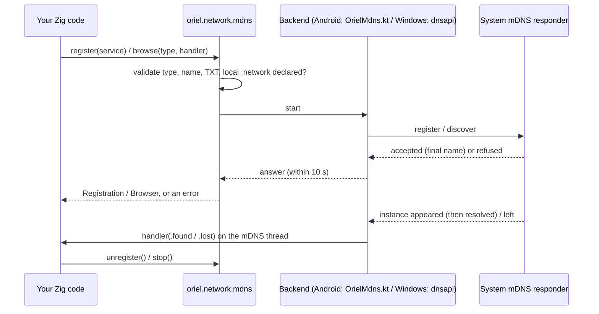

<!-- Generated from site/content/docs/network.smd by tools/docs/gen-md.mjs: edit that file. -->

# Network

Local network discovery: announce and find services with mDNS/DNS-SD through the platform's own responder, and hold the multicast lock.

`oriel.network` is for apps that talk to other devices on the same network
without a server in between: a phone finding a desktop app, two instances
pairing, a receiver announcing itself. It has two parts:

- **`oriel.network.mdns`**: register a DNS-SD service (`_myapp._tcp` on a
  port, with TXT data) and browse for others, through the operating
  system's own mDNS responder. The app opens no multicast socket and needs
  no multicast lock or Apple multicast entitlement for this.
- **`oriel.network.acquireMulticast`**: a reference-counted hold on the
  platform's multicast reception, for apps that send or receive raw
  multicast themselves.

Ordinary HTTP from Zig needs neither (use `std.http`); neither does the
page's `fetch`. Both parts are Zig APIs: the page reaches them through your
[commands](commands.md) and events.

## Availability

| Platform | `mdns` | `acquireMulticast` | Underneath |
|---|---|---|---|
| Linux | `error.Unsupported` | succeeds, holds nothing | (Avahi planned) |
| Windows | yes, Windows 10 1809 or later | succeeds, holds nothing | dnsapi `DnsServiceRegister` / `DnsServiceBrowse` / `DnsServiceResolve` |
| macOS | `error.Unsupported` | succeeds, holds nothing | (dns_sd planned) |
| Android | yes | `error.Unsupported` (the Wi-Fi `MulticastLock` isn't written yet) | `NsdManager` (`OrielMdns.kt`) |
| iOS | `error.Unsupported` | succeeds, holds nothing | (dns_sd planned) |

`oriel.network.mdns.supported()` tells at run time whether this platform has
an mDNS backend.

**Build flag:** `network`, on by default (`.network = false` on the oriel
dependency leaves it out). **Permission:** both parts require
`.permissions.local_network` in `addApp`; without it they return
`error.NotDeclared`. Declaring it writes:

| Platform | What `.local_network` declares |
|---|---|
| Android | `ACCESS_NETWORK_STATE`, `ACCESS_WIFI_STATE`, `CHANGE_WIFI_MULTICAST_STATE` (normal permissions, no prompt) |
| iOS, macOS | `NSLocalNetworkUsageDescription` with your reason (the Local Network prompt) |
| Windows, Linux | nothing |

See [Permissions](permissions.md) for
`oriel.permissions.status(.local_network)` (`granted` on Linux and
Windows, `unknown` on iOS and macOS, which have no query API).

## Quick start

```zig
// build.zig
_ = oriel.addApp(b, dep, .{
    .name = "my-app",
    .root_source_file = b.path("src/main.zig"),
    .permissions = .{ .local_network = "Finds your other devices on this network" },
});
```

```zig
// src/main.zig: announce this instance, and report others to the page
const std = @import("std");
const oriel = @import("oriel");
const app = @import("oriel_app");
const mdns = oriel.network.mdns;

pub const Events = struct {
    peer_found: struct { name: []const u8, address: []const u8, port: u16 },
    peer_lost: struct { name: []const u8 },
};
const events = oriel.App.events(Events);

var registration: ?mdns.Registration = null;
var browser: ?mdns.Browser = null;

pub const Commands = struct {
    // register and browse block until the OS answers: off the main thread
    pub const async_commands = .{"start_discovery"};

    pub fn start_discovery(_: std.mem.Allocator, args: struct { name: []const u8 }) !void {
        if (!mdns.supported()) return oriel.ipc.fail("mDNS isn't available on {s}", .{oriel.target.name});
        if (registration == null) registration = try mdns.register(.{
            .type = "_myapp._tcp",
            .name = args.name,
            .port = 47001,
            .txt = &.{.{ .key = "v", .value = "1" }},
        });
        if (browser == null) browser = try mdns.browse("_myapp._tcp", onEvent, null);
    }
};

/// On the mDNS thread; the event's data is valid only during the call.
fn onEvent(_: ?*anyopaque, event: *const mdns.Event) void {
    switch (event.*) {
        .found => |f| events.emit(.peer_found, .{
            .name = f.name,
            .address = if (f.addresses.len > 0) f.addresses[0] else "",
            .port = f.port,
        }),
        .lost => |l| events.emit(.peer_lost, .{ .name = l.name }),
    }
}

pub fn main(init: std.process.Init) !u8 {
    return oriel.main(init, .{ .commands = Commands, .events = Events }, .{
        .app = app.build,
        .window = .{ .title = "Peers", .width = 800, .height = 600 },
    });
}
```

```js
const { invoke, listen } = window.oriel;
listen("peer_found", (p) => console.log("found", p.name, p.address, p.port));
listen("peer_lost", (p) => console.log("lost", p.name));
await invoke("start_discovery", { name: "Kitchen tablet" });
```

## How it works



**The facade** (`src/modules/network.zig`, `network/mdns.zig`) validates
everything before the OS sees it: the service type (`_name._tcp` or
`_name._udp`), the instance name, the TXT record. It checks that the app
declares `local_network`, then hands over to the OS backend chosen at
build time (`network/<os>.zig` names it `mdns_backend`). `register` and
`browse` block until the OS accepts or refuses, at most 10 seconds, so
their errors come back from the call.

**Android** (`network/android.zig`, `OrielMdns.kt`): `NsdManager` talks to
the system's mDNS responder, which does the multicast itself, so no
`WifiManager.MulticastLock` is involved. Zig calls Kotlin on the UI thread;
Kotlin answers from NsdManager's thread and delivers events from its own
`oriel-mdns` Java thread, where your handler runs. Each service found is
resolved before you hear about it: on Android 14+ with
`registerServiceInfoCallback` (every address, and updates while the
service lives); before that with `resolveService`, one at a time (older
releases refuse concurrent resolves), retried with backoff and given up
after 10 s so one silent service can't stall the rest. Android reports no
host name. Android 17's local network protection (`ACCESS_LOCAL_NETWORK`,
from targetSdk 37) will gate NSD too; Oriel's template targets 35.

**Windows** (`network/mdns_windows.zig`): the DNS client service's
responder through `DnsServiceRegister`, `DnsServiceBrowse` and
`DnsServiceResolve`. Callbacks come on the DNS client's thread pool; a
browse resolves each instance announced and reports one whose record
expires. What a browse keeps is bounded, since anyone on the LAN can
announce names: 64 resolves in flight, 256 names reported, 16 addresses per
name. TXT values travel as UTF-16 strings, so they must be UTF-8 text
without NUL.

**Handlers** run on the backend's thread, never the main thread, one at a
time across every browser. `stop` waits out a handler running on another
thread, which is why a handler must not wait for the main thread (it may be
in `stop`).

**The multicast lock** (`network/common.zig`) is a count: the first
`acquireMulticast` turns the platform's multicast reception on, the last
`release` turns it off. On Linux, Windows, macOS and iOS there's nothing
to turn on (Apple's Local Network prompt and iOS's multicast entitlement
are the real gates); on Android, where the system drops multicast packets
unless an app holds a Wi-Fi multicast lock, the backend isn't written yet
and returns `error.Unsupported`.

## Examples

### Read a TXT value from a found service

```zig
fn onEvent(_: ?*anyopaque, event: *const mdns.Event) void {
    const f = switch (event.*) {
        .found => |found| found,
        .lost => return,
    };
    const version = f.txtValue("v") orelse "0"; // keys compare case-insensitively
    if (!std.mem.eql(u8, version, "1")) return;
    for (f.addresses) |a| std.log.info("{s} at {s}:{d}", .{ f.name, a, f.port });
}
```

`found` comes again for a name whose addresses, port or TXT change, so
treat it as "insert or update" keyed by `name`. A link-local IPv6 address
carries its scope (`fe80::1%wlan0`), which `std.Io.net` needs to connect.

### Keep state for the handler

The `ctx` pointer reaches the handler unchanged:

```zig
const Peers = struct {
    mutex: std.Io.Mutex = .init,
    count: usize = 0,
};
var peers: Peers = .{};

browser = try mdns.browse("_myapp._tcp", onPeer, &peers);

fn onPeer(ctx: ?*anyopaque, event: *const mdns.Event) void {
    const p: *Peers = @ptrCast(@alignCast(ctx.?));
    // copy event data you keep: it's valid only during this call
    _ = p;
}
```

### The name the network sees

If another device already announces the name, the OS renames yours:

```zig
const reg = try mdns.register(.{ .type = "_myapp._tcp", .name = "Kitchen tablet", .port = 47001 });
std.log.info("announced as {s}", .{reg.name()}); // maybe "Kitchen tablet (2)"
```

### Native code on Android (C ABI)

A Rust or C library linked into the app's `liboriel.so` can use the same
backend through `oriel_mdns_*` (exported on Android only):

```
int32_t oriel_mdns_supported(void);
int32_t oriel_mdns_register(const char *type, const char *name, uint16_t port,
                            const oriel_mdns_txt *txt, size_t txt_count,
                            uint32_t *out_handle, char *out_name, size_t out_name_size);
void    oriel_mdns_unregister(uint32_t handle);
int32_t oriel_mdns_browse(const char *type, oriel_mdns_callback cb, void *ctx, uint32_t *out_handle);
void    oriel_mdns_browse_stop(uint32_t handle);
```

The structs, the event layout and the error codes (`ORIEL_MDNS_E_*`, `-1`
to `-10`) are in the header comment of `src/modules/network/mdns_c.zig`.
The rules are the Zig API's.

## Reference

### `oriel.network`

```zig
pub const available: bool; // the network flag, resolved for this target

pub const MulticastError = error{ NotDeclared, Unsupported, Failed };

pub const MulticastLock = struct {
    id: u32,
    pub fn release(self: MulticastLock) void;
};

pub fn acquireMulticast() MulticastError!MulticastLock;

pub const mdns = @import("network/mdns.zig"); // below
pub fn check(gpa: std.mem.Allocator, ctx: oriel.CheckContext) !oriel.Check;
```

| Declaration | Behavior |
|---|---|
| `acquireMulticast()` | A hold on multicast reception, from any thread. The platform's lock is taken on the first hold and released with the last. At most 64 holds at once. |
| `MulticastLock.release()` | Ends the hold. Releasing twice does nothing. |
| `error.NotDeclared` | `.permissions.local_network` isn't declared. |
| `error.Unsupported` | No backend: Android, for now. |
| `error.Failed` | The OS refused, or 64 holds are already taken. |
| `check(gpa, ctx)` | The module's smoke check, as run by `oriel.checkAll` (reports the backend). |

### `oriel.network.mdns`

```zig
pub const Txt = struct { key: []const u8, value: []const u8 };

pub const Service = struct {
    type: []const u8, // "_name._tcp" or "_name._udp"
    name: []const u8, // the instance name
    port: u16,
    txt: []const Txt = &.{},
};

pub const Found = struct {
    name: []const u8,
    type: []const u8, // as passed to browse
    host: ?[]const u8, // null on Android
    addresses: []const []const u8, // "192.168.1.20", "fe80::1%wlan0"; may be empty
    port: u16,
    txt: []const Txt,
    pub fn txtValue(self: Found, key: []const u8) ?[]const u8;
};
pub const Lost = struct { name: []const u8, type: []const u8 };
pub const Event = union(enum) { found: Found, lost: Lost };
pub const Handler = *const fn (ctx: ?*anyopaque, event: *const Event) void;

pub const Registration = struct {
    pub fn name(self: *const Registration) []const u8;
    pub fn unregister(self: Registration) void;
};
pub const Browser = struct {
    pub fn stop(self: Browser) void;
};

pub fn supported() bool;
pub fn register(service: Service) Error!Registration;
pub fn browse(service_type: []const u8, handler: Handler, ctx: ?*anyopaque) Error!Browser;

pub fn validateType(service_type: []const u8) Error!void;
pub fn validateName(name: []const u8) Error!void;
pub fn validateTxt(txt: []const Txt) Error!void;
pub fn validateService(service: Service) Error!void;

pub const answer_timeout_ms = 10_000;
pub const max_name_bytes = 63;
pub const max_txt_bytes = 1300;
pub const max_handles = 32;
```

| Declaration | Behavior |
|---|---|
| `supported()` | `true` on Android and Windows. Elsewhere `register` and `browse` return `error.Unsupported`. |
| `register(service)` | Announces `service` until `unregister`. Blocks until the OS accepts (at most `answer_timeout_ms`). Any thread, including a handler. |
| `Registration.name()` | The name the OS announces: yours, or a renamed one if it was taken. |
| `Registration.unregister()` | Withdraws the service. Any thread. |
| `browse(type, handler, ctx)` | Browses for `type` until `stop`; `handler(ctx, event)` gets services found (resolved) and lost. Blocks until the OS starts browsing. The handler may run before `browse` returns. A trailing dot on `type` is accepted and removed. |
| `Browser.stop()` | Stops the browse. Any thread, a handler included. Once it returns, the handler isn't called again (called from inside the handler: once that call returns). |
| `Found.txtValue(key)` | The TXT value for `key`, compared case-insensitively, or null. |
| `validate*` | The checks `register` and `browse` run first, usable on their own (on every platform). |

**Rules.**

- **Type:** `_name._tcp` or `_name._udp`, optional trailing dot, no domain
  and no subtype. `name` is 1 to 15 letters, digits and hyphens with at
  least one letter, no hyphen at either end or two in a row (RFC 6335);
  case doesn't matter.
- **Instance name:** 1 to 63 bytes of UTF-8, no control characters.
- **TXT:** keys are non-empty printable ASCII without `=`, distinct
  (case-insensitively); each `key=value` at most 255 bytes; the whole
  record at most 1300 bytes. Values are bytes (on Windows: UTF-8 text
  without NUL).
- **Handles:** at most 32 registrations and 32 browsers alive at once
  (`error.TooMany`).

**Threads.** Handlers run on the backend's mDNS thread (Android:
`oriel-mdns`; Windows: a DNS client pool thread), never the main thread,
one call at a time across all browsers. An event's data is valid only
during the call: copy what you keep. Don't block in a handler (later
events wait), and don't wait there for the main thread. `found` repeats
for a name whose addresses, port or TXT change; `lost` comes only for a
name that was `found`.

| `Error` | When |
|---|---|
| `error.Unsupported` | No mDNS backend on this platform. |
| `error.NotDeclared` | `.permissions.local_network` isn't declared. |
| `error.InvalidServiceType`, `error.InvalidName`, `error.InvalidTxt` | The rules above. |
| `error.Failed` | The OS refused (the reason is logged under `mdns`), or the app isn't running. |
| `error.Timeout` | The OS didn't answer within 10 seconds. |
| `error.TooMany` | 32 registrations, or 32 browsers, already alive. |
| `error.OutOfMemory` | |

### Migrating from 0.11

- `oriel.network.info` and `oriel.network.onChange` are gone: they never
  had a backend. Oriel has no network-state API; the page's
  `navigator.onLine` and `online`/`offline` events cover connectivity.
- `oriel.network.common` and `impl`, and in `mdns` the Kotlin wire-format
  helpers (`encodeTxt`, `decodeTxt`, `encodeEvent`, `decodeEvent`,
  `DecodeError`, now `network/mdns_wire.zig`) and `Unsupported`, are no
  longer public.

## Troubleshooting

- **`error.NotDeclared`.** Add `.permissions = .{ .local_network = "..." }`
  to `addApp`.
- **`error.Unsupported` from `register` or `browse`.** Linux, macOS and iOS
  have no mDNS backend yet; check `oriel.network.mdns.supported()` and hide
  the feature.
- **`error.Unsupported` from `acquireMulticast` on Android.** The Wi-Fi
  multicast lock isn't implemented; use `mdns`, which doesn't need it.
- **`error.InvalidTxt` on Windows only.** A TXT value isn't UTF-8 text or
  contains a NUL; encode binary values (base64).
- **Services found on Android 13 and older appear slowly.** Resolves run
  one at a time there; many services on the network queue up.
- **`error.Timeout`.** The system responder didn't answer within 10
  seconds; the call can be retried.
- **`network = false` but `local_network` declared.** The build warns
  (`oriel.network stays off`): the dependency's explicit flag wins.

## Related

- [Permissions](permissions.md): `.permissions.local_network` and its status.
- [Commands](commands.md): exposing discovery to the page, and `async_commands`.
- [Extensions](extensions.md): native code that needs its own networking.
- [Android](android.md): the manifest Oriel generates.
