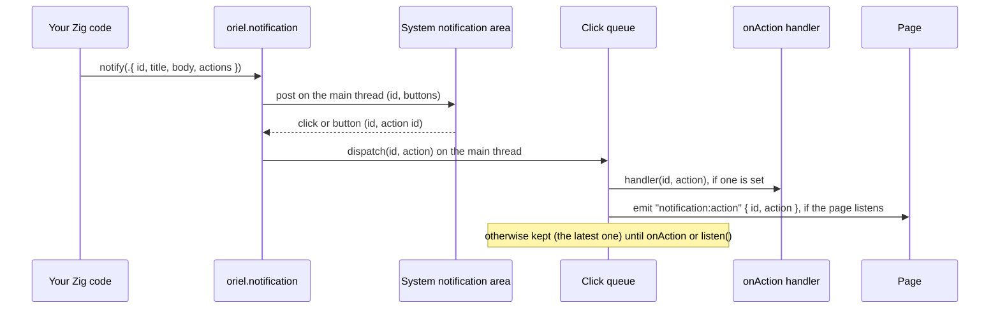

<!-- Generated from site/content/docs/notifications.smd by tools/docs/gen-md.mjs: edit that file. -->

# Notifications

System notifications from Zig, with buttons, and the clicks reported back to Zig and the page.

`oriel.notification` shows a notification in the system's own notification
area: GNotification on Linux, a shell balloon on Windows, Notification Center
on macOS and iOS, the notification shade on Android. A notification has a
title, an optional body and optional buttons; a click on it, or on one of its
buttons, comes back to your Zig handler and to the page as a
`notification:action` event, even when the click is what launched the app.

Notifications are shown from Zig. The page asks for one through a
[command](commands.md) of yours, so the app decides what
may be shown and when. For the page's own `new Notification(...)` (the web
API), see [Permissions](permissions.md): Oriel only lets a
page use it where the web view supports it and the app declares
`notifications`.

## Availability

| Platform | Backend | Buttons | Clicks reported | Permission |
|---|---|---|---|---|
| Linux | GIO `GNotification` | yes | notification and buttons | none |
| Windows | `Shell_NotifyIconW` balloon (shown as a toast on Windows 10 and 11) | no | the balloon only | none; the global "Notifications" switch applies |
| macOS, `.app` bundle | `UNUserNotificationCenter` | yes | notification and buttons | macOS asks on the first notification |
| macOS, unbundled (`zig build run`) | `osascript` "display notification" (shown as Script Editor) | no | none | none |
| Android | `NotificationManager`, channel `oriel` | up to 3 | notification and buttons | `POST_NOTIFICATIONS` on Android 13+ |
| iOS | `UNUserNotificationCenter` | yes | notification and buttons | iOS asks on the first notification, or on `oriel.permissions.request(.notifications)` |

The module is on by default on every platform (the `notification` flag);
turn it off with `.notification = false` in `b.dependency("oriel", ...)`,
and then `oriel.notification.available` is `false`. Declare the permission
with `.permissions = .{ .notifications = "..." }` in `addApp`: Android
needs it in the manifest to show anything on Android 13 and later, and it
lets `oriel.permissions` query and request it everywhere.

## Quick start

```zig
// build.zig
_ = oriel.addApp(b, dep, .{
    .name = "my-app",
    .root_source_file = b.path("src/main.zig"),
    .permissions = .{ .notifications = "" }, // "" uses the default reason text
});
```

```zig
// src/main.zig
const std = @import("std");
const oriel = @import("oriel");
const app = @import("oriel_app");

pub const Commands = struct {
    pub fn notify(_: std.mem.Allocator, args: struct { title: []const u8, body: []const u8 }) !void {
        try oriel.notification.notify(.{
            .id = "greeting",
            .title = args.title,
            .body = args.body,
            .actions = &.{.{ .id = "open", .label = "Open" }},
        });
    }
};

pub fn main(init: std.process.Init) !u8 {
    return oriel.main(init, .{ .commands = Commands }, .{
        .app = app.build,
        .window = .{ .title = "My App", .width = 800, .height = 600 },
    });
}
```

```js
// The page: ask first (Android 13+, iOS, macOS prompt here), then notify.
if ((await window.oriel.permissions.request("notifications")) === "granted") {
  await window.oriel.invoke("notify", { title: "Hello", body: "From Zig" });
}

window.oriel.listen("notification:action", ({ id, action }) => {
  // id: "greeting"; action: "open", or null for a click on the notification
});
```

## How it works



**Showing.** `notify` builds the notification for the platform and posts
it. On Windows, macOS, Android and iOS the work is moved to the main thread
(the call waits for it and returns its error); on Linux the GApplication's
`send_notification` is called from the calling thread, and the click action
`app.oriel-notification` is registered on the main thread the first time.
The sources are `src/modules/notification/linux.zig`, `windows.zig`,
`macos.zig`, `ios.zig`, `android.zig` (with `OrielRuntime.notify` in the
Android template's Kotlin), and `apple.zig`, shared by macOS and iOS.

**Ids.** The notification's `id` travels with it so a click can report it:
as the GNotification id and the action target on Linux, in `userInfo`
(`oriel.id`) on macOS and iOS, as the notification tag and an Intent extra
on Android, and in a buffer for the balloon on screen on Windows. A
notification with the same `id` as one still shown replaces it (Linux,
macOS, iOS, Android; Windows shows one balloon at a time anyway). Without
an `id`, each notification is new and its clicks report `""`.

**Buttons.** On macOS and iOS a set of buttons is a `UNNotificationCategory`,
registered once per distinct set (its identifier is a hash of the ids and
labels). On Linux each button is a GNotification button with the
`(ss)` target `(id, action)`. On Android each button is a broadcast to
`OrielActionReceiver`, which dismisses the notification and reports the
button without opening the app; at most the first 3 are shown.

**Clicks.** Each backend calls `common.dispatch(id, action)` on the main
thread (`src/modules/notification/common.zig`). The click goes to the
handler set with `onAction` and is emitted to every window as
`notification:action`. A click that comes before there is a handler, or
before the page called `listen("notification:action")`, is kept by
`src/core/pending_events.zig` and handed over when the handler is set or
the page listens; the bridge's `listen()` sends the built-in
`events:ready` for this event ([Commands](commands.md)).
This is how a tap that launched the app reaches it: the macOS and iOS
shells install the notification center's delegate as the app finishes
launching, and Android hands a launching tap straight to Zig. Each
audience keeps only the latest click it missed.

**What a click does besides.** On Linux a click on the notification itself
(not a button) also presents the main window. On Android a tap opens the
app; a button doesn't. On macOS and iOS the system brings the app forward.
On Windows nothing else happens. While the app is in front, macOS and iOS
still show the banner (Oriel's delegate asks for banner, list and sound).

## Examples

### Reply buttons, handled in Zig

```zig
fn setup() !void {
    oriel.notification.onAction(onNotification);
}

fn onNotification(id: []const u8, action: ?[]const u8) void {
    // Main thread. `id` and `action` are borrowed: copy them to keep them.
    if (action) |a| {
        if (std.mem.eql(u8, a, "snooze")) scheduleReminder(id);
    } else {
        oriel.App.showWindow(); // a click on the notification itself
    }
}

pub fn remind(task: []const u8) !void {
    try oriel.notification.notify(.{
        .id = task,
        .title = "Reminder",
        .body = task,
        .actions = &.{
            .{ .id = "done", .label = "Done" },
            .{ .id = "snooze", .label = "Snooze" },
        },
    });
}
```

`setup` is the one passed in `App.Config.setup`; setting the handler there
still receives a click that launched the app. `scheduleReminder` and the
window call stand for your own code ([Windows](windows.md)
has the window API).

### A progress notification that updates in place

```zig
fn exportProgress(done: u32, total: u32) void {
    var buf: [64]u8 = undefined;
    const body = std.fmt.bufPrint(&buf, "{d} of {d} files", .{ done, total }) catch return;
    // Same id: replaces the previous one instead of stacking.
    oriel.notification.notify(.{ .id = "export", .title = "Exporting", .body = body }) catch |err|
        std.log.warn("notification: {s}", .{@errorName(err)});
}
```

### Ask before the first notification (Android 13+, iOS)

```js
const status = await window.oriel.permissions.query("notifications");
if (status === "prompt") await window.oriel.permissions.request("notifications");
else if (status === "denied") await window.oriel.permissions.openSettings("notifications");
```

On Android 13 and later, `notify` fails with `error.NotificationFailed`
until the user allows notifications. On iOS and macOS the first `notify`
asks by itself; asking earlier, at a moment the user understands, is
better.

The showcase (`examples/showcase`) has a Notify tile on its System tab: the
page requests the permission, invokes the `notify` command
(`examples/showcase/src/main.zig`), and shows the `notification:action`
event it gets back (`examples/showcase/web/app.js`).

## Reference

### `oriel.notification`

```zig
pub const available: bool;

pub const NotificationOptions = struct {
    id: ?[]const u8 = null,
    title: []const u8,
    body: ?[]const u8 = null,
    actions: []const Action = &.{},
};

pub const Action = struct { id: []const u8, label: []const u8 };

pub const ActionHandler = *const fn (id: []const u8, action: ?[]const u8) void;

pub fn notify(options: NotificationOptions) !void;
pub fn onAction(handler: ?ActionHandler) void;
```

| Declaration | Meaning |
|---|---|
| `available` | `true` when the `notification` flag is on for this target (it exists on every platform). Calling into the module while it's off is a build error; guard with `if (oriel.notification.available)`. |
| `NotificationOptions.id` | Identifies the notification: a later one with the same id replaces it, and its clicks report it. `null`: a new notification each time, clicks report `""`. |
| `NotificationOptions.title` | The title. Required. |
| `NotificationOptions.body` | The text under the title, or none. On Android it expands to the full text (`BigTextStyle`). |
| `NotificationOptions.actions` | Buttons. Shown on Linux, macOS (bundled), iOS and Android (the first 3). Ignored by Windows balloons and the macOS `osascript` fallback. |
| `Action.id` | Reported as `action` when the button is clicked. Use a non-empty id: an empty one reads as a click on the notification on Linux and Android, and on macOS and iOS ids starting with `com.apple.` are never reported. |
| `Action.label` | The button's text. |
| `notify` | Shows the notification. May be called from any thread; returns once it is posted (not shown: the system may still drop it, see below). |
| `onAction` | Sets the click handler, or clears it with `null`. Any thread. The handler runs on the main thread with `id` (`""` when the notification had none) and `action` (the button's id, `null` for a click on the notification). Both slices are valid only during the call. A click that came before a handler was set is handed to the first one set. |

`notify`'s errors, by platform:

| Error | Platform | When |
|---|---|---|
| `error.NoApp` | Linux | before the GTK application exists (call it from `setup` or later) |
| `error.NoSpaceLeft` | Linux | the title is over 255 bytes, the body over 1023, the id or a button id over 127, a label over 255 |
| `error.AppNotRunning` | Windows | before the shell's host window exists |
| `error.ShellNotifyIconFailed` | Windows | the shell refused the balloon |
| `error.NotificationCenterUnavailable` | macOS (bundled), iOS | no `UNUserNotificationCenter` |
| `error.InvalidUtf8` | macOS (bundled), iOS | the title, id or a button isn't valid UTF-8 |
| `error.NotificationCreateFailed` | macOS (bundled), iOS | the request or category couldn't be created |
| `error.NotifyFailed` | macOS (unbundled) | `osascript` couldn't be started |
| `error.NotificationFailed` | Android | notifications are off for the app (on Android 13+, until `POST_NOTIFICATIONS` is granted), or the system refused |

### Page event: `notification:action`

```ts
window.oriel.listen("notification:action", (e: { id: string; action: string | null }) => void): () => void;
```

Emitted to every window on each click. `id` is the notification's id
(`""` when it had none); `action` is the button's id, or `null` when the
notification itself was clicked. A click from before the page listened
(one that launched the app, or that came while the page was loading) is
delivered when `listen` is called; only the latest such click is kept. The
page has no API to show a notification: expose a command that calls
`oriel.notification.notify`.

### Per platform

- **Linux.** GIO `GNotification` sent through the app's `GApplication`, so
  the desktop shows it under the app's name and icon. Clicks and buttons
  activate the application action `app.oriel-notification` with the
  target `(id, action)`, `action` `""` for the notification itself; a
  click on the notification also presents the main window. Notifications
  aren't gated: `oriel.permissions.status(.notifications)` is `granted`
  when declared.
- **Windows.** A `Shell_NotifyIconW` balloon (`NIF_INFO`,
  `NOTIFYICON_VERSION_4`) on its own notification icon (uID 2001, apart
  from tray icons), with the main window's small icon, else the
  executable's, else the default application icon. The title is cut to 63
  UTF-16 units and the body to 255, never splitting a surrogate pair; the
  id is kept up to 128 bytes. One balloon at a time: a new one replaces the
  one on screen. A click (`NIN_BALLOONUSERCLICK`) reports the balloon's id
  with no action; the icon is removed when the balloon is clicked, times
  out or is closed, and at `terminating` ([Lifecycle](lifecycle.md)).
  Balloons have no buttons, and WinRT toasts (which need an AppUserModelID
  and packaging) aren't used. The status follows the user's global switch
  (`HKCU\Software\Microsoft\Windows\CurrentVersion\PushNotifications`,
  `ToastEnabled = 0` is `denied`).
- **macOS.** In an `.app` bundle with a bundle identifier,
  `UNUserNotificationCenter`: authorization (alert and sound) is requested
  on the first notification, and a denial makes later ones silent, with
  the log line `notifications are not allowed for this app (System
  Settings > Notifications)`. Without an `id`, the request identifier is
  `oriel-<n>`. The center's delegate is installed at launch, so clicks on
  notifications from an earlier run, or one that launched the app, are
  reported. An unbundled executable (the dev build) has no bundle
  identifier, which UserNotifications requires, so it runs
  `/usr/bin/osascript` with the title and body as arguments (never as
  script text); macOS shows it as Script Editor, and clicks are not
  reported. Build a bundle ([Packaging](packaging.md)) to
  test buttons and clicks.
- **Android.** `NotificationManager`, on a channel with id `oriel` named
  after the app's label (importance default), created on first use. The
  small icon is the drawable `res/drawable/ic_notification` when the app
  has one, else the app icon. A notification is auto-cancelled on tap. A
  tap opens the app (`OrielMainActivity`) and reports the click, also when
  it launches the app; a button reports its id without opening the app and
  dismisses the notification. A button pressed while the app isn't
  running starts the app, but that press isn't reported. Notification
  clicks are not `android:event` system events.
- **iOS.** `UNUserNotificationCenter`: authorization (alert and sound) is
  requested on the first notification unless
  `oriel.permissions.request(.notifications)` asked already (which also
  asks for badges); a denial makes later notifications silent, with the
  log line `notifications are not allowed for this app (Settings >
  Notifications)`. Notifications show while the app is in front too. The
  delegate is installed in `didFinishLaunching`, so a tap that launched the
  app is reported.

### Permission

`.permissions.notifications` in `addApp` (any string; `""` uses the
default text `"<App> shows notifications."`). What declaring it does:

| Platform | Declares | `status` / `request` |
|---|---|---|
| Linux | nothing | `granted` |
| Windows | nothing | the global "Notifications" switch: `granted` or `denied`; `openSettings` opens `ms-settings:notifications` |
| macOS | nothing (no Info.plist key exists) | `UNUserNotificationCenter` settings (`prompt` until asked); `unknown` unbundled; settings pane `com.apple.preference.notifications` |
| Android | `<uses-permission android:name="android.permission.POST_NOTIFICATIONS"/>` | runtime permission on Android 13+, `granted` before |
| iOS | nothing (no Info.plist key exists) | `UNUserNotificationCenter` settings |

An undeclared permission reads `denied` from `oriel.permissions`, but
`notify` itself doesn't check the declaration: only Android's system stops
it. [Permissions](permissions.md) has the full API.

### Smoke check

`oriel.checkAll` runs the module's check: on Linux it builds a
GNotification without sending it, on Windows it reports balloon support,
on macOS whether the bundled or the `osascript` path applies, on iOS
whether the framework is present, and on Android whether notifications are
enabled for the app.

## Troubleshooting

- **Nothing appears on Android 13+, `error.NotificationFailed`.** The app
  must declare `.permissions.notifications` (the manifest needs
  `POST_NOTIFICATIONS`) and the user must allow it: call
  `permissions.request("notifications")` first.
- **macOS: the notification says Script Editor, buttons are missing,
  clicks do nothing.** It's the unbundled dev build's `osascript`
  fallback. Run the `.app` bundle.
- **macOS or iOS: nothing appears after the first time.** The user denied
  the prompt; the log says `notifications are not allowed for this app`.
  Send the user to `permissions.openSettings("notifications")`.
- **Windows: buttons don't show, and a second notification replaces the
  first.** Balloons have no buttons and the app has one balloon at a time.
  If none show at all, check Settings > System > Notifications
  (`permissions.query("notifications")` is `denied` when they're off).
- **Linux: notifications don't show, or clicks don't come back.** The
  desktop decides how a GApplication's notifications are shown; GNOME Shell
  matches them to the app through its installed `.desktop` file, which an
  installed package provides ([Packaging](packaging.md)).
- **A click is reported once to Zig but the page missed it.** Call
  `listen("notification:action")` early (at page load); a click from before
  that is delivered when it's called, but only the latest one.

## Related

- [Permissions](permissions.md): declaring, querying and
  requesting `notifications`, and the web view's own notification requests.
- [Commands](commands.md): how the page asks Zig to notify,
  and how queued events reach `listen()`.
- [Lifecycle](lifecycle.md): the app's background,
  foreground and termination events.
- [Tray](tray.md): a menu in the notification area, on the
  desktop.
- [Android](android.md): foreground-service notifications and
  their actions (`android:event`), which are separate from this module.
