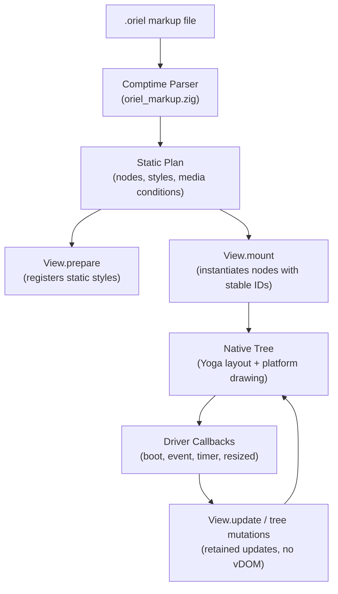

<!-- Generated from site/content/docs/oriel-ui-reference.smd by tools/docs/gen-md.mjs: edit that file. -->

# Oriel UI reference

Every element, attribute, style rule, media condition, and Zig API the Oriel renderer supports, how .oriel templates compile, and how applications drive them.

The [Oriel renderer](architecture.md#renderers) runs
interfaces written in compiled `.oriel` templates directly from Zig, with no
JavaScript engine, no DOM tree, and no QuickJS heap.

This page is the reference for the `.oriel` template language and the
`oriel.ui` Zig module: every supported element, attribute, style property,
media condition, dynamic binding, and engine callback, how each maps to
native retained nodes, and how applications such as
[system-monitor](examples.md#system-monitor) use them.
For the HTML and CSS reference of the web-based native renderer, see the
[Native UI reference](native-ui-reference.md).

## Availability

The Oriel renderer requires the `-Dzig_ui` build option (and `-Dnative_ui`,
which provides the windowing, event surfaces, and platform text backends).
In applications that configure the standard renderer choice, this corresponds
to `-Drenderer=oriel`:

```sh
zig build -Drenderer=oriel -Doptimize=ReleaseSafe
```

The `.oriel` language, style sheets, and Zig APIs are identical across all
supported operating systems. The platform text and control engines are
shared with the native renderer:

| Platform | Text engine | Form fields | Checkboxes, radios | Buttons |
|---|---|---|---|---|
| Linux | Pango | GTK widgets | `GtkCheckButton` | Platform button or drawn |
| Windows | DirectWrite | RichEdit, `COMBOBOX`, trackbar | `BUTTON` | Platform button or drawn |
| macOS | Core Text | AppKit controls | `NSButton` | Platform button or drawn |
| iOS | Core Text | UIKit controls | Drawn | Platform button or drawn |
| Android | `StaticLayout` | `EditText`, `Spinner`, `SeekBar` | Drawn | Drawn |

Templates are compiled at build time into compact static node arrays and
style definitions. Dynamic text bindings are owned directly by the native
tree's allocator, eliminating garbage collection cycles and frame pauses.

## Quick start

### 1. Enable in build.zig

In your application's `build.zig`, configure the Oriel dependency with
`native_ui = true` and `zig_ui = true`:

```zig
const std = @import("std");
const oriel = @import("oriel");

pub fn build(b: *std.Build) void {
    const target = oriel.resolveTarget(b, b.standardTargetOptions(.{}));
    const optimize = b.standardOptimizeOption(.{});

    const dep = b.dependency("oriel", .{
        .target = target,
        .optimize = optimize,
        .native_ui = true,
        .zig_ui = true,
    });

    _ = oriel.addApp(b, dep, .{
        .name = "my-app",
        .root_source_file = b.path("src/main.zig"),
        .frontend = .{ .dir = "views", .dist = "." },
    });
}
```

### 2. Write a template (views/hello.oriel)

A template begins with an optional `<style>` block containing tokens and
named styles, followed by exactly one root element:

```xml
<style>
  $bg: #161b22
  $border: #30363d
  $text: #f0f6fc
  $accent: #58a6ff
  card: padding=16 gap=12 background=$bg border-width=1 border-color=$border radius=8
  btn: padding=6,12,6,12 background=$accent radius=6
</style>
<column class="card" width="320">
  <text font-size="18" font-weight="600" color=$text>Hello, <span color=$accent>{name}</span>!</text>
  <button id="greet" class="btn">
    <text font-size="14" font-weight="600" color="#ffffff" text-align="center">Click me</text>
  </button>
</column>
```

### 3. Mount and handle events in Zig (src/main.zig)

Embed the template into your binary and drive it through `oriel.ui`:

```zig
const std = @import("std");
const oriel = @import("oriel");
const ui = oriel.ui;

const HelloView = ui.View(@embedFile("hello.oriel"));
const view_base: i64 = 100;
const style_base: i64 = 1000;

var counter: usize = 0;

fn boot(e: *ui.Engine) !void {
    try HelloView.prepare(&e.tree, style_base);
    _ = try HelloView.mount(&e.tree, view_base, style_base, &.{
        .{ .name = "name", .value = "World" },
    });
    e.tree.root = e.tree.get(view_base);
}

fn event(e: *ui.Engine, id: i64, kind: []const u8, _: []const u8) bool {
    if (std.mem.eql(u8, kind, "click") and id == HelloView.id("greet", view_base)) {
        counter += 1;
        var buf: [32]u8 = undefined;
        const val = std.fmt.bufPrint(&buf, "User #{d}", .{counter}) catch "User";
        HelloView.update(&e.tree, view_base, &.{.{ .name = "name", .value = val }}) catch {};
        return true;
    }
    return false;
}

pub fn main(init: std.process.Init) !u8 {
    ui.configure(.{ .boot = boot, .event = event });
    return oriel.main(init, .{}, .{
        .window = .{ .title = "Oriel Quick Start", .width = 400, .height = 300 },
    });
}
```

## How it works



1. **Build-time parsing.** When Zig compiles `ui.View(@embedFile("..."))`,
   `oriel_markup.parseVariant` reads the markup and validates every tag,
   attribute, number, color, token, and media condition at compile time.
   Invalid syntax or unknown attributes trigger descriptive build errors.
2. **Variant pre-compilation.** Up to 64 `@media` and `@when` blocks are
   compiled into variant condition masks. Resizing the window or toggling
   between light and dark mode switches variants immediately without
   re-parsing.
3. **Static styles.** `View.prepare` stores the view's immutable layout and
   visual properties into `tree.Tree` starting at a caller-selected `style_base`.
4. **Stable node identities.** `View.mount` builds the retained node hierarchy
   at `base + node_index`. Every element with an `id="name"` attribute can be
   addressed in constant time using `View.id("name", base)`.
5. **Dynamic text bindings.** Text containing `{binding}` place-holders is
   instantiated during `mount` and updated with `View.update`. The string
   values are copied into the native tree's allocator, ensuring memory safety
   without holding references to transient buffers.
6. **Frame batching.** User interactions and timers trigger `Driver` functions.
   Tree updates are coalesced and painted on the next display refresh via
   the platform backend.

## Examples

### Dynamic rows in a virtualized list

In [system-monitor](examples.md#system-monitor),
process and disk rows are separate `.oriel` templates mounted at calculated
base ID offsets:

```xml
<!-- views/disk.oriel -->
<column gap="3">
  <row gap="8">
    <text font-size="12" color="#f0f6fc" id="name" grow="1" nowrap="true" font-weight="600">{name}</text>
    <text font-size="12" color="#8b949e" id="size" mono="true">{size}</text>
  </row>
  <canvas id="bar" height="6" />
  <row gap="8">
    <text font-size="11" color="#6e7681" id="mount" grow="1" nowrap="true">{mount}</text>
    <text font-size="11" color="#6e7681" id="rw" mono="true">{rw}</text>
  </row>
</column>
```

In Zig, each disk row is mounted with a stable base ID `disk_base + i * Disk.node_count`:

```zig
const Disk = ui.View(@embedFile("disk.oriel"));
const disk_base: i64 = 20000;
const disk_style_base: i64 = 12000;

fn update_disks(e: *ui.Engine, disks: []const DiskInfo) !void {
    try Disk.prepare(&e.tree, disk_style_base);
    for (disks, 0..) |d, i| {
        const base = disk_base + @as(i64, @intCast(i)) * Disk.node_count;
        _ = try Disk.mount(&e.tree, base, disk_style_base, &.{
            .{ .name = "name", .value = d.name },
            .{ .name = "size", .value = d.size_str },
            .{ .name = "mount", .value = d.mount_point },
            .{ .name = "rw", .value = if (d.read_only) "ro" else "rw" },
        });
    }
}
```

### Custom canvas drawing with ui.Program

A `<canvas>` element provides immediate-mode vector drawing from Zig:

```xml
<column background="#161b22" padding="10" radius="8">
  <text font-size="12" color="#8b949e">CPU Sparkline</text>
  <canvas id="sparkline" height="40" />
</column>
```

In Zig, use `ui.Program` to draw charts or custom graphics into the canvas:

```zig
fn draw_sparkline(e: *ui.Engine, canvas_id: i64, history: []const f32) !void {
    var p = ui.Program.init(e.gpa);
    defer p.deinit();

    // Fill background
    try p.rect(0, 0, 200, 40, .{ .fill = .{ 22, 27, 34, 1 } });

    // Draw sparkline path
    if (history.len > 1) {
        const step = 200.0 / @as(f32, @floatFromInt(history.len - 1));
        for (history, 0..) |val, i| {
            const x = @as(f32, @floatFromInt(i)) * step;
            const y = 40.0 - (val * 40.0);
            if (i == 0) try p.moveTo(x, y) else try p.lineTo(x, y);
        }
        try p.stroke(.{ .color = .{ 63, 185, 80, 1 }, .width = 1.5 });
    }

    try e.tree.setCanvasProgram(canvas_id, p);
}
```

### Responsive layouts and theme tokens

Use `<style>` tokens and `@media` queries to adapt layouts to window widths
and platform color schemes:

```xml
<style>
  $bg: #ffffff
  $fg: #1f2328
  $border: #d0d7de
  sidebar: width=240 padding=16 background=$bg border-color=$border
  content: grow=1 padding=20 background=$bg

  @media (prefers-color-scheme: dark) {
    $bg: #0d1117
    $fg: #f0f6fc
    $border: #30363d
  }

  @media (max-width: 640) {
    sidebar: display=none
  }
</style>
<row height="100%">
  <column class="sidebar">
    <text color=$fg font-weight="700">Navigation</text>
  </column>
  <column class="content">
    <text color=$fg font-size="16">Main content area</text>
  </column>
</row>
```

### Absolute popup menus and dialogs

Context menus and floating overlays use `position="absolute"` and explicit
z-index stacking:

```xml
<!-- views/actions.oriel -->
<column position="absolute" top="130" left="180" width="200" padding="5"
        background="#1f242c" border-width="1" border-color="#30363d" radius="8" z="100">
  <control id="end" value="⚠ Terminate Process…" height="30" font-size="12"
           color="#ff7b72" background="#1f242c" border-width="0" radius="5" />
  <view height="1" background="#30363d" margin="4,0,4,0" />
  <control id="copy" value="📋 Copy Details" height="30" font-size="12"
           color="#f0f6fc" background="#1f242c" border-width="0" radius="5" />
</column>
```

## Reference

### Template structure and grammar

A `.oriel` template file must follow these structural rules:
- An optional `<style>...</style>` block may precede the markup. It takes no
  attributes and must appear before any elements.
- The template must have **exactly one root element** (typically `<column>`,
  `<row>`, or `<view>`).
- All tags must be properly nested and closed, either with matching closing
  tags (`<row>...</row>`) or as self-closing elements (`<canvas />`,
  `<input />`, `<checkbox />`, `<image ... />`, `<path ... />`).
- **Text must be inside `<text>`**: raw text outside of `<text>` elements is
  a compile error.
- **Resource limits**: a single template supports up to 512 nodes, a maximum
  nesting depth of 32, and up to 64 combined `@media` and `@when` blocks.

#### Character entities

The template compiler resolves the standard XML/HTML character entities
anywhere in attribute values and text:
- `&amp;` (`&`), `&lt;` (`<`), `&gt;` (`>`), `&quot;` (`"`), `&apos;` (`'`)
- Decimal entities: `&#N;` (e.g. `&#32;` preserves a space, `&#10;` a newline)
- Hexadecimal entities: `&#xH;` (e.g. `&#x26A0;` for `⚠`)

#### Style block syntax

Inside `<style>...</style>`:
- **Design tokens**: `$name: value` assigns a reusable token. Tokens can be
  referenced in style attributes and element attributes as `$name`.
- **Named rules**: `name: prop=value prop2="quoted value"` defines a class
  applied via `class="name"`.
- **Media queries**: `@media (condition) [and (condition)] { ... }` overrides
  tokens or rules when the condition matches. Supported features:
  - `(max-width: N)` / `(max-width: Npx)`
  - `(min-width: N)` / `(min-width: Npx)`
  - `(prefers-color-scheme: dark)` or `(prefers-color-scheme: light)`
- **Dynamic state queries**: `@when (state_name) { ... }` applies rules when
  the application toggles `ui.View.setState(tree, base, "state_name", true)`.
- **Comments**: `/* comment text */` is ignored.

### Elements

| Element | Kind | Children | Description |
|---|---|---|---|
| `view` | `.view` | Yes | Generic layout box container. |
| `row` | `.view` | Yes | Flexbox container with `flex-direction: row`. |
| `column` | `.view` | Yes | Flexbox container with `flex-direction: column`. |
| `button` | `.view` | Yes | Clickable container (`click=true`, role `button`, focusable). Hosts a platform button when text-only and unstyled, or a custom drawn box. |
| `control` | `.button` | No | Pre-styled platform or drawn button with a `value="..."` label. |
| `text` | `.text` | Spans | Text container. Collapses whitespace as HTML does. May contain literal text, `{bindings}`, and `<span>` elements. |
| `span` | Run | Text | Styled inline run within a `<text>`. May set colors, font styling, links, outlines, or inline boxes. |
| `canvas` | `.canvas` | No | Immediate-mode 2D drawing surface driven by `ui.Program`. Configured with `pixel-width` and `pixel-height`. |
| `input` | `.input` | No | Single-line editable text field. Hosts the platform native text control. |
| `textarea` | `.textarea` | No | Multi-line text field with configurable `rows` and `cols`. |
| `select` | `.select` | Options | Dropdown selection list. Contains `<option>` tags. |
| `option` | Option | Text | Entry in a `<select>`: `<option value="val">Label</option>`. |
| `checkbox` | `.check` | No | Checkbox control (default 13×13 px). Supports `checked` and `mixed` states. |
| `radio` | `.check` | No | Radio button control (default 13×13 px). |
| `slider` | `.input` | No | Numeric range trackbar control with `min`, `max`, and `step`. |
| `image` | `.image` | No | Raster or vector image asset loaded from `src` with `fit` scaling. |
| `icon` | `.icon` | Paths | Vector SVG icon with `viewbox` containing `<path>` definitions. |
| `path` | Shape | No | SVG path shape within an `<icon>`: `<path d="..." fill="..." stroke="..." />`. |

### Attributes

#### Identity, accessibility, and focus

| Attribute | Type / Allowed values | Description |
|---|---|---|
| `id` | Name | Unique identifier within the template. Used by `View.id("name", base)`. |
| `label` | String or `{binding}` | Accessible name (screen readers) and platform control label. |
| `role` | Role name | Accessibility role (`button`, `heading`, `link`, `img`, `generic`, etc.). |
| `level` | `1`–`6` | Heading level when `role="heading"`. |
| `description` | String | Accessible description. |
| `alt` | String | Alternative text for `<image>`. |
| `focusable` | `true`, `false` | Explicitly enables or disables keyboard focus. |
| `tabindex` | Integer | Tab stop order (default `0` for focusable drawn elements). |
| `tooltip` | String or `{binding}` | Tooltip text displayed on pointer hover. |
| `root` | `true`, `false` | Declares element as an accessibility root container. |

#### Layout and Flexbox

| Attribute | Format / Values | Description |
|---|---|---|
| `width`, `height` | Dim: `N`, `N%`, `calc`, `auto`, `none` | Element size. `calc` format: `50%-8px`. |
| `min-width`, `min-height` | Dim | Minimum size constraints. |
| `max-width`, `max-height` | Dim | Maximum size constraints. |
| `grow` | Number | Flexbox `flex-grow` factor (e.g. `grow="1"`). |
| `shrink` | Number | Flexbox `flex-shrink` factor (default `0` on containers and inputs). |
| `basis` | Dim | Flexbox `flex-basis` length. |
| `gap` | Number | Gap between flex children (both row and column). |
| `row-gap`, `column-gap` | Number | Independent row or column gap spacing. |
| `padding` | `N` or `top,right,bottom,left` | Internal padding in pixels. |
| `margin` | `N` or `top,right,bottom,left` | External margin in pixels. |
| `align` | `auto`, `flex-start`, `center`, `flex-end`, `stretch`, `baseline` | Cross-axis alignment of children (`align-items`). |
| `align-self` | Align values | Cross-axis alignment for this specific item. |
| `justify` | `flex-start`, `center`, `flex-end`, `space-between`, `space-around`, `space-evenly` | Main-axis distribution (`justify-content`). |
| `wrap` | `nowrap`, `wrap`, `wrap-reverse` | Flex line wrapping. |
| `direction` | `row`, `column`, `row-reverse`, `column-reverse` | Flex layout direction. |
| `display` | `flex`, `none` | `display="none"` hides the element and removes it from layout. |
| `box-sizing` | `border-box`, `content-box` | Box model sizing calculations. |
| `aspect-ratio` | Number | Target width-to-height ratio. |

#### Positioning and scrolling

| Attribute | Format / Values | Description |
|---|---|---|
| `position` | `relative`, `absolute` | Layout positioning mode. |
| `top`, `right`, `bottom`, `left` | Dim | Inset distances for positioned elements. |
| `relative` | `top,right,bottom,left` | Offset adjustments (px or `auto`) for `position="relative"`. |
| `sticky` | `top,right,bottom,left` | Inset thresholds for sticky positioning. |
| `z` | Integer | Stacking order (`z-index`). |
| `clip` | `true` | Clips child rendering to element bounds (`overflow: hidden`). |
| `visible` | `true`, `false` | Visual visibility. Hidden elements remain in layout; inherited by children. |
| `pointer-events` | `auto`, `none` | Whether element receives clicks and pointer events. |
| `clickable` | `true`, `false` | Enables click detection on a `<view>`, `<row>`, or `<column>`. |
| `scroll` | `true`, `false` | Enables vertical scrolling container. |
| `scroll-x` | `true`, `false` | Enables horizontal scrolling container. |
| `scrollbar` | `auto`, `always` | Scrollbar display behavior. |
| `scrollbar-width` | `thin`, `none` | Scrollbar thickness. |
| `scrollbar-color` | `#thumb #track` | Space-separated thumb and track colors. |

#### Visual appearance and drawing

Colors use `#RRGGBB`, `#RRGGBBAA`, or `rgba(r, g, b, a)`.

| Attribute | Format / Values | Description |
|---|---|---|
| `background` | Color | Background fill color. |
| `gradient-stops` | `r,g,b,a,pos; ...` | Semicolon-separated color gradient stops. |
| `gradient-angle` | Number | Linear gradient direction angle in degrees. |
| `gradient-radial` | `cx,cy,rx,ry` | Radial gradient center and radii. |
| `radius` | `N` or `tl,tr,br,bl` | Corner border radii in pixels (or `x/y` elliptical). |
| `border-width` | `N` or `top,right,bottom,left` | Border stroke width in pixels. |
| `border-bottom` | Number | Bottom border width convenience attribute. |
| `border-color` | Color or 4 colors | Border colors (top, right, bottom, left). |
| `border-style` | `solid`, `dashed`, `dotted` | Border stroke style. |
| `opacity` | Number (`0.0`–`1.0`) | Element opacity multiplier. |
| `shadow` | `x,y,blur[,spread],color` | Box drop shadow (e.g. `0,2,8,#00000040`). |
| `outline` | `width,offset,color` | Outline stroke without affecting geometry. |
| `outline-style` | `solid`, `dashed`, `dotted` | Outline dash pattern. |
| `outline-halo` | Color | Secondary halo color outside the outline. |
| `outline-radius` | Number | Corner radius for the outline. |
| `translate-x`, `translate-y` | Number | Transform translation offsets in pixels. |
| `scale` | Number | Transform uniform scaling multiplier. |
| `rotate` | Number | Transform rotation angle in degrees. |

#### Typography and text

Text attributes apply to `<text>`, `<span>`, and inherit downward to all
child text elements (unless overridden):

| Attribute | Format / Values | Description |
|---|---|---|
| `color` | Color | Font text color. |
| `font-size` | Number | Font size in points/pixels. |
| `font-weight` | Number | Font weight (e.g. `400` normal, `600` semibold, `700` bold). |
| `font-family` | String | Font family cascade (e.g. `system-ui, sans-serif`). |
| `mono` | `true`, `false` | Selects the platform monospace font. |
| `italic` | `true`, `false` | Italic text style. |
| `underline` | `true`, `false` | Underline text decoration (on `<span>`). |
| `text-align` | `left`, `center`, `right`, `justify`, `start`, `end` | Text paragraph alignment. |
| `line-height` | Number | Line height in pixels. |
| `letter-spacing` | Number | Tracking space between characters in pixels. |
| `nowrap` | `true`, `false` | Disables automatic line wrapping. |
| `max-content` | `true`, `false` | Sizing width: fits un-wrapped text length. |
| `fit-content` | `true`, `false` | Sizing width: fits wrapped text bounds. |

#### Spans and inline boxes

Inside a `<text>`, `<span>` elements segment text into distinct styles.
In addition to text typography attributes, `<span>` supports:
- `link="name"`: turns the span into a clickable link. Clicks dispatch to
  `View.id("name", base)` (allocated after all template nodes).
- `unset="prop1 prop2"`: clears inherited properties from the parent `<text>`
  for this run.
- **Inline box decorations** (for inline badges, code pills, or tags):
  - `box="N"`: numeric tag identifying this inline box.
  - `box-padding`, `box-margin`, `box-border-width`, `box-radius`: 1 or 4 values.
  - `box-background`, `box-border-color`: fill and outline colors.

#### Form controls

| Attribute | Element | Description |
|---|---|---|
| `value` | `input`, `textarea`, `control`, `slider` | Initial field text, button label, or slider value. |
| `placeholder` | `input`, `textarea` | Ghost text shown when the field is empty. |
| `placeholder-color`| `input`, `textarea` | Color of the placeholder text. |
| `disabled` | All controls | Disables interaction and dims the control. |
| `readonly` | `input`, `textarea` | Prevents editing while permitting selection and copy. |
| `password` | `input` | Obscures input characters with bullets. |
| `rows`, `cols` | `textarea` | Visible line and character count dimensions. |
| `checked` | `checkbox`, `radio` | Boolean checked state. |
| `mixed` | `checkbox` | Tri-state indeterminate checkbox appearance. |
| `accent` | `checkbox`, `radio`, `slider` | Platform accent tint color. |
| `min`, `max`, `step` | `slider` | Slider range boundaries and stepping interval. |
| `type` | `input` | Field semantic type (`email`, `url`, `tel`, `number`, `search`, `date`). |
| `inputmode` | `input` | Mobile software keyboard type (`none`, `text`, `decimal`, `numeric`, `tel`, `search`, `email`, `url`). |
| `enterkey` | `input` | Action label on mobile return key (`enter`, `done`, `go`, `next`, `previous`, `search`, `send`). |
| `autocapitalize` | `input` | Capitalization behavior (`none`, `sentences`, `words`, `characters`). |
| `autocorrect` | `input` | Enables or disables mobile spell suggestions. |
| `spellcheck` | `input` | Enables or disables red underline spelling checks. |
| `no-arrow` | `select` | Hides the default platform dropdown disclosure arrow. |

#### Images, icons, and canvas

| Attribute | Element | Description |
|---|---|---|
| `src` | `image` | Path to asset or data URI (PNG, JPEG, SVG). |
| `fit` | `image` | Scaling mode: `fill`, `contain`, `cover`, `none`, `scale-down`. |
| `pixel-width`, `pixel-height` | `canvas` | Offscreen bitmap buffer pixel dimensions. |
| `viewbox` | `icon` | SVG viewbox coordinates: `min_x,min_y,width,height`. |
| `icon-color` | `icon` | Resolves `currentColor` in nested `<path>` shapes. |
| `d` | `path` | SVG path description string (e.g. `M10 10 L20 20 Z`). |
| `fill`, `stroke` | `path` | Path colors, `none`, or `currentColor`. |
| `stroke-width` | `path` | Stroke line width in viewbox units. |
| `linecap` | `path` | Stroke ends: `butt`, `round`, `square`. |
| `linejoin` | `path` | Stroke corners: `miter`, `round`, `bevel`. |
| `evenodd` | `path` | SVG `evenodd` fill rule (`true` or `false`). |

### Zig API (oriel.ui)

#### Engine and driver configuration

The application configures its lifecycle callbacks before launching the app:

```zig
pub fn configure(driver: Driver) void;

pub const Driver = struct {
    boot: *const fn (*Engine) anyerror!void,
    event: ?*const fn (*Engine, id: i64, kind: []const u8, data: []const u8) bool = null,
    timer: ?*const fn (*Engine, id: u32) anyerror!void = null,
    resized: ?*const fn (*Engine) anyerror!void = null,
    shutdown: ?*const fn (*Engine) void = null,
    resolved: ?*const fn (*Engine, req_id: u32, ok: bool, json: []const u8) anyerror!void = null,
    scrolled: ?*const fn (*Engine, id: i64) anyerror!void = null,
    drag: ?*const fn (*Engine, id: i64, data: []const u8) u8 = null,
};
```

- `boot(e: *Engine)`: called when the native window and renderer engine
  initialize. Register styles and mount root templates here.
- `event(e: *Engine, id: i64, kind: []const u8, data: []const u8)`: receives
  UI interactions (`"click"`, `"input"`, `"change"`, `"focus"`, `"blur"`).
  Return `true` if handled.
- `timer(e: *Engine, id: u32)`: fired by scheduled timers.
- `resized(e: *Engine)`: fired when window dimensions change. Variant masks
  are updated automatically.
- `resolved(e: *Engine, req_id: u32, ok: bool, json: []const u8)`: receives
  asynchronous command replies invoked with `ui.invoke`.
- `scrolled(e: *Engine, id: i64)`: fired when a scroll container moves.
- `shutdown(e: *Engine)`: cleanup resources when the window closes.

#### Compiled view type (ui.View)

Calling `ui.View(comptime source: []const u8)` returns a compiled view
manager struct:

```zig
pub fn View(comptime source: []const u8) type {
    return struct {
        /// Number of retained nodes plus link IDs allocated by this template.
        pub const node_count: usize;

        /// Compile-time list of all {binding} names in the template.
        pub const binding_names: []const []const u8;

        /// Computes the absolute node ID for an element name at base ID.
        pub fn id(comptime name: []const u8, base: i64) i64;

        /// Registers static template styles into the tree at style_base.
        pub fn prepare(t: *tree.Tree, style_base: i64) !void;

        /// Instantiates retained nodes and binds initial values. Returns base ID.
        pub fn mount(t: *tree.Tree, base: i64, style_base: i64, bindings: []const Binding) !i64;

        /// Updates dynamic text bindings on an existing mounted instance.
        pub fn update(t: *tree.Tree, base: i64, bindings: []const Binding) !void;

        /// Toggles a @when (name) dynamic state variant.
        pub fn setState(t: *tree.Tree, base: i64, comptime name: []const u8, on: bool) !void;
        pub fn setStateNamed(t: *tree.Tree, base: i64, name: []const u8, on: bool) !void;
    };
}
```

#### UI helpers

- `ui.setVisible(t: *tree.Tree, id: i64, on: bool) !void`: updates the
  visibility property of an existing node.
- `ui.invoke(e: *Engine, id: u32, command: []const u8, args: anytype) !void`:
  dispatches an asynchronous background command from the Oriel backend,
  returning the result to the driver's `resolved` callback.
- `oriel fmt`: the command-line tool formats `.oriel` template files to standard
  indentation and attribute styling ([CLI](cli.md#fmt)).
- `ORIEL_NUI_EXPORT`: environment variable allowing pages running under the
  native web renderer to export their DOM subtrees directly as `.oriel` view
  templates ([Porting a page](https://github.com/highercomve/Oriel/blob/main/docs/design/zig-ui-experiment.md#porting-a-page)).

## Troubleshooting

### Build errors

- **`.oriel template exceeds node/depth limit`**: a single template contains
  more than 512 nodes or exceeds a nesting depth of 32. Split large views into
  smaller sub-templates (like `monitor.oriel` and `process.oriel`).
- **`.oriel text requires a <text> element`**: raw text was placed directly
  inside a `<view>`, `<row>`, or `<column>`. Wrap all text inside `<text>...</text>`.
- **`.oriel token not in the <style>: $token`**: an element referenced a token
  not declared in the `<style>` block.
- **`@setEvalBranchQuota` exceeded**: building large embedded views can
  exhaust Zig's default comptime execution branch budget. Place
  `@setEvalBranchQuota(1000000);` at the top of functions manipulating views.

### Runtime errors

- **`error.IdentityChanged`**: `View.mount` was called on a base ID that
  already hosts a node of a different element kind or different style ID.
  Ensure unique base IDs across different template types.
- **`error.InvalidTextNode`**: attempted to update text on a node that is not
  a `<text>` element.
- **Missing bindings during mount**: if a template contains `{name}`, calling
  `mount` without supplying a matching `Binding{ .name = "name", .value = "..." }`
  fails validation. Check `View.binding_names` to inspect required bindings.

## Related

- [Native renderer](native-renderer.md): the web-based native UI engine.
- [Native UI reference](native-ui-reference.md): HTML, CSS, and DOM reference for the native renderer.
- [Architecture](architecture.md): overview of Oriel's three renderer tiers.
- [Examples](examples.md#system-monitor): the system monitor example built with `.oriel` templates.
- [CLI reference](cli.md#fmt): using `oriel fmt` to format `.oriel` files.
