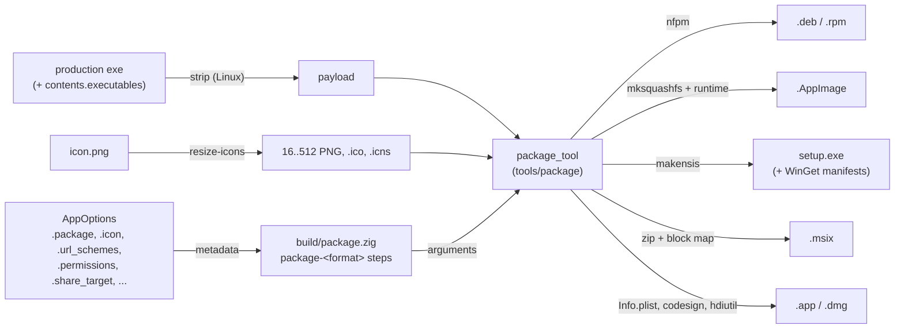

<!-- Generated from site/content/docs/packaging.smd by tools/docs/gen-md.mjs: edit that file. -->

# Packaging

Installers for every platform from one build.zig: deb, rpm and AppImage, setup.exe and MSIX, .app and .dmg, APK and AAB, and the iOS .ipa.

`oriel package` (the `package` step) turns the production build into the
installers users download: `.deb`, `.rpm` and `.AppImage` on Linux, a
per-user `setup.exe` (and optionally an `.msix`) on Windows, a `.app` and
`.dmg` on macOS. Phones are packaged by their own toolchains: Gradle writes
the APK and AAB, and the `ios-ipa` step zips the `.app` into an `.ipa`.

Every format is described once, in `build.zig`: the app id, name, version
and publisher in `.package`, and the things the platforms register (URL
schemes, permissions, the share target, file types) in the `AppOptions`
fields of the features that own them. Oriel writes each format's manifest
from that, so there is no `Info.plist`, `.desktop` file, NSIS script or
`AppxManifest.xml` to maintain. Signing is on [Signing](signing.md);
to package an existing website instead of an app, see [Wrap](wrap.md).

## Availability

| Format | Target | Built on | Default | Tools |
|---|---|---|---|---|
| `.deb` | Linux | Linux | yes | `nfpm` |
| `.rpm` | Linux | Linux | yes | `nfpm` |
| `.AppImage` | Linux | Linux | yes | `mksquashfs`; the type-2 runtime (downloaded) |
| NSIS `setup.exe` | Windows | Windows or Linux | yes | `makensis` (NSIS 3) |
| `.msix` | Windows | Windows or Linux | no (add to `formats`) | none to build; `signtool` to sign |
| `.app` | macOS | a Mac (assembled anywhere, unsigned off a Mac) | yes | `codesign` |
| `.dmg` | macOS | a Mac | yes | `hdiutil`, `ditto` |
| APK, AAB | Android | Linux, macOS, Windows | `oriel android build` | Gradle 8.11.1+, JDK 17, Android SDK and NDK |
| `.ipa` | iOS | macOS, or Linux with xtool | `ios-ipa` step | `zip`; the iOS SDK |

`oriel doctor` checks the tools; `oriel setup nsis` installs NSIS without
administrator rights.

## Quick start

```zig
_ = oriel.addApp(b, dep, .{
    .name = "notes",
    .root_source_file = b.path("src/main.zig"),
    .icon = b.path("icon.png"),
    .frontend = .{ .dir = "frontend" },
    .url_schemes = &.{"notes"},
    .package = .{
        .id = "dev.example.Notes",
        .name = "Notes",
        .summary = "A simple notes app",
        .publisher = "Example Ltd <dev@example.com>",
        .version = "1.2.0",
        .license = "MIT",
        .homepage = "https://example.com/notes",
        .categories = "Utility;TextEditor;",
    },
});
```

```sh
oriel package                            # this OS's default formats
oriel package -Dtarget=x86_64-windows    # setup.exe, from Linux
zig build package-deb                    # one format
ls zig-out/package
```

On Linux that writes `notes_1.2.0_amd64.deb`, `notes-1.2.0-1.x86_64.rpm`
and `notes-1.2.0-x86_64.AppImage`.

## How it works



`addApp` calls `addPackageSteps` (`build/package.zig`) with the same
executable `zig build` installs, so packaging never compiles the app again.
It resolves the metadata once (defaults filled in), derives the Linux
runtime dependencies from the enabled modules, and creates one step per
format, each a run of the host tool `package_tool` (`tools/package/main.zig`)
with that format's arguments. The tool generates the manifests itself
(`tools/package/nfpm.zig`, `desktop.zig`, `nsis.zig`, `msix.zig`,
`macos.zig`, `winget.zig`), converts the icon (`ico.zig`, `icns.zig`, no
`iconutil` or ImageMagick), strips ELF files (`elf_strip.zig`), and runs the
external tool for the archive format. Intermediate files (`nfpm.yaml`, the
AppDir, `installer.nsi`) stay in Zig's cache; only the finished packages are
installed into `zig-out/package/`.

`package` depends on each selected format's step, and each format also gets
its own `package-<format>` step. When the target has no formats
(`oriel package` for Android or iOS), the step fails with
`no package formats for <os> yet`.

What enters every format is resolved once into a *payload*: the app's
executable, `.package.contents` (extra executables and files) and Oriel's
runtime libraries (`libggml-cuda.so`, `libggml-vulkan.so`, `espeak-ng-data/`
when built with them). Linux packages get stripped copies; `zig-out/bin`
keeps the originals.

## Examples

### Ship a CLI and a model file with the app

```zig
const cli = b.addExecutable(.{ .name = "notes-cli", .root_module = cli_module });
_ = oriel.addApp(b, dep, .{
    // ...
    .package = .{
        .id = "dev.example.Notes",
        .contents = .{
            .executables = &.{cli},
            .files = &.{.{ .path = "models/tiny.bin", .source = b.path("models/tiny.bin") }},
        },
    },
});
```

On deb and rpm everything goes to `/usr/lib/notes/` with `/usr/bin/notes`
and `/usr/bin/notes-cli` symlinks, so each program finds `models/tiny.bin`
next to its own (resolved) path.

### Replace an older package name

GhostPen took over the Tauri version's `ghost-pen` package:

```zig
.package = .{ .replaces = &.{"ghost-pen"}, .conflicts = &.{"ghost-pen"} },
```

### An MSIX next to the installer

```zig
.package = .{
    .formats = &.{ .nsis, .msix },
    .msix = .{ .publisher = "CN=Example Ltd, O=Example Ltd, C=US" },
},
```

```sh
oriel package -Dtarget=x86_64-windows -Dmsix-pfx=cert.pfx   # password in $ORIEL_MSIX_PFX_PASSWORD
```

### Publish to WinGet

```zig
.package = .{
    .license = "MIT", // required by WinGet
    .winget = .{ .id = "Example.Notes", .moniker = "notes", .tags = &.{"notes"} },
},
```

```sh
oriel package -Dtarget=x86_64-windows \
  -Dwinget-url=https://github.com/example/notes/releases/download/v1.2.0
wingetcreate submit --token "$GITHUB_TOKEN" zig-out/package/winget
```

### Android and iOS

```sh
oriel android build --apk --aab   # android/app/build/outputs/{apk,bundle}/release/
oriel ios build --ipa             # zig-out/<Name>.ipa
```

## Reference

### `PackageOptions`

`AppOptions.package`; every field is optional.

| Field | Type | Default | Meaning |
|---|---|---|---|
| `id` | `?[]const u8` | `"dev.oriel.<name>"` | Reverse-DNS app id: the desktop entry and icon names, the Linux application id, `CFBundleIdentifier`, the Android `applicationId`, the Windows uninstall key and MSIX identity, `oriel_app.build.id`. |
| `name` | `?[]const u8` | `AppOptions.name` | Display name: menus, Start Menu, `<Name>.app`, the install directory on Windows. |
| `summary` | `?[]const u8` | `"<name> application"` | One line: the desktop entry's `Comment`, the MSIX description. |
| `description` | `?[]const u8` | `summary` | Longer text for deb and rpm. |
| `publisher` | `?[]const u8` | from the id | Maintainer / vendor / publisher (`"Acme <dev@acme.com>"`): deb `Maintainer`, rpm `Vendor`/`Packager`, NSIS and WinGet publisher, MSIX `PublisherDisplayName`. Without it, the id's organization part (`dev.example.Notes` → `example`). Set it. |
| `license` | `?[]const u8` | none | SPDX identifier. Required for WinGet. |
| `homepage` | `?[]const u8` | none | Project URL (deb, rpm, NSIS, WinGet). |
| `categories` | `?[]const u8` | `"Utility;"` | XDG categories, `;`-separated. |
| `version` | `?[]const u8` | `"0.1.0"` | The version in every format and file name; Android derives `versionCode` from it ([Building](building.md#android)). |
| `formats` | `?[]const Format` | per OS | Formats `package` builds: `.deb`, `.rpm`, `.appimage`, `.nsis`, `.msix`, `.app`, `.dmg`. Default: Linux `deb, rpm, appimage`; Windows `nsis`; macOS `app, dmg`. |
| `extra_deb_depends` | `[]const []const u8` | `&.{}` | Added to the derived deb `Depends`. |
| `extra_rpm_depends` | `[]const []const u8` | `&.{}` | Added to the derived rpm `Requires`. |
| `replaces` | `[]const []const u8` | `&.{}` | deb `Replaces`, rpm `Obsoletes`: installing this upgrades those packages. |
| `conflicts` | `[]const []const u8` | `&.{}` | deb and rpm `Conflicts`. |
| `webview2_loader` | `?LazyPath` | `-Dwebview2-loader` | `WebView2Loader.dll`, installed next to the Windows executable. |
| `contents` | `PackageContents` | `.{}` | What else every package holds ([below](#contents)). |
| `winget` | `?Winget` | `null` | WinGet manifests ([below](#winget)). |
| `msix` | `Msix` | `.{}` | The `.msix` format's settings ([below](#msix)). |

The icon is `AppOptions.icon` and the URL schemes `AppOptions.url_schemes`
([Building](building.md#appoptions)).

### Package contents

`PackageContents` (`oriel.PackageContents`):

| Field | Type | Default | Meaning |
|---|---|---|---|
| `executables` | `[]const *Step.Compile` | `&.{}` | Other executables of the build, installed next to the app's under their file names; on deb and rpm also linked into `/usr/bin`. |
| `files` | `[]const PackageFile` | `&.{}` | `{ .path, .source }`: `path` relative to the executable's directory, `/`-separated, no `.` or `..`, none of `\ : * ? " < > \| =`, no names Windows can't hold (a component ending in `.` or space, `con`, `nul`, `com1`...), at most 200 bytes. Installed as they are, mode 0644. |
| `runtime_libraries` | `bool` | `true` | Oriel's runtime libraries and data the app was built with. A `files` entry of the same path replaces one. |
| `strip` | `bool` | `true` | Linux: package stripped copies of the ELF executables and libraries (no symbol table or debug info; the dynamic symbol table stays). A ReleaseSafe app drops from about 70 MB to under 20 MB, but its crash traces show addresses; `false` keeps the symbols. |

Where the payload goes:

| Format | App executable | Extra executables and files |
|---|---|---|
| deb, rpm, no extras | `/usr/bin/<exe>` | none |
| deb, rpm, with extras | `/usr/lib/<exe>/<exe>` | `/usr/lib/<exe>/`, with `/usr/bin/<name>` symlinks for every executable |
| AppImage | `usr/bin/<exe>` | `usr/bin/` |
| NSIS | `$INSTDIR\<exe>.exe` | `$INSTDIR\`, removed by the uninstaller (and emptied directories) |
| MSIX | the package root | next to it |
| `.app` | `Contents/MacOS/<exe>` | executables and Mach-O files in `Contents/MacOS/` (signed inside-out with the bundle); other files in `Contents/Resources/`, reached through a `Contents/MacOS/<top-level name>` symlink |

The tools refuse two entries with the same destination, an entry that
collides with the app's executable, and paths that would leave the install
directory.

### Build steps and outputs

| Step | Output in `zig-out/package/` |
|---|---|
| `package` | Every format in `formats` |
| `package-deb` | `<exe>_<version>_<arch>.deb` (`amd64`, `arm64`) |
| `package-rpm` | `<exe>-<version>-1.<arch>.rpm` (`x86_64`, `aarch64`) |
| `package-appimage` | `<exe>-<version>-<arch>.AppImage` |
| `package-nsis` | `<exe>-<version>-setup.exe`, and `winget/` with `-Dwinget-url` |
| `package-msix` | `<exe>-<version>.msix` |
| `package-app` | `<Name>.app` and `<Name>.entitlements` (signed for distribution with `-Dmacos-sign-identity`) |
| `package-dmg` | `<exe>-<version>.dmg` (the `.app` and an `Applications` link) |

Options: `-Dwebview2-loader`, `-Dappimage-runtime`, `-Dwinget-url`, and the
signing options on [Signing](signing.md). `oriel package`
adds `-Doptimize=ReleaseSafe` and a portable `-Dcpu` when you give neither
([Building](building.md#steps)).

### deb and rpm

Built with `nfpm` (`$PATH`, then `$HOME/go/bin/nfpm`). They install the
executable, `/usr/share/applications/<id>.desktop` (validated with
`desktop-file-validate`) and `/usr/share/icons/hicolor/<size>x<size>/apps/<id>.png`
for 16 to 512 px. Dependencies are derived from the build:

| Built with | deb | rpm |
|---|---|---|
| always | `libgtk-4-1 (>= 4.12)`, `libc6 (>= 2.38)` | `gtk4 >= 4.12`, `glibc >= 2.38` |
| a web view (not `-Dnative_ui`) | `libwebkitgtk-6.0-4` | `webkitgtk6.0` |
| `global_shortcut` or `input` | `libx11-6` | `libX11` |
| `input` | `libxkbcommon0`, `libxtst6` | `libxkbcommon`, `libXtst` |
| `input` or `clipboard` | `libwayland-client0` | `libwayland-client` |

plus `extra_deb_depends` / `extra_rpm_depends`. GTK 4.12 and glibc 2.38
mean Ubuntu 24.04, Debian 13, Fedora 39 or later; on older systems the
package manager says why instead of installing an app that can't start.

### AppImage

A SquashFS image (`mksquashfs`) behind the standard type-2 runtime
(`runtime-<arch>`), downloaded once into the cache and checked for an ELF
header; `-Dappimage-runtime=<path>` or `$ORIEL_APPIMAGE_RUNTIME` supplies
your own. It holds the payload, the desktop entry and the icons.

It doesn't bundle GTK 4 or WebKitGTK: WebKitGTK starts helper processes
from fixed install paths and loads GPU, GStreamer and font stacks that must
match the host. The AppImage is therefore a few MB and runs on any
distribution with GTK 4 and WebKitGTK 6.0 installed, and on none without
them. The [Updater](updater.md) replaces the outer
`.AppImage` file when the app runs from one.

### Desktop entries

Packages generate `<id>.desktop` with `Name`, `Comment` (summary), `Exec`,
`Icon=<id>`, `Categories`, `Terminal=false`, `StartupNotify=true` and
`StartupWMClass=<id>`; with URL schemes, `Exec=<exe> %u` and
`MimeType=x-scheme-handler/<scheme>;` for each
([Deep links](deep-links.md)).

A build run from `zig-out` has no entry, and some desktop features need
one: the GlobalShortcuts portal registers only apps it can find, and the app
menu, notifications and deep links use it. Install one for the local build:

```sh
oriel desktop-entry            # the dev build (<id>.Dev, "Name (Dev)", Exec = zig-out/bin/<name>-dev),
                               # or the production build when there is no dev mode
oriel desktop-entry --release  # the production build (<id>)
oriel desktop-entry --remove   # remove both
```

It writes `$XDG_DATA_HOME/applications/<id>.desktop` (`~/.local/share`
when unset) and the hicolor icons there. The underlying steps are
`zig build desktop-entry` and `desktop-entry-release`.

### NSIS installer

`<exe>-<version>-setup.exe`, compiled with `makensis` (`$ORIEL_MAKENSIS`,
`PATH`, `/usr/bin/makensis`, `/usr/local/bin/makensis`; on Windows also
Program Files). It:

- installs per user to `$LOCALAPPDATA\Programs\<name>` without elevation
  (`RequestExecutionLevel user`);
- adds Start Menu shortcuts (`$SMPROGRAMS\<name>`) and an uninstaller,
  registered under `HKCU\Software\Microsoft\Windows\CurrentVersion\Uninstall\<id>`;
- refuses to install or uninstall while the app or one of its extra
  executables runs (the exe is locked);
- checks for the WebView2 Evergreen runtime (HKCU and HKLM, both
  registry views) and offers to download and run Microsoft's bootstrapper;
- registers each URL scheme under `HKCU\Software\Classes\<scheme>`;
- with `.share_target`, adds a Send To shortcut (`--oriel-send-to`) and
  "Open with" for `windows_extensions` (`--oriel-open-with "%1"`);
- installs silently with `setup.exe /S`, uninstalls with `Uninstall.exe /S`.

`WebView2Loader.dll` is required next to the executable (Oriel loads it
only from there); without `package.webview2_loader` or
`-Dwebview2-loader` a Windows package step fails, unless the app is built
with `-Dnative_ui`. The executable carries the icon as a multi-size `.ico`
resource (16, 24, 32, 48, 64, 256 px). The installer is unsigned:
[Signing](signing.md#windows).

### MSIX

Opt-in (`formats = &.{ .nsis, .msix }`). Oriel writes the package itself
(`tools/package/msix.zig`): no Windows SDK, so it builds on Linux CI. The
manifest declares a full-trust desktop app, capabilities from
`.permissions` (bluetooth, `privateNetworkClientServer` for
`local_network`, microphone, webcam, location, graphics capture) and from
`.windows.capabilities`, and for `.share_target` a Share Target plus a file
type association for its `windows_extensions`.

`Msix`:

| Field | Type | Default | Meaning |
|---|---|---|---|
| `publisher` | `?[]const u8` | `null` | Identity Publisher: the signing certificate's Subject, exactly (`"CN=Contoso Ltd, O=Contoso Ltd, C=US"`). `null`: an unsigned package with Windows 11's unsigned-publisher OID. |
| `publisher_display_name` | `?[]const u8` | `package.publisher` | `PublisherDisplayName`. |
| `identity_name` | `?[]const u8` | `package.id` | Identity Name: `[A-Za-z0-9.-]`, 3 to 50 characters. |
| `min_version` | `[]const u8` | `"10.0.17763.0"` | `TargetDeviceFamily MinVersion`. |

An unsigned package installs only with `Add-AppxPackage -AllowUnsigned`
(development and testing). Signing options are on
[Signing](signing.md#msix).

### WinGet

`Winget` (`package.winget`):

| Field | Type | Default | Meaning |
|---|---|---|---|
| `id` | `[]const u8` | required | `PackageIdentifier`, `Publisher.App` (`"Acme.MyApp"`). |
| `moniker` | `?[]const u8` | `null` | Short name for `winget install <moniker>`. |
| `tags` | `[]const []const u8` | `&.{}` | Search tags. |
| `license_url` | `?[]const u8` | `null` | License URL. |
| `release_notes_url` | `?[]const u8` | `null` | Release notes URL. |

With `-Dwinget-url=<base URL the setup.exe is published under>` (or
`$ORIEL_WINGET_URL`), `package-nsis` writes `zig-out/package/winget/<id>.yaml`,
`<id>.installer.yaml` and `<id>.locale.en-US.yaml`. The installer manifest
is `nullsoft`, `Scope: user`, silent with `/S`, its `ProductCode` is the app
id (the uninstall key, so `winget upgrade` recognizes an installed copy),
and its SHA-256 is the `setup.exe` just built: publish that exact file.
Without `-Dwinget-url` no manifests are written; without `license` the step
fails. Submit them once the release is public with `wingetcreate submit`
(a GitHub token with `public_repo`); the same command submits each new
version.

### macOS `.app` and `.dmg`

`<Name>.app/Contents` holds `MacOS/<exe>`, `Resources/icon.icns`, `PkgInfo`
and an `Info.plist` with:

- `CFBundleIdentifier` (`package.id`), `CFBundleName` / `CFBundleDisplayName`
  (`package.name`), `CFBundleShortVersionString` / `CFBundleVersion`
  (`package.version`), `NSHighResolutionCapable`, `NSPrincipalClass`;
- `LSMinimumSystemVersion`, read from the executable's own Mach-O build
  version, so the two always agree (13.0 unless the target says otherwise:
  [Building](building.md#targets));
- `CFBundleURLTypes` for `url_schemes`;
- usage descriptions for the declared permissions and `.macos.usage_descriptions`
  (macOS refuses a permission without its key);
- with `.share_target`: `CFBundleDocumentTypes` for its MIME types (Finder's
  "Open With", drops on the Dock icon) and an `NSServices` entry.

`<Name>.entitlements` lists the hardened-runtime entitlements for the
declared permissions plus `.macos.entitlements`; it is used when signing.

`zig build` also installs `zig-out/<Name>.app`: start it with
`open zig-out/<Name>.app` so notifications, permission prompts and deep
links are attributed to the app. Both bundles are ad-hoc signed
(`codesign --sign -`), enough for the Mac that built them; a download is
quarantined and Gatekeeper refuses it until it is signed and notarized
([Signing](signing.md#apple)). The `.dmg` holds the
`.app` and an `Applications` link; it is signed only when it is also
notarized.

### Icons

From the one `AppOptions.icon` PNG (default: Oriel's), resized at build time:

| Platform | What is made |
|---|---|
| Linux | hicolor PNGs at 16, 24, 32, 48, 64, 128, 256, 512 px named `<id>.png`; the window's icon name is the app id |
| Windows | a `.ico` (16, 24, 32, 48, 64, 256) embedded as the executable's resource: Explorer, taskbar, title bar, Alt-Tab, shortcuts, the installer and Settings → Apps use it |
| macOS | `icon.icns` (16 to 1024 px) in the bundle; unbundled runs set the Dock icon at runtime |
| Android | launcher icons in the Gradle project |
| iOS | the app icon in the bundle |

### File associations

File types an app opens come from `AppOptions.share_target`
([Share](share.md)):

| Platform | Declared from | What the OS shows |
|---|---|---|
| Windows (NSIS) | `share_target.windows_extensions`, `label` | "Open with" for each extension, and a Send To entry |
| Windows (MSIX) | the same | A file type association and a Share Target |
| macOS | `share_target.types` | `CFBundleDocumentTypes` (Open With, Dock drops) and a Services item |
| iOS | `share_target.types` | Document types ("Open in", Files); the app gets copies |
| Android | none yet | No intent filters are generated (receiving shares isn't implemented on Android) |
| Linux | none yet | The desktop entry declares URL schemes only |

### Android: APK and AAB

`oriel android build [--abi arm64|x86_64|all] [--apk] [--aab]` builds the
release library for each ABI (`-Doptimize=ReleaseSafe`), then runs Gradle
(`assembleRelease`, `bundleRelease`) in `android/`. Outputs:
`android/app/build/outputs/apk/release/` (sideloading) and
`android/app/build/outputs/bundle/release/` (Google Play). Release builds
are shrunk by R8. The manifest's permissions, features, URL scheme intent
filters and services are regenerated from `build.zig` on
every build. Without `$ORIEL_ANDROID_KEYSTORE` the APK is unsigned
([Signing](signing.md#android)). The project and the
device workflow are on [Android](android.md).

### iOS: `.ipa`

`zig build ios-ipa -Dtarget=aarch64-ios` (or `oriel ios build --ipa`)
writes `zig-out/<Name>.ipa`: `Payload/<Name>.app`, zipped, unsigned. The
bundle's `Info.plist` gets the id, name, version, minimum iOS, URL schemes,
document types, usage descriptions and background modes from `build.zig`.
`xtool install` signs it with your Apple ID to run on a device; for the App
Store, sign it with a distribution certificate and upload it
([iOS](ios.md)).

## Troubleshooting

- **`no package formats for <os> yet`**: `oriel package` for Android or
  iOS; use `oriel android build` or `oriel ios build --ipa`.
- **`Windows packages need WebView2Loader.dll next to the app`**: run
  `oriel webview2`, or pass `-Dwebview2-loader=<path>`.
- **`packaging for Windows requires NSIS`**: `oriel setup nsis`.
- **`WinGet needs a license`**: set `.package.license`.
- **The AppImage doesn't start on another distribution**: it needs GTK 4
  and WebKitGTK 6.0 on the host (`gtk4`, `webkitgtk-6.0`).
- **A packaged app's crash trace shows only addresses**: Linux packages
  are stripped; set `.contents.strip = false`.
- **"Apple could not verify ... is free of malware"**: the `.app` isn't
  notarized. Users can allow it once in System Settings → Privacy &
  Security → Open Anyway, or run
  `xattr -dr com.apple.quarantine /Applications/<Name>.app`; notarizing
  removes the prompt.
- **Android: `package.version '...': VersionPartTooLarge`**: minor and
  patch must be below 100 for the version code.

## Related

- [Building](building.md): `addApp`, `AppOptions` and the build steps.
- [Signing](signing.md): Authenticode, Developer ID and notarization, MSIX, Android keystores.
- [Updater](updater.md): shipping new versions of installed apps.
- [Wrap](wrap.md): package an existing website.
- [Desktop](desktop.md), [Android](android.md), [iOS](ios.md): the platforms.
