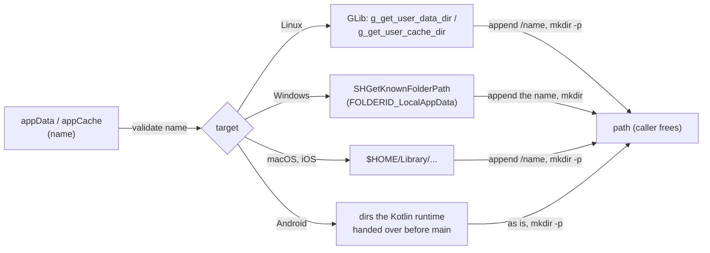

<!-- Generated from site/content/docs/paths.smd by tools/docs/gen-md.mjs: edit that file. -->

# App directories

The app's private data and cache directories on every platform, from one call: oriel.paths.appData and appCache.

`oriel.paths` answers "where does this app keep its files?" on every
platform with one call and no `if (android)`: `appData` for what the app
must not lose (databases, downloaded models, documents it manages), and
`appCache` for what it can fetch or rebuild (thumbnails, responses). Both
folders are private to the app, kept across updates, and on phones removed
with the app.

Use `appData` for files; small settings fit the
[settings store](store.md), which keeps its own JSON files
in the config directory. Files the user picks or saves elsewhere go through
[dialogs](dialogs.md) and [files](files.md).

## Availability

| Platform | `appData` (kept until the app is removed) | `appCache` (the system may clear it) |
|---|---|---|
| Linux | `$XDG_DATA_HOME/<name>` (`~/.local/share/<name>`) | `$XDG_CACHE_HOME/<name>` (`~/.cache/<name>`) |
| Windows | `%LOCALAPPDATA%\<name>` | `%LOCALAPPDATA%\<name>\cache` |
| macOS | `~/Library/Application Support/<name>` | `~/Library/Caches/<name>` |
| iOS | `<container>/Library/Application Support/<name>` | `<container>/Library/Caches/<name>` |
| Android | the files dir itself (`Context.getFilesDir()`, `/data/user/0/<package>/files`) | the cache dir itself (`Context.getCacheDir()`) |

`oriel.paths` is part of Oriel's core: always built, no flag, no
permission.

## Quick start

```zig
const std = @import("std");
const oriel = @import("oriel");
const app = @import("oriel_app");

fn setup() !void {
    const gpa = std.heap.smp_allocator;
    const data = try oriel.paths.appData(gpa, .{ .name = "GhostPantry" });
    defer gpa.free(data);
    const db_path = try std.fs.path.join(gpa, &.{ data, "pantry.db" });
    defer gpa.free(db_path);
    std.log.info("database at {s}", .{db_path});
}

pub fn main(init: std.process.Init) !u8 {
    return oriel.main(init, .{ .commands = struct {}, .events = struct {} }, .{
        .app = app.build,
        .window = .{ .title = "GhostPantry" },
        .setup = setup,
    });
}
```

`name` is the folder's name off Android: the product name
(`"GhostPantry"`) or the app id (`app.build.id`). Pick one and keep it:
changing it moves the app's data to a new, empty folder.

## How it works



`src/core/paths.zig` checks `name` with the store's app id rules, then
asks the platform for its base directory:

- **Linux** and **Windows**, **macOS** and **iOS** reuse the store's
  backends (`src/modules/store/linux.zig`, `windows.zig`, `macos.zig`):
  `appData` is exactly `oriel.store.dataDir(name)` and `appCache` is
  `oriel.store.cacheDir(name)`. They are compiled in even when the store
  module is off. On iOS `$HOME` is the app's sandbox container.
- **Android** uses the directories the Kotlin runtime passes to native code
  at start, before the app's `main` (`src/platform/android/paths.zig`). The
  sandbox is already the app's own, so `name` adds no folder: the files sit
  in `filesDir` like a plain Android app's. `name` is still checked, so a
  bad name fails on every platform.

The directory is created if missing (`mkdir -p` on POSIX, each level with
`CreateDirectoryW` on Windows). The call does file system work: call it
once, at start or in `setup`, and keep the path.

**Windows** uses Local AppData, not Roaming: databases and models are large
and machine-local and shouldn't roam with the profile. Settings meant to
roam belong in the store, whose config directory is `%APPDATA%`.

## Examples

### Open a database in the app's data folder

```zig
fn openDb(gpa: std.mem.Allocator) !oriel.sql.Db {
    const dir = try oriel.paths.appData(gpa, .{ .name = app.build.id });
    defer gpa.free(dir);
    const path = try std.fs.path.joinZ(gpa, &.{ dir, "notes.db" });
    defer gpa.free(path);
    return oriel.sql.Db.open(path);
}
```

See [SQL](sql.md) for the database API.

### A cache that may disappear

```zig
fn thumbnailPath(gpa: std.mem.Allocator, id: u64) ![]u8 {
    const cache = try oriel.paths.appCache(gpa, .{ .name = app.build.id });
    defer gpa.free(cache);
    return std.fmt.allocPrint(gpa, "{s}" ++ std.fs.path.sep_str ++ "{x}.jpg", .{ cache, id });
}
```

Treat a missing file in the cache as "rebuild it": phones clear caches on
low storage, and the user can clear them in the system settings.

### Show the user where their data is

```zig
pub const Commands = struct {
    /// invoke("data_folder"): for an "Open data folder" menu item.
    pub fn data_folder(gpa: std.mem.Allocator) ![]const u8 {
        return oriel.paths.appData(gpa, .{ .name = app.build.id });
    }
};
```

The page gets paths only through commands like this one; `oriel.paths` has
no page API.

## Reference

### `oriel.paths`

```zig
pub const Kind = enum { data, cache };

pub const Options = struct {
    name: []const u8,
};

pub fn appData(gpa: std.mem.Allocator, options: Options) ![]const u8;
pub fn appCache(gpa: std.mem.Allocator, options: Options) ![]const u8;
pub fn appDir(gpa: std.mem.Allocator, kind: Kind, options: Options) ![]const u8;
```

| Declaration | Meaning |
|---|---|
| `appData(gpa, .{ .name })` | The private data directory (the Availability table), created if missing. Caller frees. |
| `appCache(gpa, .{ .name })` | The private cache directory, created if missing. Caller frees. |
| `appDir(gpa, kind, .{ .name })` | `appData` for `.data`, `appCache` for `.cache`. |
| `Options.name` | The folder name off Android. Checked everywhere: not empty (`error.EmptyAppId`); no `/`, `\`, `:`, `..`, NUL or control characters (`error.InvalidAppId`). |

**Errors.** `error.EmptyAppId`, `error.InvalidAppId`; allocation failures;
Android `error.AppNotRunning` before the runtime handed over its
directories (it does so before `main`, so this happens only in code that
runs before the runtime starts, such as tests); Android, macOS and iOS
`error.CreateDirectoryFailed`; macOS and iOS `error.HomeNotSet`; Windows
`error.KnownFolderNotFound` and `error.CreateDirectoryFailed`. Linux
ignores a failure to create the directory: it shows when the app opens a
file there.

**Threads.** Any thread. Nothing is cached: each call queries the platform
and creates the directory.

### Other folders the app has

| Folder | Where |
|---|---|
| Settings files | the store's `configDir` ([Settings store](store.md#directories)) |
| Log file | [Logging](logging.md) |
| Android: app-specific external storage, for large downloads | `oriel.store.impl.externalDataDir(gpa, app_id)`: `/storage/emulated/0/Android/data/<package>/files/<app_id>`, else `<filesDir>/<app_id>`; Android only |

**On Android the store's directories differ.** `oriel.store.dataDir` and
`configDir` are `<filesDir>/<app id>` there (and `cacheDir` is
`<cacheDir>/<app id>`), a subfolder of `appData`, because existing apps'
data lives there. An app that keeps data with the store's functions keeps
calling them; an app that kept files in `filesDir` itself moves to
`appData` without moving anything.

## Troubleshooting

- **`InvalidAppId`.** `name` has a separator, `..`, `:` or a control
  character. Use a plain product name or the reverse-DNS app id.
- **Data "vanished" after renaming the app.** `name` changed, so the
  folder did; move the old folder or keep the old name.
- **Files in `appCache` are gone.** The system cleared it (phones, low
  disk, macOS storage management). Only keep there what can be rebuilt.

## Related

- [Settings store](store.md): settings by key, in the config
  directory.
- [SQL](sql.md): databases in `appData`.
- [Logging](logging.md): where the log file goes.
- [Files](files.md): files the user picks.
