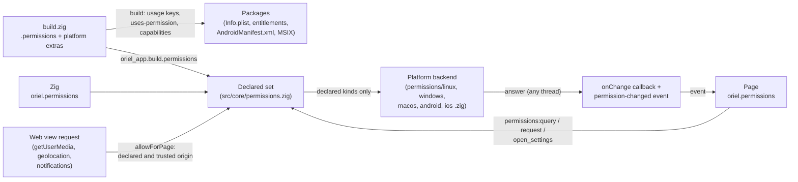

<!-- Generated from site/content/docs/permissions.smd by tools/docs/gen-md.mjs: edit that file. -->

# Permissions

Declare the OS permissions an app needs once in build.zig, have every package carry them, and query or request them at runtime from Zig or the page.

An app that records the microphone, reads the location, types into other
apps or finds devices on the LAN needs the user's (or the OS's) permission.
Each platform asks for it differently: an Android `<uses-permission>` and a
runtime prompt, an `Info.plist` usage text and a TCC prompt on macOS and iOS,
an MSIX capability and the Privacy settings on Windows. Oriel gives you one
declaration and one runtime API for all of them:

1. **Declare** what the app needs, with the reason the user sees, in
   `build.zig`: `.permissions = .{ .microphone = "..." }`.
2. The build **writes** it into each package: the Android manifest, the iOS
   and macOS `Info.plist`, the macOS entitlements, the MSIX manifest.
3. **Query and request** it at runtime with `oriel.permissions` (Zig) or
   `window.oriel.permissions` (the page).
4. The web view's own requests (`getUserMedia`, geolocation, web
   notifications) are **granted only for declared permissions**, and only
   to the app's own pages.

A permission the app doesn't declare is always `denied` and never asked
for. On macOS and iOS this also prevents a crash: using a protected
resource without its `Info.plist` usage key terminates the app.

Declarations a kind doesn't cover (an Android permission like `VIBRATE`, an
`NSMotionUsageDescription`, an MSIX capability) go in the platform's own
options, described [below](#platform-declarations); they end
up in the package but have no runtime API.

## Availability

| Platform | Declared in the package as | Runtime backend | Settings page |
|---|---|---|---|
| Linux | nothing (Linux packages declare no permissions) | not gated; the camera, screen capture and location go through XDG portals, which ask on use | none |
| Windows | MSIX capabilities (the NSIS installer has none) | the Privacy settings' switches and group policy, read from the registry; nothing ever prompts | `ms-settings:` page |
| macOS | `Info.plist` usage keys, `<Name>.entitlements` | TCC: AVCaptureDevice, CoreGraphics screen capture, AXIsProcessTrusted, UNUserNotificationCenter, CoreBluetooth | System Settings, Privacy & Security pane |
| Android | `<uses-permission>` and `<uses-feature>` in `AndroidManifest.xml` | runtime permissions (`checkSelfPermission`, `requestPermissions`) | the app's page in Settings |
| iOS | `Info.plist` usage keys | AVCaptureDevice, CLLocationManager, UNUserNotificationCenter, CoreBluetooth | the app's page in Settings |

The API is always built; no build flag turns it on. Declaring `camera`
turns on the [camera](camera.md) module and declaring
`local_network` turns on the [network](network.md) module,
unless the `oriel` dependency's options set that module's flag themselves.

## Quick start

Declare the microphone, with the text the OS shows the user:

```sh
oriel permission add microphone "Dictation turns your speech into text"
```

which writes, in `build.zig`:

```zig
_ = oriel.addApp(b, dep, .{
    .name = "my-app",
    .root_source_file = b.path("src/main.zig"),
    .permissions = .{
        .microphone = "Dictation turns your speech into text",
    },
});
```

The declaration reaches the app with the rest of the build's settings
(`.app = app.build` in `oriel.main`); nothing else to pass. Then, from the
page:

```js
const { permissions } = window.oriel;

let status = await permissions.query("microphone"); // never prompts
if (status === "prompt" || status === "unknown") {
  status = await permissions.request("microphone"); // the OS prompt, where there is one
}
if (status === "denied") await permissions.openSettings("microphone");
```

Or from Zig:

```zig
const permissions = oriel.permissions;

fn setup() !void {
    permissions.onChange(changed);
    switch (permissions.status(.microphone)) {
        .granted => startDictation(),
        .prompt, .unknown => _ = permissions.request(.microphone), // the answer arrives in `changed`
        .denied => _ = permissions.openSettings(.microphone),
    }
}

fn changed(kind: permissions.Kind, status: permissions.Status) void {
    if (kind == .microphone and status == .granted) startDictation();
}
```

## How it works



**Build time.** `AppOptions.permissions` is a struct with one optional
string per kind (`Declared`, `src/core/permissions/common.zig`); a non-null
field declares the kind, its text is the reason (`""` uses a default text,
completed as `"<App name> <text>"`, for example "My App records audio from the
microphone."). Enabled modules add what they need with the default reason:
`audio_capture` declares `microphone` and `system_audio`. The build then
writes each package's declarations from the same set:

- **Android**: `build/android_manifest.zig` rewrites the
  `<!-- oriel:permissions -->` and `<!-- oriel:features -->` regions of the
  app's `AndroidManifest.xml` on every build, leaving the rest of the file
  as you wrote it.
- **iOS, macOS**: `tools/package/ios.zig` and `tools/package/macos.zig`
  write the usage keys into `Info.plist`; for macOS, `<Name>.entitlements`
  (next to the `.app`) gets the hardened-runtime entitlements used when
  signing ([Signing](signing.md)).
- **Windows**: `tools/package/msix.zig` writes the MSIX capabilities, in the
  order the schema requires.

The generated `oriel_app` module carries the set (`oriel_app.build`), and
`oriel.main` hands it to `oriel.permissions` before any window exists.

**Runtime.** `src/core/permissions.zig` checks every call against the
declared set and passes declared kinds to the platform backend under
`src/core/permissions/`. `status` reads the current state and never
prompts. `request` returns the status at the time of the call; when that is
already `granted` or `denied` it is also the answer, otherwise the backend
shows the OS prompt and the answer comes later, through the `onChange`
callback and a `permission-changed` event to every page. The page's
`permissions.request()` waits for that event, so its promise resolves with
the answer. On Android the backend calls the Kotlin runtime
(`OrielPermissions.kt`) on the UI thread; on Apple platforms the answers
come from the frameworks' completion handlers, on their threads.

**The web view's requests.** When a page calls `getUserMedia()`, the
Geolocation API or `Notification.requestPermission()`, the window's
permission handler (`src/platform/<os>/window.zig`) asks
`permissions.allowForPage`: the app must declare every kind requested, and
the requesting page must be the app's own (the asset origin or the dev
server) or an origin whose [capability](security.md) allows
the `permissions:webview` command. Otherwise the request is denied without
a prompt and the log says which permission to add. After a grant, the OS
permission still applies: TCC or Android may still ask the user.

## Examples

### Ask for the microphone before recording

```js
const { permissions, listen } = window.oriel;

async function ensureMicrophone() {
  const status = await permissions.request("microphone");
  if (status === "granted" || status === "unknown") return true; // unknown: the first use asks
  if (status === "denied") {
    showBanner("Turn on the microphone for this app in Settings.", () =>
      permissions.openSettings("microphone"));
  }
  return false;
}

// Another window, or Zig, may have asked: keep the UI in step.
listen("permission-changed", ({ name, status }) => {
  if (name === "microphone") updateMicButton(status);
});
```

[Dictation](dictation.md) and audio capture record through
the OS; the request only makes the prompt appear at a moment you choose.

### Accessibility for typing into other apps (macOS)

The [input](input.md) module posts keyboard events, which
macOS drops without the Accessibility permission. macOS gives no callback
when the user flips the switch, so Oriel polls for up to two minutes after
`request`:

```zig
// build.zig: .permissions = .{ .accessibility = "types your dictated text into other apps" },

fn setup() !void {
    oriel.permissions.onChange(onPermission);
    if (oriel.permissions.status(.accessibility) != .granted) {
        _ = oriel.permissions.request(.accessibility); // shows macOS's alert pointing to Settings
    }
}

fn onPermission(kind: oriel.permissions.Kind, status: oriel.permissions.Status) void {
    if (kind != .accessibility) return;
    std.log.info("accessibility: {s}", .{@tagName(status)}); // granted, or still prompt after two minutes
}
```

Test this from the `.app` bundle (`open zig-out/<Name>.app`): TCC charges a
permission to the *responsible* app, so an unbundled binary started from a
terminal gets the terminal's permissions.

### Video calls in a partner's page

A remote page gets camera and microphone only when its origin has a
capability allowing `permissions:webview`:

```zig
// build.zig
.permissions = .{ .camera = "for video calls", .microphone = "for video calls" },
```

```zig
// src/main.zig
return oriel.main(init, api, .{
    .app = app.build,
    .window = .{ .title = "Calls" },
    .security = .{
        .capabilities = &.{.{
            .origin = "https://meet.partner.example",
            .commands = &.{"permissions:webview"},
        }},
    },
});
```

How the page may be navigated to at all is on the
[Security](security.md) page.

### A permission no kind covers (Android, iOS)

```zig
_ = oriel.addApp(b, dep, .{
    .name = "steps",
    .root_source_file = b.path("src/main.zig"),
    .permissions = .{ .notifications = "" },
    .android = .{
        .permissions = &.{
            .{ .name = "android.permission.ACTIVITY_RECOGNITION" },
            .{ .name = "android.permission.VIBRATE" },
        },
    },
    .ios = .{ .usage_descriptions = &.{
        .{ .key = "NSMotionUsageDescription", .text = "Counts your steps" },
    } },
});
```

The app asks for these with its own native code (a
[platform hook](platform-hooks.md) or an
[extension](extensions.md)); `oriel.permissions` covers the
kinds only.

## Reference

### Kinds

`oriel.permissions.Kind`; the page uses the same names as strings.

| Kind | What it covers |
|---|---|
| `microphone` | Recording from a microphone (on Apple platforms, also speech recognition) |
| `camera` | The camera |
| `screen_capture` | Recording the screen |
| `accessibility` | Controlling other apps: synthetic input, reading their UI |
| `location` | The user's location |
| `notifications` | Showing notifications |
| `system_audio` | Recording the audio other apps play (macOS 14.4+) |
| `bluetooth` | Bluetooth LE: finding, waking and connecting to nearby devices |
| `local_network` | The local network: discovery and multicast (mDNS) |

### `AppOptions.permissions`

```zig
.permissions = .{
    .microphone = "Dictation turns your speech into text",
    .accessibility = "", // "" = the default text
},
```

Type `oriel.permissions.Declared` (re-exported by `build.zig` as
`Permissions`): one `?[]const u8 = null` field per kind. Non-null declares
the kind; the text is the reason the OS shows, `""` for the default:

| Kind | Default text (after the app's name) |
|---|---|
| `microphone` | records audio from the microphone. |
| `camera` | uses the camera. |
| `screen_capture` | records the screen. |
| `accessibility` | controls other apps (keyboard input, copy and paste). |
| `location` | uses your location. |
| `notifications` | shows notifications. |
| `system_audio` | records the audio other apps play. |
| `bluetooth` | finds and wakes nearby devices. |
| `local_network` | finds devices on your local network. |

Reasons must be valid UTF-8 without control characters (they go into XML);
a bad one fails the build.

### What each kind declares

| Kind | Android manifest | iOS `Info.plist` | macOS `Info.plist` | macOS entitlement | MSIX capability |
|---|---|---|---|---|---|
| `microphone` | `RECORD_AUDIO`, `FOREGROUND_SERVICE`, `FOREGROUND_SERVICE_MICROPHONE` | `NSMicrophoneUsageDescription`, `NSSpeechRecognitionUsageDescription` | same as iOS | `com.apple.security.device.audio-input` | `<DeviceCapability Name="microphone">` |
| `camera` | `CAMERA`; `<uses-feature android.hardware.camera required=false>` | `NSCameraUsageDescription` | same | `com.apple.security.device.camera` | `<DeviceCapability Name="webcam">` |
| `screen_capture` | nothing | nothing | nothing | nothing | `rescap:graphicsCaptureProgrammatic`, `rescap:graphicsCaptureWithoutBorder` |
| `accessibility` | nothing (see [Android](#android-backend)) | nothing | nothing | nothing | nothing |
| `location` | `ACCESS_COARSE_LOCATION`, `ACCESS_FINE_LOCATION` | `NSLocationWhenInUseUsageDescription`, `NSLocationUsageDescription` | same | `com.apple.security.personal-information.location` | `<DeviceCapability Name="location">` |
| `notifications` | `POST_NOTIFICATIONS` | nothing | nothing | nothing | nothing |
| `system_audio` | nothing | nothing | `NSAudioCaptureUsageDescription` | `com.apple.security.device.audio-input` | nothing |
| `bluetooth` | `BLUETOOTH_SCAN` (`usesPermissionFlags="neverForLocation"`), `BLUETOOTH_ADVERTISE`, `BLUETOOTH_CONNECT`; `BLUETOOTH`, `BLUETOOTH_ADMIN`, `ACCESS_FINE_LOCATION` with `maxSdkVersion=30`; `<uses-feature android.hardware.bluetooth_le required=false>` | `NSBluetoothAlwaysUsageDescription` | same | nothing | `<DeviceCapability Name="bluetooth">` |
| `local_network` | `ACCESS_NETWORK_STATE`, `ACCESS_WIFI_STATE`, `CHANGE_WIFI_MULTICAST_STATE` | `NSLocalNetworkUsageDescription` | same | nothing | `<Capability Name="privateNetworkClientServer">` |

Android permission names are `android.permission.*`. A name two kinds need
(`ACCESS_FINE_LOCATION` for `location` and `bluetooth`) is written once,
without `maxSdkVersion` if either needs it on every level. Every MSIX
manifest also has `internetClient` and `rescap:runFullTrust`. The camera
feature is not required, so Google Play doesn't hide the app from devices
without a camera (the camera module falls back to the photo picker). iOS
apps can't record the system's audio, so `system_audio` writes nothing for
iOS. The `bluetooth` entitlement for a sandboxed or hardened macOS app is
yours to add (`.macos.entitlements`).

### Platform declarations

Declarations no kind writes go in the platform's options in `addApp`, and
are merged with the kinds' ones:

```zig
.android = .{
    .permissions = &.{.{ .name = "android.permission.BLUETOOTH", .max_sdk = 30 }},
    .features = &.{.{ .name = "android.hardware.nfc", .required = false }},
},
.ios = .{ .usage_descriptions = &.{.{ .key = "NSMotionUsageDescription", .text = "Counts your steps" }} },
.macos = .{
    .usage_descriptions = &.{.{ .key = "NSAppleEventsUsageDescription", .text = "Controls Music" }},
    .entitlements = &.{"com.apple.security.device.bluetooth"},
},
.windows = .{ .capabilities = &.{.{ .name = "proximity", .kind = .device }} },
```

| Field | Type | Meaning |
|---|---|---|
| `android.permissions` | `[]const struct { name: []const u8, max_sdk: ?u32 = null, flags: ?[]const u8 = null }` | `<uses-permission>` entries: `android:maxSdkVersion` and `android:usesPermissionFlags`. One entry per name: a name a kind already writes keeps that entry (its flags and place), but an extra without `max_sdk` lifts its `maxSdkVersion`, so it holds on every API level. |
| `android.features` | `[]const struct { name: []const u8, required: bool = false }` | `<uses-feature>` entries, one per name, required if any declaration requires it. |
| `ios.usage_descriptions`, `macos.usage_descriptions` | `[]const struct { key: []const u8, text: []const u8 }` | `Info.plist` keys. The key must end in `UsageDescription` (characters `[A-Za-z0-9_.~-]`), the text must not be empty. A key a kind also writes keeps its place and takes this text. |
| `macos.entitlements` | `[]const []const u8` | Boolean entitlements (`<true/>`) added to `<Name>.entitlements`, each once; keys as above, else a build error. |
| `windows.capabilities` | `[]const struct { name: []const u8, kind: enum { general, uap, restricted, device } = .general }` | MSIX `<Capability>`, `<uap:Capability>`, `<rescap:Capability>` (Store review) or `<DeviceCapability>`; names `[A-Za-z0-9._-]` or a device interface's `name:...` form. The NSIS installer ignores them. |

Linux has no field: nothing in a Linux package declares permissions.

### Zig: `oriel.permissions`

```zig
pub const Kind = enum { microphone, camera, screen_capture, accessibility, location,
                        notifications, system_audio, bluetooth, local_network };
pub const Status = enum { granted, denied, prompt, unknown };
pub const Declared = struct { microphone: ?[]const u8 = null, ... }; // as AppOptions.permissions

pub fn status(kind: Kind) Status;
pub fn request(kind: Kind) Status;
pub fn openSettings(kind: Kind) bool;
pub fn onChange(callback: ?*const fn (Kind, Status) void) void;
pub fn declared() Declared;
pub fn parseKind(name: []const u8) ?Kind;
```

| Status | Meaning |
|---|---|
| `granted` | Allowed, or not gated on this OS. |
| `denied` | Refused, restricted by policy, not available on this OS, or not declared. |
| `prompt` | Not decided yet: `request` (or the first use) asks the user. |
| `unknown` | This OS can't report it; the first use may ask. |

- **`status(kind)`**: the current status; never prompts. Undeclared kinds
  are `denied`. Callable from any thread (on Android it runs on the UI
  thread and waits).
- **`request(kind)`**: asks the user when the OS allows asking ahead of
  use, and returns the status at the time of the call (`prompt` while the
  OS dialog is open). The answer is always delivered through `onChange` and
  the `permission-changed` event, also when it is immediate (already
  granted or denied, an OS that never prompts). An undeclared kind logs a
  warning naming the line to add to `build.zig`, and resolves `denied`.
- **`openSettings(kind)`**: opens the OS settings page for the kind;
  `false` when there is none or the kind isn't declared.
- **`onChange(callback)`**: one callback (a new call replaces it; `null`
  removes it), called on any thread when a `request` resolves.
- **`declared()`**: the declared set; `Declared` has `has(kind)`,
  `reason(kind)` (`""` when declared without a text) and
  `reasonOrDefault(kind)`.
- **`parseKind(name)`**: a kind from its name, or null.

`setDeclared`, `allowForPage`, `check`, `common` and `impl` are public for
Oriel's own use (the shell, the window code, the smoke check that `oriel
check` runs, which reports every kind's status without prompting).

### Page: `window.oriel.permissions`

```ts
type PermissionName = "microphone" | "camera" | "screen_capture" | "accessibility" | "location"
  | "notifications" | "system_audio" | "bluetooth" | "local_network";
type PermissionStatus = "granted" | "denied" | "prompt" | "unknown";

interface PermissionsApi {
  query(name: PermissionName): Promise<PermissionStatus>;   // never prompts
  request(name: PermissionName): Promise<PermissionStatus>; // resolves with the answer
  openSettings(name: PermissionName): Promise<boolean>;
}

// event
"permission-changed": { name: PermissionName; status: PermissionStatus }
```

The generated TypeScript bindings export the same object as `permissions`
(`import { permissions } from "./oriel"`). `request` resolves when the
`permission-changed` event for that name arrives, or at once when the
status at the call isn't `prompt`. An unknown name rejects with
`UnknownPermission`. The commands behind it (`permissions:query`,
`permissions:request`, `permissions:open_settings`) are built in; a remote
origin calls them like any command, as its capability allows.

### Platform behavior

| Kind | Linux | Windows | macOS | Android | iOS |
|---|---|---|---|---|---|
| `microphone` | granted | Privacy switch | TCC prompt | runtime prompt | prompt |
| `camera` | prompt (portal on use) | Privacy switch | TCC prompt | runtime prompt | prompt |
| `screen_capture` | prompt (portal on use) | granted | TCC; see below | always prompt (MediaProjection asks every session) | denied |
| `accessibility` | granted | granted | TCC; `request` shows the alert and polls | see below | denied |
| `location` | prompt (portal on use) | Privacy switch | unknown (first use asks) | runtime prompt (`ACCESS_FINE_LOCATION`) | prompt ("when in use") |
| `notifications` | granted | global notifications switch | prompt (bundled app) | Android 13+: runtime prompt; before: the app's notification switch | prompt |
| `system_audio` | granted | granted | unknown (first use asks) | always prompt | denied |
| `bluetooth` | granted | granted | prompt (CoreBluetooth) | runtime prompt ("Nearby devices"; location up to API 30) | prompt (CoreBluetooth) |
| `local_network` | granted | granted | unknown (first use asks) | granted (install-time) | unknown (first use asks) |

#### Linux

Nothing is gated for a native (non-Flatpak) app: the microphone (PulseAudio,
PipeWire), input and notifications just work. The camera, screen capture
and location go through XDG portals that ask at the moment of use, so they
read `prompt`, and `request` returns that without a dialog. There is no
settings page (`openSettings` is `false`).

#### Windows

Windows never prompts a desktop app: `request` reports the current status.
The microphone, camera and location are `denied` when any of these is off:
the per-user switch, "Let desktop apps access your ...", the device-wide
switch (the `CapabilityAccessManager\ConsentStore` registry keys), or when
the `AppPrivacy` group policy forces a deny (a force-allow policy wins over
the switches). Notifications follow the global switch (`ToastEnabled`).
Everything else is `granted`. `openSettings` opens
`ms-settings:privacy-microphone`, `privacy-webcam`, `privacy-location`,
`notifications`, `bluetooth` or `network`; screen capture, accessibility
and system audio have no page.

#### macOS

- **Microphone, camera**: `AVCaptureDevice` authorization and prompt.
- **Screen capture**: `CGPreflightScreenCaptureAccess`; macOS can't tell
  "not asked" from "denied", so a missing grant reads `prompt`. `request`
  shows the system alert pointing to Settings the first time; a grant takes
  effect after the app restarts.
- **Accessibility**: `AXIsProcessTrusted`; `request` shows the system
  prompt and polls for up to two minutes.
- **Notifications**: `UNUserNotificationCenter`, which needs a bundle;
  an unbundled binary notifies through `osascript` and reads `unknown`.
- **Bluetooth**: `CBManager.authorization`; `request` creates a
  `CBCentralManager`, which prompts while undecided. CoreBluetooth is
  loaded on first use, not linked.
- **Location, system audio, local network**: no public status API:
  `unknown`; the first use asks.
- `openSettings` opens the Privacy & Security pane for the kind
  (`x-apple.systempreferences:...Privacy_Microphone`, `_Camera`,
  `_ScreenCapture` for screen and system audio, `_Accessibility`,
  `_LocationServices`, `_Bluetooth`, `_LocalNetwork`), or the Notifications
  pane.

TCC grants follow the bundle and its signature: run the `.app`
(`zig-out/<Name>.app`, which `zig build` writes) so prompts carry the app's
name. The dev bundle and the signed package have different signatures, so
macOS keeps separate grants for each.

When the app declares the microphone or camera, Oriel turns on WebKit's
private `_setMediaDevicesEnabled:` preference, without which WKWebView hides
`navigator.mediaDevices` from custom-scheme pages. Apps you distribute
yourself are fine; the Mac App Store may reject private API use.

#### Android

- Runtime permissions use `checkSelfPermission` and `requestPermissions`
  from the foreground Activity, with request codes `0x4E00` plus the kind's
  index (hooks must leave `0x4E00..0x4FFF` alone,
  [Platform hooks](platform-hooks.md)). A permission asked
  before that Android won't prompt for again reads `denied`.
- **Screen capture, system audio**: `prompt` always; MediaProjection asks
  every session.
- **Accessibility**: an `AccessibilityService` the app declares itself (in
  the developer part of the manifest) and the user enables in Settings:
  `granted` when enabled, `prompt` when not, `denied` when the app has no
  service. `request` opens the accessibility settings.
- **Local network**: install-time permissions, always `granted`;
  `request` asks nothing.
- `openSettings` opens the accessibility settings, the app's notification
  settings, or the app's details page.

#### iOS

The microphone and camera (`AVCaptureDevice`), location
(`CLLocationManager`, when in use), notifications
(`UNUserNotificationCenter`) and Bluetooth (`CBManager`) prompt. Screen
capture, system audio and accessibility don't exist for iOS apps:
`denied`. The local network has no status API: `unknown`. `openSettings`
opens the app's page in Settings for every kind and returns `true`.

### Web view requests

| Platform | Requests Oriel decides |
|---|---|
| Linux (WebKitGTK) | microphone, camera and screen (`getUserMedia`, `getDisplayMedia`), geolocation, notifications |
| Windows (WebView2) | microphone, camera, geolocation, notifications; other kinds keep WebView2's default |
| macOS, iOS (WKWebView) | microphone and camera; a [platform hook](platform-hooks.md) can take the decision first |
| Android (WebView) | microphone and camera; when allowed, Oriel then asks for the runtime permissions |

Each is granted only when the app declares every kind asked for and the
page (on Windows, the requesting frame) is trusted: the app's own origin,
the dev server, or a capability origin allowing `permissions:webview`.

### CLI: `oriel permission`

```sh
oriel permission add <kind> ["reason"]   # add or replace a kind's reason
oriel permission remove <kind>
oriel permission list                     # kind: reason, or "(default reason)"
```

Run inside an app (the directory with `build.zig.zon` or below). It edits
`.permissions` in the first `addApp(...)` options of `build.zig`, creating
the field when missing and removing it with its last kind. It accepts the
kinds `microphone`, `camera`, `screen_capture`, `accessibility`,
`location`, `notifications`, `system_audio`, `bluetooth` and
`local_network`.

### Migrating from 0.11

- `App.Config.permissions` is gone: the declaration comes with
  `.app = app.build`, from `build.zig`.

## Troubleshooting

- **Always `denied`, and a log line `permission 'x' requested but not
  declared`.** Add the kind to `.permissions` in `build.zig` (the line is
  in the message) and rebuild.
- **`page ... asked for 'camera', which the app doesn't declare: denied`**
  or **`... but its origin is not allowed: denied`.** A web view request
  for an undeclared kind, or from an origin without a capability allowing
  `permissions:webview`.
- **The macOS app quits the moment it records.** The usage key is missing:
  the bundle was built without the kind declared, or the binary runs
  outside its bundle.
- **No prompt on macOS, or the prompt names Terminal.** Run the `.app`,
  not the bare binary; TCC charges permissions to the responsible app.
- **Accessibility granted, but macOS still blocks the rebuilt app.** The
  grant is tied to the code signature, and an ad-hoc signed rebuild may not
  match it. Remove the app from the Accessibility list and add it again, or
  test from a Developer ID signed bundle.
- **Windows reports `denied` without asking.** Windows never asks desktop
  apps; send the user to `openSettings`.
- **Android accessibility is `denied`.** The app declares no
  `AccessibilityService`; there's nothing for the user to enable.

## Related

- [Security](security.md): capabilities, and which pages get the bridge.
- [Camera](camera.md), [Dictation](dictation.md),
  [Input](input.md), [Network](network.md),
  [Notifications](notifications.md): the modules that use these permissions.
- [Signing](signing.md): where `<Name>.entitlements` is used.
- [Packaging](packaging.md): the MSIX, `.app` and Android packages.
- [Platform hooks](platform-hooks.md): permission results and media-capture decisions in native code.
