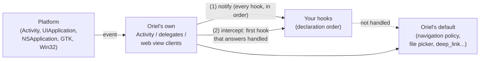

<!-- Generated from site/content/docs/platform-hooks.smd by tools/docs/gen-md.mjs: edit that file. -->

# Platform hooks

Your code inside the platform's own app, window and web view events: Kotlin on Android, Objective-C or Swift on iOS and macOS, Zig on the desktop.

A platform hook is a class (or, in Zig, a set of functions) that the
platform's own events reach through Oriel: an Activity started, a window or
web view was created, the page asked for a file chooser, the system opened a
URL, iOS woke the app for a background download. A hook **reacts** to an
event (configure the web view, keep a reference, log) or **takes it over**
(answer "handled", and Oriel's default handling is skipped). Oriel keeps its
own Activity, delegates, web view clients and bridge; hooks sit beside them,
so an app never has to replace Oriel's code to reach the platform.

Use a hook when the platform calls *you*. When your code calls native code
(a camera SDK, an on-device model), that's an
[app extension](extensions.md); one class can be both.

| | Platform hooks | App extensions |
|---|---|---|
| Who calls | The platform, through Oriel, when its events happen | Your Zig code, by name; the page through what Zig exposes |
| Thread | The main (UI) thread | The extension's own worker threads |
| What for | React to, or take over, the app's own lifecycle, windows and web views | Your native code as a service |
| Declared with | `.android.hooks`, `.ios.hooks`, `.macos.hooks`; `oriel.hooks` in Zig | `AppOptions.extensions` |

## Availability

| Platform | Language | Declared with | What a hook sees |
|---|---|---|---|
| Android | Kotlin or Java | `.android.hooks` in `build.zig` | `OrielAndroidHooks`: Activity lifecycle, WebView lifecycle, file chooser, activity and permission results |
| iOS | Objective-C or Swift | `.ios.hooks` in `build.zig` | `OrielPlatformHooks`: app and scene delegate, WebKit delegates, URLs and activities, remote notifications, background URLSessions |
| macOS | Objective-C or Swift | `.macos.hooks` in `build.zig` | `OrielPlatformHooks`: app delegate, windows, WebKit delegates, URLs and activities, Dock reopen |
| Linux, Windows, macOS | Zig | `oriel.hooks.subscribe` at runtime | Windows and web views as they're created and destroyed, with their native handles |

Hooks need no build flag and no permission. On macOS both kinds exist: the
Objective-C/Swift hooks for AppKit and WebKit callbacks, the Zig hooks for
code that already lives in Zig (the same window and web view events, as
native handles).

## Quick start

An Android hook that zooms the main window's text:

```zig
// build.zig
_ = oriel.addApp(b, dep, .{
    .name = "my-app",
    .root_source_file = b.path("src/main.zig"),
    .android = .{ .hooks = &.{.{
        .class = "dev.example.MyHooks",
        .sources = &.{b.path("src/android/MyHooks.kt")},
    }} },
});
```

```kotlin
// src/android/MyHooks.kt
package dev.example

import android.webkit.WebView
import dev.oriel.OrielAndroidHooks

class MyHooks : OrielAndroidHooks {
    override fun onWebViewCreated(view: WebView, windowLabel: String) {
        if (windowLabel == "main") view.settings.textZoom = 110
    }
}
```

The same on iOS and macOS, in Objective-C:

```zig
.ios = .{ .hooks = &.{.{ .class = "MyHooks", .sources = &.{b.path("apple/MyHooks.m")} }} },
.macos = .{ .hooks = &.{.{ .class = "MyHooks", .sources = &.{b.path("apple/MyHooks.m")} }} },
```

```objc
// apple/MyHooks.m
#import "oriel_hooks.h"

@interface MyHooks : NSObject <OrielPlatformHooks>
@end

@implementation MyHooks
- (void)webViewConfiguration:(WKWebViewConfiguration *)configuration window:(NSString *)label {
    configuration.applicationNameForUserAgent = @"MyApp";
}
@end
```

And on the desktop, in Zig, before `oriel.main`:

```zig
pub fn main(init: std.process.Init) !u8 {
    if (oriel.hooks.available) try oriel.hooks.subscribe(.{ .webview_created = webViewCreated });
    return oriel.main(init, api, config);
}

fn webViewCreated(v: oriel.hooks.WebView) void {
    std.log.info("web view for {s}: {s}", .{ v.label, @tagName(v.native) });
}
```

## How it works



Oriel owns the platform's entry points: the Android `Activity` and WebView
clients (`OrielActivity.kt`, `OrielWindow.kt`), the iOS app and scene
delegates and the macOS app delegate (`src/platform/ios/Shell.zig`,
`src/platform/macos/Shell.zig`), the WebKit navigation and UI delegates,
and the desktop windows. Each place where an app may want in calls the
hooks registered for it. There are two kinds of call:

- **Notifications** ("an Activity started", "a web view was created") go to
  every hook that implements them, in declaration order, and return nothing.
- **Interceptions** ("the page wants a file chooser", "this navigation:
  allow it?") ask each hook in turn. The first hook that answers *handled*
  (`true` in Kotlin, `YES` in Objective-C) owns the request: it must
  complete it exactly once, now or later, on the main thread, and neither
  later hooks nor Oriel see it. If every hook answers *not handled*, Oriel
  does what it does without hooks.

```mermaid
sequenceDiagram
  participant P as Page
  participant W as WebView / WKWebView
  participant O as Oriel
  participant A as Hook A
  participant B as Hook B
  P->>W: <input type=file> clicked
  W->>O: onShowFileChooser / decidePolicy
  O->>A: intercept?
  A-->>O: not handled
  O->>B: intercept?
  B-->>O: handled (keeps the callback)
  B->>W: callback(result), exactly once
  Note over O: Oriel's own picker never runs
```



**Registration.** The build turns the declarations into code: for Android a
generated `OrielHooksRegistry.kt` that constructs each class directly (no
reflection, so R8 keeps them), for iOS and macOS a table of class names that
Oriel's shell instantiates at launch (`src/platform/apple/hooks.zig`).
Classes are constructed once per process, in declaration order, before the
first Activity, scene or window, and live as long as the process. In Zig,
`oriel.hooks.subscribe` adds the handlers to a table (`src/core/hooks.zig`)
that each desktop shell calls from its window code.

**Lifetimes.** A process outlives its Activities, scenes and windows. On
Android a WebView can outlive an Activity (configuration changes), and a
renderer crash replaces a window's WebView. Hooks therefore keep state per
Activity, per WebView or per window label, and release it in the matching
destroyed callback; a hook must not assume an Activity or window exists
when it is constructed.

**What hooks leave alone.** Oriel's clients and delegates carry its
security: the navigation policy, the permission rules, the `window.oriel`
bridge (which checks every call's origin). A hook adds settings, its own
script message handlers, its own user scripts, and decides the requests it
intercepts; it doesn't replace `webViewClient`, `webChromeClient`, the
`WKWebView` delegates or the `userContentController`, or register a handler
for Oriel's URL scheme. Allowing a navigation Oriel would block bypasses
its navigation rules; the bridge's origin check still applies.

## Examples

### Show a help site in an in-app browser (iOS)

```objc
#import <SafariServices/SafariServices.h>
#import "oriel_hooks.h"

@interface AppHooks : NSObject <OrielPlatformHooks>
@property (nonatomic, strong) OrielHooksContext *context;
@end

@implementation AppHooks
- (void)registered:(OrielHooksContext *)context {
    self.context = context; // its properties are read live
}

- (BOOL)webView:(WKWebView *)webView
    handleNavigationAction:(WKNavigationAction *)action
           decisionHandler:(void (^)(WKNavigationActionPolicy))decisionHandler {
    if (![action.request.URL.host isEqualToString:@"help.example.com"]) return NO; // Oriel decides
    decisionHandler(WKNavigationActionPolicyCancel); // exactly once
    [self.context.presentingViewController
        presentViewController:[[SFSafariViewController alloc] initWithURL:action.request.URL]
                     animated:YES completion:nil];
    return YES; // owned: no later hook, nor Oriel, sees it
}
@end
```

```zig
.ios = .{ .hooks = &.{.{
    .class = "AppHooks",
    .sources = &.{b.path("ios/AppHooks.m")},
    .frameworks = &.{"SafariServices"},
}} },
```

The showcase's `ShowcaseHooks` (`examples/showcase/extensions/ios/` and
`.../macos/`) does this for example.com, and logs every event it sees
(`showcase.hooks: ...`).

### Downloads that continue while the app is suspended (iOS)

A background `URLSession` keeps downloading after iOS suspends or even quits
the app, and relaunches it to deliver the events. The hook claims its own
session and keeps the completion handler:

```swift
@objc(DownloadHooks)
final class DownloadHooks: NSObject, OrielPlatformHooks, URLSessionDownloadDelegate {
    static let identifier = "dev.example.models"
    private var finish: (() -> Void)?

    func handleEvents(forBackgroundURLSession identifier: String,
                      completionHandler: @escaping () -> Void) -> Bool {
        guard identifier == Self.identifier else { return false } // not ours
        finish = completionHandler
        _ = session() // recreate it: its delegate receives the events
        return true
    }

    func urlSessionDidFinishEvents(forBackgroundURLSession session: URLSession) {
        DispatchQueue.main.async { self.finish?(); self.finish = nil } // exactly once
    }

    func session() -> URLSession {
        URLSession(configuration: .background(withIdentifier: Self.identifier),
                   delegate: self, delegateQueue: nil)
    }

    func urlSession(_ session: URLSession, downloadTask: URLSessionDownloadTask,
                    didFinishDownloadingTo location: URL) {
        // Move the file out of `location` before returning.
    }
}
```

GhostPantry downloads its on-device vision models this way: its
`PantryVisionExtension` is both an app extension (Zig asks it for a model)
and a platform hook (it owns the background session).

### Your own camera flow (Android)

Oriel's camera module already answers `<input type="file" accept="image/*">`
([Camera](camera.md)). A hook takes the chooser only for a
flow of its own, a document scanner or a vendor SDK:

```kotlin
class ScanHooks : OrielAndroidHooks {
    private lateinit var context: OrielAndroidHooksContext
    private var pending: ValueCallback<Array<Uri>>? = null

    override fun onRegistered(context: OrielAndroidHooksContext) { this.context = context }

    override fun onShowFileChooser(
        activity: Activity, view: WebView,
        callback: ValueCallback<Array<Uri>>, params: WebChromeClient.FileChooserParams,
    ): Boolean {
        if ("application/x-scan" !in params.acceptTypes) return false // Oriel's picker
        pending = callback
        activity.startActivityForResult(Intent(activity, ScanActivity::class.java), context.requestCode(1))
        return true
    }

    override fun onActivityResult(activity: Activity, requestCode: Int, resultCode: Int, data: Intent?): Boolean {
        if (requestCode != context.requestCode(1)) return false
        pending?.onReceiveValue(data?.data?.let { arrayOf(it) }) // null on cancel
        pending = null
        return true
    }

    override fun onWebViewDestroyed(view: WebView, windowLabel: String) {
        pending?.onReceiveValue(null); pending = null
    }
}
```

### Configure WebKitGTK from Zig (Linux)

```zig
fn webViewCreated(v: oriel.hooks.WebView) void {
    switch (v.native) {
        .webkitgtk => |view| if (comptime oriel.target.is_desktop_linux) {
            const settings = webkit_web_view_get_settings(view);
            webkit_settings_set_enable_smooth_scrolling(settings, 1);
        },
        .wkwebview, .webview2 => {},
    }
}

extern fn webkit_web_view_get_settings(view: *anyopaque) *anyopaque;
extern fn webkit_settings_set_enable_smooth_scrolling(settings: *anyopaque, enabled: c_int) void;
```

The showcase does this in `examples/showcase/src/platform_hooks.zig`.

## Reference

### Android: `.android.hooks`

```zig
.android = .{ .hooks = &.{
    .{
        .class = "dev.example.MyHooks", // implements dev.oriel.OrielAndroidHooks
        .sources = &.{b.path("src/android/MyHooks.kt")},
        .dependencies = &.{"com.example:scanner-sdk:1.2.3"},
    },
} },
```

| Field | Type | Meaning |
|---|---|---|
| `class` | `[]const u8` | Fully qualified Kotlin or Java class implementing `dev.oriel.OrielAndroidHooks`, with a public zero-argument constructor. |
| `sources` | `[]const LazyPath` | Its Kotlin/Java files. Each is copied on every build into the Gradle project under `app/src/main/java/<its package path>/` (a `package` line is required); a file dropped from the list is removed there. Empty when the class comes with an app extension or a Maven dependency. |
| `dependencies` | `[]const []const u8` | Maven coordinates, exactly `group:artifact:version` (letters, digits, `.`, `_`, `-`); merged with `.android.dependencies`, each once. Pin a fixed version. |

Classes are registered in declaration order, at most 64. A duplicate or
invalid class name is a build error. Registration is regenerated on every
Android build into `dev/oriel/OrielHooksRegistry.kt` (don't edit it). Native
methods your hook calls over JNI need R8 keep rules: `.android.proguard_rules`
(written between `# oriel:proguard` markers of `app/proguard-rules.pro`).
Vendor libraries an SDK loads (`libOpenCL.so`) are declared with
`.android.native_libraries` ([Android](android.md)).

### Android: `OrielAndroidHooks`

Every method has a default; override the ones you need. All run on the UI
thread.

| Method | Kind | When |
|---|---|---|
| `onRegistered(context: OrielAndroidHooksContext)` | notify | once, after construction, before any Activity |
| `onActivityCreated(activity, savedInstanceState)`, `onActivityStarted`, `onActivityResumed`, `onActivityPaused`, `onActivityStopped`, `onActivityDestroyed` | notify | the Activity's lifecycle |
| `onSaveInstanceState(activity, outState)` | notify | the Activity saves its state |
| `onConfigurationChanged(activity, configuration)` | notify | rotation, theme, locale... |
| `onNewIntent(activity, intent)` | notify | a new Intent for the running Activity (deep links are also delivered to `oriel.deep_link`) |
| `onWebViewCreated(view, windowLabel)` | notify | Oriel installed its clients and bridge; before the first navigation |
| `onWebViewAttached(activity, view, windowLabel)`, `onWebViewDetached(...)` | notify | the WebView joins or leaves an Activity |
| `onWebViewDestroyed(view, windowLabel)` | notify | the WebView is destroyed (window closed, or replaced after a renderer crash) |
| `onShowFileChooser(activity, view, callback, params): Boolean` | intercept | `<input type="file">`; `true`: complete `callback` exactly once (`null` for cancel); honour `params`' accept types, capture flag and mode |
| `onActivityResult(activity, requestCode, resultCode, data): Boolean` | intercept | `true` when handled |
| `onRequestPermissionsResult(activity, requestCode, permissions, grantResults): Boolean` | intercept | `true` when handled; return `false` for Oriel's codes |

**Request codes.** `context.requestCode(local)` (local `0..255`) gives each
hook class its own 256 codes in `0x8000..0xBFFF`, so independently written
hooks never collide. Results in that range go straight to the owning class,
with the full code: compare with the same `context.requestCode(...)`.
Results outside it visit hooks in order until one returns `true`; unhandled
activity results reach the Activity, unhandled permission results reach
Oriel's handler. `0x4E00..0x4FFF` is Oriel's (permissions, its own
workflows). An SDK with fixed codes must use codes outside both ranges.

**Manifest.** Activities, services or providers a hook needs go in the
developer part of `AndroidManifest.xml` (outside Oriel's generated
regions, which every build rewrites); permissions go in `.permissions` or
`.android.permissions` ([Permissions](permissions.md)).

### iOS and macOS: `.ios.hooks`, `.macos.hooks`

```zig
.ios = .{ .hooks = &.{
    .{ .class = "AppHooks", .sources = &.{b.path("ios/AppHooks.m")}, .frameworks = &.{"SafariServices"} },
    .{ .class = "DownloadHooks", .swift_sources = &.{b.path("apple/DownloadHooks.swift")} },
} },
.macos = .{ .hooks = &.{
    .{ .class = "AppHooks", .sources = &.{b.path("macos/AppHooks.m")} },
} },
```

| Field | Type | Meaning |
|---|---|---|
| `class` | `[]const u8` | The Objective-C class, or the `@objc(Name)` of a Swift class, conforming to `OrielPlatformHooks`, with a plain `-init`. |
| `sources` | `[]const LazyPath` | Objective-C files, compiled by Zig's clang with `-fobjc-arc`; `#import "oriel_hooks.h"` works (and `oriel_extension.h`). |
| `swift_sources` | `[]const LazyPath` | Swift files, compiled by `swiftc` into one object per hook; the bridging header `oriel_swift.h` makes both protocols visible. |
| `frameworks` | `[]const []const u8` | SDK frameworks to link (`"SafariServices"`). Frameworks a Swift file `import`s are linked by themselves. |

At most 16 hooks per platform. An invalid or duplicate class name, or an
invalid framework name, is a build error on any host. A class that is also
an [app extension](extensions.md) (`.extensions[].ios`, or
`.macos = .{ .objc = ... }`) is constructed once and both get the same
object: list its sources in one place only.

### iOS and macOS: `OrielPlatformHooks`

`src/platform/apple/include/oriel_hooks.h` documents each method. Every
method is optional and runs on the main thread; Oriel asks
`respondsToSelector:` once per method, at construction. Don't throw
Objective-C exceptions: nothing catches them.

| Method | Platform | Kind | When |
|---|---|---|---|
| `registered:(OrielHooksContext *)` | both | notify | right after `-init`, in declaration order, before the first scene or window |
| `webViewConfiguration:(WKWebViewConfiguration *) window:(NSString *)` | both | notify | before the `WKWebView` is created, with Oriel's scheme handler and bridge set; change preferences, the data store, the user agent, add your own handlers and scripts |
| `webViewCreated:(WKWebView *) window:(NSString *)` | both | notify | after Oriel installs its delegates and bridge, before the first navigation |
| `webViewDestroyed:(WKWebView *) window:(NSString *)` | both | notify | the window is being destroyed; drop your references |
| `webView:handleNavigationAction:decisionHandler:` | both | intercept | before Oriel's navigation policy; call `decisionHandler` once (Allow loads it in this web view, Cancel drops it) |
| `webView:handleMediaCapturePermissionForOrigin:initiatedByFrame:type:decisionHandler:` | both | intercept | getUserMedia, before Oriel's rule (granted when the app declares the device and the page is its own); the OS permission still applies after a grant |
| `openURL:(NSURL *)` | both | intercept | a URL of the app's schemes (iOS: `scene:openURLContexts:` and a connecting scene's URLs; macOS: the GetURL Apple Event, `application:openURLs:`); not file URLs. `NO` leaves it to [`oriel.deep_link`](deep-links.md) |
| `continueUserActivity:(NSUserActivity *)` | both | intercept | universal links, Handoff; Oriel handles none itself |
| `didRegisterForRemoteNotificationsWithDeviceToken:(NSData *)`, `didFailToRegisterForRemoteNotificationsWithError:(NSError *)` | both | notify | what your own `registerForRemoteNotifications` call produces (with the `aps-environment` entitlement) |
| `applicationDidFinishLaunching:(UIApplication *) options:(NSDictionary *)` | iOS | notify | after `registered:`, before the main window and the app's `setup` |
| `sceneWillConnect:(UIScene *) options:(UISceneConnectionOptions *)` | iOS | notify | Oriel showed its window in the scene; its URLs and activities follow |
| `sceneDidDisconnect:`, `sceneDidBecomeActive:`, `sceneWillResignActive:`, `sceneWillEnterForeground:`, `sceneDidEnterBackground:` | iOS | notify | the scene delegate's events |
| `handleEventsForBackgroundURLSession:completionHandler:` | iOS | intercept | iOS launched or woke the app for a background URLSession; `YES`: recreate the session with the same identifier, call the handler once after `urlSessionDidFinishEvents(forBackgroundURLSession:)`. Unclaimed, Oriel calls it at once |
| `applicationDidFinishLaunching:(NSNotification *)` | macOS | notify | the run loop started: the main window is open and `setup` ran |
| `windowCreated:(NSWindow *) label:(NSString *)` | macOS | notify | an Oriel window exists, before its page loads and before `webViewCreated:` |
| `windowWillClose:(NSWindow *) label:(NSString *)` | macOS | notify | the window closes (not when only hidden), after `webViewDestroyed:` |
| `applicationShouldHandleReopen:hasVisibleWindows:` | macOS | intercept | a Dock click or a relaunch; `YES` skips Oriel's (showing the main window, `on_second_instance`) |

`OrielHooksContext` has `name` (the class name as declared) and, read live
each time, `presentingViewController` on iOS (the controller in front, to
present native UI from; nil before the first scene shows the main window)
or `keyWindow` on macOS (the key window, else Oriel's main window). Oriel
defines the class at run time: only send it messages.

Windows drawn by the [native renderer](native-renderer.md)
have no web view: only their window methods are called.

### Building Objective-C and Swift hooks

- **Objective-C** compiles with Zig's clang against the platform SDK. iOS
  builds need the iOS SDK anyway ([iOS](ios.md)). For macOS
  the SDK is `-Dmacos_sdk=<MacOSX.sdk>`, else `$SDKROOT` when it is a MacOSX
  SDK, else `xcrun --sdk macosx --show-sdk-path`. Without one, a macOS build
  with hook sources stops with an error naming what to install. `zig build
  check` never compiles hook sources, so it works without an SDK.
- **Swift** compiles with `swiftc` (`$SWIFTC`, else Xcode's, else the one on
  `PATH`) for `arm64-apple-ios18.0` (or `-simulator`) or
  `arm64-apple-macos15.0` / `x86_64-apple-macos15.0`, one object per hook,
  linked against the OS's Swift runtime. iOS Swift builds on Linux with
  xtool's SDK ([App extensions](extensions.md)); macOS Swift
  needs a Mac.
- **Swift overlays link by themselves.** Zig's linker ignores Swift's
  autolink entries, so Oriel links the frameworks the Swift sources
  `import`, every `libswift*.tbd` of the SDK, and turns on
  `dead_strip_dylibs`: the executable loads only the libraries it uses.
  Frameworks only an Objective-C file uses go in `.frameworks`.
- **Minimums with Swift: iOS 18, macOS 15.** These releases split the Swift
  Darwin overlay into new libraries that Zig's linker records correctly
  only for them. The minimum is raised when the target names no version;
  an explicit lower one (`-Dtarget=aarch64-ios.17.0`) is a build error.
  Without Swift, Oriel's minimums stay (iOS 15, macOS 13).

### Zig: `oriel.hooks`

```zig
pub const available: bool; // Linux, macOS, Windows; false on Android and iOS

pub const Handlers = struct {
    window_created: ?*const fn (window: Window) void = null,
    window_destroyed: ?*const fn (window: Window) void = null,
    webview_created: ?*const fn (webview: WebView) void = null,
    webview_destroyed: ?*const fn (webview: WebView) void = null,
};

pub const max_subscribers = 16;
pub fn subscribe(handlers: Handlers) error{TooManySubscribers}!void;

pub const Window = struct { label: []const u8, native: NativeWindow };
pub const WebView = struct { label: []const u8, native: NativeWebView };

pub const NativeWindow = union(enum) {
    gtk: *anyopaque, // GtkWindow* (a GtkApplicationWindow), Linux
    appkit: *anyopaque, // NSWindow*, macOS
    win32: *anyopaque, // HWND, Windows
};

pub const NativeWebView = union(enum) {
    webkitgtk: *anyopaque, // WebKitWebView* (WebKitGTK 6.0), Linux
    wkwebview: *anyopaque, // WKWebView*, macOS
    webview2: struct {
        core: *anyopaque, // ICoreWebView2*
        controller: *anyopaque, // ICoreWebView2Controller*
    },
};
```

- **Subscribing.** Up to 16 subscriptions, from any thread; there is no
  unsubscribe. On Android and iOS `subscribe` succeeds and nothing is ever
  called: use the native hooks there. Subscribe before `oriel.main` to see
  the main window; windows that already exist aren't replayed.
- **Order.** Handlers run on the main thread, in subscription order. Per
  window: `window_created`, then `webview_created`; at the end
  `webview_destroyed`, then `window_destroyed`. Return quickly; don't open
  or close windows from a handler.
- **When.** The created hooks run once the window holds its web view and
  Oriel installed its bridge (the `window.oriel` script, the asset scheme
  handler, navigation and permission policy), before the first navigation
  and before the window is first shown. The destroyed hooks run when Oriel
  destroys the window (closed, or the app quitting on Linux and macOS; on
  Windows, windows still open at quit go with the process, without them).
- **Lifetime.** `label` is borrowed: copy it to keep it. A native handle is
  valid from its created hook until its destroyed hook returns, and Oriel
  owns it: don't destroy, close or release it (retain or `AddRef` it to keep
  it longer, and drop that by the destroyed hook).
- **Leave alone** Oriel's handlers on the web view (WebKitGTK's
  `decide-policy` and `permission-request`, the WKWebView delegates,
  WebView2's event handlers), its user scripts and message handlers, and
  the page it loads.
- [Native renderer](native-renderer.md) windows have no web
  view: only the window hooks run.

### Migrating from 0.11

- `.android.hooks` entries are `{ .class, .sources, .dependencies }`
  structs, like the Apple ones; a hook's Kotlin files move from
  `.android.sources` to its entry. `.android.extensions` is gone.
- The Android interface is `OrielAndroidHooks` (and
  `OrielAndroidHooksContext`), in Kotlin and Java; the `OrielAndroidExtension`
  name is gone. Old runtime files in an app's Gradle project are deleted by
  the next build.

## Troubleshooting

- **A hook is never called.** Check the class name is the fully qualified
  Kotlin name or the Objective-C/`@objc` name exactly; on iOS and macOS the
  log says when a declared class can't be found. In Zig, subscribe before
  `oriel.main`.
- **`Unresolved reference: OrielAndroidExtension`** after upgrading: rename
  to `OrielAndroidHooks`.
- **The picker opens twice, or never closes.** A hook returned `true` from
  `onShowFileChooser` without completing the callback, or completed it
  twice. Complete it exactly once, with `null` on cancel, and in
  `onWebViewDestroyed` for one still pending.
- **A Swift hook links on the simulator but not for an older iOS.** Swift
  hooks need iOS 18 / macOS 15; drop the explicit lower version.

## Related

- [App extensions](extensions.md): your native code, called from Zig.
- [Lifecycle](lifecycle.md): background, foreground,
  memory pressure and termination on every platform, without native code.
- [Deep links](deep-links.md): what `openURL:` and
  `onNewIntent` fall through to.
- [Android](android.md) and [iOS](ios.md): the platform builds.
