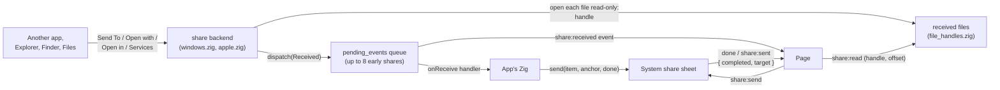
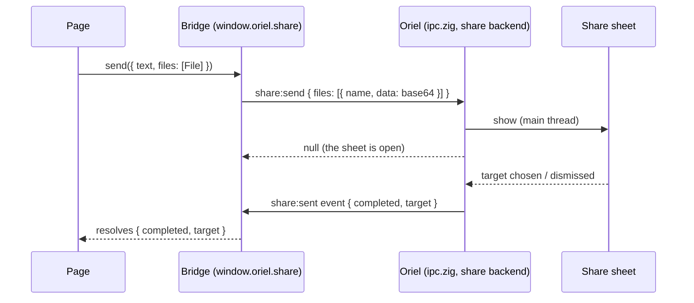

<!-- Generated from site/content/docs/share.smd by tools/docs/gen-md.mjs: edit that file. -->

# Share

Send text, links and files to other apps through the system share sheet, and receive what other apps share with yours.

`oriel.share` connects the app to the system's sharing: it **sends** text,
a URL and files through the platform's share sheet (`send`), and it
**receives** what the user shares with the app from elsewhere: Explorer's
Send To menu, Finder's "Open With", the iOS "Open in" row, the macOS
Services menu (`onReceive` in Zig, the `share:received` event in the page).
Received files reach the app as read-only **handles**, never paths.

Use it to hand content to another app the user picks. To save a file where
the user chooses, use a save dialog ([Dialogs](dialogs.md));
to open a URL in the browser, `window.oriel.openExternal`
([Security](security.md)); for files dragged onto a window,
[Drag and drop](drag-and-drop.md).

## Availability

| Platform | Send | Receive | `capabilities().receive` |
|---|---|---|---|
| Windows | Share sheet (`DataTransferManager`), text, URL, files, several | Send To and "Open with" (installer); packaged (MSIX): also a Share Target (text, URL, files) | `send_to` |
| macOS | `NSSharingServicePicker`, text, URL, files, several | "Open With" and drops on the Dock icon (`CFBundleDocumentTypes`); a Services menu item (`NSServices`) | `open_with` |
| iOS | `UIActivityViewController`, text, URL, files, several | "Open in" from the share sheet and Files (`CFBundleDocumentTypes`), as copies | `open_with` |
| Linux | not yet: `error.Unsupported` | not yet | `null` |
| Android | not yet: `error.Unsupported` | not yet | `null` |

The module is the `share` flag, **on by default** on every platform
(`b.dependency("oriel", .{ .share = false })` leaves it out). Declaring
`.share_target` in `addApp` also turns it on, and is what makes the app
a receiver: without it nothing is declared in the packages and nothing is
received. Sharing needs no permission.

On Linux and Android the module compiles and runs: `send` and `open`
return `error.Unsupported`, `capabilities()` reports nothing, and nothing
arrives. Check `capabilities()` (or `window.oriel.share.capabilities()`)
before showing a Share button.

## Quick start

Receive images and text, and share a note:

```zig
// build.zig
_ = oriel.addApp(b, dep, .{
    .name = "notes",
    .root_source_file = b.path("src/main.zig"),
    .frontend = .{ .static_dir = b.path("web") },
    .share_target = .{ .types = &.{ "image/*", "text/plain" }, .label = "Add to Notes" },
});
```

```js
// web/app.js
window.oriel.listen("share:received", async (share) => {
  if (share.text) addNote(share.text);
  for (const f of share.files) addImage(await window.oriel.share.file(f)); // a File
});

shareButton.hidden = !(await window.oriel.share.capabilities()).send.supported;
shareButton.onclick = async () => {
  const { completed, target } = await window.oriel.share.send({ title: "Note", text: note.value });
  console.log(completed ? `shared with ${target ?? "an app"}` : "dismissed");
};
```

The same from Zig:

```zig
const std = @import("std");
const oriel = @import("oriel");
const app = @import("oriel_app");

pub fn main(init: std.process.Init) !u8 {
    return oriel.main(init, .{ .commands = Commands, .events = Events }, .{
        .app = app.build,
        .window = .{ .title = "Notes", .width = 800, .height = 600 },
        .setup = setup,
    });
}

fn setup() void {
    oriel.share.onReceive(onShare);
}

fn onShare(share: *const oriel.share.Received) void {
    defer oriel.share.release(share.id); // done with its files
    if (share.text) |t| std.log.info("text: {s}", .{t});
    for (share.files) |f| std.log.info("{s} ({s}, {d} bytes)", .{ f.name, f.mime, f.size });
}

const Commands = struct {
    pub fn shareNote(args: struct { text: []const u8 }) !void {
        try oriel.share.send(.{ .title = "Note", .text = args.text }, null, null);
    }
};
const Events = struct {};
```

## How it works



**Receiving.** The build declares the app as a receiver in each package,
from `.share_target`: on Windows the NSIS installer adds a Send To shortcut
running `<exe> --oriel-send-to` and, for `windows_extensions`, "Open with"
entries running `<exe> --oriel-open-with "%1"`; the MSIX package declares
a Share Target and file type associations (`tools/package/msix.zig`); on
macOS and iOS the `Info.plist` gets `CFBundleDocumentTypes` (the MIME types
mapped to UTIs) and, on macOS, an `NSServices` entry titled with the label
(`tools/package/macos.zig`, `tools/package/ios.zig`). When the system then
hands the app something, the backend (`src/modules/share/windows.zig`,
`src/modules/share/apple.zig`) opens each file **read-only, in place**, as
an entry in a handle table (`src/core/file_handles.zig`); files that can't
be opened (gone, a folder) are left out. On Windows a share that launches a
second instance is forwarded to the running one (the single-instance
`WM_COPYDATA` path) and arrives there. On iOS the system's copies in
`Documents/Inbox` are unlinked once open: the descriptor keeps them
readable until the share is released.

The share then goes through `dispatch` (`src/modules/share/common.zig`)
into a queue (`src/core/pending_events.zig`) that hands it, on the main
thread, to two audiences: the Zig handler set with `onReceive`, and the
page's `share:received` listeners. A share that arrives before either is
there (the one that launched the app) waits: up to 8 per audience, then the
oldest is dropped. The page's `listen("share:received", ...)` sends the
`events:ready` built-in, which flushes what waited.



**Sending.** `send` runs on the main thread (it hops there from any
thread) and opens the sheet from the main window: Windows'
`DataTransferManager` through `IDataTransferManagerInterop`, macOS's
`NSSharingServicePicker` (anchored at `anchor`, else the window's center),
iOS's `UIActivityViewController` (a popover from `anchor` on iPad). Files
become paths the sheet can take: a path is passed as is, a received handle
or bytes are written into a temporary folder (`%TEMP%\oriel-share-out\<pid>`
on Windows, `NSTemporaryDirectory()/oriel-share` on Apple), cleared on the
next send. `send` returns once the sheet is showing; `done` runs on the main
thread when it closes. Windows reports no dismissal: when the window is in
front again with no target chosen, Oriel reports `completed: false`.

The page's `oriel.share.send` is the built-in `share:send` command
(`src/core/ipc.zig`): `File`/`Blob` contents travel base64 in the request,
and the result comes back as the `share:sent` event, which the bridge
(`src/core/bridge_js.zig`) turns into the promise's value. The
[native renderer](native-renderer.md) has the same
`window.oriel.share`.

## Examples

### Share a generated file from Zig

```zig
fn exportReport(csv: []const u8) !void {
    try oriel.share.send(.{
        .title = "Report",
        .files = &.{.{ .bytes = .{ .name = "report.csv", .bytes = csv } }},
    }, null, &struct {
        fn done(r: oriel.share.Result) void {
            std.log.info("share sheet closed: completed={}", .{r.completed});
        }
    }.done);
}
```

### Pass a received file on

A received file can be sent again without reading it: give its handle (or
the file object from the event) to `send`.

```js
window.oriel.listen("share:received", async (share) => {
  if (share.files.length === 0) return;
  await window.oriel.share.send({ title: "Forwarded", files: share.files });
});
```

### Read a received file in Zig

```zig
fn onShare(share: *const oriel.share.Received) void {
    defer oriel.share.release(share.id);
    for (share.files) |f| {
        const file = oriel.share.open(f.handle) catch continue; // a new read-only descriptor
        defer file.close(app_io); // the std.Io your app keeps
        importFile(file, f.name, f.mime);
    }
}
```

### Share from the iPad's button

```js
const r = button.getBoundingClientRect();
await window.oriel.share.send({
  url: location.href,
  anchor: { x: Math.round(r.x), y: Math.round(r.y), width: Math.round(r.width), height: Math.round(r.height) },
});
```

## Reference

### `AppOptions.share_target`

```zig
.share_target = .{
    .types = &.{ "image/*", "text/plain" },
    .label = "Add to Notes",
    .windows_extensions = &.{ "png", "jpg" },
},
```

| Field | Type | Default | Meaning |
|---|---|---|---|
| `types` | `[]const []const u8` | `&.{"*/*"}` | MIME types the app accepts. `text/plain` also means text and URL shares. Become `CFBundleDocumentTypes` UTIs on macOS and iOS, the MSIX Share Target's data formats, and the macOS Services item's file types (text and URLs when a type takes text: `text/plain`, `text/*`, `*/*`). |
| `multiple` | `bool` | `false` | Several items at once (meant for Android `ACTION_SEND_MULTIPLE`; Android receiving isn't written yet). |
| `label` | `?[]const u8` | the app's name | The Send To shortcut's name (Windows), the Share Target's description (MSIX), the Services menu item's title (macOS). |
| `windows_extensions` | `[]const []const u8` | `&.{}` | Windows: also register "Open with" for these file extensions. |

Declaring it turns the `share` module on unless the dependency's options
set `.share = false` (then the build warns and the module stays off).
The unpackaged Windows Send To shortcut takes any file, whatever `types`
says.

### Zig: `oriel.share`

```zig
pub const available: bool; // the module is in this build

pub fn onReceive(handler: ?ReceiveHandler) void;
pub fn send(item: Outgoing, anchor: ?Rect, done: ?DoneHandler) SendError!void;
pub fn capabilities() Capabilities;
pub fn open(handle: u32) OpenError!std.Io.File;
pub fn read(handle: u32, offset: u64, len: u64, out: *std.ArrayList(u8)) !void;
pub fn release(id: u32) void;
```

| Declaration | Threading | Meaning |
|---|---|---|
| `onReceive(handler)` | any thread; the handler runs on the main thread | Set (or clear, with `null`) the handler for shares. Shares that came before (up to 8) are handed to it when it is set. The page gets every share too, as `share:received`. |
| `send(item, anchor, done)` | any thread (runs on the main thread) | Open the share sheet. Returns when it shows; `done` runs on the main thread when it closes. `anchor`: where it points from (iPad popover, macOS picker); Windows ignores it. |
| `capabilities()` | any | What this platform receives and sends. |
| `open(handle)` | any | A new read-only descriptor for a received file; the caller closes it. `error.InvalidHandle` once released. `error.Unsupported` on Linux and Android. |
| `read(handle, offset, len, out)` | any | Up to `len` bytes from `offset`, appended to `out` (what the page's `share.file` uses). `error.InvalidHandle` for an unknown handle. |
| `release(id)` | main thread | Let a share go: its files' handles close, and iOS Inbox copies with them. Shares not released stay open until the app exits. |

#### Types

```zig
pub const Received = struct {
    id: u32, // for release
    source: Source,
    text: ?[]const u8 = null,
    subject: ?[]const u8 = null,
    url: ?[]const u8 = null,
    files: []const File = &.{},
};
pub const File = struct { handle: u32, name: []const u8, mime: []const u8, size: u64 };
pub const ReceiveHandler = *const fn (received: *const Received) void; // `received` lives until it returns

pub const Source = enum { share, open_with, service, send_to, extension };

pub const Outgoing = struct {
    title: ?[]const u8 = null,
    text: ?[]const u8 = null,
    url: ?[]const u8 = null,
    files: []const OutFile = &.{},
};
pub const OutFile = union(enum) {
    path: []const u8, // a file on disk
    handle: u32, // a received file
    bytes: struct { name: []const u8, bytes: []const u8 }, // sent as a file with this name
};
pub const Rect = struct { x: c_int, y: c_int, width: c_int, height: c_int }; // App.Rect
pub const Result = struct { completed: bool, target: ?[]const u8 = null };
pub const DoneHandler = *const fn (result: Result) void;

pub const Capabilities = struct { receive: ?Source = null, send: SendCapabilities = .{} };
pub const SendCapabilities = struct {
    supported: bool = false, files: bool = false, text: bool = false, url: bool = false, multiple: bool = false,
};

pub const SendError = error{ Unsupported, Busy, InvalidHandle };
pub const OpenError = error{ InvalidHandle, Unsupported };
```

| `Source` | How the share came |
|---|---|
| `share` | A system share sheet (a packaged Windows app's Share Target) |
| `open_with` | "Open with" / "Open in" (Finder, the Dock icon, iOS Files and share sheet, Windows "Open with") |
| `service` | The macOS Services menu |
| `send_to` | Windows' Send To menu |
| `extension` | A share extension (reserved; no backend yet) |

`File.mime` comes from the OS where it gives one, else from the name's
extension (`application/octet-stream` when unknown). `Result.target` is
the chosen target where the OS reports it: Windows' target application
name, the macOS sharing service's title, the iOS activity type.

| `SendError` | When |
|---|---|
| `Unsupported` | Linux and Android; an empty item (no text, URL or file); no main window; the sheet couldn't be shown. |
| `Busy` | A share sheet is already open. |
| `InvalidHandle` | An `OutFile.handle` that names no received file (any more), or one that changed since it arrived. |

### Page: `window.oriel.share`

```ts
interface ReceivedFile { handle: number; name: string; mime: string; size: number }
interface Received {
  id: number;
  source: "share" | "open_with" | "service" | "send_to" | "extension";
  text: string | null; subject: string | null; url: string | null;
  files: ReceivedFile[];
}

window.oriel.listen("share:received", (share: Received) => void): () => void;
window.oriel.share.file(f: ReceivedFile | number): Promise<File>;
window.oriel.share.send(item?: {
  title?: string; text?: string; url?: string;
  files?: (File | Blob | ReceivedFile | number)[];
  anchor?: { x: number; y: number; width: number; height: number };
}): Promise<{ completed: boolean; target: string | null }>;
window.oriel.share.capabilities(): Promise<{
  receive: "share" | "open_with" | "service" | "send_to" | "extension" | null;
  send: { supported: boolean; files: boolean; text: boolean; url: boolean; multiple: boolean };
}>;
```

- **`share:received`** carries the `Received` as JSON. Listening flushes
  shares that came before (up to 8).
- **`file(f)`** reads a received file through the `share:read` built-in in
  4 MiB chunks (base64), and returns a `File` with its name and type.
  Rejects with `InvalidHandle` once the share was released.
- **`send(item)`** resolves when the sheet closes. `File`/`Blob` contents
  are sent base64; their total is limited to **16 MiB** (`TooLarge`): share
  bigger files from Zig with a path, or pass a received file's handle.
  Rejects with the `SendError` name, or `Unsupported` when the module is off.
- **`capabilities()`** answers `{ receive: null, send: { supported: false } }`
  when the module is off.

The page can't release a share; release it from Zig (`onReceive` sees the
same shares) when the files are no longer needed.

Built-in commands: `share:send` (`{ title, text, url, files: [{ handle } |
{ name, data }], anchor }`, answers `null`, result as the `share:sent`
event), `share:read` (`{ handle, offset = 0, length = 4 MiB }`, at most
16 MiB per call, answers base64), `share:capabilities`.

## Troubleshooting

- **Nothing is received.** Check `.share_target` is declared, and that the
  app was installed from its package: Send To and "Open with" come from the
  NSIS installer or the MSIX package, document types and Services from the
  `.app` bundle's `Info.plist`; a bare executable is never offered.
- **The share arrives in Zig but not in the page.** The page must
  `listen("share:received", ...)`; until it does, shares wait in a queue of 8.
- **`Unsupported` from `send`.** Linux and Android don't send yet; elsewhere
  the item was empty or there was no main window. Check `capabilities()`.
- **`TooLarge` from the page's `send`.** Over 16 MiB of `File`/`Blob` data:
  send from Zig with `.path`.
- **`InvalidHandle`.** The share was released (or the received file changed
  on disk after it arrived).
- Log lines are scoped `share` (`share: a received file can't be opened`).

## Related

- [Deep links](deep-links.md): URLs of the app's own schemes, another way in.
- [Drag and drop](drag-and-drop.md): files dropped on a window.
- [Files](files.md): file handles and reading files from the page.
- [Packaging](packaging.md): the installers and bundles that declare the share target.
