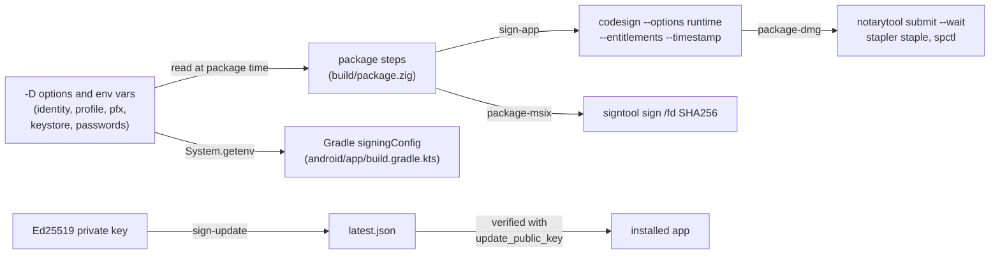

<!-- Generated from site/content/docs/signing.smd by tools/docs/gen-md.mjs: edit that file. -->

# Signing

Code signing for every platform: Authenticode and MSIX on Windows, Developer ID, notarization and self-signed certificates on macOS, keystores on Android, and the Ed25519 keys that sign your updates.

An unsigned app works, but each platform makes users pay for it: Windows
SmartScreen warns, macOS Gatekeeper refuses a downloaded app, Android won't
install an unsigned APK and Google Play won't take an unsigned bundle. This
page covers what Oriel signs for you and what you sign yourself, per
platform, plus the separate Ed25519 key that signs your update manifests.

Secrets never go in `build.zig`: signing identities, keystores and
passwords come from `-D` options and environment variables at package time,
so the same `build.zig` builds unsigned locally and signed in CI.

## Availability

| Platform | What Oriel does | How you turn it on |
|---|---|---|
| Windows `setup.exe`, `.exe` | Nothing: sign after packaging | `signtool` or `osslsigncode` ([below](#windows)) |
| Windows `.msix` | Signs with `signtool` | `-Dmsix-pfx` or `-Dmsix-cert-sha1` |
| macOS `.app`, `.dmg` | Ad-hoc signs every build; signs with your identity, hardened runtime and entitlements, notarizes and staples | `-Dmacos-sign-identity`, `-Dmacos-notarize-profile` |
| macOS, no Apple account | Makes and installs a self-signed certificate | `oriel signing create` / `import` |
| Android APK, AAB | Gradle signs release builds | `ORIEL_ANDROID_KEYSTORE` and three more variables |
| iOS `.app`, `.ipa` | Nothing (simulator builds are signed ad hoc on a Mac) | `xtool install`, or `codesign` with a distribution certificate |
| Updates (every desktop OS) | Signs manifests with Ed25519, verifies them in the app | `zig build keygen`, `sign-update`; `AppOptions.update_public_key` |

## Quick start

macOS, distributed outside the App Store:

```sh
# once: notarization credentials into the keychain
xcrun notarytool store-credentials oriel-notary --apple-id you@example.com --team-id AB12CD34EF

oriel package -Dmacos-sign-identity="Developer ID Application: Your Name (AB12CD34EF)" \
              -Dmacos-notarize-profile=oriel-notary
spctl -a -vv zig-out/package/MyApp.app
```

Android release:

```sh
keytool -genkeypair -v -keystore release.jks -alias app -keyalg RSA -keysize 4096 -validity 10000
export ORIEL_ANDROID_KEYSTORE=$PWD/release.jks ORIEL_ANDROID_KEY_ALIAS=app
export ORIEL_ANDROID_KEYSTORE_PASSWORD=... ORIEL_ANDROID_KEY_PASSWORD=...
oriel android build --apk --aab
```

Windows installer, on Linux:

```sh
oriel package -Dtarget=x86_64-windows
osslsigncode sign -pkcs12 cert.pfx -pass "$CERT_PASS" -n "My App" -i https://example.com \
  -t http://timestamp.digicert.com \
  -in zig-out/package/my-app-1.0.0-setup.exe -out my-app-1.0.0-setup.exe
```

## How it works



**macOS.** Every bundle is signed ad hoc (`codesign --sign -`) when it is
built on a Mac: that is enough to run on that Mac and to have notifications
and permission prompts attributed to the app. When a signing option is
given, `package-app` signs a *copy* of the bundle with `package_tool
sign-app` (`tools/package/sign_macos.zig`): nested code first, inside-out
(the `.package.contents` executables and Mach-O libraries in
`Contents/MacOS`, executables with the app's entitlements, libraries
without), then the bundle, each with the hardened runtime, the generated
`<Name>.entitlements` and a secure timestamp, then `codesign --verify
--strict`. No `--deep`. `package-dmg` builds the disk image from the signed
copy and, with a notarization profile, signs it, submits it to
`xcrun notarytool submit --keychain-profile <profile> --wait`, staples the
ticket and checks it with `spctl`. `zig build`'s `zig-out/<Name>.app` stays
ad hoc (fast, offline). The keychain isn't an input Zig's cache can see,
so signing reruns on every package build.

**Windows.** The MSIX step signs the package with `signtool` after writing
it. The NSIS installer and the executable inside it are not signed by
Oriel: the installer is built from the executable in Zig's cache in the
same step, so you sign the finished `setup.exe` (see
[Troubleshooting](#troubleshooting) for the executable).

**Android.** The generated Gradle project
(`android/app/build.gradle.kts`) reads the keystore from the environment
when Gradle runs; `oriel android build` passes the environment through.
Without `ORIEL_ANDROID_KEYSTORE` the release build is unsigned and the CLI
says so.

**Updates** are signed with your own Ed25519 key, independently of code
signing: the app embeds the public key at build time and refuses any
manifest it doesn't verify ([Updater](updater.md)).

## Examples

### macOS without a Developer ID: keep permissions across updates

Ad-hoc signed, macOS identifies an app by the hash of that exact build, so
every update looks like a new app and the user's grants (Accessibility,
Microphone, Screen Recording) stop applying. Signed with the same
certificate every release, even a self-signed one, the app's designated
requirement names the certificate and the grants survive. Gatekeeper still
asks once on first launch; only notarization removes that.

```sh
oriel signing create --name "My App"
# ~/.config/oriel/keys/my-app-codesign.p12 and .p12.password (0600); prints the SHA-1
oriel signing import ~/.config/oriel/keys/my-app-codesign.p12    # on the Mac
oriel package -Dmacos-sign-identity=<SHA-1>
codesign -d -r- zig-out/package/MyApp.app    # the requirement names the certificate
```

Keep the certificate and reuse it: a new certificate is a new identity.

### macOS in CI (GitHub Actions)

```sh
base64 < ~/.config/oriel/keys/my-app-codesign.p12 | gh secret set MACOS_CERT_P12
gh secret set MACOS_CERT_PASSWORD < ~/.config/oriel/keys/my-app-codesign.p12.password
```

```sh
# in the macOS job
printf '%s' "$MACOS_CERT_P12" | base64 --decode > "$RUNNER_TEMP/cert.p12"
oriel signing import "$RUNNER_TEMP/cert.p12" --password-env MACOS_CERT_PASSWORD
rm -f "$RUNNER_TEMP/cert.p12"
oriel package -Dmacos-sign-identity="$MACOS_SIGN_IDENTITY"
security delete-keychain oriel-signing.keychain-db   # in an always() step
```

GhostPen's release workflow does exactly this.

### Try the hardened runtime locally

```sh
oriel package -Dmacos-sign-dry-run
```

Prints the `codesign`, `notarytool`, `stapler` and `spctl` commands without
running them, and signs the package ad hoc with the hardened runtime and
the entitlements, so it runs as the signed app would (a missing
entitlement shows up now, not after notarization).

### Windows Authenticode on Windows

```powershell
signtool sign /fd SHA256 /tr http://timestamp.digicert.com /td SHA256 /f cert.pfx /p $env:CERT_PASS zig-out\package\my-app-1.0.0-setup.exe
signtool verify /pa zig-out\package\my-app-1.0.0-setup.exe
```

### Signed MSIX from a certificate in the store

```zig
.package = .{ .formats = &.{ .nsis, .msix }, .msix = .{ .publisher = "CN=Example Ltd, O=Example Ltd, C=US" } },
```

```powershell
oriel package -Dmsix-cert-sha1=0123456789ABCDEF0123456789ABCDEF01234567 -Dmsix-timestamp=http://timestamp.digicert.com
```

## Reference

### Windows Authenticode

Sign `zig-out/package/<exe>-<version>-setup.exe` after `oriel package`:

| Host | Tool | Command |
|---|---|---|
| Linux, macOS | `osslsigncode` (`pacman -S osslsigncode`, `apt install osslsigncode`) | `osslsigncode sign -pkcs12 cert.pfx -pass ... -n <name> -i <url> -t <timestamp URL> -in <file> -out <signed>`; `osslsigncode verify <file>` |
| Windows | `signtool` (Windows SDK) | `signtool sign /fd SHA256 /tr <timestamp URL> /td SHA256 /f cert.pfx /p ... <file>`; `signtool verify /pa <file>` |

Certificates: an OV (organization validated) certificate builds
SmartScreen reputation over downloads; an EV certificate is trusted from
the first run and keeps its key in a hardware token or cloud HSM. Always
timestamp, so the signature outlives the certificate. The standalone
executable in `zig-out/bin` (for a portable download, or the updater's
`raw` payload) is signed the same way.

### MSIX

| Option | Environment | Meaning |
|---|---|---|
| `-Dmsix-pfx=<file>` | `ORIEL_MSIX_PFX` | Sign with this `.pfx`; its password from `ORIEL_MSIX_PFX_PASSWORD`. |
| `-Dmsix-cert-sha1=<thumbprint>` | `ORIEL_MSIX_CERT_SHA1` | Sign with this certificate from the user's store. |
| `-Dmsix-timestamp=<url>` | | RFC 3161 timestamp server. |
| | `ORIEL_SIGNTOOL` | The `signtool` to run (default: `PATH`, then the newest Windows Kits 10). |

`package.msix.publisher` must equal the certificate's Subject exactly, or
Windows refuses the package. Without a pfx or thumbprint the package is
unsigned and installs only with `Add-AppxPackage -AllowUnsigned`.

### Apple: codesign and notarization

| Option | Environment | Meaning |
|---|---|---|
| `-Dmacos-sign-identity=<id>` | `ORIEL_MACOS_SIGN_IDENTITY` | A keychain identity: `"Developer ID Application: Name (TEAMID)"`, a certificate's SHA-1, or `-` (ad hoc, with the hardened runtime and entitlements: for local tests only). `security find-identity -v -p codesigning` lists them. |
| `-Dmacos-notarize-profile=<name>` | `ORIEL_MACOS_NOTARIZE_PROFILE` | A profile stored with `xcrun notarytool store-credentials` (Apple ID with an app-specific password, or an API key). The credentials stay in the keychain; the build passes only the name. Needs a real identity. |
| `-Dmacos-sign-dry-run` | | Print the commands; sign ad hoc with the hardened runtime and entitlements. Needs no identity or profile. |

The options are declared for every target (a CI script may pass them to
all) and used only for macOS. Empty environment values count as unset.
Identities and profiles are passed as plain arguments, never through a
shell; a value starting with `-` other than the ad-hoc `-` is refused.

What is signed:

- `zig-out/package/<Name>.app`: hardened runtime, `<Name>.entitlements`,
  secure timestamp, verified with `codesign --verify --strict`.
- The `.dmg`: only when it is also notarized. macOS 15 refuses to open a
  signed disk image it can't verify (self-signed, or not notarized), which
  would add a second Gatekeeper prompt; unsigned, only the app inside is
  assessed.
- A rejected notarization prints the `xcrun notarytool log` command with
  the submission id.

`<Name>.entitlements` holds the usage entitlements for the declared
permissions (`com.apple.security.device.audio-input` for `microphone`, ...)
plus `AppOptions.macos.entitlements` ([Permissions](permissions.md)).
Oriel doesn't generate a sandbox entitlement; a sandboxed app's helper
executables would need `com.apple.security.inherit`.

The ad-hoc `zig-out/<Name>.app` and the signed package have different
signatures, so macOS keeps separate permission grants for each.

### `oriel signing`

A self-signed code-signing certificate for macOS apps.

| Command | Runs on | What it does |
|---|---|---|
| `oriel signing create [--name N] [--out DIR] [--days 3650] [--force]` | any OS, needs `openssl` | An RSA-3072 certificate with the code-signing extended key usage, CN = `--name` (default: `.name` from `./build.zig`). Writes `<DIR>/<name>-codesign.p12` and `<...>.p12.password` (a random password), both 0600, in `~/.config/oriel/keys` by default (`$XDG_CONFIG_HOME/oriel/keys`); prints the SHA-1. The `.p12` uses SHA1-3DES and a SHA-1 MAC, which `security import` reads. Refuses to overwrite without `--force`. The private key is never printed. |
| `oriel signing import <file.p12> [--password-env VAR] [--keychain NAME]` | macOS | Imports into a new keychain `oriel-signing.keychain-db` (recreated each time) with a random throwaway password, unlocked without a timeout, `codesign` allowed without prompts (`set-key-partition-list`), first in the user's search list. `--keychain login` imports into yours; another name creates that keychain (it must not exist). The password comes from `<file>.password` or `$VAR`. |
| `oriel signing show [<file.p12>]` | any OS | Name, SHA-1 and expiry of one certificate, or of every `*-codesign.p12` in the keys directory. |

The certificate is untrusted: `security find-identity -v` doesn't list it
(without `-v` it shows `CSSMERR_TP_NOT_TRUSTED`), but `codesign` signs with
it by SHA-1 or name, and Apple's timestamp server accepts it.
`security delete-keychain oriel-signing.keychain-db` removes the imported
keychain.

### Android

| Variable | Meaning |
|---|---|
| `ORIEL_ANDROID_KEYSTORE` | Path to the keystore (`.jks` or `.keystore`). When unset, release builds are unsigned. |
| `ORIEL_ANDROID_KEYSTORE_PASSWORD` | The keystore's password. |
| `ORIEL_ANDROID_KEY_ALIAS` | The key's alias. |
| `ORIEL_ANDROID_KEY_PASSWORD` | The key's password. |

Read by Gradle (`signingConfigs.release`) for `assembleRelease` and
`bundleRelease`. For Google Play, the AAB is signed with your upload key
and Play re-signs it with the app signing key; keep the upload keystore,
since every update must be signed with it. Debug builds (`oriel android
dev`) use Android's debug key.

### iOS

`zig build` and `ios-ipa` produce unsigned bundles; simulator bundles built
on a Mac are signed ad hoc, as Xcode does, so the signature names the bundle
id. On a device, `oriel ios install` / `xtool install` signs the bundle with
your Apple ID's development certificate. For the App Store or TestFlight,
sign the `.app` with a distribution certificate and provisioning profile
(`codesign`, or xtool) before zipping it, and upload the `.ipa`
([iOS](ios.md)).

### Update signing keys

Update manifests are signed with an Ed25519 key you generate:

```sh
zig build keygen -- --name my-app       # ~/.config/oriel/keys/my-app.key (0600) and my-app.pub
```

Put the public key (44 base64 characters) in `AppOptions.update_public_key`
and keep the private key out of the repository (a CI secret). Signing
manifests, their format and the app side are on
[Updater](updater.md#update-tool).

## Troubleshooting

- **SmartScreen warns about the installer**: sign `setup.exe`; with an OV
  certificate the warning fades as the file gains reputation.
- **The executable inside the installer is unsigned**: `oriel package`
  signs neither; sign the installer. If you need a signed inner
  executable, sign `zig-out/bin/<exe>.exe` and build the installer from it
  outside `oriel package` (Oriel has no hook for this yet).
- **`-Dmacos-notarize-profile needs -Dmacos-sign-identity="Developer ID Application: ..."`**:
  notarization takes a Developer ID signature; add the identity, or
  `-Dmacos-sign-dry-run` to see the commands.
- **`MAC verification failed` on `security import`**: the `.p12` was made
  with OpenSSL 3's defaults; make it with `oriel signing create`.
- **The user is asked for Accessibility or Microphone again after an
  update**: the app is ad-hoc signed; sign every release with the same
  certificate.
- **`note: $ORIEL_ANDROID_KEYSTORE is not set, so the release APK is unsigned`**:
  export the four variables before `oriel android build`.
- **MSIX: "publisher doesn't match"**: set `package.msix.publisher` to the
  certificate's Subject exactly.

## Related

- [Packaging](packaging.md): the formats these signatures go on.
- [Updater](updater.md): Ed25519-signed manifests and in-app updates.
- [Permissions](permissions.md): the entitlements and usage descriptions signing carries.
- [Android](android.md) and [iOS](ios.md): the mobile release workflows.
