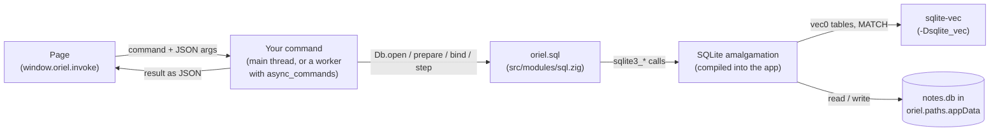

<!-- Generated from site/content/docs/sql.smd by tools/docs/gen-md.mjs: edit that file. -->

# SQL

SQLite compiled into the app, with sqlite-vec for nearest-neighbour vector search, on every platform.

`oriel.sql` is SQLite, built from its amalgamation into the app: a database
file, prepared statements, and the whole C API underneath. With
`-Dsqlite_vec`, every connection also has
[sqlite-vec](https://github.com/asg017/sqlite-vec)'s `vec0` virtual tables
for k-nearest-neighbour search over embeddings (`oriel.sqlite_vec`).

Use it for anything relational or larger than a handful of settings: notes,
a pantry, a history, a search index. For a few key/value settings use the
[store](store.md); for files the user picks, see
[Files](files.md).

`oriel.sql` is a Zig API. The page reaches it through your own
[commands](commands.md): Oriel exposes no SQL to the page,
so a page can't run arbitrary queries against your database.

## Availability

| Platform | `oriel.sql` | `oriel.sqlite_vec` |
|---|---|---|
| Linux | yes | yes, with `-Dsqlite_vec` |
| Windows | yes | yes, with `-Dsqlite_vec` |
| macOS | yes | yes, with `-Dsqlite_vec` |
| Android | yes | yes, with `-Dsqlite_vec` |
| iOS | yes | yes, with `-Dsqlite_vec` |

| Flag | Default | Meaning |
|---|---|---|
| `sql` | on | SQLite (`oriel.sql`). `.sql = false` on the oriel dependency leaves it out; SQLite isn't even downloaded then (a lazy dependency). |
| `sqlite_vec` | off | sqlite-vec, registered on every connection. Needs `sql`: `-Dsqlite_vec` with `-Dsql=false` stops the build (`sqlite_vec requires sql to be enabled`). |

No permission is needed: the database is a file in a directory the app
owns. The page sees the resolved flags as `window.oriel.features.sql` and
`window.oriel.features.sqliteVec`.

## Quick start

```zig
// build.zig: sql is on by default; this only adds vector search
const dep = b.dependency("oriel", .{ .target = target, .optimize = optimize, .sqlite_vec = true });
```

```zig
// src/main.zig
const std = @import("std");
const oriel = @import("oriel");
const app = @import("oriel_app");

pub const Commands = struct {
    pub fn add_note(gpa: std.mem.Allocator, args: struct { text: []const u8 }) !i64 {
        const dir = try oriel.paths.appData(gpa, .{ .name = app.build.id });
        defer gpa.free(dir);
        const path = try std.fs.path.joinZ(gpa, &.{ dir, "notes.db" });
        defer gpa.free(path);

        const db = try oriel.sql.Db.open(path);
        defer db.close();
        try db.exec("CREATE TABLE IF NOT EXISTS notes (id INTEGER PRIMARY KEY, text TEXT NOT NULL)");

        const insert = try db.prepare("INSERT INTO notes (text) VALUES (?1)");
        defer insert.finalize();
        try insert.bindText(1, args.text);
        _ = try insert.step();
        return db.lastInsertRowId();
    }
};

pub const Events = struct {};

pub fn main(init: std.process.Init) !u8 {
    return oriel.main(init, .{ .commands = Commands, .events = Events }, .{
        .app = app.build,
        .window = .{ .title = "Notes", .width = 800, .height = 600 },
    });
}
```

```js
const id = await window.oriel.invoke("add_note", { text: "Buy milk" });
```

A real app opens the database once and keeps it (see
[Keep one connection](#example-one-connection)).

## How it works



**Build.** `build.zig` adds SQLite's amalgamation (`sqlite3.c`, the
`sqlite` entry of `build.zig.zon`, SQLite 3.53.4) to the `oriel` module
with `-DSQLITE_THREADSAFE=1 -DSQLITE_DQS=0 -DSQLITE_OMIT_DEPRECATED`. Only
`sqlite3.h` and `sqlite3ext.h` go on the include path. With `-Dsqlite_vec`
it also compiles `sqlite-vec.c` (v0.1.9) with `-DSQLITE_CORE
-DSQLITE_VEC_STATIC`: the extension is linked in statically, not loaded
from a file. Nothing is a system library, so the same SQLite runs on
every platform, Android and iOS included.

**Opening.** `Db.open` (`src/modules/sql.zig`) calls `sqlite3_open`, which
creates the file if it doesn't exist. When the build has `sqlite_vec`, it
then calls `sqlite3_vec_init` on the new connection, so `vec0`,
`vec_version()` and sqlite-vec's other functions exist on every connection
without a `load_extension`.

**Threads.** `SQLITE_THREADSAFE=1` is SQLite's serialized mode: a
connection may be used from any thread, and SQLite serializes the calls.
A statement's bind/step/column sequence is still one conversation; don't
interleave two threads on the same statement, and keep transactions on one
thread. Sync commands run on the main thread, so a long query there
freezes the window: list such commands in `async_commands` (they run on
the worker pool) and guard the shared connection with a mutex, as the
showcase does.

**Where the file goes.** A relative path is relative to the process's
current directory, which on Android and iOS isn't writable and on the
desktop is wherever the app was started. Put databases in
[`oriel.paths.appData`](paths.md): private to the app, kept
across updates, removed with the app on phones. `":memory:"` opens a
database that lives as long as the connection.

**What the wrapper covers.** `Db` and `Stmt` cover the common path (open,
exec, prepare, bind text/int/blob, step, read int/float/text). Everything
else is SQLite's own C API through `oriel.sql.c`, on the same handles:
`sqlite3_errmsg(db.handle)`, `sqlite3_reset(stmt.handle)`,
`sqlite3_bind_double`, `sqlite3_column_blob`, `sqlite3_busy_timeout` and
so on.

## Examples

### Keep one connection

The showcase's Notes tab (`examples/showcase/src/notes.zig`) opens
`notes.db` once, in the app's data directory, and serializes the commands
that use it:

```zig
const std = @import("std");
const oriel = @import("oriel");
const app = @import("oriel_app");
const sql = oriel.sql;

var io: std.Io = undefined; // set in main from init.io
var db: ?sql.Db = null;
var mutex: std.Io.Mutex = .init;

fn database() !sql.Db {
    if (db) |d| return d;
    const gpa = std.heap.smp_allocator;
    const dir = try oriel.paths.appData(gpa, .{ .name = app.build.id });
    defer gpa.free(dir);
    const path = try std.fs.path.joinZ(gpa, &.{ dir, "notes.db" });
    defer gpa.free(path);
    const d = try sql.Db.open(path);
    errdefer d.close();
    try d.exec(
        \\CREATE TABLE IF NOT EXISTS notes (
        \\  id INTEGER PRIMARY KEY,
        \\  text TEXT NOT NULL,
        \\  created_at TEXT NOT NULL DEFAULT (datetime('now', 'localtime'))
        \\);
    );
    db = d;
    return d;
}

pub const Note = struct { id: i64, text: []const u8, created_at: []const u8 };

pub const Commands = struct {
    pub const async_commands = .{"notes_list"};

    pub fn notes_list(gpa: std.mem.Allocator) ![]Note {
        mutex.lockUncancelable(io);
        defer mutex.unlock(io);
        const stmt = try (try database()).prepare("SELECT id, text, created_at FROM notes ORDER BY id DESC");
        defer stmt.finalize();
        var notes: std.ArrayList(Note) = .empty;
        while (try stmt.step()) {
            try notes.append(gpa, .{
                .id = stmt.int(0),
                .text = try stmt.text(gpa, 1), // copied: SQLite's buffer dies on the next step
                .created_at = try stmt.text(gpa, 2),
            });
        }
        return notes.toOwnedSlice(gpa);
    }
};
```

```js
const notes = await window.oriel.invoke("notes_list"); // [{ id, text, created_at }, ...]
```

### Report SQLite's message to the page

The wrapper's errors (`error.SqlitePrepare`, `error.SqliteStep`...) carry no
text; SQLite's is one call away:

```zig
pub fn run_query(gpa: std.mem.Allocator, args: struct { sql: []const u8 }) !void {
    const d = try database();
    const q = try gpa.dupeZ(u8, args.sql);
    defer gpa.free(q);
    d.exec(q) catch return oriel.ipc.fail("{s}", .{std.mem.span(oriel.sql.c.sqlite3_errmsg(d.handle))});
}
```

### Reuse a prepared statement

```zig
const insert = try db.prepare("INSERT INTO items (name) VALUES (?1)");
defer insert.finalize();
try db.exec("BEGIN");
for (names) |name| {
    try insert.bindText(1, name);
    _ = try insert.step();
    _ = oriel.sql.c.sqlite3_reset(insert.handle); // ready for the next row
}
try db.exec("COMMIT");
```

### Vector search with sqlite-vec

Embeddings go in a `vec0` table as raw little-endian `f32` blobs
(`oriel.sqlite_vec.asBytes`); a `MATCH` query returns the nearest rows by
`distance`:

```zig
const vec = oriel.sqlite_vec;

try db.exec("CREATE VIRTUAL TABLE IF NOT EXISTS items USING vec0(embedding float[4])");

const insert = try db.prepare("INSERT INTO items (rowid, embedding) VALUES (?1, ?2)");
defer insert.finalize();
const embedding = [_]f32{ 1.0, 0.0, 0.0, 0.0 };
try insert.bindInt(1, 42);
try insert.bindBlob(2, vec.asBytes(&embedding));
_ = try insert.step();

const knn = try db.prepare("SELECT rowid, distance FROM items WHERE embedding MATCH ?1 ORDER BY distance LIMIT 5");
defer knn.finalize();
const query = [_]f32{ 0.9, 0.1, 0.0, 0.0 };
try knn.bindBlob(1, vec.asBytes(&query));
while (try knn.step()) {
    std.log.info("id={d} distance={d}", .{ knn.int(0), knn.float(1) });
}
```

The vectors' dimension must match the table's (`float[4]` here). JSON
text (`'[0.9, 0.1, 0, 0]'`) works too, through `bindText`. sqlite-vec's
own documentation covers the rest of its SQL (other element types,
metadata columns, distance metrics).

## Reference

### `oriel.sql`

```zig
pub const available: bool; // the sql flag, resolved for this target
pub const c = @cImport(@cInclude("sqlite3.h")); // SQLite's C API

pub const Db = struct {
    handle: *c.sqlite3,

    pub fn open(path: [:0]const u8) !Db;
    pub fn close(self: Db) void;
    pub fn exec(self: Db, sql: [:0]const u8) !void;
    pub fn prepare(self: Db, sql: [:0]const u8) !Stmt;
    pub fn lastInsertRowId(self: Db) i64;
    pub fn scalarInt(self: Db, sql: [:0]const u8) !i64;
};

pub const Stmt = struct {
    handle: *c.sqlite3_stmt,

    pub fn finalize(self: Stmt) void;
    pub fn bindText(self: Stmt, index: c_int, value: []const u8) !void;
    pub fn bindInt(self: Stmt, index: c_int, value: i64) !void;
    pub fn bindBlob(self: Stmt, index: c_int, value: []const u8) !void;
    pub fn step(self: Stmt) !bool;
    pub fn int(self: Stmt, col: c_int) i64;
    pub fn float(self: Stmt, col: c_int) f64;
    pub fn text(self: Stmt, gpa: std.mem.Allocator, col: c_int) ![]u8;
};

pub fn check(gpa: std.mem.Allocator, ctx: oriel.CheckContext) !oriel.Check;
```

| Declaration | Behavior | Errors |
|---|---|---|
| `Db.open(path)` | `sqlite3_open`: opens or creates the file (UTF-8 path; `":memory:"` for an in-memory database). Registers sqlite-vec when the build has it. | `error.SqliteOpen`, `error.SqliteVecInit` (the connection is closed in both cases) |
| `Db.close()` | `sqlite3_close_v2`: statements still open keep the connection alive until they're finalized. | none |
| `Db.exec(sql)` | `sqlite3_exec`: runs every statement in `sql`, no results. | `error.SqliteExec` |
| `Db.prepare(sql)` | `sqlite3_prepare_v2` of the first statement in `sql`. | `error.SqlitePrepare`; `error.SqliteEmptyStatement` for empty, blank or comment-only SQL |
| `Db.lastInsertRowId()` | `sqlite3_last_insert_rowid`: the rowid of the connection's last successful `INSERT`. | none |
| `Db.scalarInt(sql)` | Prepares, steps once and returns column 0 of the first row as `i64`. | `error.SqlitePrepare`, `error.SqliteEmptyStatement`, `error.SqliteNoRow` |
| `Stmt.finalize()` | `sqlite3_finalize`. Every prepared statement must be finalized. | none |
| `Stmt.bindText(i, v)`, `bindInt(i, v)`, `bindBlob(i, v)` | Bind parameter `i` (**1-based**: `?1`, or the n-th `?`). Text and blobs are copied (`SQLITE_TRANSIENT`), so `v` may be freed right after. | `error.SqliteBind` |
| `Stmt.step()` | `sqlite3_step`: `true` with a row ready, `false` when done. | `error.SqliteStep` (constraint violations, `SQLITE_BUSY`, ...) |
| `Stmt.int(col)`, `float(col)` | Column `col` (**0-based**) of the current row, converted by SQLite. NULL reads as 0. | none |
| `Stmt.text(gpa, col)` | Column `col` as text, copied into `gpa` (caller frees); NULL gives `""`. | `error.OutOfMemory` |
| `check(gpa, ctx)` | The module's smoke check (an in-memory table), as run by `oriel.checkAll`. | |

**Compile options.** `SQLITE_THREADSAFE=1` (serialized),
`SQLITE_DQS=0` (double-quoted strings are identifiers only: write string
literals with single quotes), `SQLITE_OMIT_DEPRECATED`. Everything else is
SQLite's default: the JSON functions are built in; FTS5 and R*Tree aren't,
since they need `SQLITE_ENABLE_FTS5` / `SQLITE_ENABLE_RTREE`.

**What isn't wrapped** goes through `oriel.sql.c` with `db.handle` /
`stmt.handle`: error messages (`sqlite3_errmsg`), `sqlite3_reset`,
`sqlite3_clear_bindings`, NULL and double binds, blob columns, column
types and names, busy timeouts, backups, `sqlite3_changes`.

### `oriel.sqlite_vec`

```zig
pub const available: bool; // the sqlite_vec flag, resolved for this target
pub const c = @cImport({ @cInclude("sqlite3.h"); @cInclude("sqlite-vec.h"); });

pub fn version() []const u8; // "v0.1.9"
pub fn asBytes(vec: []const f32) []const u8;
pub fn check(gpa: std.mem.Allocator, ctx: oriel.CheckContext) !oriel.Check;
```

| Declaration | Behavior |
|---|---|
| `version()` | The compiled-in sqlite-vec version (`SQLITE_VEC_VERSION`). SQL's `vec_version()` returns the same. |
| `asBytes(vec)` | The `f32` slice's memory as bytes (no copy), the blob format `vec0` `float[N]` columns take. Valid as long as `vec`. |
| `check(gpa, ctx)` | Smoke check: `vec_version()` and a KNN query on an in-memory `vec0` table. |

There is nothing to call to turn sqlite-vec on: `oriel.sql.Db.open`
registers it on every connection when the flag is on.

### Unavailable builds

With `.sql = false` (or `sqlite_vec` off), `oriel.sql.available` (or
`oriel.sqlite_vec.available`) is `false` and every other declaration is a
compile error naming the flag. Code shared between builds guards with
`if (oriel.sql.available)`.

## Troubleshooting

- **`error.SqliteOpen` on Android or iOS.** The path is relative, or in a
  directory that doesn't exist. Use `oriel.paths.appData` (it creates the
  directory).
- **`error.SqlitePrepare` with no clue why.** Read
  `oriel.sql.c.sqlite3_errmsg(db.handle)` right after the failure. A common
  one: `no such column: "x"` from a double-quoted string literal
  (`SQLITE_DQS=0`); use `'x'`.
- **`no such module: vec0`.** The build doesn't have `sqlite_vec`: pass
  `.sqlite_vec = true` on the oriel dependency.
- **`sqlite_vec requires sql to be enabled`** at build time: drop
  `.sql = false`.
- **The window freezes during a query.** The command is sync, so it runs
  on the main thread: add it to `async_commands`.
- **Garbage text in results.** `Stmt.text` copies; reading
  `sqlite3_column_text` through `oriel.sql.c` yourself returns a pointer
  that the next `step` invalidates.

## Related

- [Paths](paths.md): where the database file belongs.
- [Store](store.md): small key/value settings, no SQL.
- [Commands](commands.md): how the page reaches your queries, and `async_commands`.
- [Local AI](local-ai.md): on-device models whose embeddings sqlite-vec can index.
- [Modules](modules.md): every build flag.
