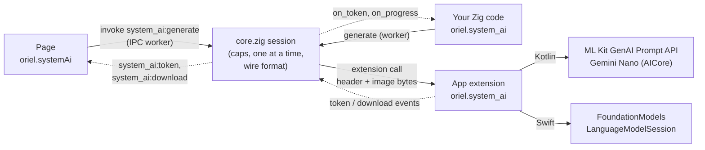

<!-- Generated from site/content/docs/system-ai.smd by tools/docs/gen-md.mjs: edit that file. -->

# System AI

The phone's own language model through oriel.system_ai: Gemini Nano on Android, Apple Foundation Models on iOS 26+, with nothing for the app to download or ship.

`oriel.system_ai` asks the language model the operating system already has:
Gemini Nano through ML Kit's GenAI Prompt API (AICore) on Android, Apple
Foundation Models (Apple Intelligence) on iOS 26 and later. The app ships
no model and downloads nothing of its own; the reply streams to Zig and to
the page. The same API is in Zig (`oriel.system_ai`) and in the page
(`oriel.systemAi`).

Whether a phone has such a model is a run-time fact: most Android phones
have no Gemini Nano, and iOS needs 26 with Apple Intelligence turned on.
Check `status()` and fall back to [Chat](chat.md) (llama.cpp,
everywhere) when it says `unavailable`.

## Availability

| Platform | Model | Images | Streaming | Context | Needs |
|---|---|---|---|---|---|
| Android | Gemini Nano (ML Kit `com.google.mlkit:genai-prompt:1.0.0-beta4`) | 1 per request | yes | the model's token limit | a phone with AICore and Gemini Nano (a Pixel 9, recent Galaxy S...) |
| iOS | Apple Foundation Models | no (text only for now) | yes | 4096 tokens | iOS 26 with Apple Intelligence on, on an eligible device; built with the iOS 26 SDK (Xcode 26) |
| Linux, Windows, macOS | none | | | | `oriel.system_ai.available` is false |

- **Build:** `.system_ai = true` (off by default). On Android it adds the ML
  Kit dependency and Oriel's Kotlin backend; on iOS Oriel's Swift backend,
  with `FoundationModels` weak-linked so the app still runs before iOS 26.
  The Swift backend **raises the app's minimum to iOS 18** (an explicit lower
  target is a build error). Built with an older SDK, the backend compiles
  but always reports `unavailable`.
- **Permissions:** none.
- **Desktop:** asked for on Linux, Windows or macOS, the flag resolves to
  off, `available` is false, and code under `if (oriel.system_ai.available)`
  isn't compiled. The page's commands fail with "oriel.systemAi isn't in this
  build (-Dsystem_ai, Android and iOS)".

## Quick start

`build.zig`:

```zig
const dep = b.dependency("oriel", .{
    .target = target,
    .optimize = optimize,
    .system_ai = true,
});
```

The page needs nothing more: `oriel.systemAi` is in the bridge.

```js
const ai = window.oriel.systemAi;
if (window.oriel.features.systemAi) {
  let st = await ai.status();
  if (st.state === "downloadable") st = await ai.download((p) => console.log(p.state, p.downloaded, p.total));
  if (st.state === "available") {
    const reply = await ai.generate({ prompt: "Name three herbs" }, (piece) => { out.textContent += piece; });
  } else {
    console.log(st.state, st.reason); // why, for people
  }
}
```

From Zig, on a worker thread (an async command or `oriel.App.spawn`):

```zig
const std = @import("std");
const oriel = @import("oriel");

fn ask(arena: std.mem.Allocator) !?[]const u8 {
    if (!oriel.system_ai.available) return null;
    const st = oriel.system_ai.status();
    if (st.state != .available) {
        std.log.info("system AI: {s}: {s}", .{ @tagName(st.state), st.reason() });
        return null;
    }
    return try oriel.system_ai.generate(arena, .{
        .system = "Answer in one sentence.",
        .prompt = "Name three herbs",
    }, null); // the page gets system_ai:token events either way
}
```

## How it works



The backends are Oriel's own [app extension](extensions.md)
named `oriel.system_ai` (names starting with `oriel.` are reserved for
Oriel), built only with `-Dsystem_ai`: `src/modules/system_ai/OrielSystemAi.kt`
on Android and `src/modules/system_ai/SystemAi.swift` on iOS. The extension
has two workers, so `status` and `capabilities` answer while a `generate`
runs, and accepts inputs up to 40 MiB.

`src/modules/system_ai/core.zig` is the platform-independent half. It checks
a request against the caps before anything crosses to the platform, allows
one `generate` or `download` at a time (`error.Busy`), encodes the request
(a little-endian `u32` with the JSON header's length, the header `{ system,
prompt, images: [{ mime, size }], temperature, max_tokens, schema, stream }`,
then each image's bytes), and routes the extension's events: a `token`
event goes to `on_token` and to the page as `system_ai:token`, a `download`
event to `on_progress` and the page as `system_ai:download`. A token that
isn't UTF-8 is dropped; a reply that passes 1 MiB is cancelled.

Every call blocks on the platform, with timeouts: 20 s for `status` and
`capabilities`, 3 minutes for `generate`, 10 minutes for `download`.
Neither backend runs on the main (UI) thread: there `status` reads as
`unavailable` and the others fail with `error.WrongThread`. The page's
commands run on an IPC worker, except `system_ai:cancel`, which only sets a
flag and runs at once.

**Android.** `status` maps ML Kit's feature status: `AVAILABLE`,
`DOWNLOADABLE`, `DOWNLOADING`, anything else (or AICore refusing the app)
`unavailable`. `download` follows AICore's download (progress at most five
times a second) and returns the new status; on a phone without Gemini Nano
it fails with `unavailable`. `generate` sends the system prompt as a system
instruction when the model supports one (else it is prepended to the
prompt), decodes the image (scaled down by powers of two to at most 2048
pixels a side), and streams the text.

**iOS.** `status` maps `SystemLanguageModel.default.availability`: device not
eligible and Apple Intelligence off are `unavailable` (with a reason saying
which), "model not ready" is `downloading`. Apple Intelligence downloads its
model itself: `download` returns at once when it's ready and fails with
`not_ready` while it isn't. `generate` opens a `LanguageModelSession` with the
system prompt as instructions and streams `streamResponse`'s snapshots as
pieces. Requests with images are refused (`invalid_request`).

**Schemas** go to the model as instructions on both platforms ("Answer with
JSON only, following this JSON schema: ..."): `capabilities().structured_output`
is false, and the reply isn't guaranteed to parse. [Chat](chat.md)'s
`.schema` enforces one with a grammar.

## Examples

### Describe a photo (Android)

```js
const ai = window.oriel.systemAi;
const caps = await ai.capabilities();
if (caps.images) {
  const file = picker.files[0]; // a File is a Blob: the bridge sends it as base64
  const text = await ai.generate({
    prompt: "Describe this photo in one sentence.",
    images: [{ data: file }],
  });
}
```

Blobs, `ArrayBuffer`s, typed arrays and base64 strings all work; the MIME
type comes from `mime`, else the Blob's type, else `image/jpeg`.

### JSON out

```js
const raw = await ai.generate({
  prompt: `Extract the date and the place: ${message}`,
  schema: { type: "object", properties: { date: { type: "string" }, place: { type: "string" } } },
  temperature: 0,
});
let fields;
try { fields = JSON.parse(raw); } catch { fields = null; } // instructions, not a grammar
```

### System AI first, a local model otherwise

```zig
pub fn summarize(gpa: std.mem.Allocator, args: struct { text: []const u8 }) ![]const u8 {
    const prompt = try std.fmt.allocPrint(gpa, "Summarize:\n{s}", .{args.text});
    if (oriel.system_ai.available and oriel.system_ai.status().state == .available) {
        if (oriel.system_ai.generate(gpa, .{ .prompt = prompt }, null)) |reply| return reply else |err| {
            std.log.warn("system AI: {s} ({s})", .{ @errorName(err), oriel.system_ai.lastError() });
        }
    }
    const r = try oriel.chat.generate(gpa, &.{.{ .role = "user", .content = prompt }}, .{});
    return r.text;
}
```

(An async command. `chat` needs `.llama = true` and `chat.init`.)

### A Stop button

```js
stop.onclick = () => window.oriel.systemAi.cancel(); // the running generate rejects
```

`examples/showcase`'s System AI card (built with `-Dsystem_ai`) shows the
status, the download, streaming and cancel.

## Reference

### Zig: `oriel.system_ai`

`src/modules/system_ai.zig`. Every function but `cancel` and `lastError`
blocks: call them from a worker.

| Declaration | Meaning |
|---|---|
| `available: bool` | `true` in an Android or iOS build with `.system_ai`. |
| `status() Status` | Whether the model is ready, downloadable, downloading or unavailable, and why. Never fails: problems read as `unavailable` with a reason. |
| `capabilities() Capabilities` | What the model takes (cached by the platform; all false/0 when the call fails). |
| `download(on_progress: ?ProgressFn) Error!void` | Android: download Gemini Nano, returning when it's ready. iOS: returns at once when ready, else `error.NotReady` (or `error.Unavailable`). |
| `generate(arena, req: Request, on_token: ?TokenFn) Error![]const u8` | The whole reply, allocated in `arena`; `on_token` sees it piece by piece (the page always does). |
| `cancel() void` | Any thread: the running `generate` or `download` fails with `error.Cancelled`. |
| `lastError() []const u8` | `"<code>: <message>"` of this thread's last failed `download` or `generate`, in the platform's words, or `""`. |
| `pageCall(arena, cmd, args) ![]u8` | The page's `system_ai:*` commands; called by Oriel's IPC. |

```zig
pub const State = enum { available, downloadable, downloading, unavailable };

pub const Status = struct {
    state: State = .unavailable,
    pub fn reason(s: *const Status) []const u8; // for people: why, or what to do next
};

pub const Capabilities = struct {
    images: bool = false, // Android: true
    max_images: u8 = 0, // Gemini Nano: 1
    streaming: bool = false,
    structured_output: bool = false, // false on both: schemas are instructions
    max_input_tokens: u32 = 0, // 0 when unknown
};

pub const Image = struct { bytes: []const u8, mime: []const u8 }; // "image/jpeg", "image/png"...

pub const Request = struct {
    system: []const u8 = "",
    prompt: []const u8,
    images: []const Image = &.{},
    temperature: f32 = 0.2, // 0 to 2
    max_tokens: u32 = 1024, // 1 to 8192
    schema: ?[]const u8 = null, // a JSON schema, sent as instructions
};

pub const DownloadState = enum { started, progress, completed, failed };
pub const Progress = struct { state: DownloadState, downloaded: u64 = 0, total: u64 = 0 }; // total 0: unknown

pub const TokenFn = *const fn (text: []const u8) void; // the platform's thread: copy, return quickly
pub const ProgressFn = *const fn (progress: Progress) void; // the platform's download thread
```

`Error`:

| Error | Page code | Meaning |
|---|---|---|
| `Unavailable` | `unavailable` | No model on this device, OS version or configuration (`status` says why). |
| `NotReady` | `not_ready` | Supported but not downloaded yet, or still downloading. |
| `Busy` | `busy` | A `generate` or `download` is already running. |
| `Cancelled` | `cancelled` | `cancel()`, or the reply passed 1 MiB. |
| `Timeout` | `timeout` | Past the call's timeout. |
| `TooLarge` | `too_large` | Over a cap. |
| `InvalidRequest` | `invalid_request` | An empty or non-UTF-8 prompt, a bad MIME type, temperature or `max_tokens` out of range, more images than the model takes, images on iOS. |
| `WrongThread` | `wrong_thread` | Called on the main thread. |
| `Failed` | `failed` | The platform failed: `lastError()` has its code and message. |
| `OutOfMemory` | | |

Limits (public constants): `max_prompt_bytes` = 64 KiB (each of prompt,
system prompt and schema), `max_images` = 4 (the platform may take fewer),
`max_image_bytes` = 8 MiB, `max_response_bytes` = 1 MiB.

### Page: `oriel.systemAi`

In every bridge, typed as `SystemAiApi` in the generated `oriel.ts`
(`export const systemAi`). `oriel.features.systemAi` says whether the build
has it.

```ts
interface SystemAiApi {
  status(): Promise<SystemAiStatus>;
  capabilities(): Promise<SystemAiCapabilities>;
  /** Where the platform downloads on demand (Android); resolves with the new status. */
  download(onProgress?: (event: SystemAiDownloadEvent) => void): Promise<SystemAiStatus>;
  /** The whole reply; onToken sees it piece by piece. */
  generate(request: SystemAiRequest, onToken?: (text: string) => void): Promise<string>;
  /** Stops the running generate or download: it rejects. */
  cancel(): Promise<void>;
}

interface SystemAiStatus { state: "available" | "downloadable" | "downloading" | "unavailable"; reason: string }
interface SystemAiCapabilities { images: boolean; maxImages: number; streaming: boolean; structuredOutput: boolean; maxInputTokens: number }
interface SystemAiImage { data: string | Blob | ArrayBuffer | ArrayBufferView; mime?: string } // base64 or bytes, 8 MiB at most
interface SystemAiRequest { prompt: string; system?: string; images?: SystemAiImage[]; temperature?: number; maxTokens?: number; schema?: string | object }
interface SystemAiDownloadEvent { state: "started" | "progress" | "completed" | "failed"; downloaded: number; total: number }
```

A failed call rejects with `"<code>: <the platform's message>"` or the code
alone (`"busy"`, `"not_ready"`, `"cancelled"`); a request the bridge can't
read rejects with the expected shape. `download` and `generate` listen to
their events only while they run.

| Command | Arguments | Result |
|---|---|---|
| `system_ai:status` | `{}` | `{ state, reason }` |
| `system_ai:capabilities` | `{}` | `{ images, maxImages, streaming, structuredOutput, maxInputTokens }` |
| `system_ai:download` | `{}` | `{ state, reason }` after the download |
| `system_ai:generate` | `{ prompt, system?, images?: [{ data: base64, mime }], temperature?, maxTokens?, schema?: string }` | the reply text |
| `system_ai:cancel` | `{}` | `null` (runs at once, not on a worker) |

### Events

| Event | Payload | When |
|---|---|---|
| `system_ai:token` | `{ text }` | The reply's next piece, whole UTF-8 characters (from Zig callers too). |
| `system_ai:download` | `{ state, downloaded, total }` | Android's download progress. |

### Migrating from 0.11

- `download(io, on_progress)` and `generate(io, arena, req, on_token)`
  lose their unused `io`: `download(on_progress)`,
  `generate(arena, req, on_token)`.

## Troubleshooting

- **`unavailable` on an Android phone.** It has no AICore with Gemini Nano;
  the reason says what AICore reported. Use [Chat](chat.md).
- **`unavailable` on iOS 26.** Apple Intelligence is off, the device isn't
  eligible, or the app was built with an SDK older than iOS 26's; the reason
  says which.
- **`downloading` for a long time on iOS.** Apple Intelligence is preparing
  its model; there is nothing to start from the app.
- **`wrong_thread`.** The call ran on the main thread; use an async command
  or `oriel.App.spawn`.
- **The iOS build fails with an iOS version error.** `-Dsystem_ai` needs iOS
  18 or later as the minimum; drop the explicit lower `-Dtarget` version.
- **The JSON doesn't parse.** Schemas are instructions here; validate the
  reply, or use Chat's `.schema` for guaranteed JSON.

## Related

- [Chat](chat.md): a local LLM on every platform.
- [Local AI](local-ai.md): llama.cpp, whisper.cpp and the GPU backends.
- [App extensions](extensions.md): the mechanism the backends are built on.
- [Android](android.md) and [iOS](ios.md): the platform builds.
