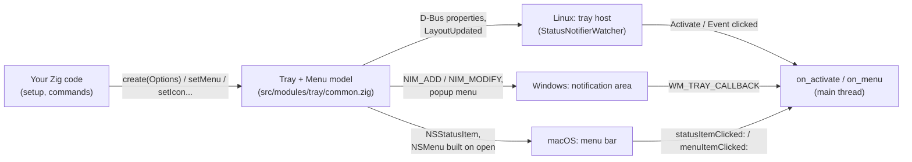

<!-- Generated from site/content/docs/tray.smd by tools/docs/gen-md.mjs: edit that file. -->

# Tray

An icon in the system tray or the macOS menu bar, with a menu of items, check items and submenus, driven from Zig.

`oriel.tray` puts an icon in the desktop's notification area: the
StatusNotifierItem tray on Linux, the notification area on Windows, a menu
bar extra on macOS. Left-clicking it shows or hides the main window (or
calls your handler); the other click opens a menu you describe as data.
Use it for apps that keep running without a window: a recorder, a sync
client, a hotkey tool.

For the menu bar at the top of the window (or the screen, on macOS), use
the [menu](menu.md); for a message that appears and goes,
[notifications](notifications.md).

## Availability

| Platform | What it uses | Clicks |
|---|---|---|
| Linux | StatusNotifierItem + `com.canonical.dbusmenu` over D-Bus (GIO), no GTK3 or libappindicator | KDE Plasma, GNOME with the AppIndicator extension, waybar, Quickshell and any other StatusNotifierItem host; the host decides which click opens the menu (usually right) |
| Windows | `Shell_NotifyIconW` (version 4) + `TrackPopupMenu` | left click or keyboard select: activate; right click: the menu |
| macOS | `NSStatusItem` + `NSMenu` in the menu bar | left click: activate; right click or Control-click: the menu |
| Android, iOS | none: phones have no tray | `oriel.tray.available` is `false` |

The `tray` build flag is on by default wherever a tray exists; there is
nothing to declare and no permission. On Android and iOS the flag resolves
to off and every use must sit under `if (oriel.tray.available)`
([Modules](modules.md)).

## Quick start

```zig
// build.zig: tray is on by default on the desktop; nothing to add.
const dep = b.dependency("oriel", .{ .target = target, .optimize = optimize });
```

```zig
// src/main.zig
const std = @import("std");
const oriel = @import("oriel");
const app = @import("oriel_app");

var tray: if (oriel.tray.available) ?*oriel.tray.Tray else void =
    if (oriel.tray.available) null else {};

pub fn main(init: std.process.Init) !u8 {
    return oriel.main(init, .{ .commands = Commands, .events = Events }, .{
        .app = app.build,
        .window = .{ .title = "My App", .width = 800, .height = 600, .hide_on_close = true },
        .setup = setup,
    });
}

pub const Commands = struct {};
pub const Events = struct {};

fn setup() !void {
    if (!oriel.tray.available) return;
    tray = try oriel.tray.Tray.create(std.heap.smp_allocator, .{
        .id = "com.example.MyApp",
        .title = "My App",
        .tooltip = "My App is running",
        .icon = .{ .png = @embedFile("tray.png") },
        .menu = &.{
            .{ .item = .{ .id = "show", .label = "Show or hide" } },
            .separator,
            .{ .item = .{ .id = "quit", .label = "Quit" } },
        },
        .on_menu = onMenu,
    });
}

fn onMenu(id: []const u8, _: ?bool) void {
    if (std.mem.eql(u8, id, "show")) if (oriel.App.getWindow("main")) |w| w.toggle();
    if (std.mem.eql(u8, id, "quit")) oriel.App.quit(0);
}
```

With `.hide_on_close = true` closing the window hides it and the app keeps
running in the tray; the left click (or "Show or hide") brings it back.

## How it works



A `Tray` holds a platform-neutral menu model (`Menu` in
`src/modules/tray/common.zig`): a flat list of nodes, index 0 the root, each
item with its key (your `id`), label, enabled and checked state. Each
backend shows that model its own way:

- **Linux** (`src/modules/tray/linux.zig`). GTK4 has no tray API, so the tray
  exports two D-Bus objects on the session bus: `/StatusNotifierItem`
  (`org.kde.StatusNotifierItem`: id, title, tooltip, icon pixmap or icon
  name) and `/MenuBar` (`com.canonical.dbusmenu`, version 3, built from the
  model on each `GetLayout`). It owns the name
  `org.kde.StatusNotifierItem-<pid>-<n>` and registers with
  `org.kde.StatusNotifierWatcher` whenever that appears, so the icon comes
  back after the tray host (a panel, a shell extension) restarts. A PNG is
  decoded with zigimg and sent as ARGB32 pixels. Changes emit `NewTitle`,
  `NewToolTip`, `NewIcon` and `LayoutUpdated`. Several trays per process
  work.
- **Windows** (`src/modules/tray/windows.zig`). The icon belongs to Oriel's
  hidden host window, which outlives every app window, so closing the main
  window keeps the icon. Clicks arrive as `WM_TRAY_CALLBACK` on the main
  thread; the right click builds a popup `HMENU` from the model and runs
  `TrackPopupMenu`. A PNG is decoded with zigimg into a 32-bit `HICON`
  (Windows' own decoder is the fallback). One tray per app.
- **macOS** (`src/modules/tray/macos.zig`). An `NSStatusItem` whose button
  takes the PNG at 18 points high. The `NSMenu` is rebuilt from the model
  every time it opens, so changes always show. One tray per app.

Clicks call `on_menu(id, checked)` on the main thread. A check item flips
its own state first, so `checked` is the new value; plain items pass
`null`; disabled items, separators and submenus call nothing. `id` is a
copy, so the callback may call `setMenu` or even `deinit` (a "Quit" item).
The left click calls `on_activate`, or toggles the main window when you
gave none.

Nothing crosses to the page by itself: the tray is a Zig API. To let the
page react, emit an event from `on_menu`; to let it change the tray, give it
a command (see [Examples](#examples)).

## Examples

### A "Do not disturb" check item the page follows

```zig
pub const Events = struct {
    dnd: struct { on: bool },
};
const events = oriel.App.events(Events);

fn setup() !void {
    if (!oriel.tray.available) return;
    tray = try oriel.tray.Tray.create(std.heap.smp_allocator, .{
        .id = "com.example.MyApp",
        .title = "My App",
        .icon = .{ .png = @embedFile("tray.png") },
        .menu = &.{
            .{ .check = .{ .id = "dnd", .label = "Do not disturb" } },
            .separator,
            .{ .item = .{ .id = "quit", .label = "Quit" } },
        },
        .on_menu = onMenu,
    });
}

fn onMenu(id: []const u8, checked: ?bool) void {
    if (std.mem.eql(u8, id, "dnd")) events.emit(.dnd, .{ .on = checked.? });
    if (std.mem.eql(u8, id, "quit")) oriel.App.quit(0);
}
```

```js
window.oriel.listen("dnd", ({ on }) => {
  document.body.classList.toggle("quiet", on);
});
```

### Let the page set the tooltip and the check state

Commands that aren't listed in `async_commands` run on the main thread, the
thread the tray wants on Linux and Windows:

```zig
pub const Commands = struct {
    pub fn tray_status(args: struct { text: []const u8, dnd: bool }) !void {
        if (!oriel.tray.available) return;
        const t = tray orelse return;
        try t.setTooltip(args.text);
        t.setChecked("dnd", args.dnd);
    }
};
```

```js
await window.oriel.invoke("tray_status", { text: "3 uploads left", dnd: false });
```

### A tray only where there is one

The page sees the build's flags as `window.oriel.features`:

```js
if (window.oriel.features.tray) {
  document.querySelector("#close-hint").textContent = "Closing keeps the app in the tray.";
}
```

The showcase (`examples/showcase/src/main.zig`, `setup`) creates its tray
this way, with "Show or hide the window", "Dictate anywhere" and "Quit".

## Reference

### Build flag

| Flag | Default | Effect |
|---|---|---|
| `.tray` (`-Dtray` on Oriel's own command line) | on for Linux, Windows, macOS | builds `oriel.tray` and links zigimg. `.tray = false` drops it. On Android and iOS it resolves to off; `-Dtray=true` for those targets on Oriel's own command line is an error. |

### `oriel.tray`

```zig
pub const available: bool; // false on Android and iOS, or with .tray = false

pub const Options = struct {
    id: []const u8,                 // stable identifier, usually the app id
    title: []const u8,
    tooltip: []const u8 = "",
    icon: Icon,
    menu: []const MenuItem = &.{},
    on_menu: ?*const fn (id: []const u8, checked: ?bool) void = null,
    on_activate: ?*const fn () void = null, // null: toggle the main window
};

pub const Icon = union(enum) {
    png: []const u8,  // PNG bytes (any format zigimg reads)
    name: []const u8, // icon theme name, e.g. "mail-unread"
};

pub const MenuItem = union(enum) {
    item: struct { id: []const u8, label: []const u8, enabled: bool = true },
    check: struct { id: []const u8, label: []const u8, checked: bool = false, enabled: bool = true },
    separator,
    submenu: struct { label: []const u8, items: []const MenuItem, enabled: bool = true },
};

pub const Tray = struct {
    pub fn create(gpa: std.mem.Allocator, options: Options) !*Tray;
    pub fn deinit(self: *Tray) void;
    pub fn setMenu(self: *Tray, items: []const MenuItem) !void;
    pub fn setChecked(self: *Tray, id: []const u8, checked: bool) void;
    pub fn isChecked(self: *Tray, id: []const u8) ?bool;
    pub fn setTooltip(self: *Tray, tooltip: []const u8) !void;
    pub fn setTitle(self: *Tray, title: []const u8) !void;
    pub fn setIcon(self: *Tray, icon: Icon) !void;
};

pub fn check(gpa: std.mem.Allocator, ctx: oriel.CheckContext) !oriel.Check; // smoke check
```

| Declaration | Behavior |
|---|---|
| `Tray.create` | Copies everything in `options` (strings, the menu), shows the icon and returns the tray. Errors: Linux `error.SessionBusUnavailable`, `error.RegisterObjectFailed`; Windows `error.AppNotRunning` (called before the app's main loop exists: create it in `setup` or later), `error.ShellNotifyIconFailed`, `error.NamedIconsNotSupportedOnWindows`; macOS `error.StatusItemCreateFailed`; any: `error.InvalidIcon` (the PNG didn't decode), `error.OutOfMemory`. |
| `deinit` | Removes the icon and frees the tray. Safe from inside `on_menu`; don't touch the tray afterwards. |
| `setMenu` | Replaces the whole menu (copied). Linux sends `LayoutUpdated`; Windows and macOS show it the next time the menu opens. |
| `setChecked` | Sets a check item's state by `id`; an unknown `id` is ignored. |
| `isChecked` | A check item's state; `null` for an unknown `id` or an item that isn't a check item. |
| `setTooltip` | Linux: the tooltip's body (its title is `title`). Windows: the hover text, at most 127 UTF-16 units (longer is cut). macOS: the button's tooltip. |
| `setTitle` | Linux: the item's `Title` (shown by some hosts, and as the tooltip's heading). macOS: the accessibility title, and the text shown when there is no image. Windows: stored, not shown. |
| `setIcon` | Replaces the icon. |
| `check` | The module's smoke check (run by `oriel.checkAll`): decodes the icon and builds a menu; Linux also reports whether a tray host is present, macOS creates and removes a real status item in a running app. |

**Icons.** `.png` works everywhere: Linux sends the decoded pixels (the host
scales them; 22 to 64 pixels square is plenty), Windows makes an `HICON`,
macOS draws it 18 points high (a 36 or 54 pixel PNG stays sharp on Retina).
The image is shown as is, not as a template image, so pick one that reads on
both light and dark menu bars. `.name` is an icon theme name on Linux; macOS
tries `NSImage imageNamed:` and shows `title` as text when there's no such
image; Windows returns `error.NamedIconsNotSupportedOnWindows`.

**Menu items.** `id` is what `on_menu` gets back; keep it under 256 bytes
(longer ids are cut there in the callback). Ids should be unique:
`setChecked` and `isChecked` act on the first item with that id. Submenus
nest to any depth; a submenu itself has no id and isn't clickable.

**Threads.** Callbacks run on the main thread. On macOS `create`,
`deinit` and every setter may be called from any thread (they run on the
main thread and wait). On Linux and Windows call them on the main thread:
`setup`, a sync command, a tray or menu callback, or
`oriel.App.runOnMain` from a worker.

**One tray.** Linux allows several trays per process. On Windows and macOS
the last created tray gets the clicks (macOS logs `a second tray replaces
the first one's click handling`); create one.

**Lifetime.** The tray lives until `deinit`; closing or hiding windows
doesn't touch it. Oriel doesn't destroy it at quit: call `deinit` (from a
"Quit" item, or a [lifecycle](lifecycle.md) `terminating`
handler) to remove the icon before the process ends.

### Page API

There is no tray API in the page. `window.oriel.features.tray` says whether
this build has one; use your own events and commands to connect the two.

## Troubleshooting

- **No icon on GNOME.** GNOME Shell has no tray of its own: install and
  enable the AppIndicator and KStatusNotifierItem extension. The smoke
  check's detail says `tray host absent` when no
  `org.kde.StatusNotifierWatcher` is on the session bus. The icon appears
  as soon as a host starts; the log line is `registered
  org.kde.StatusNotifierItem-... with the tray host` (scope `tray`).
- **`error.AppNotRunning` on Windows.** The tray was created before
  `oriel.main` started the app: create it in `setup`.
- **`error.NamedIconsNotSupportedOnWindows`.** Use `.png` (embed the file
  with `@embedFile`).
- **The icon is a black square on a dark macOS menu bar.** The PNG is drawn
  as is: use a light-on-transparent or coloured icon that reads on both.
- **The second tray's menu never opens (Windows, macOS).** Only one tray
  gets clicks there.
- **Using `oriel.tray` in a phone build is a build error** naming the
  module: put the code under `if (oriel.tray.available)`.

## Related

- [Menu](menu.md): the window's or the app's menu bar, with shortcuts.
- [Windows](windows.md): `hide_on_close`, `visible`, showing and hiding the main window.
- [Notifications](notifications.md): messages from an app in the tray.
- [Global shortcuts](global-shortcuts.md): system-wide hotkeys, often paired with a tray.
- [Modules](modules.md): build flags and `available`.
