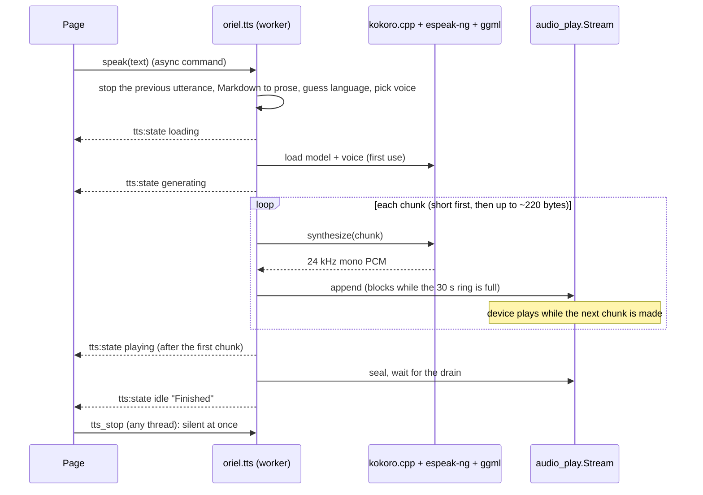

<!-- Generated from site/content/docs/tts.smd by tools/docs/gen-md.mjs: edit that file. -->

# Text to speech

Read text aloud offline with oriel.tts: Kokoro-82M voices for eight languages, verified downloads, Markdown read as prose, and streaming playback on the CPU or the GPU.

`oriel.tts` reads text aloud offline with Kokoro-82M, on every platform: a
catalog of models and voices with verified downloads, Markdown read as
prose, the language guessed from the text, and playback that starts after
the first sentence while the rest is synthesized. It is the voice-out
counterpart of [Dictation](dictation.md) and
[Chat](chat.md). Its building blocks, `oriel.kokoro`
(synthesis) and `oriel.audio_play` (playback), are public for pipelines of
your own, such as writing WAV files.

## Availability

| Platform | Synthesis | GPU | Playback | Phoneme data shipped at |
|---|---|---|---|---|
| Linux | Kokoro on the CPU (up to 8 threads) | CUDA, Vulkan | miniaudio (PulseAudio, ALSA...) | `espeak-ng-data/` next to the executable |
| Windows | same | Vulkan | miniaudio (WASAPI) | `espeak-ng-data/` next to the executable |
| macOS | same | Metal | miniaudio (Core Audio) | `<App>.app/Contents/Resources/espeak-ng-data` |
| Android | CPU, the fast cores (2 to 4 threads) | Vulkan where usable | miniaudio (AAudio or OpenSL ES) | APK assets, copied to `<filesDir>/espeak-ng-data` |
| iOS | same as Android | Metal (devices) | miniaudio (Core Audio, with an AVAudioSession) | `<App>.app/espeak-ng-data` |

Turned on by `.kokoro = true`, which needs `.llama = true` or
`.whisper = true` (they supply the shared ggml build; otherwise:
`kokoro needs llama or whisper`). Its dependencies (kokoro.cpp, espeak-ng
1.52.0, Highway, miniaudio) are fetched lazily. No permission; downloads
need network access. The GPU flags are the
[Local AI](local-ai.md#build-options) ones.
**License:** espeak-ng and its data are GPL-3.0-or-later and ship with the
app (see [Licenses](#licenses)).

## Quick start

`build.zig`:

```zig
const dep = b.dependency("oriel", .{
    .target = target,
    .optimize = optimize,
    .kokoro = true,
    .whisper = true, // or .llama = true
});
```

`src/main.zig`:

```zig
const std = @import("std");
const oriel = @import("oriel");
const app = @import("oriel_app");
const tts = oriel.tts;

pub const Events = struct {
    @"tts:download": @FieldType(tts.Events, "tts:download"),
    @"tts:state": @FieldType(tts.Events, "tts:state"),
};

pub const Commands = struct {
    pub const async_commands = .{ "tts_download", "tts_warm_up", "speak" };

    pub fn tts_download(_: std.mem.Allocator, args: struct { id: []const u8 }) !void {
        try tts.download(args.id);
    }
    pub fn tts_warm_up(_: std.mem.Allocator, args: tts.Options) !void {
        try tts.warmUp(args);
    }
    pub fn speak(gpa: std.mem.Allocator, args: struct { text: []const u8, options: tts.Options = .{} }) !tts.Result {
        return tts.speak(gpa, args.text, args.options);
    }
    // Not async: it must run while `speak` is busy on a worker.
    pub fn tts_stop(_: std.mem.Allocator) void {
        tts.stop();
    }
};

pub fn main(init: std.process.Init) !u8 {
    const data = try oriel.paths.appData(init.gpa, .{ .name = "MyApp" });
    const models_dir = try std.fs.path.join(init.gpa, &.{ data, "tts" });
    tts.init(init.io, init.gpa, models_dir); // must outlive the app

    return oriel.main(init, .{ .commands = Commands, .events = Events }, .{
        .app = app.build,
        .window = .{ .title = "Reader", .width = 800, .height = 600 },
    });
}
```

The page:

```js
const { invoke, listen } = window.oriel;

await invoke("tts_download", { id: "kokoro-82m-q8_0" }); // 135 MB, once per device
await invoke("tts_download", { id: "af_heart" });        // a voice, 0.5 MB
listen("tts:state", ({ phase }) => { button.textContent = phase === "idle" ? "Read aloud" : "Stop"; });
const r = await invoke("speak", { text: "# Hello\nRead **this** aloud." });
console.log(r.first_audio_ms, r.synth_ms / 1000 / r.audio_s); // latency, real-time factor
```

## How it works



`src/modules/tts.zig` plays one utterance at a time. A new `speak`, or
`stop` from any thread, bumps a generation counter and silences the playing
stream at once; the old `speak` notices at its next check and returns
promptly with `stopped = true`, and its late events never overwrite the new
utterance's state.

**Text.** With `.markdown` (the default) headings, list markers, emphasis,
code fences and link targets are removed (`prepareText`). `lang = "auto"`
guesses the language from the text (`guessLanguage`: English, Spanish,
French, Italian, Portuguese, Japanese, Chinese, Hindi, Russian; English when
unsure). `voice = "auto"` takes the first catalog voice on the device for
that language, then one of the same family (`en-gb` for `en-us`), then any.

**Streaming.** The text is cut at sentence, clause or word boundaries
(`oriel.tts.chunks`): a short first chunk, so sound starts quickly, then
chunks sized to the audio already queued (what can be made in 70% of the
time it lasts, up to 220 bytes). On a phone's CPU the first chunk is what
the measured speed makes in about 1.5 s. One `audio_play.Stream` plays the
whole utterance from a bounded ring, so there are no gaps when synthesis is
faster than real time, and no false "finished" between chunks. When
synthesis falls behind, the device plays silence and `Result.gap_ms` counts
it. A chunk with nothing to say ("…") is skipped.

**Engine.** The Kokoro context stays loaded between utterances: another
voice or language reuses it, another model or backend reloads it.
`.backend = .auto` loads the GPU backends (`ggml_gpu.load`) and lets Kokoro
pick CUDA, Vulkan or Metal; a model the GPU can't take falls back to the CPU.
Kokoro has no OpenCL path, so Android phones whose Vulkan 1.2 isn't usable
(older Adrenos) run it on the CPU, on the fast cores only: a thread on a
little core holds every step back.

**Phoneme data.** Kokoro phonemizes with espeak-ng, which reads compiled
runtime data (`phontab`, `phonindex`, `phondata`, `intonations`, one
`<name>_dict` per language, the `lang/` voice definitions). Oriel compiles
it at build time from the espeak-ng 1.52.0 sources with a host tool
(`tools/espeak_data.zig`, wired by `build/espeak_data.zig`), and `addApp`
ships it with every `.kokoro` app: about 2.9 MB with the default languages,
half of it Mandarin. At run time `oriel.tts` looks once, before the first
engine starts: `$KOKORO_ESPEAK_DATA_PATH`, then `<models_dir>/espeak-ng-data`,
then the bundled copy, then the system's (Linux packages, Homebrew). On
Android the APK's copy is extracted to `<filesDir>/espeak-ng-data` on first
start and after each app update.

**Memory.** `unload_on` (critical memory pressure by default) frees the
context unless speaking ([Local AI](local-ai.md#how-it-works)).
`App.run` shuts playback down and frees the context after its command pool
drains.

## Examples

### Read aloud with a Stop button

```js
const { invoke, listen } = window.oriel;
let speaking = false;
listen("tts:state", ({ phase, message }) => {
  speaking = phase !== "idle" && phase !== "error";
  readButton.textContent = speaking ? "Stop" : "Read aloud";
  if (phase === "error") status.textContent = message; // e.g. "NoVoice"
});
readButton.onclick = () => speaking
  ? invoke("tts_stop")
  : invoke("speak", { text: note.value, options: { speed: 1.1 } });
// When the reading screen opens: load the model before the first tap.
invoke("tts_warm_up", {});
```

`examples/showcase`'s Speak tab and its "Read aloud" buttons on chat replies
and notes are built this way.

### A Spanish voice, a fixed language

```zig
try oriel.tts.download("ef_dora");
_ = try oriel.tts.speak(gpa, texto, .{ .voice = "ef_dora", .lang = "es" });
```

### Write a WAV file

`oriel.kokoro` without playback. Make the phoneme data reachable first:
`oriel.tts` does it for its own engine; on your own, set
`KOKORO_ESPEAK_DATA_PATH` before the first `kokoro.init`.

```zig
const kokoro = oriel.kokoro;
var params = kokoro.defaultParams();
params.backend = kokoro.c.KOKORO_BACKEND_CPU;
const ctx = kokoro.init("models/kokoro-82m-q8_0.gguf", params) orelse {
    std.log.err("kokoro: {s}", .{kokoro.lastError()});
    return error.ModelLoadFailed;
};
defer kokoro.free(ctx);
try kokoro.loadVoice(ctx, "models/kokoro-voice-af_heart.gguf");
try kokoro.setLanguage(ctx, "en-us");
const audio = try kokoro.synthesize(ctx, "Hello from Oriel.");
defer kokoro.freePcm(audio.samples);
try writeWav(path, audio.samples, audio.rate); // mono f32 at 24 kHz
```

### Play your own PCM

```zig
const s = try oriel.audio_play.Stream.init(io, gpa, 24000);
defer s.deinit();
try s.start();
try s.append(samples); // copied: `samples` can be freed after this
s.seal();
while (!s.finished()) try io.sleep(.fromMilliseconds(20), .awake);
```

## Reference

### Build options

| Option | Default | Effect |
|---|---|---|
| `.kokoro` / `-Dkokoro` | `false` | kokoro.cpp, espeak-ng, Highway SIMD and miniaudio; `oriel.tts`, `oriel.kokoro`, `oriel.audio_play`. Needs `.llama` or `.whisper`. |
| `.tts_languages` / `-Dtts_languages` | `"en,es,fr,pt,it,ja,cmn,hi"` | The espeak-ng dictionaries compiled into the shipped data: comma-separated `dictsource/<name>_rules` names. `en` covers en-us and en-gb, `pt` pt-br, `cmn` Mandarin (espeak's `zh`/`cmn` voices). |
| `-Dggml_cuda`, `-Dggml_vulkan`, `-Dggml_metal` | see [Local AI](local-ai.md#build-options) | Kokoro on the GPU. Its CUDA and Vulkan calls go through ggml's backend registry, so without a GPU or the library it stays on the CPU. |

`zig build espeak-data -Dkokoro -Dwhisper` in the Oriel checkout writes the
compiled data to `zig-out/espeak-ng-data`. Adding languages:

```zig
.tts_languages = "en,es,fr,pt,it,ja,cmn,hi,de,ko",
```

On Android the data goes into `zig-out/android-assets/espeak-ng-data`,
which Oriel's managed `oriel-dependencies.gradle` adds to the APK's assets
(also in projects generated before 0.9.9, whose own `build.gradle.kts`
doesn't read that folder).

### Functions

| Function | Thread | Meaning |
|---|---|---|
| `init(io, gpa, dir: []const u8) void` | any, once, before anything else | Where models and voices live (created when needed); `dir` must outlive the app. Subscribes to `oriel.lifecycle`. |
| `speak(a, text, opts: Options) !Result` | worker | Read `text` aloud; returns when played or stopped. Stops a running utterance first. Strings in the result are allocated with `a`. |
| `stop() void` | any, returns at once | Silence the current utterance; its `speak` returns with `stopped`. |
| `warmUp(opts: Options) !void` | worker | Load the model and voice `speak` would use, without speaking; on a GPU also synthesize a word so pipelines compile. `lang = "auto"`: English's voice (else any). Returns at once while speaking; `speak` waits for a warm-up in progress. About 0.2 s on a desktop, 1 s on a phone. |
| `status() Status` | any; doesn't wait for synthesis (the first call loads the GPU backend) | The catalog, what's on the device, where the model runs, the phoneme data, the download and the phase. |
| `download(id) !void` | worker | A model or voice id. Emits `tts:download`; returns at once when the file is there. The file's SHA-256 is checked before it is renamed into place. |
| `delete(id) !void` | worker | Remove a model (unloaded first) or voice, and a half-finished download of it. |
| `unloadIdle() void` | any (main included) | Free the context unless speaking. |
| `deinit() void` | after commands finished | Stop and free the context. `App.run` calls it; safe twice or without `init`. |
| `prepareText(a, text) ![]u8` | any | `text` with its Markdown removed. |
| `guessLanguage(text) []const u8` | any | `"en-us"`, `"es"`, `"fr"`, `"it"`, `"pt-br"`, `"ja"`, `"zh"`, `"hi"` or `"ru"` (static). |
| `defaultThreads() c_int` | any | Up to 8 on desktops; on phones the fast cores, 2 to 4. |
| `findModel(id) ?*const Model`, `findVoice(id) ?*const Voice` | any | Catalog lookups. |
| `modelPresent(m) bool`, `voicePresent(v) bool` | any after `init` | The file is there with the catalog's size. |

| Variable | Meaning |
|---|---|
| `available: bool` | `true` with `.kokoro`. |
| `unload_on: oriel.lifecycle.UnloadOn` | When the context is freed by itself; default critical memory pressure. |
| `audio_context: ?*audio_play.c.ma_context` | A miniaudio context to play through (null: the default device). Tests and headless runs point it at miniaudio's null backend. Set before speaking; it must outlive every `speak`. |
| `models`, `voices` | The catalog (below). |
| `chunks` | The text splitter: `next(text, *pos, limit) ?[]const u8`, `split(a, text) ![][]const u8`; `first_max = 80`, `max = 220`, `min = 40` bytes. |

### Models and voices

| Catalog | |
|---|---|
| Models (`models`) | `kokoro-82m-q8_0` (Kokoro 82M (Q8_0), 135 MB, the default) and `kokoro-82m-f16` (156 MB) |
| Voices (`voices`, 0.5 MB each) | English (US): `af_heart`, `af_bella`, `af_nicole`, `am_michael`, `am_fenrir`; English (UK): `bf_emma`; Spanish: `ef_dora`, `em_alex`; French: `ff_siwis`; Portuguese (Brazil): `pf_dora`; Italian: `if_sara`; Japanese: `jf_alpha`; Chinese: `zf_xiaobei`; Hindi: `hf_alpha` |

Files come from
[simonfxr/kokoro.cpp-GGUF](https://huggingface.co/simonfxr/kokoro.cpp-GGUF)
into the directory given to `init`: `kokoro-82m-q8_0.gguf`,
`kokoro-voice-<id>.gguf`. Copying them there works too (a file counts when
it has the catalog's size). Phones get the same catalog.

```zig
pub const Model = struct { id: []const u8, label: []const u8, file: []const u8, size: u64, sha256: []const u8,
    pub fn mb(self: *const Model) u32 };
pub const Voice = struct { id: []const u8, lang: []const u8, label: []const u8, file: []const u8, size: u64, sha256: []const u8 };
pub const Backend = enum { auto, cpu };
```

### Options and results

`Options`:

| Field | Type | Default | Meaning |
|---|---|---|---|
| `model` | `[]const u8` | `"auto"` | A model id; `"auto"`: the default if downloaded, else any. |
| `voice` | `[]const u8` | `"auto"` | A voice id; `"auto"`: one for the language on the device. |
| `lang` | `[]const u8` | `"auto"` | An espeak-ng language (`"en-us"`, `"es"`, `"fr"`...); `"auto"`: `guessLanguage`. |
| `speed` | `f32` | `1.0` | 0.25 to 4 (2 = twice as fast). |
| `markdown` | `bool` | `true` | Read Markdown as prose. |
| `backend` | `Backend` | `.auto` | `.auto`: the GPU when ggml has one, else the CPU. |
| `threads` | `u16` | `0` | CPU threads; 0: `defaultThreads()`. |

`Result`:

| Field | Meaning |
|---|---|
| `voice`, `lang`, `backend` | What it was read with, and where Kokoro ran (`"CPU"`, `"Vulkan0"`...). |
| `chunks: u32` | Chunks synthesized. |
| `first_audio_ms: u32` | From the call to the first sound, model loading included. |
| `synth_ms`, `load_ms: u32` | Synthesis of all chunks; model loading (0 when loaded). |
| `audio_s: f32` | Audio synthesized; `synth_ms / 1000 / audio_s` is the real-time factor. |
| `gap_ms: u32` | Silence heard because synthesis fell behind. |
| `stopped: bool` | A newer `speak` or a `stop` cut it short. |

`Status`: `backend` (where the loaded model runs, else the GPU backend found
or `"CPU"`), `gpu`, `models_dir`, `espeak_data` (null: `speak` fails),
`models: [2]ModelStatus { id, label, mb, present }`,
`voices: [14]VoiceStatus { id, label, lang, present }`, `loaded`,
`downloading`, `speaking`, `phase`.

### Events

| Event | Payload | When |
|---|---|---|
| `tts:download` | `{ id, done_mb, total_mb }` | Each megabyte, and `done_mb == total_mb` at the end. |
| `tts:state` | `State { phase, message, voice }` | `phase` is `"loading"`, `"generating"`, `"playing"`, `"idle"` (message `"Stopped"` or `"Finished"`) or `"error"` (message: the error's name). |

### Errors

| Error | Meaning |
|---|---|
| `NotInitialized` | `init` wasn't called. |
| `NoModel`, `NoVoice` | Nothing downloaded (or the asked-for one isn't). |
| `UnknownModel`, `UnknownVoice` | Not in the catalog (`download`/`delete` say `UnknownModel` for both). |
| `EspeakDataMissing` | No phoneme data found. |
| `ModelLoadFailed`, `VoiceFailed`, `LanguageFailed`, `SynthesisFailed` | kokoro.cpp failed (`kokoro.lastError()` has its text). |
| `ChecksumMismatch`, `SizeMismatch` | The download isn't the catalog's file; it was deleted. |
| `AlreadyDownloading`, `Downloading`, `Speaking` | One download at a time; deleting what is downloading or speaking. |

### `oriel.kokoro`

`src/modules/kokoro.zig`, a thin wrapper over kokoro.cpp. A context isn't
thread-safe: serialize calls on it, and run loading and synthesis on a
worker.

| Declaration | Meaning |
|---|---|
| `c` | kokoro.cpp's C API (`kokoro.h`). |
| `sample_rate: u32` | 24000. |
| `Context` | The C library's opaque context. |
| `Audio` | `{ samples: []f32, rate: u32 }`: mono float32, owned by the C library. |
| `defaultParams()` | Context parameters with the pinned ABI version; `.backend` is `KOKORO_BACKEND_CPU` or `KOKORO_BACKEND_AUTO`, `.n_threads`. With AUTO, call `oriel.ggml_gpu.load(io)` first so CUDA or Vulkan is registered. |
| `init(path, params) ?*Context` | Load a model; null with `lastError()` explaining. |
| `free(ctx)` | |
| `loadVoice(ctx, path) !void` | `error.VoiceFailed`. |
| `setLanguage(ctx, espeak_lang) !void` | `error.LanguageFailed`. |
| `setLengthScale(ctx, scale)` | Duration multiplier (2 = half as fast), clamped to 0.25 to 4. |
| `setThreads(ctx, n)` | CPU threads for the next synthesis. |
| `backendName(ctx)`, `voiceName(ctx)` | `"CPU"`, `"Vulkan"`, `"Metal"`, `"CUDA"`...; the loaded voice. |
| `synthesize(ctx, text) !Audio` | `error.SynthesisFailed`, `error.InvalidAudio`. |
| `freePcm(samples)` | Free what `synthesize` returned (the engine's allocator). |
| `lastError() []const u8` | The C engine's last error on this thread. |
| `status`, `error_ok` | The C status enum and its OK value. |

### `oriel.audio_play`

`src/modules/audio_play.zig`: mono float32 playback through miniaudio,
as a `Stream`: one device for a whole utterance (or any PCM), fed chunk by
chunk through a bounded ring (`Stream.buffer_seconds = 30`).

```zig
const s = try oriel.audio_play.Stream.init(io, gpa, 24000); // heap-allocated
defer s.deinit();          // releases the device: never in its callback
try s.start();             // or startWithContext(ctx): a miniaudio context of yours
try s.append(chunk1);      // copied; blocks while the ring is full
try s.append(chunk2);      // error.Cancelled once stopped
s.seal();                  // no more audio: finished() after the drain
while (!s.finished()) try io.sleep(.fromMilliseconds(20), .awake);
```

`stop()` works from any thread, the audio callback included: output turns
silent at once, `append` returns `error.Cancelled`, `finished()` is true.
`deinit` stops, releases the device and frees the stream, on the owning
thread after other threads are done calling `stop`. `playedSeconds()`,
`queuedSeconds()` and `starvedSeconds()` (silence inserted because appends
fell behind) report progress.

### Performance

Q8_0 model, streaming, model loaded:

| Device | Backend | First audio | Real-time factor |
|---|---|---|---|
| RTX 4070 | CUDA | about 54 ms | 0.02 to 0.03 |
| RTX 4070 | Vulkan | like CUDA | 0.02 to 0.03; 1 to 4 s of pipeline compilation on a context's first use (`warmUp` hides it) |
| Ryzen 7 7800X3D | CPU, 8 threads | about 0.6 s | about 0.36 |
| Snapdragon 732G | CPU, 2 fast cores | about 4 s | about 2.75: gaps |

Under 1, synthesis is faster than playback and the utterance plays without
gaps after the first chunk. Build phone apps with the default
`-Dggml_arm=dotprod`: without it the 732G's factor was about 7.5. Metal is
compiled in on Apple platforms but hasn't been measured.

### Validation

The numbers above come from the devices in the table. Playback tests use
miniaudio's null backend, which opens no audio device. For real synthesis in
the test suite, provide the files (the test runner has no bundled data next
to it):

```sh
KOKORO_ESPEAK_DATA_PATH=$PWD/zig-out/espeak-ng-data \
ORIEL_TTS_MODEL=/path/to/kokoro-82m-q8_0.gguf \
ORIEL_TTS_VOICE=/path/to/kokoro-voice-af_heart.gguf \
zig build test -Dkokoro -Dwhisper -Daudio_capture=false
```

`ORIEL_TTS_DIR=<dir with kokoro-82m-q8_0.gguf, kokoro-voice-af_heart.gguf
and kokoro-voice-ef_dora.gguf>` adds the streaming test (first audio, real-time
factor and gaps per backend, English and Spanish; silent unless
`ORIEL_TTS_SPEAKERS=1`). With `-Dggml_vulkan` or `-Dggml_cuda` the test step
installs the GPU library in `zig-out/lib` and measures the GPU too
(`-Doptimize=ReleaseFast` for real numbers).

### Licenses

espeak-ng and the runtime data compiled from it are GPL-3.0-or-later; apps
built with `.kokoro` ship that data and link espeak-ng. kokoro.cpp, Highway,
miniaudio and ucd-tools have their own notices. Oriel's license stays MIT;
the dependency texts are in `NOTICE` and `licenses/tts`. Models and voices
are downloaded by the app at run time, not distributed with Oriel; their
licenses are upstream's.

### Migrating from 0.11

- `audio_play`'s one-shot API (`start`, `stop`, `finished`, `shutdown`,
  `on_progress`, `on_done`, `session`) is gone: play PCM through
  `audio_play.Stream` ([example](#example-play)).

## Troubleshooting

- **`EspeakDataMissing`.** The bundled data isn't where Oriel looks: run the
  app from its install directory (or `zig-out/bin`), or set
  `KOKORO_ESPEAK_DATA_PATH`. On Windows
  espeak-ng opens files through ANSI paths, so the directory's path must be
  representable in the system code page.
- **`NoVoice` for a language.** Download a voice of that language, or pass
  `voice` explicitly.
- **Speech has pauses on a phone.** The CPU synthesizes slower than real
  time (`Result.gap_ms`): use the q8_0 model and keep `-Dggml_arm=dotprod`.
- **The first utterance on a GPU starts late.** Call `warmUp` when the
  reading screen opens.
- **Stop doesn't act at once.** `tts_stop` must not be in `async_commands`.

## Related

- [Local AI](local-ai.md): ggml, GPU backends, downloads and memory.
- [Chat](chat.md): read replies aloud.
- [Dictation](dictation.md): voice in.
- [Packaging](packaging.md): where the phoneme data goes in each package.
