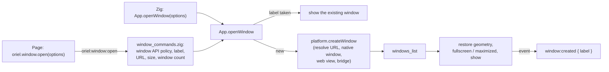

<!-- Generated from site/content/docs/windows.smd by tools/docs/gen-md.mjs: edit that file. -->

# Windows

The main window and any others: every WindowOptions field, labels, placement and overlays, the page's oriel.window API, and how each platform shows them.

Every Oriel app has a main window, described by `App.Config.window`, with
the label `"main"`. It can open more: from Zig with `App.openWindow`, from
the page with `oriel.window.open`, or lazily with `App.registerWindow` so a
window the user may never open costs nothing at startup. Each window is a
native window with its own web view (or native renderer surface) and its
own page, and has a label that Zig, the page and events use to address it.

Use a second window for a settings panel, a detached view or an overlay
(live captions, a floating palette). For a dialog that picks files, use
[Dialogs](dialogs.md); for a menu-bar or tray popup, see
[Tray](tray.md).

## Availability

| Platform | Windows | Overlay options (`transparent`, `always_on_top`, `skip_taskbar`, `placement`, click-through) | Notes |
|---|---|---|---|
| Linux | GTK 4 windows, any number | Transparency and click-through everywhere. On X11, EWMH hints and positioning. On Wayland, `always_on_top`, `skip_taskbar` and `placement` need gtk4-layer-shell (`-Dlayer_shell=true`, the library installed, a wlr-layer-shell compositor); without it they are ignored | `max_width`/`max_height` are not applied (GTK 4 has no maximum size) |
| Windows | Win32 windows | All (WS_EX_TOPMOST, WS_EX_TOOLWINDOW, DWM transparency, WS_EX_TRANSPARENT) | Sizes and margins are logical pixels, scaled by the window's DPI |
| macOS | `NSWindow`s | All (floating or status window level, collection behavior, clear background, `ignoresMouseEvents`) | A main window created hidden makes the app an accessory app (no Dock icon) |
| Android | One Activity (and task) per window | None (no-ops) | Size, resizing and decorations apply in desktop windowing; a hidden window keeps its page running |
| iOS | A view controller per window | `transparent` only | Other windows get their own scene on iPad (Stage Manager, Split View) and are presented full screen over the main window on iPhone |

No build flag or permission is needed. `remember_geometry` needs the
`store` module (on by default).

## Quick start

```zig
const std = @import("std");
const oriel = @import("oriel");
const app = @import("oriel_app");

pub const Commands = struct {
    pub fn open_settings(_: std.mem.Allocator) !void {
        _ = try oriel.App.openWindow(.{
            .label = "settings",
            .title = "Settings",
            .url = "/settings", // the app's own page (or the dev server's)
            .width = 480,
            .height = 360,
        });
    }
};

pub fn main(init: std.process.Init) !u8 {
    return oriel.main(init, .{ .commands = Commands }, .{
        .app = app.build,
        .window = .{
            .title = "Notes",
            .width = 960,
            .height = 720,
            .min_width = 480,
            .remember_geometry = true,
        },
    });
}
```

The same from the page:

```ts
import { orielWindow } from "./oriel";

const settings = await orielWindow.open({ label: "settings", url: "/settings", title: "Settings", width: 480, height: 360 });
await settings.setTitle("Settings (unsaved)");
// In the settings window itself: close it.
await orielWindow.current().close();
```

## How it works



`App.openWindow` (`src/core/App.zig`) copies the options, checks the
window count against `security.window_api.max_windows`, and asks the
platform to create the window (`src/platform/<os>/window.zig`). The
platform resolves the URL first, so a rejected URL leaves no window
behind: a relative path (`"/settings"`, `"settings"`) becomes the dev
server's URL in a dev build or the app origin in production
(`app://app/settings`, or `https://app.localhost/settings` on Windows and
Android); no URL loads `App.Config.start`; an absolute URL must be on the
app's origins, `allowed_origins` or a capability's origin. Then it makes the
native window, the web view with the bridge script, and the overlay
settings (`overlay.zig` on Linux, macOS and Windows). Back in `openWindow`
the window joins `App.windows_list`, gets its saved size
(`remember_geometry`), goes fullscreen or maximized, is shown unless
`visible = false`, and every page gets `window:created`.

A page's `oriel.window` calls are built-in commands
(`src/core/window_commands.zig`). They don't use capabilities: the
`security.window_api` policy decides. The app's own pages may use the API;
a window may change, close or send events to only itself unless
`allow_modify_other_windows` is set; labels, URLs and sizes from the page
are validated.

Closing a window (the close button, `close()`, `App.closeWindow`) hides it
instead when it has `hide_on_close`. Otherwise its geometry is saved,
every page gets `window:closed`, and the window and its web view are
destroyed. Closing the last open window quits the app. The main window
with `hide_on_close` or `visible = false` keeps the app running with no
window shown (a tray app).

## Examples

### A settings window created on first use

```zig
fn setup() !void {
    // Declared now, created (a web view and a page load) the first time it's shown.
    try oriel.App.registerWindow(.{ .label = "settings", .title = "Settings", .url = "/settings", .width = 480, .height = 360, .hide_on_close = true });
}
```

A window may only show itself unless `allow_modify_other_windows` is on,
so the main window asks Zig:

```zig
pub const Commands = struct {
    pub fn show_settings(_: std.mem.Allocator) !void {
        const w = try oriel.App.ensureWindow("settings"); // created the first time
        w.show();
    }
};
```

```ts
await invoke("show_settings");
```
### A caption overlay that doesn't take focus

```zig
_ = try oriel.App.openWindow(.{
    .label = "captions",
    .url = "/captions",
    .width = 720,
    .height = 120,
    .decorations = false,
    .transparent = true, // give html, body a transparent background
    .always_on_top = true,
    .skip_taskbar = true,
    .focus_on_show = false, // typing stays in the app underneath
    .placement = .{ .anchor = .bottom, .margin = 48 },
});
if (oriel.App.getWindow("captions")) |w| w.setClickThrough(true);
```

On Wayland this is a layer-shell surface when gtk4-layer-shell is
available; elsewhere a normal window with the platform's hints.

### A frameless window the user can drag

```html
<header data-oriel-drag-region>
  <span>My App</span>
  <button id="close">×</button> <!-- buttons, inputs and links keep their clicks -->
</header>
```

```zig
.window = .{ .title = "My App", .decorations = false },
```

Pressing the primary button on an element inside `data-oriel-drag-region`
(not on a button, field, link, `contenteditable` or anything under
`data-oriel-no-drag`) calls `startDragging()`. A dragged window drops its
`placement`, so showing it again leaves it where the user put it.

### Keep running in the tray

```zig
.window = .{ .title = "Clipboard history", .hide_on_close = true, .visible = false },
.setup = setup, // create the tray here; its "Show" item calls oriel.App.showWindow()
```

See [Tray](tray.md).

### Links that open new windows

```zig
.window_open = .new_window,
```

`window.open("/report")` and `<a target="_blank" href="/report">` to an app
page then open an Oriel window labeled `win-1`, `win-2`, ...; with the
default `.main_view` they load in the main window. Links to other allowed
origins load in the main window; anything else follows the navigation
policy ([Security](security.md#how-it-works)).

## Reference

### `WindowOptions`

`App.WindowOptions`, for `App.Config.window`, `App.openWindow` and
`App.registerWindow`:

| Field | Type | Default | Meaning |
|---|---|---|---|
| `label` | `[:0]const u8` | `"main"` | The window's name: unique, 1 to 64 characters of ASCII letters, digits, `-` and `_` (checked for page calls). `App.Config.window` must keep `"main"`. |
| `title` | `[:0]const u8` | `""` | Title bar text. |
| `url` | `?[:0]const u8` | `null` | What to load: a relative app path, or an absolute URL on an allowed origin. Null loads `App.Config.start` (or the dev server's root). |
| `width`, `height` | `c_int` | `800`, `600` | Initial size in logical pixels. |
| `min_width`, `min_height` | `?c_int` | `null` | Minimum size. |
| `max_width`, `max_height` | `?c_int` | `null` | Maximum size (Windows and macOS). |
| `resizable` | `bool` | `true` | The user may resize it. |
| `decorations` | `bool` | `true` | Title bar and border; false for a frameless window. |
| `fullscreen` | `bool` | `false` | Start fullscreen. |
| `maximized` | `bool` | `false` | Start maximized (ignored when `fullscreen`). |
| `remember_geometry` | `bool` | `false` | Save width, height and maximized state when the window closes, restore them when it opens (in the store `window_geometry`, keys `<label>_width`, `<label>_height`, `<label>_maximized`). Needs the `store` module. Position isn't saved. |
| `visible` | `bool` | `true` | Show once created; false creates it hidden (`show()` later). A hidden main window keeps the app running; on macOS it also leaves the app out of the Dock. |
| `transparent` | `bool` | `false` | Only what the page paints shows; give `html, body` a transparent background. |
| `always_on_top` | `bool` | `false` | Keep above other windows. |
| `skip_taskbar` | `bool` | `false` | Leave it out of the taskbar, Dock window list and Alt-Tab. |
| `placement` | `?Placement` | `null` | Where to put it when shown, relative to its monitor's work area; null lets the window manager decide. |
| `hide_on_close` | `bool` | `false` | Closing hides it instead (reopen with `show()`). |
| `focus_on_show` | `bool` | `true` | Take keyboard focus when shown; false for overlays that mustn't steal typing. |

### `Placement`

`App.Placement`: a position relative to the work area of the window's
monitor (without panels and docks where the OS reports them). Portable
where absolute coordinates are not (Wayland).

| Field | Type | Default | Meaning |
|---|---|---|---|
| `anchor` | `Anchor` | `.center` | `.center`, `.top`, `.bottom`, `.left`, `.right`, `.top_left`, `.top_right`, `.bottom_left`, `.bottom_right` |
| `margin` | `c_int` | `0` | Distance from the anchored edges, logical pixels. |
| `offset_x`, `offset_y` | `c_int` | `0` | Shift from the anchored position (x right, y down). |

`Placement.origin(area: Rect, w, h)` computes the top-left corner;
`App.Rect` is `{ x, y, width, height }` (`c_int`).

### Zig: `oriel.App`

| Declaration | Meaning |
|---|---|
| `openWindow(options: WindowOptions) !*Window` | Create and (unless `visible = false`) show a window; with a label that's already open, show that window and return it. Main thread. Errors: `MaxWindowsExceeded`, `AppNotRunning` (before `run`), URL errors (`DisallowedOrigin`, `DisallowedScheme`, `InvalidUrl`, `ControlCharactersNotAllowed`), `OutOfMemory`. |
| `registerWindow(options: WindowOptions) !void` | Declare a window without creating it; registering a label again replaces its options. Any thread. |
| `ensureWindow(label) !*Window` | The window, created from its registered options if needed; `error.WindowNotFound` if it was never registered. Main thread. |
| `isWindowRegistered(label) bool` | Whether `label` was registered (created or not). |
| `getWindow(label) ?*Window` | An open window. The pointer is freed when the window closes: main thread only. |
| `getWindowCount() usize` | Open windows. |
| `closeWindow(label) void` | Close a window (no-op for an unknown label). |
| `postCloseWindow(label) !void` | Queue a close (what the page's `close()` uses); `error.WindowNotFound`. |
| `showWindow()`, `hideWindow()`, `toggleWindow()` | Show, hide or toggle the main window. |
| `emitTo(label, name, payload) !void` | An event to one window ([Commands](commands.md#events)). |
| `runOnMain(ctx, func)` | Run on the main thread, from any thread. |
| `quit(code: u8)` | Quit the app, from any thread. |

`App.windows_list`, `windows_mutex`, `getWindowByHandle`, `main_window`,
`gtk_app` and `setPendingThemeColor` are public for the platform layer;
apps don't use them.

### Zig: `App.Window`

Fields: `label`, `handle` (the platform's), `options` (the window's
`WindowOptions`, kept current by `place`, `startDragging` and
`setAlwaysOnTop`), `app_id`. Methods (main thread):

| Method | Meaning |
|---|---|
| `show()`, `hide()`, `toggle()`, `focus()`, `close()` | Visibility, focus, close. |
| `setTitle(title: [:0]const u8)` | Title bar text. |
| `setSize(width, height)`, `getSize() WindowSize` | Size in logical pixels (`WindowSize` is `{ width, height }`). |
| `setFullscreen(bool)`, `isFullscreen() bool` | Fullscreen. |
| `setMaximized(bool)`, `isMaximized() bool` | Maximized. |
| `place(placement: Placement)`, `center()` | Move to an anchor of the work area (`center()` is `place(.{})`). |
| `workArea() ?Rect` | The usable area of the window's monitor, or null when unknown. |
| `startDragging()` | Let the user move the window while the primary button is down. A Wayland layer-shell overlay follows the pointer instead. The window drops its placement. |
| `setClickThrough(enabled: bool)` | Let the mouse pass through to what's below. |
| `setAlwaysOnTop(enabled: bool)` | Keep above other windows. |
| `setThemeColor(color: ?[4]u8)` | The caption colour where the platform draws one (Android on ChromeOS and desktop Android); the bridge sends the page's `<meta name="theme-color">` by itself. A no-op elsewhere. |
| `emit(name, payload)` | An event to this window only. |
| `saveGeometry()`, `restoreGeometry()` | What `remember_geometry` calls on close and open. |

Native handles (GtkWindow, NSWindow, HWND and their web views) are given to
[platform hooks](platform-hooks.md).

### `App.Config` fields for windows

| Field | Default | Meaning |
|---|---|---|
| `window` | `.{}` | The main window's `WindowOptions` (label `"main"`). |
| `start` | `"index.html"` | Path and query loaded when a window has no `url`. |
| `spa_fallback` | `true` | An unknown path whose last segment has no dot (`/users/42`) serves `index.html`; one with a dot (`/users/john.doe`, `/report.pdf`) is a missing file (404). |
| `window_open` | `.main_view` | `window.open()` and `target="_blank"` to an app page: `.main_view` loads it in the main window, `.new_window` opens an Oriel window (`win-<n>`). |
| `user_agent` | `null` | The web views' User-Agent. |

### Page: `oriel.window`

Exported as `orielWindow` from the generated `./oriel` (`window.oriel.window`
in plain scripts).

| API | Meaning |
|---|---|
| `open(options: WindowOptions): Promise<WindowHandle>` | Open a window (or show the open one with that label). |
| `current(): WindowHandle` | This window. |
| `get(label): Promise<WindowHandle \| null>` | An open window by label. |
| `all(): Promise<WindowHandle[]>` | Every open window. |
| `emitTo(label, event, payload?): Promise<void>` | An event to one window. |

`WindowOptions` from the page: `label` (required), `url`, `title`, `width`,
`height` (default 800 and 600), `min_width`, `min_height`, `max_width`,
`max_height`, `resizable`, `decorations`, `fullscreen`, `maximized`. The
overlay fields, `visible`, `hide_on_close`, `remember_geometry` and
`placement` are Zig-only. Sizes must be 1 to 32767.

`WindowHandle` (`label` plus methods, each a Promise):

| Method | Meaning |
|---|---|
| `close()`, `show()`, `hide()`, `focus()` | `show()` also creates a window registered with `App.registerWindow`. |
| `setTitle(title)` | |
| `setSize(width, height)` | 1 to 32767 each. |
| `maximize(maximized = true)`, `fullscreen(fullscreen = true)` | |
| `startDragging()` | Call from a `mousedown` (or use `data-oriel-drag-region`). |
| `emit(event, payload?)` | `emitTo(this.label, ...)`. |

Events: `window:created` and `window:closed`, payload `{ label }`, to every
page (not declared in the generated `Events`: use `window.oriel.listen`).

### Window commands

What the page's API sends. Every one first requires the window API to be
allowed for the calling page (`Forbidden` otherwise).

| Command | Arguments | Checks |
|---|---|---|
| `oriel:window:open` | `WindowOptions` | Label, URL (`validateWindowUrl`), sizes, window count |
| `oriel:window:close`, `show`, `hide`, `focus`, `startDragging` | `{ label }` | Label; modifying another window |
| `oriel:window:setTitle` | `{ label, title }` | same |
| `oriel:window:setSize` | `{ label, width, height }` | same; sizes |
| `oriel:window:maximize`, `fullscreen` | `{ label, maximized? / fullscreen? }` | same |
| `oriel:window:setThemeColor` | `{ label, color: [r, g, b, a] \| null }` | same (sent by the bridge itself) |
| `oriel:window:emitTo` | `{ label, event, payload }` | same |
| `oriel:window:get` | `{ label }` | Label; returns `{ label, title }` or `null` |
| `oriel:window:all` | | `[{ label, title }]` |
| `oriel:window:current` | | `{ label, title }` |

Errors: `Forbidden` (window API not allowed for this page),
`InvalidLabel`, `PermissionDenied` (another window, without
`allow_modify_other_windows`), `MaxWindowsExceeded`, `WindowNotFound`,
`InvalidArgs` (a size outside 1..32767), and the URL errors
`ControlCharactersNotAllowed`, `InvalidUrl` (backslashes, a leading `//`,
`..` or `%2e`), `BlockedScheme` (`javascript:`, `file:`, `data:`, `blob:`,
`about:`), `RemoteUrlsNotAllowed`, `DisallowedOrigin`.

### The window API policy

`App.Config.security.window_api` (`security.WindowApiPolicy`):

| Field | Default | Meaning |
|---|---|---|
| `enabled` | `true` | The app's own pages may use `oriel.window`. |
| `allow_remote` | `false` | Any remote page may use it (a capability's `window_api = true` grants it to one origin). |
| `allow_remote_urls` | `false` | The page may open windows on remote URLs (which must also be in `allowed_origins` or a capability). |
| `max_windows` | `16` | Open windows at once (Zig's `openWindow` too). |
| `allow_modify_other_windows` | `false` | A window may close, change and send events to other windows. |

### Platform notes

| Platform | Behavior |
|---|---|
| Linux | The app holds itself while the main window is hidden (`hide_on_close`, `visible = false`). Overlays on Wayland need gtk4-layer-shell, loaded at runtime; it's ignored (logged once) without it. A layer surface takes keyboard focus exclusively unless `focus_on_show = false`. |
| Windows | `skip_taskbar` is `WS_EX_TOOLWINDOW` (off the taskbar and Alt+Tab); click-through is `WS_EX_LAYERED \| WS_EX_TRANSPARENT`. |
| macOS | `always_on_top` uses the floating level, or the status level when the window also skips the taskbar. `skip_taskbar` shows the window on every Space and over full-screen apps. Clicking the Dock icon with every window hidden shows the main window. |
| Android | Each window is an Activity in its own task; `show()` starts or brings it back, `hide()` sends its task to the back. The WebView outlives its Activity (rotation). `placement`, click-through, always-on-top and dragging are no-ops. |
| iOS | Closing the main window hides it. Other windows: their own scene where the device has several, else full screen over the main window; closing dismisses them. Overlay options other than `transparent` are no-ops. |

### Migrating from 0.11

- `App.Config.title`, `width`, `height`, `min_*`, `max_*`, `resizable`,
  `decorations`, `fullscreen`, `maximized`, `remember_geometry`, `url`,
  `transparent`, `always_on_top`, `skip_taskbar` and `placement` moved into
  `App.Config.window` (a `WindowOptions`). Its default size is now 800×600.
- `show_main_window = false` is `.window = .{ .visible = false }`.
- `on_close = .hide` is `.window = .{ .hide_on_close = true }`.

## Troubleshooting

| Symptom | Cause and fix |
|---|---|
| An overlay on Wayland is a normal window | gtk4-layer-shell is missing or the build lacks `-Dlayer_shell=true`, or the compositor (GNOME) has no wlr-layer-shell. |
| `PermissionDenied` from a page | The page changed another window. Do it from Zig, or set `security.window_api.allow_modify_other_windows`. |
| `MaxWindowsExceeded` | More than `max_windows` (16) open; close some or raise it. |
| `InvalidLabel` | Labels are 1 to 64 of `A-Z a-z 0-9 - _`. |
| `RemoteUrlsNotAllowed`, `DisallowedOrigin` | The page opened a remote URL: set `allow_remote_urls` and list the origin in `allowed_origins`. |
| A transparent window has a white background | The page paints one: `html, body { background: transparent }`. |
| The app quits when the main window closes | Expected; set `hide_on_close` to keep it running (with a tray to bring it back). |
| `/users/john.doe` shows a 404 | Paths ending in a segment with a dot are files, not routes (`spa_fallback`). |
| `remember_geometry` does nothing | The `store` module is off in the dependency options. |

## Related

- [Concepts](concepts.md): windows in the app's architecture.
- [Commands and events](commands.md): events to one window.
- [Security](security.md): which pages and URLs a window may load.
- [Tray](tray.md): bringing a hidden window back.
- [Platform hooks](platform-hooks.md): native window and web view handles.
- [Native renderer](native-renderer.md): windows without a web view.
