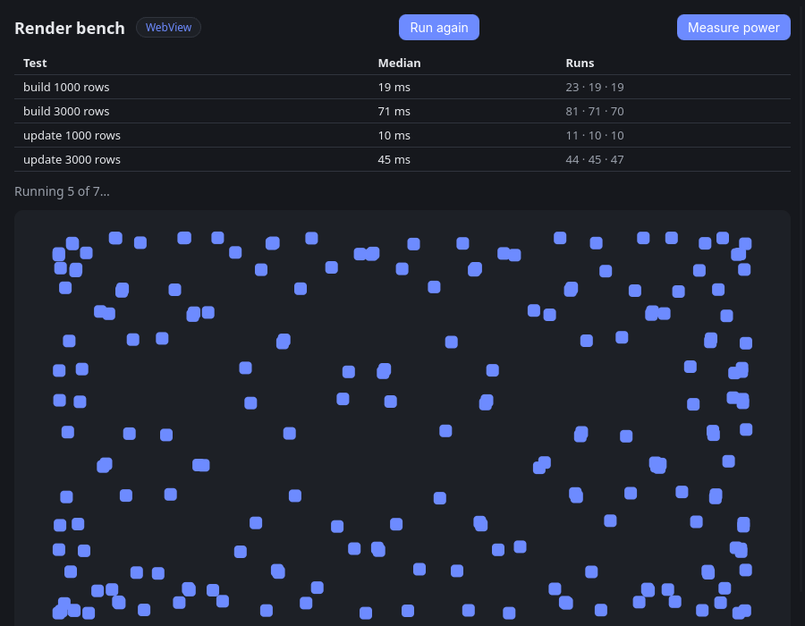

# Render bench

The same workloads in three renderer modes: WebView, native with QuickJS/DOM,
and the experimental Oriel renderer with compiled `.oriel` views. Both native
modes share the tree, Yoga layout and platform drawing backends. The Oriel
renderer excludes QuickJS, DOM and CSS processing; see [the experiment](../../docs/design/zig-ui-experiment.md).



The screenshot shows the UI during a private-display run; benchmark results
below retain their own dates and measurement conditions.

```sh
zig build -Doptimize=ReleaseFast                                         # WebView
zig build -Drenderer=native -Doptimize=ReleaseFast -p zig-out-native     # native (native DOM)
zig build -Drenderer=oriel -Doptimize=ReleaseFast -p zig-out-oriel       # Oriel (.oriel views)
./zig-out/bin/oriel-render-bench                                         # GUI
RENDER_BENCH=1 ./zig-out-native/bin/oriel-render-bench                   # one JSON line, then exits
```

## Oriel renderer

For Android, build with the default output prefix, then assemble the existing
Android host using the project's signing configuration:

```sh
zig build -Drenderer=oriel -Dtarget=aarch64-linux-android -Doptimize=ReleaseFast
cd android
# Use Gradle 8.14.3 or newer; provide ORIEL_ANDROID_KEYSTORE and signing variables.
gradle assembleRelease
```

The `.oriel` views in `views/` define the shell, result rows, workload rows,
boxes, canvas and list. `zig_ui_bench.zig` provides typed state, click handlers
and display callbacks. It retains the existing 1,000/3,000 full-row builds and
updates, 200-box animation, 200/1,000-ball canvas tests, three trials, two rounds
in benchmark mode, memory readings and four power scenarios. **Run again** and
**Measure power** work in the GUI. Startup reports “Zig view” instead of a
page script. Android memory remains app-process-tree scoped.

In this mode the primary canvas loop is Zig with f64 physics, replacing the
JavaScript loop; the `(Zig)` variant reuses `zig_balls.zig` unchanged. This
keeps the workload while removing the interpreter, rather than comparing two
JavaScript engines. Idle power uses a 250 ms timer with no animation hook.
Desktop power requires a readable battery/RAPL source.

Historical hardware reference (2026-10-03, main c0615af, the Linux desktop at 180 Hz, the median
of 3 runs of RENDER_BENCH=1, native vs WebView):

| | native | WebView |
|---|---|---|
| startup → page script | 19 ms | 349 ms |
| startup → first frame | 69 ms | 431 ms |
| build 1000 / 3000 rows | 6.4 / 18.6 ms | 20 / 69 ms |
| update 1000 / 3000 rows | 2.8 / 8.5 ms | 9 / 40 ms |
| animate 200 boxes | 165 fps | 62 fps |
| canvas 200 / 1000 balls | 180 / 91 fps | 62 / 62 fps |
| memory at start (PSS) | 110 MB | 491 MB |
| memory after the tests / a second round | 174 / 177 MB | 561 / 563 MB |

Recordings of both runs: site/assets/videos/render-bench-{native,webview}.mp4
(the native renderer page on the site shows them side by side).

The native DOM against linkedom (2026-10-02, the desktop, one run each):

| | native DOM | linkedom |
|---|---|---|
| build 1000 rows | 39.7 ms | 84.5 ms |
| build 3000 rows | 124.6 ms | 244.0 ms |
| update 1000 rows | 5.6 ms | 9.8 ms |
| update 3000 rows | 16.8 ms | 31.8 ms |
| memory after a second round (PSS) | 127 MB | 152 MB |

Results below this point are from linkedom builds (before the native DOM
was the default).

`RENDER_BENCH` is an environment variable because GTK rejects command-line
options it doesn't know.

For a short row-only diagnostic, set `RENDER_BENCH_ROWS_ONLY=1` as well.
It keeps the same construction, text changes, synchronous layout reads,
three trials and two rounds, but skips animation and canvas. Its JSON has
`"workload":"rows"`; its memory readings cover rows only. Build all variants
first and run them serially. From the repository root:

```sh
RENDER_BENCH=1 RENDER_BENCH_ROWS_ONLY=1 GSK_RENDERER=cairo \
  scripts/headless.sh perf record -m 32 -F 999 -g --call-graph dwarf,4096 \
  -o /tmp/oriel-rows.data examples/render-bench/zig-out-native/bin/oriel-render-bench
DEBUGINFOD_URLS= perf report -i /tmp/oriel-rows.data --stdio --call-graph none
```

Use `perf stat -e cycles:u,instructions:u -- <binary>` inside the same
private-display wrapper for counters, and `-Dnative_ui_prof` for stage
times. Collect normal timings separately from sampling/stage logging.
The production native runtime's observer regression test is
`zig build test-native-runtime -Doptimize=ReleaseFast` (requires Node).

## Power

Outside the default run (it takes minutes): the **Measure power** button
(60 s a scenario), or `RENDER_BENCH_POWER=<seconds>` (with `RENDER_BENCH=1`
it's in the JSON report as `power`). Scenarios: idle, animate 200 boxes,
canvas 1000 balls, and (native only) the same balls drawn from Zig. For
each: the average draw in mW, joules, fps and mJ per frame, and the
battery's charge counter's drop where there is one.

For a power-only diagnostic, set `RENDER_BENCH=1`,
`RENDER_BENCH_POWER=60` and `RENDER_BENCH_POWER_ONLY=1`. It skips the
row/animation benchmark warmup and reports `"workload":"power"`.
All power scenarios use a **320 × 240 logical-pixel** drawing area. The
results table is hidden during sampling and restored afterward; appending
results during sampling previously shrank the area and could move it off-screen
on a phone. Reports include `power_viewport` when power is measured.

On Android:

```sh
adb shell setprop debug.oriel.env "'RENDER_BENCH=1 RENDER_BENCH_POWER=60 RENDER_BENCH_POWER_ONLY=1'"
adb shell am force-stop dev.oriel.RenderBench
adb shell am start -n dev.oriel.RenderBench/dev.oriel.OrielLaunchActivity
# Collect the render_bench JSON from logcat; reset the property afterward.
```

Use wireless ADB and physically unplug all chargers. Keep the phone unlocked
with the display on; lock-screen or hidden-view runs are invalid. Retain the
brightness/refresh/network settings across modes. External memory queries run
separately from power sampling.

Where the numbers come from (`power_now` in main.zig):

| Platform | Source |
|---|---|
| Android | BatteryManager: the battery's current (`CURRENT_NOW`) times its voltage, sampled every 250 ms and integrated, and `CHARGE_COUNTER` (OrielRuntime.batteryNow / batteryCharge) |
| Linux laptop | `/sys/class/power_supply/BAT*`: `power_now`, or `current_now` × `voltage_now` |
| Linux desktop | RAPL (`/sys/class/powercap/intel-rapl:0/energy_uj`, the CPU package's energy counter), which is root-only by default: a udev rule or chmod on it opens it |
| Windows, macOS | not yet |

They're the whole device's draw (the screen, radios), not the app's: run
the WebView and the native build through the same scenarios, at the same
brightness, in airplane mode, on battery (a charger makes them meaningless:
the page says so), the phone cool, and compare. mJ per frame is fair
between a renderer that holds 120 fps and one that doesn't. Some phones
update the current only every few seconds: use 60 s or more a scenario,
and run each build two or three times. Emulators report a fixed, made-up
battery.

On Android, set the variable through the system property Oriel reads:
`adb shell setprop debug.oriel.env "'RENDER_BENCH_POWER=60'"`, or tap the
button (no adb needed: unplug the phone first).

## What it measures

Each test runs 3 times; the median is reported.

| Test | What |
|---|---|
| startup → page script | Process start until the page's first script runs |
| startup → first frame | … until its first `requestAnimationFrame` |
| build N rows | Create N styled rows, then force layout (`offsetHeight`) |
| update N rows | Change every row's text, then force layout |
| animate 200 boxes | `requestAnimationFrame` moving 200 boxes for 2 s: frames per second |
| canvas N balls | A `<canvas>` game loop: physics on N balls, then a full redraw (background, circles, text) each frame for 2 s: frames per second |
| memory (PSS) | Proportional memory of the app's readable process tree; Linux includes WebKit children, Android excludes its isolated WebView renderer |

Times cover the DOM work and the layout it triggers, not painting, in both
renderers. The native renderer's `requestAnimationFrame` is paced by the
display. Its canvas records a numeric 2d program, replayed into a bitmap
of its own by the platform backend (see `docs/native-renderer.md`, "Canvas").
The historical linkedom results below predate these changes.

Android's WebView renderer is a sandboxed process started under
`webview_zygote`, not a child of the APK's main process. The old "all
processes" label therefore overstates what this in-app `/proc` measurement
includes. New Android labels say "app process tree" and show this exclusion.
On this Poco X3's Android 12, the in-app `/proc` PSS reading also excludes
`dumpsys meminfo` graphics accounting. Its "private" counter is actually
`Pss_Anon`, which is unavailable on this device and displays zero; that is not
zero private memory. For a complete comparison, externally collect
`adb shell dumpsys meminfo`
for both the app and the isolated renderer identified as belonging to that
app, then sum their PSS readings at the same endpoint. Do not sum every
WebView renderer on the phone or compare app-only memory with a total.
[Android's process/memory documentation](https://developer.android.com/develop/ui/views/layout/webapps/manage-webview-memory).

### On screen (Android)

On Android the page's engine runs on the UI thread and hands each change to
the view synchronously, so the times above already include applying it;
what they leave out is Android's layout pass and the draw. With
`ORIEL_NUI_TRACE` the page logs a line before each timed row change and the
native view one after each draw; `onscreen.py` gives the time from one to the
next. An Android app gets no environment variables: Oriel reads them from the
`debug.oriel.env` property when its library loads.

```sh
adb shell setprop debug.oriel.env "'ORIEL_NUI_TRACE=1 ORIEL_NUI_MEM=1'"
adb logcat -c   # then start the app and let it finish
adb logcat -d -v epoch > run.txt && ./onscreen.py run.txt
adb shell setprop debug.oriel.env "''"
```

## Results

### Poco X3 memory and power (2026-10-13)

Android 12, M2007J20CG, arm64 ReleaseFast, unplugged with wireless ADB,
fixed brightness (1191) and 60 Hz peak refresh. One power pass per mode, in
Oriel/native/WebView order. Fixed visible 320 × 240 power viewport, 60 seconds
requested per scenario. Memory queries were in separate full-suite GUI runs.

| Metric | Oriel | Native JS | WebView |
|---|---:|---:|---:|
| External PSS snapshots | 89–111 MiB | 103–122 MiB | 196–202 MiB |
| Idle device draw | 1.17 W | 1.11 W | 0.98 W |
| 200 boxes device draw | 1.39 W | 2.64 W | 2.15 W |
| 1,000 balls device draw | 1.68 W | 3.25 W* | 2.09 W |
| 1,000 balls scenario-average FPS | 59.8 | 33.6* | 58.9 |
| Shared direct Zig balls draw | 1.88 W | 2.05 W | — |

Oriel's box scenario uses about 48% less whole-device power than native JS
and 36% less than WebView in this pass, at about 60 fps. Idle does not improve.
WebView PSS includes its associated isolated renderer. Native/Oriel snapshot
ranges overlap; Oriel was sampled slightly earlier after completion. All
memory endpoint screenshots showed Done; black/hidden attempts were excluded.
Do not assign a precise memory improvement percentage from these snapshots.

*Native JS's standard canvas scenario took **80.2 seconds** for the 60-second
request. Its watts and FPS cover the whole scenario, including any setup or
completion overhead. The overrun's cause is not established; this is not an
equal-duration energy or isolated steady-state drawing comparison. Other
scenarios took approximately 60 seconds. Temperatures/order/background work
differ, and one pass supplies no confidence interval or general battery-life
claim. The coarse charge counter is unsuitable for per-scenario attribution.

On this Android 12 device the in-app PSS omits external graphics accounting,
and its “private” Pss_Anon counter displays zero because that field is absent.
Use the external readings, not those in-app fields, for the table above.
The original installed APK, screen timeout and debug property were restored.

[Raw reports, samples, APK identities and conditions](results/2026-10-13-poco-x3-memory-power.json) ·
[Associated-process memory dumps and measurement runner](results/poco-x3-2026-10-13/).

### Internal theme-color observer regression (2026-10-12)

Three serial processes per variant, in rotated order, ReleaseFast on the
same Linux desktop with Xvfb at 1024×768 and software Cairo rendering.
Each process runs two rounds of three trials; these medians pool the nine
second-round samples. Row-only mode preserves the timed DOM/layout work.

| Test | Current before (`69a47ec`) | Fixed | Historical (`c0615af`) |
|---|---:|---:|---:|
| Build 1,000 rows | 18.62 ms | **7.71 ms** | 6.91 ms |
| Build 3,000 rows | 54.85 ms | **21.43 ms** | 19.70 ms |
| Update 1,000 rows | 4.22 ms | 4.20 ms | 3.23 ms |
| Update 3,000 rows | 13.86 ms | 12.45 ms | 9.50 ms |

The theme-color watcher added in `41faf78` registered as a page observer,
enabling native-to-JS mutation hooks even during detached construction.
Marking it as an internal connected-only observer restores the native
DOM's existing suppression of those hooks. Page observers retain detached
mutation records. Construction improves 59–61%; the smaller text update is
unchanged, and the larger update's trial ranges overlap. Whole-process
median retired instructions fall from 15.51 to 9.75 billion (37%), including
startup and both rounds, rather than counting only the timed rows.

This reproduces a shared-runtime regression; it does not measure the user's
Pixel 8 or replace the published hardware results. Fixed construction
remains 9–12% slower and updates 30–31% slower than the historical
checkout on this setup. [Raw samples, counters and conditions](results/2026-10-12-theme-observer-rows.json).

The user's subsequent Pixel 8 screenshot of the fixed arm64 ReleaseFast APK
shows builds at 14.37 / 97.54 ms and updates at 14.19 / 38.42 ms, versus
51.93 / 217.21 ms and 41.28 / 74.73 ms in the earlier native screenshot.
These are observed improvements of 49–72%, not controlled attribution to
the fix: the user confirmed the earlier APK was immediately pre-fix, while
its build mode was not separately recorded and run conditions are uncontrolled. PSS
increased from 72.71 to 92.67 MB; canvas medians remain near 120 fps with
one 52.84 fps Zig trial. No power result was supplied.
[Transcribed phone samples and limitations](results/2026-10-12-pixel8-screenshots.json).

### Android emulator, latest native build (2026-10-04)

The full suite completed without crashes on Android 35, x86_64 `oriel35`,
with software graphics (lavapipe/swangle), `-Dnative_ui -Doptimize=ReleaseFast`.
One process ran two rounds; each timed workload reports the second round's
median of three trials.

| Test | Median |
|---|---:|
| Build 1,000 / 3,000 rows | 12.64 / 33.77 ms |
| Update 1,000 / 3,000 rows | 6.57 / 19.05 ms |
| Animate 200 boxes | 60.21 fps |
| Canvas 200 / 1,000 balls, JS | 60.09 / 59.41 fps |
| Canvas 200 / 1,000 balls, Zig | 60.02 / 59.62 fps |
| PSS after first / second round | 47.08 / 48.35 MB |

This validates the current build, including visibility scheduling and slider
padding, but has no Android baseline comparison and measures no battery savings.
Row timings omit Android's later layout and drawing passes. Android reports
benchmark-mode JSON through logcat; desktop reports remain on stderr.
[Full results and trials](results/2026-10-04-native-android-emulator.json).

### Typed QuickJS callbacks (2026-10-04)

Comparing `3e83d4e` with typed native-to-JS dispatch and interval
self-cancellation changes, both built with `-Dnative_ui -Doptimize=ReleaseFast`:

| Test | Before | Updated |
|---|---:|---:|
| Build 1,000 rows | 7.79 ms | 7.93 ms |
| Build 3,000 rows | 21.76 ms | 21.94 ms |
| Update 1,000 rows | 3.46 ms | 3.50 ms |
| Update 3,000 rows | 10.24 ms | 10.53 ms |
| PSS after two rounds | 121.08 MB | 119.80 MB |
| Breakout JS, 500 balls, visible desktop | 138.3 fps | 139.0 fps |
| Breakout process CPU (one core = 100%) | 86.46% | 86.58% |

No clear end-to-end improvement is demonstrated. Render-bench ran one
process per version, reporting second-round medians of three trials on
Xvfb at 1280×900 with software rendering; animation and canvas reached
the display's 60 Hz limit. Breakout also passed in JS and Zig modes there.
The visible JS game ran twice per version in reversed order on the
180 Hz desktop, with identical 628×691 windows. Its first logged interval
was excluded from the pooled FPS median; game randomness remains unseeded.
Startup was faster in the single updated observation, which is insufficient
to establish a startup improvement. These are desktop performance checks,
not Android power measurements.
[Full results, trials and game logs](results/2026-10-04-native-dispatch-desktop.json).

### Flattening and emission follow-up

On `2143d84`, row leaves premerge font/layout setup, copy ordinary font fields
directly, share style/flattening snapshot storage and avoid iterator pair arrays
in emission. Properties and text runs remain owned per node; regression tests
cover later font/style edits and interactive/empty leaves. All checks pass.

Isolated QuickJS row-build rendering improves 3.4–4.6%. The final native desktop
comparison is mixed; it does **not** establish a clear overall construction win:

| Step | Before (`2143d84`) | Updated native |
|---|---:|---:|
| Build 1,000 rows | 91.56 ms | 95.50 ms |
| Build 3,000 rows | 289.90 ms | 279.52 ms |
| Update 1,000 rows | 10.85 ms | 10.64 ms |
| Update 3,000 rows | 35.41 ms | 34.54 ms |

One visible process per version, both built before timing, 900×700 windows,
unchanged synchronous layout reads, second-round medians of three trials.
Build trial ranges overlap. The preceding candidate was also mixed and remains
recorded. WebView numbers below are earlier reference measurements. The shared
macOS width-change layout shortcut is still open.
[Final comparison](results/2026-10-02-rows-phase7-desktop.json),
[preceding candidate](results/2026-10-02-rows-phase7-first-desktop.json),
[isolated rendering](results/2026-10-02-rows-phase7-qjs.json).

### Construction pass

The next pass avoids token Sets for simple class names, initializes ordinary
DOM elements/text without the constructor chain, and caches resolved font sizes
by computed style and parent size. Relative-font style reuse now invalidates
correctly after parent font changes. Full JavaScript/native checks pass.

Both binaries were built first, with no compilation during timing. One visible
process per version used the unchanged page, 900×700 windows, synchronous
layout reads and second-round medians of three trials:

| Construction | Before (`a6d6e53`) | Updated native |
|---|---:|---:|
| 1,000 rows | 106.75 ms | 91.64 ms |
| 3,000 rows | 300.47 ms | 291.27 ms |

The smaller build improves 14%; the larger median improves 3%, but its trial
ranges overlap. Isolated QuickJS DOM construction improves about 21% at both
sizes. The DOM-only candidate had mixed larger-list results; adding font-size
caching gave the final result above. General style sharing, measurement and
layout still dominate the remaining construction gap versus WebView.
[Construction comparison](results/2026-10-02-rows-phase6-desktop.json),
[DOM-only candidate](results/2026-10-02-rows-phase6-dom-only-desktop.json),
[isolated DOM/render timings](results/2026-10-02-rows-phase6-qjs.json).

### Preceding allocation pass and WebView reference

Linux desktop, ReleaseFast, 2026-10-02. The preceding comparison runs one visible
process for the previous native runtime, the updated native runtime and
WebView, serially, in identical floating 900 × 700 windows. Each reports
medians of three trials in the second benchmark round. The page is unchanged
and synchronous rendering/layout reads remain inside the timed section. Both
native binaries were built first, using reviewed main `9f21bb9` as the baseline
and `780f945` as current. Measurements waited for the user's Yocto build to
finish; compiler/Yocto checks were quiet before and after the comparison.

| Step | Native before this pass | Current native | Fresh WebView |
|---|---:|---:|---:|
| Build 1,000 rows | 125.66 ms | 106.33 ms | 19 ms |
| Build 3,000 rows | 340.51 ms | 304.82 ms | 72 ms |
| Update 1,000 rows | 11.77 ms | 10.69 ms | 10 ms |
| Update 3,000 rows | 39.00 ms | 33.44 ms | 41 ms |

This allocation pass reduces updates 9–14% and builds 10–15%. Native is about 18% faster
for the 3,000-row update, and close at 1,000 rows; WebView still wins builds
by a large margin. These are single-process comparisons, not confidence
intervals or proof of performance on every platform.
[Current comparison, trials and window geometry](results/2026-10-02-rows-phase5-reviewed-desktop.json).

The owned LinkeDOM source now allocates listener Maps only on the first
listener. Flattening uses scalar primary IDs, shared empty child arrays and
leaf snapshots, and a single style cache with epoch invalidation. The runtime's
tests import `src/native_ui/js/vendor/linkedom`; the build has no dependency
source patches.

Native list replacement also detaches Yoga children in bulk, avoiding
quadratic child-vector shifting. Simple new flex leaves build single text
runs directly. GTK retains frames for text edits only when measured natural
width/height are exactly unchanged, the font context matches and the text
fits without wrapping (or has `nowrap`). Painting remains dirty, and Yoga's
measurement cache is invalidated for future resizing. Changed metrics,
wrapped text and other backends continue through layout.

Earlier passes reuse HTML/attribute templates, avoid repeated selector
compilation, directly mark private renderer mutations, share native styles,
copy prepared Yoga styles, cache measurements and compact native lookups.
Page observers retain their queued records and DOM nodes remain fresh.

That pass measured native startup to first frame at 220 ms versus WebView's 482 ms.
Native animation/canvas remain about 60 fps; WebView is about 62 fps. PSS
after the second round is 194 MB native versus 353 MB WebView, and down from
228 MB for the reviewed native baseline. Earlier passes already substantially
reduced the original row costs.
[Original native/WebView comparison](results/2026-10-02-rows-desktop.json),
[preceding pass](results/2026-10-02-rows-phase3-desktop.json).

Three serial paired QuickJS processes, two trials per step per process, isolate
the preceding pass's JavaScript changes. The fake host excludes native apply/layout/paint;
values are medians of six measurements:

| Step | DOM before → after | JS render before → after |
|---|---:|---:|
| Build 1,000 rows | 74.10 → 48.95 ms | 144.60 → 132.55 ms |
| Build 3,000 rows | 239.75 → 144.45 ms | 336.15 → 313.45 ms |
| Update 1,000 rows | 7.60 → 6.15 ms | 6.25 → 5.45 ms |
| Update 3,000 rows | 25.80 → 22.05 ms | 21.75 → 20.25 ms |

DOM builds improve 34–40%; JavaScript rendering improves 7–8% for builds and
7–13% for updates. Bridge payload is unchanged by this pass; the preceding
shared-style pass had already reduced build traffic 86–88%.
[Latest isolated results](results/2026-10-02-rows-phase3-qjs.json),
[shared-style pass](results/2026-10-02-rows-phase2-qjs.json),
[first text/observer pass](results/2026-10-02-rows-qjs.json).

Repeat the isolated harness from the repository root with QuickJS-NG:

```sh
qjs src/native_ui/js/test/bench-qjs.js src/native_ui/js/test/runtime-linkedom.js examples/render-bench/web
```

[Research and remaining implementation priorities](../../docs/internal/native-renderer-performance.md)
describe the remaining construction/rendering cost and the WebView gap.

## Alternative JavaScript engines

The engine comparison uses the same fake host and existing row workload.
It embeds assets and inlines the unchanged runtime so CLIs without file APIs
and native AOT compilers can execute the same source:

```sh
python3 src/native_ui/js/test/make-engine-bench.py --output /tmp/oriel-engine-rows.js
python3 src/native_ui/js/test/make-engine-bench.py --trace --output /tmp/oriel-engine-rows-trace.js
python3 src/native_ui/js/test/bench-engines.py /tmp/engine-config.json --output /tmp/engine-results.json
```

The config is `{"engines": {"QuickJS": {"command": ["qjs", "/tmp/oriel-engine-rows.js"],
"trace_command": ["qjs", "/tmp/oriel-engine-rows-trace.js"]}, ...}}`.
Put QuickJS first as the transcript reference. Add entries for `node`,
`jsc`, `kiesel`, `zjs -s`, or compiled Hermes files. Arbitrary metadata such
as revision/build flags is copied into results. The committed report contains
the complete config used here; adjust executable paths for another machine.

Build engines before running; finish all compilers/Yocto jobs first. Each mode
runs untimed transcript checks, then three serial timing rounds in rotated
order. Exact equality of the first twelve row steps is required for timings;
full 24-step compatibility and failures are recorded separately. No production
engine, native layout or paint is involved.

Pinned source builds used here:

```sh
# Hermes static_h: 6e2181b288b0306d8bd1988d38d32aa879b745d5
cmake -S /tmp/oriel-engine-hermes -B /tmp/oriel-engine-hermes-build -G Ninja \
  -DCMAKE_BUILD_TYPE=Release -DHERMES_ENABLE_TEST_SUITE=OFF \
  -DHERMESVM_ALLOW_JIT=1 -DHERMESVM_HEAP_HV_MODE=HEAP_HV_PREFER32
cmake --build /tmp/oriel-engine-hermes-build --target hermes hermesc shermes hermesvm shermes_console -j6
/tmp/oriel-engine-hermes-build/bin/hermesc -O -emit-binary -out /tmp/oriel-engine-rows.hbc /tmp/oriel-engine-rows.js
/tmp/oriel-engine-hermes-build/bin/shermes -O -enable-eval -script -o /tmp/oriel-engine-rows-hermes-aot /tmp/oriel-engine-rows.js
# Repeat both compiler commands for the --trace source and separate outputs.
# Kiesel: caeb23e4500fc35099b5945b20efe9bd4ece1e4b, inside its checkout
zig build -Doptimize=ReleaseFast -Denable-intl=false -Denable-temporal=false -j4
# zjs: report-pinned revision, inside its checkout
zig build zjs -Doptimize=ReleaseFast -j4
```

Both Zig builds use Zig 0.16.0. Engines are unchanged scratch checkouts;
no node_modules modifications or new project dependencies are required.
[Results](results/2026-10-02-rows-alternative-engines.json) and
[analysis/compatibility limitations](../../docs/design/native-renderer-performance-history.md#alternative-engines-tested-2026-10-02).

## Historical results (before synchronous layout reads)

The native build/update times below exclude rendering and layout. Commit
`18a2a86` made `offsetHeight` and other layout reads flush pending rendering;
the earlier benchmark timed only DOM mutations. Comparing these values
with later build/update values falsely suggests a regression. Include the
render and layout flush inside the timed section on both revisions.

Linux, ReleaseFast, headless (Xvfb, software rendering), 2026-10-02, the
median of 3 runs:

| Test | WebView | Native |
|---|---|---|
| startup → page script | 388 ms | 83 ms |
| startup → first frame | 444 ms | 284 ms |
| memory at start | 342 MB | 151 MB |
| build 1000 rows | 19 ms | 112 ms |
| build 3000 rows | 71 ms | 340 ms |
| update 1000 rows | 10 ms | 9 ms |
| update 3000 rows | 42 ms | 32 ms |
| animate 200 boxes | 60 fps | 38 fps |
| canvas 200 balls | 60 fps | 47 fps |
| canvas 1000 balls | 60 fps | 33 fps |
| memory after the tests | 368 MB | 262 MB |
| memory after a second round | 369 MB | 268 MB |

These startup, memory and frame-rate numbers also predate later runtime
changes and use software rendering. They do not describe the current
desktop performance above.

The second round tells retained memory from a leak: before native windows
allocated with malloc and trimmed it after big removals (`malloc_trim`), the
native build grew to 401 MB after the tests and 437 MB after a second round
(smp_allocator and glibc keep freed pages); now about 260 MB, and +6 MB after a second round.
`ORIEL_NUI_MEM=1` logs the JS heap and the tree's size every 20 renders.
